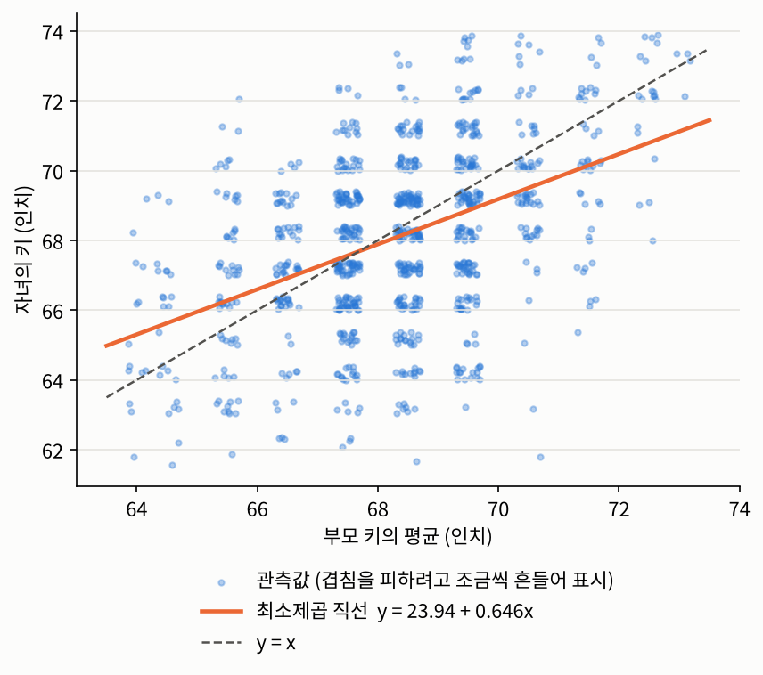
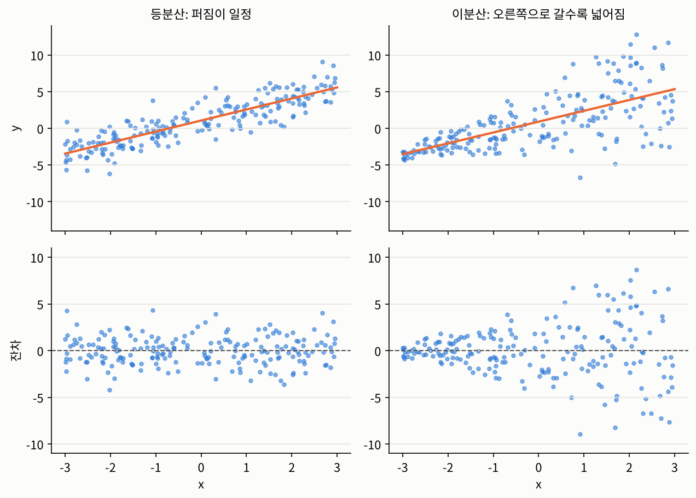
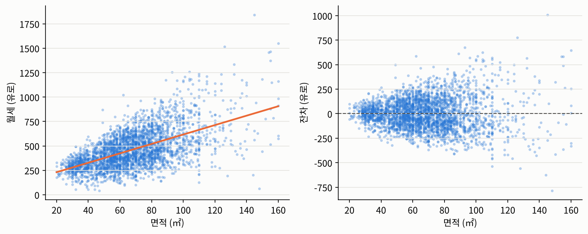
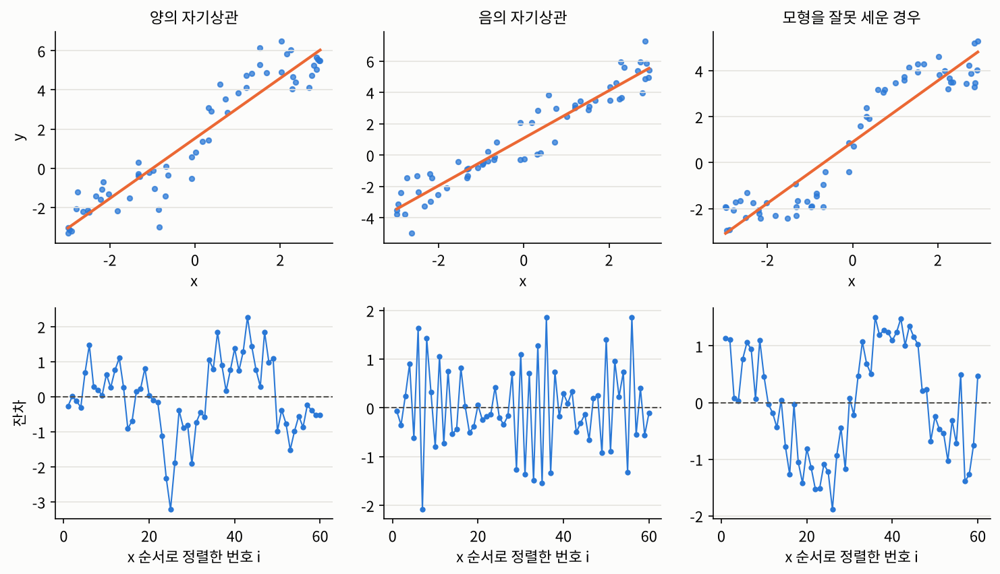

## 들어가며

[기초 통계학 4.5절](../../basic-stats/04-two-variables/05-least-squares.qmd)의 마지막에서 골턴의 부모·자녀 키 이야기를 잠깐 했습니다. 키가 큰 부모의 자녀는 평균보다 크기는 하지만 부모만큼 크지는 않다는, 평균으로의 회귀 이야기였습니다. 이번 글은 바로 그 데이터에서 출발합니다.

먼저 골턴의 데이터에 최소제곱 직선을 다시 그어 보고, 같은 부모 키에서도 자녀의 키가 얼마나 흩어져 있는지 확인하겠습니다. 그 흩어짐을 모델 안에 넣으면 **선형 모델**이 됩니다. 그다음에는 흩어짐을 나타내는 **오차항**에 대해 어떤 가정을 하는지, 그 가정들이 깨지면 데이터가 어떤 모습이 되는지를 그림으로 살펴보겠습니다.

## 골턴의 키 데이터 다시 보기

19세기 영국의 프랜시스 골턴(Francis Galton)은 부모와 자녀의 키를 모아 둘 사이의 관계를 조사했습니다.[^galton] 오늘날 공개되어 있는 그의 데이터에는 자녀 928명의 키와, 각 자녀의 부모 키의 평균이 인치 단위로 기록되어 있습니다.[^histdata] 남녀의 키 차이를 보정하려고 여성의 키에는 1.08을 곱했습니다.

부모 키의 평균을 $x$, 자녀의 키를 $y$로 두고 기초 통계학에서 배운 공식으로 최소제곱 직선을 구해 보겠습니다.

```python
import numpy as np
import pandas as pd

url = "https://raw.githubusercontent.com/vincentarelbundock/Rdatasets/master/csv/HistData/Galton.csv"
galton = pd.read_csv(url)
x = galton["parent"].to_numpy()   # 부모 키의 평균 (인치)
y = galton["child"].to_numpy()    # 자녀의 키 (인치)

beta1_hat = np.cov(x, y)[0, 1] / x.var(ddof=1)
beta0_hat = y.mean() - beta1_hat * x.mean()
print(f"관측값 수 n = {len(y)}")
print(f"beta0_hat = {beta0_hat:.3f}, beta1_hat = {beta1_hat:.3f}")

same_parent = y[x == 68.5]
print(f"부모 키 평균이 68.5인치인 자녀: {len(same_parent)}명")
print(f"  자녀 키의 범위: {same_parent.min()} ~ {same_parent.max()}")
print(f"  평균 {same_parent.mean():.2f}, 표준편차 {same_parent.std(ddof=1):.2f}")
print(f"  직선이 예측하는 값: {beta0_hat + beta1_hat * 68.5:.2f}")
```

```
관측값 수 n = 928
beta0_hat = 23.942, beta1_hat = 0.646
부모 키 평균이 68.5인치인 자녀: 219명
  자녀 키의 범위: 61.7 ~ 73.2
  평균 68.02, 표준편차 2.24
  직선이 예측하는 값: 68.21
```

여기서부터는 기초 통계학 4.5절의 $\hat{a}, \hat{b}$ 대신 절편과 기울기를 $\hat\beta_0, \hat\beta_1$로 씁니다. 공변량이 여러 개가 되면 계수도 여러 개가 되므로, 번호를 붙이기 쉬운 이 표기가 선형 모델에서는 표준입니다.

{fig-alt="부모 키의 평균(가로축, 64~73인치)과 자녀의 키(세로축, 62~74인치) 산점도. 부모 키는 몇 개의 값에만 몰려 있어 점들이 세로 줄을 이룬다. 주황색 최소제곱 직선 y = 23.94 + 0.646x와 회색 점선 y = x가 함께 그려져 있고, 최소제곱 직선이 y = x보다 완만해서 68인치 부근에서 두 선이 교차한다." width=75%}

기울기 $\hat\beta_1 = 0.646$은 1보다 작습니다. 부모 키의 평균이 1인치 큰 집안의 자녀는 평균적으로 0.646인치만 큽니다. 그림에서 주황색 직선이 회색 점선 $y = x$보다 완만한 것이 바로 평균으로의 회귀입니다.

### 절편은 무엇을 뜻할까요?

기울기는 이렇게 자연스럽게 읽히는데, 절편 $\hat\beta_0 = 23.942$는 어떨까요? 절편은 $x = 0$일 때 직선의 높이이므로, 글자 그대로 읽으면 "부모 키의 평균이 0인치인 집안의 자녀는 평균적으로 키가 약 23.9인치(약 61cm)"라는 뜻입니다. 그런데 키가 0인 부모는 있을 수 없습니다. 게다가 이 데이터의 부모 키는 64인치에서 73인치 사이에만 있으니, $x = 0$은 데이터에서 60인치 넘게 떨어진 곳입니다. 직선을 그 먼 곳까지 그대로 늘려서 읽은 값에는 실제 의미가 없습니다.

그렇다고 절편이 쓸모없는 것은 아닙니다. 이 예에서 절편은 해석할 대상이라기보다 직선을 **제자리에 놓기 위한 값**입니다. 기울기가 같아도 절편이 다르면 직선이 위아래로 옮겨 가므로, 데이터가 있는 64~73인치 구간에서 올바른 예측을 하려면 절편이 꼭 필요합니다. 다만 그 숫자 자체를 "키가 0인 부모의 자녀"로 읽지 말아야 할 뿐입니다.

반대로 $x = 0$이 자연스러운 **기준점**이어서 절편이 그대로 의미를 가지는 경우도 많습니다.

- 비료의 양 $x$로 수확량을 설명한다면, $x = 0$은 비료를 주지 않은 밭입니다. 절편은 비료 없이 얻는 평균 수확량입니다.
- 광고비 $x$로 매출을 설명한다면, 절편은 광고를 하지 않았을 때의 기본 매출입니다.
- 경력 연수 $x$로 연봉을 설명한다면, 절편은 경력 0년, 즉 신입 직원의 평균 연봉입니다.

이런 경우에도 조건이 하나 있습니다. 실제 데이터에 $x = 0$ 근처의 관측값이 있어야 합니다. 비료를 전혀 주지 않은 밭이 데이터에 하나도 없다면, 절편은 결국 데이터 밖으로 직선을 늘려 읽은 외삽값이 됩니다.

어느 경우인지는 데이터마다 다르고, 공식이 정해 주지 않습니다. 그래서 회귀분석으로 무언가를 알아내는 것이 목적이라면, 계수를 해석하기 전에 "**이 데이터에서 $x = 0$은 해석할 수 있는 상황인가?**"를 먼저 따져 보는 것이 좋습니다. 해석할 수 없는 상황이라면 절편의 숫자는 해석하지 않거나, 공변량의 기준점을 의미 있는 값으로 옮기면 됩니다. 예를 들어 부모 키에서 평균을 빼서 쓰면 절편은 "부모 키가 평균인 집안의 자녀 키"가 됩니다. 이 방법은 [1.2](02-interpretation-and-linearity.qmd)에서 **중심화**라는 이름으로 다시 다룹니다.

## 같은 부모 키, 다른 자녀 키

그림에서 점들이 세로 줄을 이루고 있는 것이 보입니다. 부모 키가 몇 개의 값으로만 기록되어 있어서, 같은 부모 키 값에 여러 자녀가 모여 있기 때문입니다. 그 가운데 부모 키의 평균이 68.5인치인 줄을 보면, 자녀 219명의 키가 61.7인치부터 73.2인치까지 넓게 퍼져 있습니다. 표준편차는 2.24인치입니다.

직선은 이 줄에서 68.21인치를 예측하고, 실제 219명의 평균은 68.02인치입니다. 직선은 이 자녀들의 **평균**은 꽤 잘 맞히지만, 개개인의 키는 맞히지 못합니다. 그렇다고 직선이 틀린 것은 아닙니다. 부모의 키만 보고서는 자녀 한 명 한 명의 키를 정확히 알 수 없는 것이 당연합니다. 자녀의 키는 부모의 키 말고도 수많은 유전적, 환경적 요인에 따라 달라지기 때문입니다.

그렇다면 데이터를 이렇게 나누어 생각할 수 있습니다.

$$\text{자녀의 키} = \underbrace{\beta_0 + \beta_1 \cdot \text{부모 키}}_{\text{부모 키로 설명되는 부분}} + \underbrace{\varepsilon}_{\text{설명되지 않는 나머지}}$$

앞부분은 부모의 키가 같으면 똑같은 **시스템적인 부분**입니다. 이 떄, 시스템적인 부분이란 우리가 다루고 있는 시스템, 다시 말해 우리가 가지고 있는 데이터로인한 결과라고 이해할 수 있습니다. 뒷부분 $\varepsilon$은 같은 부모 키에서도 자녀마다 다른 **비시스템적인 부분**이며, 이는 시스템(데이터)이 아니라, 기초 통계학에서 데이터를 우연이 만든 결과로 보았던 것처럼, 데이터들에 끼어있는 우연이 개입한 부분으로 이해할 수 있습니다. 기존의 최소제곱법을 통한 직선의 구성과 선형모델이 본격적으로 달라지는 부분은, 이러한 우연을 결정론적인 무언가로 보는 대신, 따로 확률변수의 형태를 통해 모델링하여 다뤄준다는 점에 있습니다.

## 선형 모델

부모 키처럼 반응을 설명하는 데 쓰는 변수가 하나일 필요는 없습니다. 월세를 설명할 때는 면적, 건축 연도, 위치를 함께 쓰고 싶을 것입니다. 이를 일반적으로 쓰면 다음과 같습니다.

::: {.callout-note icon=false .callout-definition}
### 정의 1.1.1 (선형 모델)
관측값 $i = 1, \ldots, n$에 대해

$$y_i = \beta_0 + \beta_1 x_{i1} + \cdots + \beta_k x_{ik} + \varepsilon_i$$

로 쓰는 통계적 모형을 **선형 모델**(linear model)이라고 합니다. 여기서

- $y_i$를 **반응변수**(response variable),
- $x_{i1}, \ldots, x_{ik}$를 **공변량**(covariate) 또는 **설명변수**(explanatory variable),
- $\beta_0, \beta_1, \ldots, \beta_k$를 **회귀계수**(regression coefficient),
- $\varepsilon_i$를 **오차항**(error term)

이라고 합니다. 그리고 $\beta_0 + \beta_1 x_{i1} + \cdots + \beta_k x_{ik}$를 **선형 예측자**(linear predictor)라고 부릅니다.
:::

선형 예측자는 모델의 체계적인 부분입니다. 반응변수가 관측값마다 다른 이유를 공변량이 다르다는 사실로 설명합니다. 오차항은 관측된 반응과 선형 예측자 사이의 차이로, 보통 확률변수로 취급합니다. 골턴의 데이터는 공변량이 하나($k = 1$)인 경우로, $y_i = \beta_0 + \beta_1 x_i + \varepsilon_i$입니다. 공변량이 하나인 선형 모델을 **단순 선형 회귀**(simple linear regression), 여러 개인 경우를 **다중 선형 회귀**(multiple linear regression)라고 부르기도 합니다.

선형 모델이 쓰이는 곳은 아주 넓습니다.

- 집의 면적, 건축 연도, 위치, 설비로 ㎡당 월세를 설명합니다.
- 교육 연수, 경력 같은 사회경제적 특성으로 개인의 소득을 설명합니다.
- 연식, 주행 거리, 옵션으로 중고차 가격을 설명합니다.
- 아이와 부모, 가구의 특성으로 개발도상국 아이들의 영양 상태를 설명합니다.

표기에 대해 한 가지만 덧붙이겠습니다. 확률변수와 그 관측값을 대문자 $Y_i$와 소문자 $y_i$로 구분하는 책도 많지만, 선형 모델에서는 관례적으로 소문자 $y_i$ 하나로 둘 다 나타냅니다. "$y_i$의 기대값"이라고 하면 확률변수로서의 $y_i$를, "$y_i = 68.5$"라고 하면 관측값을 말하는 것이니 문맥으로 구분하시면 됩니다. 이 과목도 이 관례를 따릅니다.

## 오차항에 대한 가정

오차항을 확률변수로 본다면, 그 확률변수가 어떤 성질을 가지는지 정해야 합니다. 가장 기본이 되는 **고전적 선형 모델**(classical linear model)에서는 다음 네 가지를 가정합니다.

::: {.callout-note icon=false .callout-definition}
### 정의 1.1.2 (오차항에 대한 가정)
선형 모델의 오차항 $\varepsilon_1, \ldots, \varepsilon_n$에 대해 다음을 가정합니다.

1. **기대값 0**: 모든 $i$에 대해 $\mathbb{E}(\varepsilon_i) = 0$.
2. **등분산성**(homoscedasticity): 모든 $i$에 대해 $\mathrm{Var}(\varepsilon_i) = \sigma^2$. 즉 오차의 분산이 공변량과 관계없이 일정합니다.
3. **무상관성**: $\varepsilon_1, \ldots, \varepsilon_n$은 서로 상관되어 있지 않습니다(더 강하게는 서로 독립입니다).
4. **정규성**: $\varepsilon_i \overset{\text{iid}}{\sim} \mathcal{N}(0, \sigma^2)$.

분산이 관측값마다 다른 경우, 즉 $\mathrm{Var}(\varepsilon_i) = \sigma_i^2$인 경우를 **이분산성**(heteroscedasticity)이라고 합니다.
:::

네 번째 가정은 앞의 세 가정을 모두 포함하는 가장 강한 가정입니다. 하나씩 무슨 뜻인지 보겠습니다.

**기대값 0**은 선형 예측자에서 벗어나는 정도가 **비체계적**이라는 뜻입니다. 어떤 공변량 값에서는 반응이 늘 위로 치우치고 다른 값에서는 늘 아래로 치우친다면, 그 치우침은 모델이 놓친 체계적인 부분이지 우연이 아닙니다. 이 가정 아래에서 선형 예측자는 정확히 반응의 기대값이 됩니다.

참고로 기대값이 0이라는 점은 사실 직접적인 가정이라기보다는, 지금 과목에서는 설명하지 않는 한 차원 위에서의 수학적 가정에 의한 결과에 더 가깝습니다. 이에 대한 이야기가 궁금하시다면 [수리적 데이터 분석과 통계적 추론 3.1절](../../../ds-ai/data-analysis-inference/03-linear-models/01-regression-function.qmd)을 참고해주세요. 물론 해당 과목은 측도론적 확률론을 전제하므로, 관련 지식이 없다면 이해가 어려울 수 있습니다.

### 등분산성

**등분산성**은 공변량이 어떤 값이든 반응이 선형 예측자 주위로 흩어지는 정도가 같다는 가정입니다. 두 가지 가상의 데이터를 비교해 보겠습니다. 둘 다 $x$를 $-3$과 $3$ 사이에서 200개 뽑고 $y = 1 + 1.5x + \varepsilon$으로 만들었는데, 왼쪽은 오차의 표준편차가 항상 1.5이고, 오른쪽은 $x$가 커질수록 표준편차가 커지도록 했습니다. 아래 줄은 각 점에서 최소제곱 직선을 뺀 **잔차**를 그린 것입니다.

{fig-alt="2행 2열 그림. 위쪽 두 칸은 x와 y의 산점도와 최소제곱 직선이고, 아래쪽 두 칸은 x에 대한 잔차 그림이다. 왼쪽 열(등분산)은 잔차가 x 전체에서 대략 -4와 4 사이에 고르게 퍼져 있다. 오른쪽 열(이분산)은 잔차가 왼쪽 끝에서는 0 근처에 좁게 모여 있다가 오른쪽으로 갈수록 -9에서 9까지 나팔 모양으로 넓어진다." width=85%}

오른쪽처럼 나팔 모양으로 퍼지는 경우가 실제 데이터에서도 흔합니다. 1999년 뮌헨의 임대료 조사 데이터로 확인해 보겠습니다.[^rent] 이 데이터에는 아파트 3082채의 월세(유로), ㎡당 월세, 면적, 건축 연도, 위치 등이 들어 있습니다. R 패키지 형식(`.rda`)으로 공개되어 있어서, 파이썬에서는 `pyreadr` 패키지로 읽습니다.

```python
# pip install pyreadr
import numpy as np
import pyreadr

url = "https://raw.githubusercontent.com/cran/gamlss.data/master/data/rent99.rda"
pyreadr.download_file(url, "rent99.rda")
rent = pyreadr.read_r("rent99.rda")["rent99"]

beta1_hat, beta0_hat = np.polyfit(rent["area"], rent["rent"], deg=1)
resid = rent["rent"] - (beta0_hat + beta1_hat * rent["area"])
print(f"월세 = {beta0_hat:.1f} + {beta1_hat:.2f} x 면적")
for lo, hi in [(20, 40), (60, 80), (100, 160)]:
    mask = (rent["area"] >= lo) & (rent["area"] <= hi)
    print(f"면적 {lo}~{hi}㎡: {mask.sum()}채, 잔차의 표준편차 {resid[mask].std():.1f}유로")
```

```
월세 = 134.6 + 4.82 x 면적
면적 20~40㎡: 432채, 잔차의 표준편차 79.1유로
면적 60~80㎡: 1100채, 잔차의 표준편차 149.2유로
면적 100~160㎡: 295채, 잔차의 표준편차 270.4유로
```

{fig-alt="왼쪽은 뮌헨 아파트 3082채의 면적(20~160㎡)과 월세(0~1800유로) 산점도와 주황색 최소제곱 직선이다. 오른쪽은 면적에 대한 잔차 그림으로, 면적이 작은 쪽에서는 잔차가 0 근처에 좁게 모여 있고 면적이 커질수록 위아래로 넓게 퍼진다." width=90%}

작은 집(20~40㎡)에서는 잔차의 표준편차가 약 79유로인데, 큰 집(100~160㎡)에서는 약 270유로로 세 배가 넘습니다. 생각해 보면 자연스러운 일입니다. 30㎡짜리 원룸들끼리는 월세가 크게 다를 여지가 별로 없지만, 120㎡짜리 집들은 위치나 설비에 따라 수백 유로씩 차이가 날 수 있습니다. 월세를 그대로 쓰는 모델은 등분산 가정이 맞지 않는 것입니다. 이런 데이터를 어떻게 다룰지는 4장에서 살펴봅니다. 1.2절부터는 월세 대신 ㎡당 월세를 반응변수로 쓰겠습니다.

### 무상관성

**무상관성**은 한 관측값의 오차가 다른 관측값의 오차에 대해 아무것도 알려 주지 않는다는 가정입니다. 이 가정이 깨지는 대표적인 경우는 시간 순서대로 모은 데이터입니다. 오늘 기온이 계절 평균보다 높으면 내일도 높을 가능성이 크듯이, 이웃한 관측값의 오차가 서로 닮는 것을 **자기상관**(autocorrelation)이라고 합니다.

{fig-alt="2행 3열 그림. 위쪽 줄은 세 가상 데이터의 산점도와 최소제곱 직선, 아래쪽 줄은 x 순서로 정렬한 잔차를 선으로 이은 그림이다. 왼쪽(양의 자기상관)은 잔차가 한동안 양수였다가 한동안 음수인 긴 물결 모양이다. 가운데(음의 자기상관)는 잔차가 양수와 음수를 번갈아 가며 톱니처럼 오르내린다. 오른쪽(모형을 잘못 세운 경우)은 오차가 서로 독립인데도 잔차가 사인 곡선처럼 매끄럽게 오르내린다." width=95%}

세 데이터 모두 참 직선은 $y = 1 + 1.5x$이고, 아래 줄은 잔차를 $x$ 순서대로 이은 것입니다.

- **왼쪽**은 양의 자기상관이 있는 경우입니다. 한 오차가 양수이면 다음 오차도 양수일 가능성이 커서, 잔차가 한동안 위에 머물다가 한동안 아래에 머무는 긴 물결 모양이 됩니다.
- **가운데**는 음의 자기상관이 있는 경우입니다. 한 오차가 양수이면 다음 오차는 음수일 가능성이 커서, 잔차가 톱니처럼 오르내립니다.
- **오른쪽**이 흥미롭습니다. 이 데이터의 오차는 **서로 독립**입니다. 대신 참 관계에 사인 곡선 모양의 굴곡을 넣어 두고, 그 굴곡을 무시한 채 직선을 맞췄습니다. 그러자 잔차가 왼쪽과 비슷한 물결 모양이 되었습니다. 직선이 놓친 곡선 부분이 잔차에 고스란히 남은 것입니다.

오른쪽 그림이 주는 교훈은 중요합니다. 잔차에서 상관이 보인다고 해서 꼭 오차가 상관되어 있는 것은 아닙니다. **모델을 잘못 세워도** 같은 모습이 나타날 수 있습니다. 반대로 말하면, 잔차를 들여다보는 일은 오차에 대한 가정뿐 아니라 모델의 모양 자체를 점검하는 일이기도 합니다. 이 이야기는 4장에서 본격적으로 다룹니다.

### 정규성

**정규성**은 오차가 정규분포를 따른다는 가정입니다. 이 가정이 있어야 2장에서 다룰 신뢰구간과 검정을 표본 크기와 관계없이 정확하게 만들 수 있습니다. 다만 1.4절에서 보겠지만, 표본이 충분히 크면 오차가 정규분포가 아니어도 많은 결과가 근사적으로 성립합니다. 그래서 네 가정 가운데 실제로는 가장 덜 엄격하게 따지는 가정이기도 합니다. 실제로도 선형 모델을 일반적으로 다루는 경우에는 정규성처럼 오차항에 대한 분포를 구체적으로 고정하지는 않는 경우도 많습니다.

한 가지 주의할 점이 있습니다. 이 가정들은 모두 관측할 수 없는 **오차** $\varepsilon_i$에 대한 것이지, 반응변수 $y_i$나 우리가 계산한 잔차에 대한 것이 아닙니다. 예를 들어 반응변수 $y_i$의 히스토그램이 정규분포처럼 생기지 않았다고 해서 정규성 가정이 깨진 것은 아닙니다. 아래에서 보듯이 $y_i$들은 기대값이 서로 다르기 때문입니다.

## 가정이 반응변수에 대해 말해 주는 것

오차항에 대한 가정은 곧 반응변수에 대한 가정이기도 합니다.

::: {.callout-important icon=false .callout-satz}
### 정리 1.1.3 (반응변수의 분포)
공변량 값이 주어져 있을 때, 정의 1.1.2의 가정 아래에서

1. $\mathbb{E}(y_i) = \beta_0 + \beta_1 x_{i1} + \cdots + \beta_k x_{ik}$,
2. $\mathrm{Var}(y_i) = \sigma^2$이고 $y_1, \ldots, y_n$은 서로 상관되어 있지 않으며,
3. 정규성 가정이 있으면 $y_i \sim \mathcal{N}(\beta_0 + \beta_1 x_{i1} + \cdots + \beta_k x_{ik}, \, \sigma^2)$이고 서로 독립입니다.
:::

::: {.callout-tip collapse="true" icon=false .callout-beweis}
### 증명
공변량이 주어져 있으면 선형 예측자 $\eta_i := \beta_0 + \beta_1 x_{i1} + \cdots + \beta_k x_{ik}$는 상수입니다. 따라서 $\mathbb{E}(y_i) = \eta_i + \mathbb{E}(\varepsilon_i) = \eta_i$이고, 상수를 더해도 분산과 공분산은 바뀌지 않으므로 $\mathrm{Var}(y_i) = \mathrm{Var}(\varepsilon_i) = \sigma^2$, $\mathrm{Cov}(y_i, y_j) = \mathrm{Cov}(\varepsilon_i, \varepsilon_j) = 0$입니다. 정규분포를 따르는 확률변수에 상수를 더하면 평균만 옮겨진 정규분포가 되므로 3도 성립합니다. $\square$
:::

이 정리에서 몇 가지를 읽을 수 있습니다.

- **반응변수는 iid 표본이 아닙니다.** 오차가 정규분포를 따르면 반응도 정규분포를 따르지만, 관측값마다 **기대값이 다른** 정규분포를 따릅니다. 부모 키가 64인치인 자녀와 73인치인 자녀의 키는 서로 다른 분포에서 나옵니다. 그래서 반응변수 전체를 모은 히스토그램이 정규분포 모양이 아니어도 이상할 것이 없습니다.
- **$\sigma^2$는 계수의 크기를 가늠하는 기준이 됩니다.** 골턴의 데이터에서 같은 부모 키의 자녀들 사이에 표준편차 2.24인치 정도의 흩어짐이 있다는 것을 보았습니다. 부모 키 1인치 차이가 자녀 키 0.646인치 차이로 이어진다는 것은, 이 흩어짐에 비하면 꽤 작은 차이입니다.
- **공변량은 주어진 것으로 봅니다.** 위의 모든 가정은 공변량 값이 정해져 있다는 조건 아래에서의 이야기입니다. 실험에서는 공변량을 연구자가 정하지만, 골턴의 데이터나 임대료 조사처럼 관찰로 모은 데이터에서는 공변량도 반응과 함께 우연히 관측됩니다. 그래도 선형 모델에서는 "이 공변량 값들이 주어졌을 때 반응이 어떻게 행동하는가"를 묻는 것으로 이해합니다.

## 정리

이번 글에서는 최소제곱 직선을 선형 모델로 바꾸었습니다.

- 같은 공변량 값에서도 반응은 흩어져 있습니다. 선형 모델은 반응을 공변량으로 설명되는 **선형 예측자**와 설명되지 않는 **오차항**으로 나누고, 오차항을 확률변수로 봅니다.
- 고전적 선형 모델은 오차항에 대해 **기대값 0, 등분산성, 무상관성, 정규성**을 가정합니다. 뮌헨 임대료 데이터의 월세처럼 등분산 가정이 맞지 않는 경우도 흔하고, 잔차에서 보이는 상관은 모델을 잘못 세워서 생길 수도 있습니다.
- 이 가정 아래에서 반응변수는 기대값이 선형 예측자이고 분산이 $\sigma^2$인 분포를 따릅니다. 관측값마다 기대값이 다르므로 반응변수는 iid 표본이 아닙니다.

다음 글에서는 공변량이 여러 개인 선형 모델을 statsmodels로 직접 적합하고, 각 계수가 무엇을 뜻하는지 살펴보겠습니다. 그리고 이름이 "선형"인 모델이 어떻게 곡선과 범주형 변수까지 담을 수 있는지도 알아보겠습니다.

---

### 연결되는 개념
* $\leftarrow$ **이전 개념:** [1 선형 모델과 최소제곱 추정](index.qmd)
* $\rightarrow$ **다음 개념:** [1.2 계수의 해석과 '선형'의 의미](02-interpretation-and-linearity.qmd)

[^galton]: F. Galton, "Regression Towards Mediocrity in Hereditary Stature", *The Journal of the Anthropological Institute of Great Britain and Ireland* 15, 1886, pp. 246–263.

[^histdata]: R 패키지 HistData의 `Galton` 데이터를 Rdatasets 저장소(V. Arel-Bundock)에서 CSV로 내려받아 씁니다. M. Friendly, *HistData: Data Sets from the History of Statistics and Data Visualization*, R package.

[^rent]: 뮌헨시의 임대료 지표를 만들기 위해 1999년에 조사된 데이터로, 다음 교재의 대표 예제입니다. L. Fahrmeir, T. Kneib, S. Lang, B. D. Marx, *Regression: Models, Methods and Applications*, 2nd ed., Springer, 2022. 여기서는 R 패키지 gamlss.data에 들어 있는 `rent99`를 씁니다.
