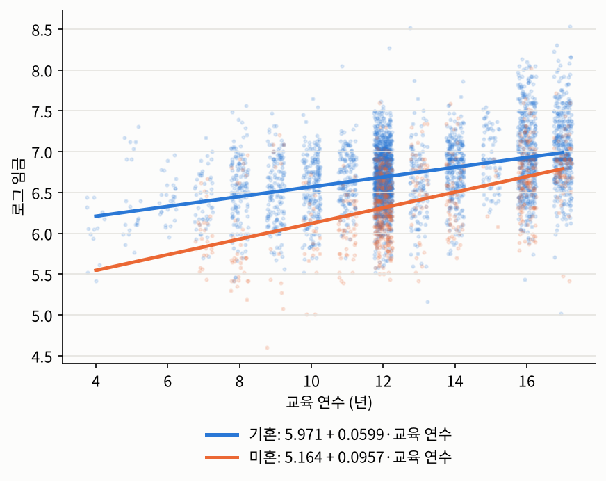
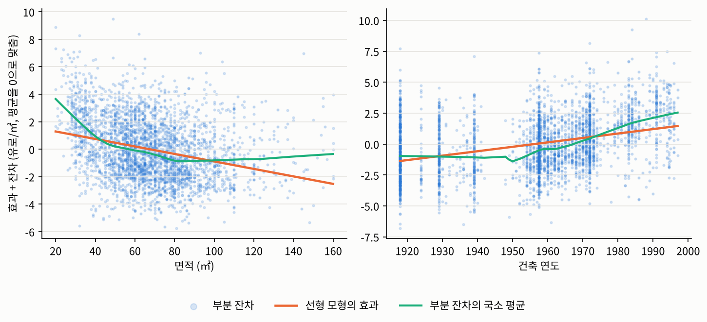
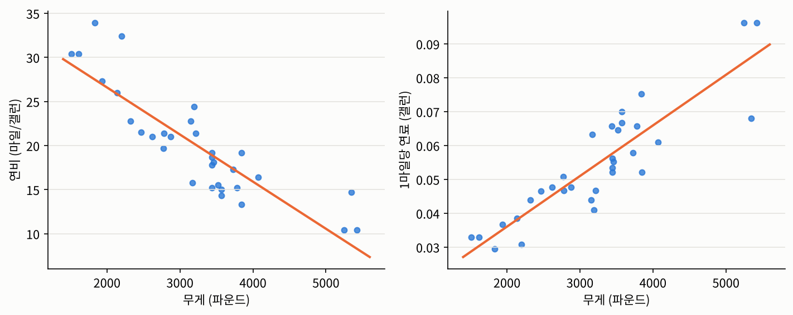
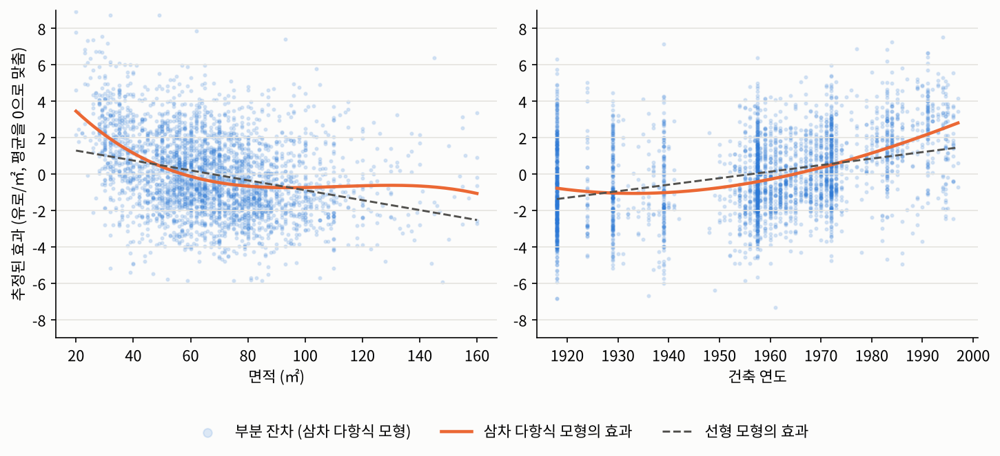
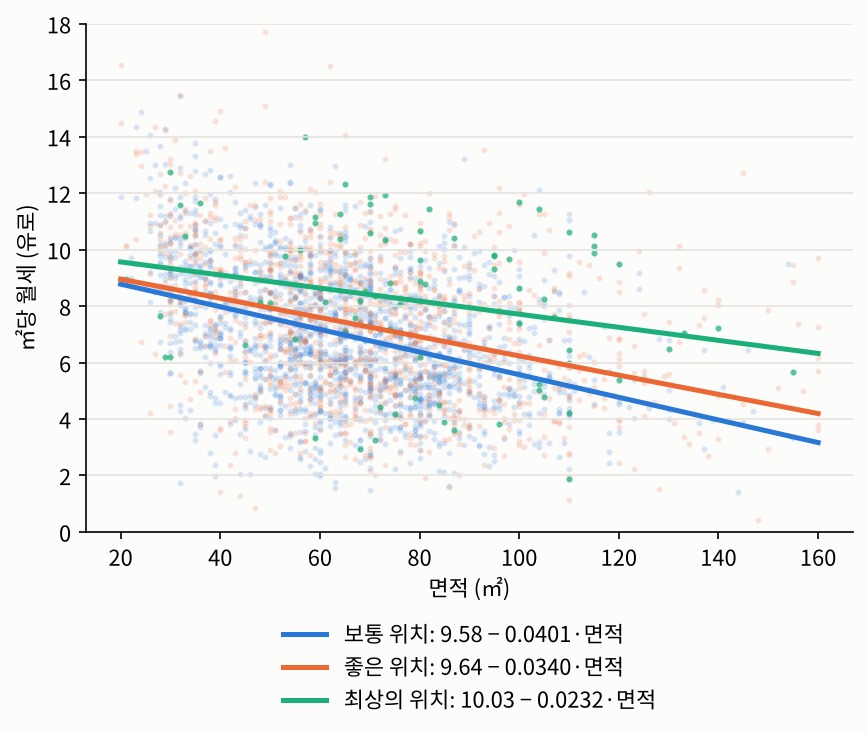

## 들어가며

[1.1](01-from-line-to-model.qmd)에서 선형 모델 $y_i = \beta_0 + \beta_1 x_{i1} + \cdots + \beta_k x_{ik} + \varepsilon_i$를 정의했습니다. 이번 글에서는 이 모델을 실제 데이터에 적합해 보고, 추정된 계수가 무엇을 뜻하는지 살펴보겠습니다. 계수를 어떻게 계산하는지는 [1.3](03-matrix-form-and-least-squares.qmd)에서 다루고, 지금은 최소제곱법으로 구한 값을 statsmodels가 계산해 준다고만 생각하겠습니다.

계수의 해석을 따라가다 보면 자연스럽게 다음 질문들이 나옵니다. 절편이 말이 안 되는 값으로 나오면 어떻게 할까요? 단위를 바꾸면 계수는 어떻게 바뀔까요? 효과가 직선이 아니면 어떻게 할까요? 마지막 질문에 답하다 보면 "선형" 모델이 생각보다 훨씬 넓은 모델이라는 것을 알게 됩니다.

## 첫 선형 모델

뮌헨 임대료 데이터로 ㎡당 월세(`rentsqm`, 유로)를 면적(`area`, ㎡)과 건축 연도(`yearc`)로 설명해 보겠습니다.

$$\text{rentsqm}_i = \beta_0 + \beta_1 \, \text{area}_i + \beta_2 \, \text{yearc}_i + \varepsilon_i$$

파이썬에서 선형 모델을 적합할 때는 statsmodels의 formula 인터페이스가 편리합니다. `"반응변수 ~ 공변량1 + 공변량2"` 꼴의 식을 문자열로 주면, 절편은 자동으로 들어갑니다.

```python
import pyreadr
import statsmodels.formula.api as smf

rent = pyreadr.read_r("rent99.rda")["rent99"]          # 1.1에서 내려받은 파일

model = smf.ols("rentsqm ~ area + yearc", data=rent).fit()
print(model.summary().tables[1])
```

```
==============================================================================
                 coef    std err          t      P>|t|      [0.025      0.975]
------------------------------------------------------------------------------
Intercept    -61.0581      3.527    -17.310      0.000     -67.974     -54.142
area          -0.0272      0.002    -16.187      0.000      -0.031      -0.024
yearc          0.0358      0.002     20.006      0.000       0.032       0.039
==============================================================================
```

`model.summary()`는 훨씬 긴 표를 출력하는데, 여기서는 계수 부분만 잘라 보았습니다. 열마다 뜻이 있지만 지금 읽을 수 있는 것은 첫 열 `coef`, 즉 추정된 회귀계수 $\hat\beta_0, \hat\beta_1, \hat\beta_2$뿐입니다. `std err`는 [1.4](04-properties.qmd)에서, `t`, `P>|t|`, 신뢰구간 `[0.025 0.975]`는 2장에서 다룹니다.

계수는 이렇게 읽습니다.

- $\hat\beta_1 = -0.0272$: **건축 연도가 같은** 두 아파트 가운데 면적이 1㎡ 넓은 쪽은 ㎡당 월세가 평균적으로 0.027유로 쌉니다. 넓은 집일수록 ㎡당 가격은 싸지는 경향이 있다는 뜻입니다. 10㎡ 차이라면 약 0.27유로입니다.
- $\hat\beta_2 = 0.0358$: **면적이 같은** 두 아파트 가운데 1년 늦게 지은 쪽은 ㎡당 월세가 평균적으로 0.036유로 비쌉니다. 10년이면 약 0.36유로입니다.

이 데이터의 ㎡당 월세는 평균 7.11유로입니다. 면적 50㎡ 차이는 약 1.36유로, 건축 연도 30년 차이는 약 1.07유로에 해당하니, 평균 월세에 비하면 꽤 의미 있는 차이입니다.

두 해석 모두 **다른 공변량이 같을 때**라는 조건이 붙어 있다는 점이 중요합니다. 선형 모델의 계수 $\beta_j$는 다른 공변량을 모두 고정한 채 $x_j$만 1만큼 다른 두 관측값의 **기대값의 차이**입니다. 경제학에서는 이런 해석을 "다른 조건이 같다면"이라는 뜻의 라틴어를 따서 **세테리스 파리부스**(ceteris paribus) 해석이라고 부릅니다. 기초 통계학의 최소제곱 직선은 공변량이 하나뿐이라 이런 조건을 붙일 수 없었습니다. 여러 공변량을 함께 넣는 가장 큰 이유가 여기에 있습니다.

## 절편이 뜻하는 것과 중심화

위 모델의 절편 $\hat\beta_0 = -61.06$은 "면적 0㎡, 서기 0년에 지은 집의 ㎡당 월세"입니다. 그런 집은 없고, 월세가 음수일 수도 없습니다. 데이터 범위에서 한참 벗어난 곳에서 직선을 읽은 외삽이기 때문입니다.

절편이 의미 있는 값이 되도록 공변량을 바꿀 수 있습니다. 다른 데이터로 살펴보겠습니다. 1976년부터 1982년까지 미국의 노동자 595명을 매년 조사한 패널 데이터로, 4165개의 관측값에 로그 임금(`lwage`), 교육 연수(`ed`), 결혼 여부(`married`) 등이 들어 있습니다.[^wages] 교육 연수로 로그 임금을 설명하는 모델을 전체 데이터와 기혼, 미혼 집단에 각각 적합해 보겠습니다.

```python
import pandas as pd
import statsmodels.formula.api as smf

url = "https://raw.githubusercontent.com/vincentarelbundock/Rdatasets/master/csv/Ecdat/Wages.csv"
wages = pd.read_csv(url)

fits = {
    "전체":   smf.ols("lwage ~ ed", data=wages).fit(),
    "기혼":   smf.ols("lwage ~ ed", data=wages[wages["married"] == "yes"]).fit(),
    "미혼":   smf.ols("lwage ~ ed", data=wages[wages["married"] == "no"]).fit(),
}
for name, fit in fits.items():
    b0, b1 = fit.params
    print(f"{name}: n = {int(fit.nobs):4d}, beta0_hat = {b0:.3f}, beta1_hat = {b1:.4f}")
print(f"교육 연수의 범위: {wages['ed'].min()} ~ {wages['ed'].max()}년, 평균 {wages['ed'].mean():.2f}년")
```

```
전체: n = 4165, beta0_hat = 5.839, beta1_hat = 0.0652
기혼: n = 3392, beta0_hat = 5.971, beta1_hat = 0.0599
미혼: n =  773, beta0_hat = 5.164, beta1_hat = 0.0957
교육 연수의 범위: 4 ~ 17년, 평균 12.85년
```

{fig-alt="교육 연수(가로축, 4~17년)와 로그 임금(세로축) 산점도. 기혼자는 파랑, 미혼자는 주황 점이고, 각 집단의 최소제곱 직선이 같은 색으로 그려져 있다. 파란 직선 5.971 + 0.0599·교육 연수는 주황 직선 5.164 + 0.0957·교육 연수보다 위에 있고, 주황 직선이 더 가팔라서 교육 연수가 길수록 두 직선의 간격이 좁아진다." width=75%}

반응변수가 로그 임금이라서 기울기는 "교육 1년당 임금이 몇 퍼센트 높은가"로 읽을 수 있습니다. 로그 임금이 0.0652 크다는 것은 임금이 $e^{0.0652} \approx 1.067$배, 즉 약 6.7% 높다는 뜻입니다. 기혼 집단에서는 약 6.2%, 미혼 집단에서는 약 10.0%입니다.

그런데 절편은 "교육 연수가 0년인 사람의 로그 임금"입니다. 이 데이터에서 교육 연수는 4년부터 17년까지만 있으니, 0년은 역시 데이터 밖입니다. 그래서 기혼과 미혼의 절편 차이 $5.971 - 5.164 = 0.807$을 "교육을 받지 않은 사람끼리 비교한 기혼과 미혼의 차이"로 읽는 것은 아무 근거가 없습니다.

해결책은 간단합니다. 교육 연수에서 평균을 빼서 **중심화**(centering)한 공변량 $x_i - \bar{x}$를 쓰면 됩니다.

```python
wages["ed_c"] = wages["ed"] - wages["ed"].mean()        # 교육 연수를 중심화

fit = smf.ols("lwage ~ ed_c", data=wages).fit()
b0, b1 = fit.params
print(f"beta0_hat = {b0:.3f}, beta1_hat = {b1:.4f}")
print(f"로그 임금의 평균 = {wages['lwage'].mean():.3f}")
```

```
beta0_hat = 6.676, beta1_hat = 0.0652
로그 임금의 평균 = 6.676
```

기울기는 그대로이고, 절편은 이제 "교육 연수가 평균(12.85년)인 사람의 로그 임금"이 되었습니다. 그리고 그 값이 로그 임금의 평균과 정확히 같습니다. 최소제곱 직선이 항상 두 평균의 점 $(\bar{x}, \bar{y})$를 지난다는 기초 통계학의 사실 덕분입니다. 중심화는 절편의 해석만 바꾸는 것이 아니라, [1.4](04-properties.qmd)에서 보겠지만 절편의 추정을 훨씬 안정적으로 만들어 주기도 합니다.

이 데이터로 답할 수 **없는** 질문도 짚고 넘어가겠습니다.

- 미혼 집단의 기울기가 더 크다는 것이 우연인지, 정말 차이가 있는지는 아직 모릅니다. 두 집단을 **따로** 적합해서는 그 차이를 검정할 방법이 없습니다. 한 모델 안에서 비교하는 방법은 이 글 뒤쪽의 교호작용에서, 검정은 2장에서 다룹니다.
- 기혼자의 임금이 더 높다고 해서 결혼이 임금을 올린다고 말할 수는 없습니다. 나이나 경력처럼 결혼 여부와 임금에 함께 관련된 변수가 차이를 만들었을 수도 있습니다. 기초 통계학에서 본 상관과 인과의 문제가 그대로 남아 있습니다.
- 이 데이터는 같은 사람을 7년 동안 반복해서 관측한 것입니다. 같은 사람의 관측값끼리는 오차가 닮았을 가능성이 크니, 1.1의 무상관 가정이 의심스럽습니다. 이런 데이터를 다루는 방법은 6장에서 살펴봅니다.

## 효과를 그림으로 보기: 부분 잔차

다시 임대료 모델로 돌아가겠습니다. 면적의 효과가 정말 직선일까요? 공변량이 하나라면 산점도에 직선을 그려 보면 되지만, 공변량이 여러 개면 한 공변량의 효과만 따로 떼어 보기가 어렵습니다. 반응 $y_i$와 면적을 산점도로 그리면 건축 연도의 효과까지 섞여 버리기 때문입니다.

이럴 때는 다른 공변량의 효과를 빼낸 값을 그립니다.

::: {.callout-note icon=false .callout-definition}
### 정의 1.2.1 (부분 잔차)
적합한 모델에서 공변량 $x_j$에 대한 $i$번째 **부분 잔차**(partial residual)는

$$\hat\varepsilon_{i,j} := y_i - \hat\beta_0 - \sum_{l \ne j} \hat\beta_l x_{il} = \hat\varepsilon_i + \hat\beta_j x_{ij}$$

입니다. 여기서 $\hat\varepsilon_i = y_i - \hat\beta_0 - \hat\beta_1 x_{i1} - \cdots - \hat\beta_k x_{ik}$는 보통의 잔차입니다.
:::

부분 잔차는 "$x_j$ 말고 나머지 공변량의 효과를 빼고 남은 부분"입니다. 모델이 맞다면 부분 잔차를 $x_j$에 대해 그린 그림은 기울기 $\hat\beta_j$인 직선 주위에 흩어져 있어야 합니다.

{fig-alt="왼쪽은 면적, 오른쪽은 건축 연도에 대한 부분 잔차 산점도이다. 각 칸에 주황색 직선(선형 모형의 효과)과 초록색 곡선(부분 잔차의 국소 평균)이 함께 그려져 있다. 면적 쪽에서 초록 곡선은 20㎡에서 40㎡까지 가파르게 내려가다가 80㎡ 이후로는 거의 평평해져, 계속 내려가는 주황 직선과 어긋난다. 건축 연도 쪽에서 초록 곡선은 1950년대까지 평평하다가 그 뒤로 올라가, 일정하게 올라가는 주황 직선과 어긋난다." width=95%}

초록 곡선은 부분 잔차의 국소 평균으로, 효과의 실제 모양을 가늠하게 해 줍니다. 두 공변량 모두 직선과 어긋납니다. 면적은 작은 집 구간에서 ㎡당 월세가 가파르게 떨어지다가 80㎡쯤부터는 거의 변하지 않고, 건축 연도는 1950년대까지는 효과가 거의 없다가 그 뒤로 올라갑니다. 효과를 직선으로 두는 모델은 이 데이터에 잘 맞지 않는 것입니다. 그렇다면 곡선을 어떻게 선형 모델에 넣을 수 있을까요?

## '선형'은 무엇에 대해 선형인가

선형 모델이 "선형"이라는 것은 **회귀계수 $\beta_0, \ldots, \beta_k$에 대해** 선형이라는 뜻입니다. 공변량에 대해서는 선형일 필요가 없습니다. 원래 변수 $z$에 어떤 변환을 한 값을 공변량으로 쓸 수 있습니다.

$$x_i = \log(z_i), \qquad x_i = z_{i1} + z_{i2}, \qquad x_i = z_{i1} z_{i2}$$

이렇게 만든 $x_i$를 넣어도 모델은 여전히 $\beta$들의 일차식이므로 선형 모델입니다. 반응변수도 분석 전에 변환할 수 있습니다. 앞의 임금 데이터에서 임금 대신 로그 임금을 쓴 것이 그 예입니다.

반면 다음 모델은 선형 모델이 아닙니다.

$$y_i = \beta_0 \, x_i^{\beta_1} + \varepsilon_i$$

$\beta_1$이 지수에 들어가 있어서, 계수에 대해 일차식이 아니기 때문입니다. 다만 이런 모델 가운데 일부는 변환으로 선형 모델로 바꿀 수 있습니다. 오차가 곱해지는 꼴의 **곱셈 모형**

$$y_i = \alpha_0 \, x_i^{\alpha_1} \, \varepsilon_i$$

에 양변 로그를 취하면

$$\log(y_i) = \log(\alpha_0) + \alpha_1 \log(x_i) + \log(\varepsilon_i)$$

가 되어, $\beta_0 = \log(\alpha_0)$, $\beta_1 = \alpha_1$인 선형 모델이 됩니다. 이 경우 로그 척도에서 등분산 가정이 성립하면, 원래 척도에서는 반응이 클수록 흩어짐도 커집니다. 1.1에서 본 월세 데이터의 나팔 모양이 바로 이런 모습이었습니다.

### 반응변수를 바꾸면: 연비 데이터

어떤 척도로 모델을 세울지는 데이터만이 아니라 **내용**을 보고 정하기도 합니다. 1974년 미국의 자동차 잡지에 실린 32개 차종의 데이터로 무게와 연비의 관계를 보겠습니다.[^mtcars] 연비는 미국식으로 "1갤런으로 몇 마일을 가는가"(mpg)로 기록되어 있습니다. 그런데 무거운 차가 연료를 더 쓴다는 관계를 생각하면, "1마일을 가는 데 몇 갤런이 드는가"(gpm)가 더 자연스러운 척도일 수 있습니다. 둘 다 모델로 적합해 보겠습니다.

```python
import pandas as pd
import statsmodels.formula.api as smf

url = "https://raw.githubusercontent.com/vincentarelbundock/Rdatasets/master/csv/datasets/mtcars.csv"
cars = pd.read_csv(url)
cars["weight"] = cars["wt"] * 1000          # 무게 (파운드), 원래 단위는 1000파운드
cars["gpm"] = 1 / cars["mpg"]               # 1마일에 드는 연료 (갤런)

fit_mpg = smf.ols("mpg ~ weight", data=cars).fit()
fit_gpm = smf.ols("gpm ~ weight", data=cars).fit()
print(f"mpg ~ weight: beta0_hat = {fit_mpg.params.iloc[0]:.3f}, beta1_hat = {fit_mpg.params.iloc[1]:.6f}, R^2 = {fit_mpg.rsquared:.3f}")
print(f"gpm ~ weight: beta0_hat = {fit_gpm.params.iloc[0]:.6f}, beta1_hat = {fit_gpm.params.iloc[1]:.3e}, R^2 = {fit_gpm.rsquared:.3f}")
print(f"무게 7000파운드에서 mpg 모형의 예측: {fit_mpg.params.iloc[0] + fit_mpg.params.iloc[1] * 7000:.2f} mpg")
```

```
mpg ~ weight: beta0_hat = 37.285, beta1_hat = -0.005344, R^2 = 0.753
gpm ~ weight: beta0_hat = 0.006169, beta1_hat = 1.494e-05, R^2 = 0.792
무게 7000파운드에서 mpg 모형의 예측: -0.13 mpg
```

{fig-alt="왼쪽은 무게(파운드)와 연비(마일/갤런), 오른쪽은 무게와 1마일당 연료(갤런)의 산점도와 최소제곱 직선이다. 왼쪽에서는 가벼운 차들이 직선보다 위에, 중간 무게의 차들이 직선보다 아래에 몰려 점들이 살짝 휘어진 모양이다. 오른쪽에서는 점들이 직선 주위에 더 고르게 흩어져 있다." width=90%}

gpm 모델의 결정계수가 조금 더 높고, 그림에서도 gpm 쪽 점들이 직선 주위에 더 고르게 흩어져 있습니다. (반응변수가 다른 두 모델의 결정계수를 그대로 비교하는 데에는 한계가 있지만, 여기서는 그림과 같은 방향을 가리킵니다.) 더 중요한 것은 내용입니다. mpg 모델은 무게 7000파운드짜리 차의 연비를 $-0.13$ mpg, 즉 연료를 넣을수록 뒤로 가는 차로 예측합니다. 이 데이터의 무게가 1513~5424파운드이니 외삽이기는 하지만, gpm 모델은 무게가 양수인 한 이런 불가능한 예측을 하지 않습니다.

### 단위를 바꾸면 계수는 어떻게 바뀔까요?

gpm 모델의 기울기 $1.494 \times 10^{-5}$은 "무게가 1파운드 늘면 1마일에 연료가 0.00001494갤런 더 든다"는 뜻인데, 한국이나 유럽에 사는 사람에게는 와닿지 않는 숫자입니다. 무게를 kg으로, 연료 소비를 "100km당 몇 L"로 바꾸면 계수는 어떻게 될까요? 모델을 다시 적합해도 되지만, 공변량이 하나인 경우에는 기초 통계학의 공식에서 바로 답이 나옵니다.

::: {.callout-important icon=false .callout-satz}
### 정리 1.2.2 (변수의 선형 변환과 최소제곱 추정값)
$y_i$를 $x_i$로 설명하는 단순 선형 회귀의 최소제곱 추정값을 $\hat\beta_0, \hat\beta_1$이라고 하겠습니다. 상수 $a_1 \ne 0$, $c_1 \ne 0$, $a_0$, $c_0$에 대해

$$t_i = a_0 + a_1 x_i, \qquad u_i = c_0 + c_1 y_i$$

로 변환한 뒤 $u_i$를 $t_i$로 설명하는 최소제곱 추정값 $\hat\alpha_0, \hat\alpha_1$은

$$\hat\alpha_1 = \frac{c_1}{a_1} \, \hat\beta_1, \qquad \hat\alpha_0 = c_0 + c_1 \hat\beta_0 - \frac{c_1 a_0}{a_1} \, \hat\beta_1$$

입니다.
:::

::: {.callout-tip collapse="true" icon=false .callout-beweis}
### 증명
평균은 $\bar{t} = a_0 + a_1 \bar{x}$, $\bar{u} = c_0 + c_1 \bar{y}$이고, 편차는 $t_i - \bar{t} = a_1 (x_i - \bar{x})$, $u_i - \bar{u} = c_1 (y_i - \bar{y})$입니다. 따라서 표본 공분산과 표본 분산은 $s_{tu} = a_1 c_1 s_{xy}$, $s_t^2 = a_1^2 s_x^2$이고, [기초 통계학 정리 4.5.2](../../basic-stats/04-two-variables/05-least-squares.qmd)에 의해

$$\hat\alpha_1 = \frac{s_{tu}}{s_t^2} = \frac{a_1 c_1 s_{xy}}{a_1^2 s_x^2} = \frac{c_1}{a_1} \hat\beta_1$$

입니다. 절편은

$$\hat\alpha_0 = \bar{u} - \hat\alpha_1 \bar{t} = c_0 + c_1 \bar{y} - \frac{c_1}{a_1}\hat\beta_1 (a_0 + a_1 \bar{x}) = c_0 + c_1 (\bar{y} - \hat\beta_1 \bar{x}) - \frac{c_1 a_0}{a_1} \hat\beta_1$$

이고, $\bar{y} - \hat\beta_1 \bar{x} = \hat\beta_0$이므로 원하는 식이 나옵니다. $\square$
:::

이 정리에서 바로 알 수 있는 것이 있습니다. 공변량만 평행이동하면($a_1 = 1$, $c_0 = 0$, $c_1 = 1$) 기울기는 바뀌지 않고 절편만 $\hat\beta_0 + (-a_0)\hat\beta_1$로 바뀝니다. 앞에서 한 중심화는 $a_0 = -\bar{x}$인 경우로, 새 절편은 $\hat\beta_0 + \hat\beta_1 \bar{x} = \bar{y}$입니다. 임금 데이터에서 본 그대로입니다.

연비 데이터에서는 1파운드 = 0.45359237kg이므로 $a_1 = 0.45359237$, 1갤런 = 3.785411784L와 1마일 = 1.609344km에서 gpm에 약 235.2를 곱하면 100km당 L가 되므로 $c_1 \approx 235.2$이고, $a_0 = c_0 = 0$입니다.

```python
LB_TO_KG = 0.45359237                         # 1파운드 = 0.45359237kg
GPM_TO_L100KM = 3.785411784 / 1.609344 * 100  # 1갤런 = 3.785411784L, 1마일 = 1.609344km
cars["weight_kg"] = LB_TO_KG * cars["weight"]
cars["l_per_100km"] = GPM_TO_L100KM * cars["gpm"]

b0, b1 = smf.ols("gpm ~ weight", data=cars).fit().params
a1, c1 = LB_TO_KG, GPM_TO_L100KM              # t = a1 * x,  u = c1 * y  (a0 = c0 = 0)
print(f"공식으로 계산: alpha0_hat = {c1 * b0:.4f}, alpha1_hat = {c1 * b1 / a1:.6f}")
alpha0, alpha1 = smf.ols("l_per_100km ~ weight_kg", data=cars).fit().params
print(f"다시 적합    : alpha0_hat = {alpha0:.4f}, alpha1_hat = {alpha1:.6f}")
print(f"무게가 100kg 늘면 100km당 연료 {100 * alpha1:.2f}L 증가")
```

```
공식으로 계산: alpha0_hat = 1.4510, alpha1_hat = 0.007746
다시 적합    : alpha0_hat = 1.4510, alpha1_hat = 0.007746
무게가 100kg 늘면 100km당 연료 0.77L 증가
```

공식과 다시 적합한 결과가 같습니다. 이제 기울기를 "차가 100kg 무거우면 100km당 연료가 평균적으로 약 0.77L 더 든다"고 읽을 수 있습니다. 단위를 바꾸는 것은 계수의 숫자만 바꿀 뿐 모델이 데이터에 맞는 정도는 바꾸지 않습니다. 결정계수도 그대로입니다.

### 다항식: 곡선 효과

이제 임대료 데이터의 휘어진 효과로 돌아가겠습니다. 면적과 건축 연도의 제곱과 세제곱을 공변량으로 넣으면 효과를 **삼차 다항식**으로 표현할 수 있습니다.

$$\text{rentsqm}_i = \beta_0 + \beta_1 a_i + \beta_2 a_i^2 + \beta_3 a_i^3 + \beta_4 t_i + \beta_5 t_i^2 + \beta_6 t_i^3 + \varepsilon_i$$

$a_i^2, t_i^3$ 같은 항이 들어 있지만 계수에 대해서는 여전히 일차식이므로 선형 모델입니다. 다만 여기서는 원래 변수 대신 $a_i = (\text{area}_i - 70)/10$, $t_i = (\text{yearc}_i - 1950)/10$을 썼습니다. 건축 연도를 그대로 세제곱하면 $1997^3 \approx 8 \times 10^9$처럼 큰 수가 되어 계산이 수치적으로 불안정해지기 때문입니다. 이 문제는 [1.3](03-matrix-form-and-least-squares.qmd)에서 다시 다루고, 더 좋은 해결책인 직교 다항식은 3장에서 소개합니다.

```python
import pyreadr
import statsmodels.formula.api as smf

rent = pyreadr.read_r("rent99.rda")["rent99"]
rent["a"] = (rent["area"] - 70) / 10        # 70㎡를 0으로, 10㎡를 1로
rent["t"] = (rent["yearc"] - 1950) / 10     # 1950년을 0으로, 10년을 1로

linear = smf.ols("rentsqm ~ a + t", data=rent).fit()
cubic = smf.ols("rentsqm ~ a + I(a**2) + I(a**3) + t + I(t**2) + I(t**3)", data=rent).fit()
print(cubic.params.round(4))
print(f"R^2: 선형 {linear.rsquared:.4f}, 삼차 다항식 {cubic.rsquared:.4f}")
```

```
Intercept    5.8932
a           -0.2613
I(a ** 2)    0.0750
I(a ** 3)   -0.0059
t            0.3651
I(t ** 2)    0.0997
I(t ** 3)   -0.0035
dtype: float64
R^2: 선형 0.2178, 삼차 다항식 0.2981
```

formula 안에서 `I(a**2)`처럼 `I()`로 감싸는 것은 "이 식을 계산한 값을 공변량으로 쓰라"는 뜻입니다. 선형 모델의 결정계수는 공변량의 척도를 바꿔도 변하지 않으므로, 선형 모델의 0.2178은 앞의 `area + yearc` 모델과 같은 값입니다.

이제 개별 계수는 해석하기 어렵습니다. 면적이 1만큼 다를 때 $a$, $a^2$, $a^3$이 한꺼번에 바뀌므로 "$a^2$만 바꾸고 나머지를 고정"하는 세테리스 파리부스 해석이 불가능하기 때문입니다. 이럴 때는 추정된 효과 $\hat\beta_1 a + \hat\beta_2 a^2 + \hat\beta_3 a^3$을 그림으로 그려서 봅니다.

{fig-alt="왼쪽은 면적, 오른쪽은 건축 연도에 대한 삼차 다항식 모형의 추정 효과(주황 곡선)와 선형 모형의 추정 효과(회색 점선), 그리고 부분 잔차(옅은 파란 점)를 그린 것이다. 면적의 주황 곡선은 20㎡에서 약 3.5로 시작해 80㎡ 부근까지 가파르게 내려간 뒤 거의 평평해진다. 건축 연도의 주황 곡선은 1940년 무렵까지 평평하다가 그 뒤로 점점 가파르게 올라가 1997년에 약 3에 이른다." width=95%}

삼차 다항식 효과는 부분 잔차 그림에서 본 모양을 잘 따라갑니다. 결정계수도 0.218에서 0.298로 올랐습니다.

### 범주형 공변량: 위치

임대료 데이터에는 전문가가 매긴 위치 등급(`location`)도 있습니다. 1은 보통, 2는 좋음, 3은 최상의 위치입니다. 이 변수를 숫자 그대로 넣으면 어떨까요?

$$\text{rentsqm}_i = \beta_0 + \beta_1 \, \text{location}_i + \cdots + \varepsilon_i$$

이 모델은 두 가지 점에서 이상합니다. 첫째, 위치 등급은 범주형 변수이고 1, 2, 3은 이름표일 뿐입니다. 둘째, 이 모델은 "보통에서 좋음으로 갈 때의 차이"와 "좋음에서 최상으로 갈 때의 차이"가 똑같이 $\beta_1$이라고 가정해 버립니다. 그럴 이유가 전혀 없습니다.

대신 각 범주를 나타내는 **더미 변수**(dummy variable)를 만듭니다.

$$\text{glocation}_i = \begin{cases} 1 & \text{좋은 위치} \\ 0 & \text{그 밖} \end{cases}, \qquad \text{tlocation}_i = \begin{cases} 1 & \text{최상의 위치} \\ 0 & \text{그 밖} \end{cases}$$

보통 위치는 두 더미가 모두 0인 경우로, 따로 더미를 만들지 않습니다. 이 범주를 **기준 범주**(reference category)라고 합니다.

```python
import pyreadr
import statsmodels.formula.api as smf

rent = pyreadr.read_r("rent99.rda")["rent99"]
location = rent["location"].astype(int)            # 1 보통, 2 좋음, 3 최상
rent["glocation"] = (location == 2).astype(int)    # 좋은 위치이면 1
rent["tlocation"] = (location == 3).astype(int)    # 최상의 위치이면 1

fit = smf.ols("rentsqm ~ glocation + tlocation + area + yearc", data=rent).fit()
print(fit.params.round(4))
```

```
Intercept   -66.0144
glocation     0.7358
tlocation     1.7864
area         -0.0288
yearc         0.0382
dtype: float64
```

- $\hat\beta_{\text{glocation}} = 0.736$: 면적과 건축 연도가 같다면, 좋은 위치의 아파트는 보통 위치보다 ㎡당 월세가 평균적으로 약 0.74유로 비쌉니다.
- $\hat\beta_{\text{tlocation}} = 1.786$: 마찬가지로 최상의 위치는 보통 위치보다 약 1.79유로 비쌉니다.

"보통 → 좋음"의 차이(0.74)와 "좋음 → 최상"의 차이($1.786 - 0.736 = 1.05$)가 다르다는 것을 데이터가 알아서 정해 줍니다. 위치 변수를 숫자 그대로 넣었다면 이 차이를 볼 수 없었을 것입니다. 왜 세 범주 모두에 더미를 만들지 않는지, 다른 코딩 방법은 없는지는 [1.3](03-matrix-form-and-least-squares.qmd)과 3장에서 다룹니다.

### 교호작용: 효과가 집단마다 다를 때

위의 모델에서 위치는 **절편만** 바꿉니다. 면적에 따른 ㎡당 월세의 변화는 위치와 관계없이 같다고 가정한 셈입니다. 그런데 최상의 위치에서는 넓은 집도 ㎡당 월세가 덜 떨어질 수 있지 않을까요? 이런 가능성은 두 공변량의 곱을 공변량으로 넣어서 표현합니다. 이 곱을 **교호작용**(interaction)이라고 합니다. 두 모델을 비교해 보겠습니다.

- 모형 1: $\text{rentsqm} = \beta_0 + \beta_1 \text{glocation} + \beta_2 \text{tlocation} + \beta_3 \text{area} + \varepsilon$
- 모형 2: $\text{rentsqm} = \beta_0 + \beta_1 \text{glocation} + \beta_2 \text{tlocation} + \beta_3 \text{area} + \beta_4 \text{glocation} \cdot \text{area} + \beta_5 \text{tlocation} \cdot \text{area} + \varepsilon$

```python
model1 = smf.ols("rentsqm ~ glocation + tlocation + area", data=rent).fit()
model2 = smf.ols("rentsqm ~ glocation + tlocation + area"
                 " + glocation:area + tlocation:area", data=rent).fit()
print("모형 1"); print(model1.params.round(4))
print("모형 2"); print(model2.params.round(4))
print(location.value_counts().sort_index())
```

```
모형 1
Intercept    9.3553
glocation    0.4646
tlocation    1.7537
area        -0.0367
dtype: float64
모형 2
Intercept         9.5789
glocation         0.0572
tlocation         0.4477
area             -0.0401
glocation:area    0.0061
tlocation:area    0.0169
dtype: float64
location
1    1794
2    1210
3      78
Name: count, dtype: int64
```

formula에서 `glocation:area`는 두 변수의 곱을 뜻합니다. 모형 2를 위치별로 나누어 쓰면 다음과 같습니다.

| 위치 | 절편 | 면적의 기울기 |
|:--|:--|:--|
| 보통 | $\beta_0$ | $\beta_3$ |
| 좋음 | $\beta_0 + \beta_1$ | $\beta_3 + \beta_4$ |
| 최상 | $\beta_0 + \beta_2$ | $\beta_3 + \beta_5$ |

모형 1에서는 세 위치의 직선이 기울기가 같고 높이만 다른 평행선이지만, 모형 2에서는 기울기도 위치마다 다릅니다. $\beta_1, \beta_2$는 기준 범주와의 **절편 차이**, $\beta_4, \beta_5$는 기준 범주와의 **기울기 차이**입니다.

{fig-alt="면적(가로축)과 ㎡당 월세(세로축)의 산점도 위에 모형 2로 추정한 세 위치의 직선이 그려져 있다. 보통 위치(파랑) 9.58 − 0.0401·면적, 좋은 위치(주황) 9.64 − 0.0340·면적, 최상의 위치(초록) 10.03 − 0.0232·면적. 세 직선은 20㎡ 부근에서는 가깝지만, 최상의 위치 직선이 가장 완만해서 면적이 커질수록 다른 두 직선과의 간격이 벌어진다." width=75%}

추정 결과를 보면 면적이 1㎡ 늘 때 ㎡당 월세는 보통 위치에서 0.0401유로, 좋은 위치에서 $0.0401 - 0.0061 = 0.0340$유로, 최상의 위치에서 $0.0401 - 0.0169 = 0.0232$유로 떨어집니다. 예상대로 위치가 좋을수록 넓은 집의 ㎡당 월세가 덜 떨어집니다. 다만 최상의 위치에 있는 아파트는 78채뿐이라, 이 차이가 우연이 아닌지는 2장의 검정으로 확인해야 합니다.

앞의 임금 데이터에서 기혼과 미혼 집단을 따로 적합한 것은, 사실 결혼 여부와 교육 연수의 교호작용을 넣은 모델 하나를 적합한 것과 같은 추정값을 줍니다. 두 집단의 절편과 기울기가 모두 다를 수 있기 때문입니다. 한 모델로 합치면 "기울기의 차이가 0인가"를 그 모델 안에서 검정할 수 있다는 장점이 있습니다.

교호작용은 다항식과 함께 쓰는 것처럼 더 복잡한 모델에서도 쓸 수 있습니다. 범주형 공변량과 교호작용은 3장에서 더 자세히 다룹니다.

## 정리

이번 글에서는 선형 모델의 계수를 해석하고, 선형 모델이 담을 수 있는 관계의 폭을 살펴보았습니다.

- 회귀계수 $\beta_j$는 **다른 공변량이 같을 때** $x_j$가 1만큼 다른 두 관측값의 기대값의 차이입니다. 공변량이 여러 개인 모델은 이렇게 다른 요인을 고정한 비교를 가능하게 해 줍니다.
- 절편은 모든 공변량이 0일 때의 기대값이라 데이터 밖의 값이 되기 쉽습니다. 공변량을 **중심화**하면 절편이 "공변량이 평균일 때의 기대값"이 됩니다. 변수의 단위를 선형으로 바꾸면 계수는 정해진 공식대로 바뀌고, 모델의 적합도는 그대로입니다.
- **부분 잔차**를 그리면 공변량이 여러 개인 모델에서도 한 공변량의 효과 모양을 점검할 수 있습니다.
- 선형 모델은 **계수에 대해** 선형인 모델입니다. 변수 변환, 다항식, 범주형 변수의 더미, 공변량끼리의 곱인 교호작용이 모두 선형 모델 안에 들어갑니다. 다만 다항식이나 교호작용이 들어가면 개별 계수보다 효과 전체를 그림으로 보는 편이 낫습니다.

지금까지는 statsmodels가 계수를 계산해 주었습니다. 다음 글에서는 선형 모델을 행렬로 써서 그 계산이 어떻게 이루어지는지 직접 유도해 보겠습니다.

---

### 연결되는 개념
* $\leftarrow$ **이전 개념:** [1.1 최소제곱 직선에서 선형 모델로](01-from-line-to-model.qmd)
* $\rightarrow$ **다음 개념:** [1.3 행렬로 쓰는 선형 모델과 최소제곱 추정량](03-matrix-form-and-least-squares.qmd)

[^wages]: C. Cornwell, P. Rupert, "Efficient Estimation with Panel Data: An Empirical Comparison of Instrumental Variables Estimators", *Journal of Applied Econometrics* 3(2), 1988, pp. 149–155. 여기서는 R 패키지 Ecdat에 들어 있는 `Wages` 데이터를 Rdatasets 저장소에서 CSV로 내려받아 씁니다.

[^mtcars]: R에 기본으로 들어 있는 `mtcars` 데이터로, 1974년 *Motor Trend* 잡지에 실린 자료입니다. H. V. Henderson, P. F. Velleman, "Building Multiple Regression Models Interactively", *Biometrics* 37(2), 1981, pp. 391–411.
