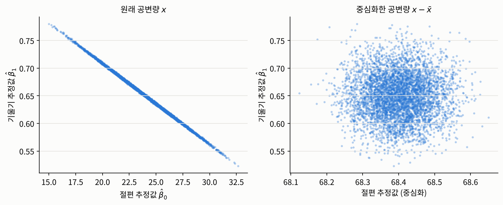
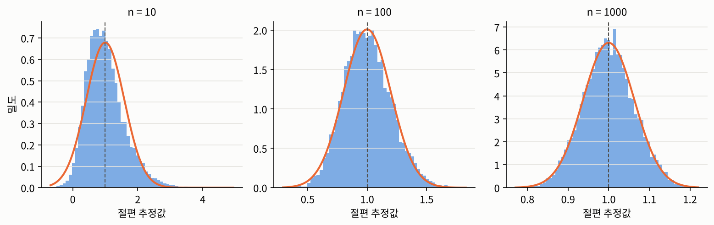

## 들어가며

[1.3](03-matrix-form-and-least-squares.qmd)에서 최소제곱 추정량 $\hat{\boldsymbol\beta} = (\mathbf{X}^t\mathbf{X})^{-1}\mathbf{X}^t\mathbf{y}$를 구했습니다. 이 식에는 반응변수 $\mathbf{y}$가 들어 있고, 선형 모델에서 $\mathbf{y}$는 오차항 때문에 우연에 따라 달라지는 확률변수입니다. 그렇다면 $\hat{\boldsymbol\beta}$도 확률변수입니다. 골턴이 다른 가족 928명을 조사했다면 기울기는 0.646이 아니라 조금 다른 값이 나왔을 것입니다.

이번 글에서는 이 흔들림을 다룹니다. $\hat{\boldsymbol\beta}$는 평균적으로 참값 $\boldsymbol\beta$를 맞힐까요? 얼마나 흔들릴까요? 다른 추정 방법보다 나을까요? 오차가 정규분포가 아니면 어떻게 될까요? 먼저 시뮬레이션으로 흔들림을 직접 본 다음, 그 결과를 정리로 정리하겠습니다.

## 데이터를 다시 뽑는다면

참값을 아는 상황을 만들어야 추정값이 참값을 얼마나 잘 맞히는지 볼 수 있습니다. 골턴 데이터의 부모 키 928개는 그대로 두고, 자녀의 키만 우리가 정한 참모형 $y_i = 24 + 0.65 x_i + \varepsilon_i$, $\varepsilon_i \sim \mathcal{N}(0, 2.2^2)$에서 새로 만들어 보겠습니다. 이 일을 5000번 반복하면서 매번 최소제곱 추정값을 계산합니다. 공변량을 고정하는 것은 [1.1](01-from-line-to-model.qmd)에서 말했듯 선형 모델의 가정이 모두 "공변량이 주어졌을 때"의 이야기이기 때문입니다.

```python
import numpy as np
import pandas as pd

url = "https://raw.githubusercontent.com/vincentarelbundock/Rdatasets/master/csv/HistData/Galton.csv"
x = pd.read_csv(url)["parent"].to_numpy()      # 공변량은 실제 데이터 그대로 고정
n = len(x)
X = np.column_stack([np.ones(n), x])
beta_true = np.array([24.0, 0.65])             # 우리가 정한 "참값"
sigma = 2.2
np.set_printoptions(suppress=True)

rng = np.random.default_rng(1557)
estimates = np.empty((5000, 2))
for r in range(5000):
    y = X @ beta_true + rng.normal(0, sigma, size=n)   # 새 자녀 키 데이터
    estimates[r] = np.linalg.solve(X.T @ X, X.T @ y)

print("추정값의 평균      :", estimates.mean(axis=0).round(4))
print("추정값의 공분산 행렬:\n", np.cov(estimates.T).round(5))
print("sigma^2 (X^t X)^(-1) :\n", (sigma**2 * np.linalg.inv(X.T @ X)).round(5))
print("beta0_hat와 beta1_hat의 상관계수:", np.corrcoef(estimates.T)[0, 1].round(4))
```

```
추정값의 평균      : [23.9964  0.6501]
추정값의 공분산 행렬:
 [[ 7.59002 -0.111  ]
 [-0.111    0.00162]]
sigma^2 (X^t X)^(-1) :
 [[ 7.63127 -0.11164]
 [-0.11164  0.00163]]
beta0_hat와 beta1_hat의 상관계수: -0.9997
```

세 가지가 눈에 띕니다.

- 5000개 추정값의 평균이 참값 $(24, 0.65)$에 아주 가깝습니다.
- 5000개 추정값의 공분산 행렬이 $\sigma^2(\mathbf{X}^t\mathbf{X})^{-1}$라는 행렬과 거의 같습니다. 이 행렬은 데이터 $\mathbf{y}$ 없이 공변량과 $\sigma$만으로 계산한 것입니다.
- 절편 추정값과 기울기 추정값의 상관계수가 $-0.9997$로, 거의 완벽한 음의 관계입니다.

처음 두 가지는 우연이 아닙니다.

## 기대값과 공분산

정리를 말하기 전에 확률변수 벡터에 대한 계산 규칙 두 가지를 적어 두겠습니다. 상수 행렬 $\mathbf{A}$와 상수 벡터 $\mathbf{b}$, 확률변수 벡터 $\mathbf{z}$에 대해

$$\mathbb{E}(\mathbf{A}\mathbf{z} + \mathbf{b}) = \mathbf{A}\,\mathbb{E}(\mathbf{z}) + \mathbf{b}, \qquad \mathrm{Cov}(\mathbf{A}\mathbf{z} + \mathbf{b}) = \mathbf{A}\,\mathrm{Cov}(\mathbf{z})\,\mathbf{A}^t$$

이 성립합니다. 한 변수일 때의 $\mathbb{E}(az + b) = a\mathbb{E}(z) + b$, $\mathrm{Var}(az + b) = a^2\mathrm{Var}(z)$를 벡터로 옮긴 것입니다. 또 정규분포를 따르는 벡터에 이런 변환을 하면 결과도 정규분포를 따릅니다.

::: {.callout-important icon=false .callout-satz}
### 정리 1.4.1 (최소제곱 추정량의 기대값과 공분산)
선형 모델 $\mathbf{y} = \mathbf{X}\boldsymbol\beta + \boldsymbol\varepsilon$에서 $\mathbf{X}$가 완전 계수이면 다음이 성립합니다.

1. $\mathbb{E}(\boldsymbol\varepsilon) = \mathbf{0}$이면 $\mathbb{E}(\hat{\boldsymbol\beta}) = \boldsymbol\beta$입니다. 즉 $\hat{\boldsymbol\beta}$는 **불편추정량**(unbiased estimator)입니다.
2. 여기에 $\mathrm{Cov}(\boldsymbol\varepsilon) = \sigma^2\mathbf{I}$이면 $\mathrm{Cov}(\hat{\boldsymbol\beta}) = \sigma^2(\mathbf{X}^t\mathbf{X})^{-1}$입니다.
3. $\boldsymbol\varepsilon \sim \mathcal{N}(\mathbf{0}, \sigma^2\mathbf{I})$이면 $\hat{\boldsymbol\beta} \sim \mathcal{N}\big(\boldsymbol\beta, \, \sigma^2(\mathbf{X}^t\mathbf{X})^{-1}\big)$입니다.
:::

::: {.callout-tip collapse="true" icon=false .callout-beweis}
### 증명
$\mathbf{y} = \mathbf{X}\boldsymbol\beta + \boldsymbol\varepsilon$을 추정량의 식에 대입하면

$$\hat{\boldsymbol\beta} = (\mathbf{X}^t\mathbf{X})^{-1}\mathbf{X}^t(\mathbf{X}\boldsymbol\beta + \boldsymbol\varepsilon) = \boldsymbol\beta + (\mathbf{X}^t\mathbf{X})^{-1}\mathbf{X}^t\boldsymbol\varepsilon$$

입니다. $\mathbf{A} := (\mathbf{X}^t\mathbf{X})^{-1}\mathbf{X}^t$로 두면 $\hat{\boldsymbol\beta} = \boldsymbol\beta + \mathbf{A}\boldsymbol\varepsilon$입니다.

1. $\mathbb{E}(\hat{\boldsymbol\beta}) = \boldsymbol\beta + \mathbf{A}\,\mathbb{E}(\boldsymbol\varepsilon) = \boldsymbol\beta$.
2. $\mathrm{Cov}(\hat{\boldsymbol\beta}) = \mathbf{A}(\sigma^2\mathbf{I})\mathbf{A}^t = \sigma^2(\mathbf{X}^t\mathbf{X})^{-1}\mathbf{X}^t\mathbf{X}(\mathbf{X}^t\mathbf{X})^{-1} = \sigma^2(\mathbf{X}^t\mathbf{X})^{-1}$. 여기서 $(\mathbf{X}^t\mathbf{X})^{-1}$이 대칭행렬이라 전치해도 그대로라는 것을 썼습니다.
3. $\hat{\boldsymbol\beta}$는 정규분포를 따르는 $\boldsymbol\varepsilon$의 선형 변환이므로 정규분포를 따르고, 평균과 공분산은 1, 2에서 구한 대로입니다. $\square$
:::

이 정리를 쉬운 말로 풀어 보겠습니다.

- **불편성**은 데이터를 수없이 다시 뽑아 추정을 반복하면 추정값들의 평균이 참값이 된다는 뜻입니다. 한 번의 추정값이 참값과 같다는 뜻은 아닙니다. 불편성에 필요한 가정은 $\mathbb{E}(\boldsymbol\varepsilon) = \mathbf{0}$ 하나뿐입니다. 오차가 이분산이거나 서로 상관되어 있어도 추정량은 여전히 불편입니다.
- **공분산 행렬** $\sigma^2(\mathbf{X}^t\mathbf{X})^{-1}$의 대각 성분은 각 계수 추정량의 분산입니다. 이 분산은 오차의 분산 $\sigma^2$가 작을수록, 그리고 $\mathbf{X}^t\mathbf{X}$가 "클수록" 작아집니다. 관측값이 많을수록, 공변량이 넓게 퍼져 있을수록 추정이 정확해진다는 뜻입니다. 이 공식은 오차가 등분산이고 무상관일 때만 맞습니다. 4장에서 이 가정이 깨졌을 때의 대처법을 다룹니다.
- 대각 성분의 제곱근을 **표준오차**(standard error)라고 합니다. 실제로는 $\sigma^2$를 모르므로 [1.5](05-projection.qmd)에서 만들 추정값 $\hat\sigma^2$를 대신 넣어 계산합니다. [1.2](02-interpretation-and-linearity.qmd)의 statsmodels 출력에 있던 `std err` 열이 바로 이것입니다.

정리 1.4.1의 3번은 [1.1](01-from-line-to-model.qmd)에서 말한 정규성 가정의 역할을 보여 줍니다. 정규성이 있으면 추정량의 분포를 **정확하게** 알 수 있고, 2장에서는 이것을 바탕으로 신뢰구간과 검정을 만듭니다.

## 절편은 왜 그렇게 흔들릴까

시뮬레이션의 세 번째 관찰로 돌아가겠습니다. 절편 추정값의 분산은 약 7.6으로, 표준편차로는 2.8인치 가까이 됩니다. 기울기의 표준편차는 $\sqrt{0.00162} \approx 0.04$에 불과한데, 절편은 왜 이렇게 크게 흔들리고, 왜 기울기와 거의 완벽하게 반대로 움직일까요?

공변량이 하나인 경우에 정리 1.4.1의 공분산 행렬을 풀어 쓰면 이유가 보입니다.

::: {.callout-important icon=false .callout-satz}
### 정리 1.4.2 (단순 선형 회귀에서 추정량의 분산)
$y_i = \beta_0 + \beta_1 x_i + \varepsilon_i$에서 오차가 등분산이고 무상관이면, $S_{xx} = \sum_i (x_i - \bar{x})^2$에 대해

$$\mathrm{Var}(\hat\beta_1) = \frac{\sigma^2}{S_{xx}}, \qquad \mathrm{Var}(\hat\beta_0) = \sigma^2\left(\frac{1}{n} + \frac{\bar{x}^2}{S_{xx}}\right), \qquad \mathrm{Cov}(\hat\beta_0, \hat\beta_1) = -\frac{\sigma^2\,\bar{x}}{S_{xx}}$$

입니다.
:::

::: {.callout-tip collapse="true" icon=false .callout-beweis}
### 증명
[정리 1.3.7](03-matrix-form-and-least-squares.qmd)의 증명에서 구한 역행렬

$$(\mathbf{X}^t\mathbf{X})^{-1} = \frac{1}{n S_{xx}}\begin{pmatrix} \sum x_i^2 & -\sum x_i \\ -\sum x_i & n \end{pmatrix}$$

에 $\sigma^2$를 곱하면 됩니다. $(2,2)$ 성분은 $\sigma^2/S_{xx}$이고, $(1,2)$ 성분은 $-\sigma^2 n\bar{x}/(nS_{xx}) = -\sigma^2\bar{x}/S_{xx}$입니다. $(1,1)$ 성분은 $\sum x_i^2 = S_{xx} + n\bar{x}^2$을 쓰면 $\sigma^2(S_{xx} + n\bar{x}^2)/(nS_{xx}) = \sigma^2(1/n + \bar{x}^2/S_{xx})$입니다. $\square$
:::

절편의 분산에 있는 $\bar{x}^2/S_{xx}$가 핵심입니다. 골턴 데이터에서 부모 키의 평균은 약 68.3인치인데, 절편은 부모 키가 **0인치**인 곳의 값입니다. 데이터가 있는 64~73인치 구간에서 직선을 조금만 기울여도, 거기서 68인치 넘게 떨어진 0인치 지점에서는 높이가 크게 달라집니다. 시소의 받침점에서 멀리 떨어진 끝이 크게 오르내리는 것과 같습니다. 그래서 기울기가 커지면 절편은 작아지고, 기울기가 작아지면 절편은 커지는 강한 음의 상관이 생깁니다. 공분산 $-\sigma^2\bar{x}/S_{xx}$의 부호가 $\bar{x}$의 부호와 반대인 것이 이 이야기입니다.

그렇다면 공변량의 평균이 0이 되도록 중심화하면 어떨까요? [1.2](02-interpretation-and-linearity.qmd)에서 해석을 위해 했던 중심화를 이번에는 추정의 정확도라는 관점에서 보겠습니다. 같은 참모형에서 자녀 키를 만들고, 공변량만 $x_i - \bar{x}$로 바꾸어 적합합니다.

```python
w = x - x.mean()                                # 중심화한 공변량
W = np.column_stack([np.ones(n), w])

rng = np.random.default_rng(1557)
estimates = np.empty((5000, 2))
for r in range(5000):
    y = 24.0 + 0.65 * x + rng.normal(0, sigma, size=n)  # 같은 참모형에서 생성
    estimates[r] = np.linalg.solve(W.T @ W, W.T @ y)

print("추정값의 평균:", estimates.mean(axis=0).round(4), " (참값: 24 + 0.65 * 평균 =", round(24 + 0.65 * x.mean(), 4), ")")
print("절편 추정값의 분산:", estimates[:, 0].var(ddof=1).round(5), " 이론값 sigma^2/n:", round(sigma**2 / n, 5))
print("기울기 추정값의 분산:", estimates[:, 1].var(ddof=1).round(5))
print("두 추정값의 상관계수:", np.corrcoef(estimates.T)[0, 1].round(4))
```

```
추정값의 평균: [68.4007  0.6501]  (참값: 24 + 0.65 * 평균 = 68.4003 )
절편 추정값의 분산: 0.0052  이론값 sigma^2/n: 0.00522
기울기 추정값의 분산: 0.00162
두 추정값의 상관계수: -0.0117
```

{fig-alt="5000번의 시뮬레이션에서 얻은 (절편 추정값, 기울기 추정값) 산점도 두 개. 왼쪽(원래 공변량)은 점들이 절편 15~33, 기울기 0.52~0.78 범위에서 오른쪽 아래로 내려가는 아주 가는 직선 위에 몰려 있다. 오른쪽(중심화한 공변량)은 절편이 68.1~68.7 범위에 있고 점들이 둥근 구름 모양으로 퍼져 있어 두 추정값 사이에 관계가 보이지 않는다." width=90%}

중심화하면 절편은 "부모 키가 평균인 집안의 자녀 키 기대값"이 되고, 그 분산은 7.6에서 0.0052로 1000배 넘게 줄어듭니다. 이론값 $\sigma^2/n$과도 맞습니다. 정리 1.4.2에서 $\bar{x} = 0$을 넣으면 $\mathrm{Var}(\hat\beta_0) = \sigma^2/n$이 되기 때문입니다. 이것은 바로 표본 평균의 분산입니다. 기울기의 분산은 그대로이고, 두 추정값의 상관은 사라졌습니다.

정리 1.4.2를 다시 보면 이것이 일반적인 사실임을 알 수 있습니다. 공변량을 $w_i = x_i + a$로 평행이동해도 $S_{ww} = S_{xx}$로 변하지 않지만 $\bar{w} = \bar{x} + a$는 변하므로, 절편 추정량의 분산 $\sigma^2(1/n + \bar{w}^2/S_{xx})$는 $\bar{w} = 0$일 때, 즉 중심화했을 때 가장 작습니다. 공변량의 원점을 데이터의 한가운데에 두면 절편을 가장 정확하게 추정할 수 있습니다. 물론 이것은 절편이 **무엇을 뜻하는지**가 바뀐 결과이기도 합니다. 데이터에서 멀리 떨어진 곳의 값을 추정하는 것보다 데이터 한가운데의 값을 추정하는 것이 쉬운 것은 당연합니다.

## 정규 오차와 최대우도 추정

최소제곱법은 "제곱 오차를 가장 작게"라는 직관적인 기준에서 나왔습니다. 그런데 오차가 정규분포를 따른다고 가정하면, [기초 통계학](../../basic-stats/index.qmd)에서 다루는 또 다른 추정 원리인 **최대우도 추정**(maximum likelihood estimation)도 같은 답을 줍니다.

::: {.callout-important icon=false .callout-satz}
### 정리 1.4.3 (정규 오차에서 최대우도 추정량)
$\boldsymbol\varepsilon \sim \mathcal{N}(\mathbf{0}, \sigma^2\mathbf{I})$이면 $\boldsymbol\beta$의 우도함수는

$$L(\boldsymbol\beta) = \left(\frac{1}{\sqrt{2\pi\sigma^2}}\right)^{n} \exp\left(-\frac{1}{2\sigma^2}(\mathbf{y} - \mathbf{X}\boldsymbol\beta)^t(\mathbf{y} - \mathbf{X}\boldsymbol\beta)\right)$$

이고, 이를 가장 크게 만드는 최대우도 추정량은 최소제곱 추정량과 같습니다. 즉 $\hat{\boldsymbol\beta}_{\mathrm{ML}} = \hat{\boldsymbol\beta}_{\mathrm{LS}}$입니다.
:::

::: {.callout-tip collapse="true" icon=false .callout-beweis}
### 증명
$y_i \sim \mathcal{N}(\mathbf{x}_i^t\boldsymbol\beta, \sigma^2)$이고 서로 독립이므로, 우도는 각 밀도의 곱

$$\prod_{i=1}^n \frac{1}{\sqrt{2\pi\sigma^2}}\exp\left(-\frac{(y_i - \mathbf{x}_i^t\boldsymbol\beta)^2}{2\sigma^2}\right)$$

이고 이것이 위의 식입니다. 로그를 취하면

$$\log L(\boldsymbol\beta) = -\frac{n}{2}\log(2\pi\sigma^2) - \frac{1}{2\sigma^2}\mathrm{LS}(\boldsymbol\beta)$$

입니다. 첫째 항은 $\boldsymbol\beta$와 관계없고 $1/(2\sigma^2) > 0$이므로, $\log L$을 가장 크게 만드는 것은 $\mathrm{LS}(\boldsymbol\beta)$를 가장 작게 만드는 것과 같습니다. $\square$
:::

증명에서 보듯 정규분포의 밀도에 들어 있는 $(y - \mu)^2$이 최소제곱의 "제곱"과 정확히 맞물립니다. 최소제곱법이 단지 계산하기 편한 기준이 아니라, 정규 오차라는 확률 모델 아래에서 자연스럽게 나오는 방법이라는 뜻입니다. 거꾸로 말하면 오차가 정규분포가 아닐 때는 최소제곱법이 최대우도 추정과 다를 수 있고, 6장의 일반화 선형 모델에서는 실제로 최대우도 추정을 따로 해야 합니다.

## 가우스–마르코프 정리

정규성을 가정하지 않으면 최소제곱 추정량이 특별한 이유가 사라질까요? 그렇지 않습니다. 기대값 0과 등분산, 무상관만 가정해도 최소제곱 추정량은 어떤 의미에서 가장 좋은 추정량입니다.

::: {.callout-important icon=false .callout-satz}
### 정리 1.4.4 (가우스–마르코프 정리)
$\mathbb{E}(\boldsymbol\varepsilon) = \mathbf{0}$, $\mathrm{Cov}(\boldsymbol\varepsilon) = \sigma^2\mathbf{I}$이고 $\mathbf{X}$가 완전 계수라고 하겠습니다. $p \times n$ 행렬 $\mathbf{C}$와 $p$차원 벡터 $\mathbf{d}$로 $\tilde{\boldsymbol\beta} = \mathbf{C}\mathbf{y} + \mathbf{d}$꼴로 쓸 수 있는 **선형** 추정량 가운데 불편추정량이라면, 어떤 것이든

$$\mathrm{Cov}(\tilde{\boldsymbol\beta}) - \mathrm{Cov}(\hat{\boldsymbol\beta})$$

가 양의 준정부호(positive semidefinite) 행렬입니다. 이런 뜻에서 최소제곱 추정량을 **최량 선형 불편추정량**(best linear unbiased estimator, BLUE)이라고 합니다.
:::

"양의 준정부호"라는 말이 낯설 수 있는데, 뜻은 간단합니다. 어떤 벡터 $\mathbf{a}$를 골라 계수의 일차결합 $\mathbf{a}^t\boldsymbol\beta$를 추정하든, $\mathbf{a}^t\tilde{\boldsymbol\beta}$의 분산이 $\mathbf{a}^t\hat{\boldsymbol\beta}$의 분산보다 작을 수 없다는 뜻입니다. $\mathbf{a}$를 $(0, 1, 0, \ldots, 0)^t$로 고르면 계수 하나하나에 대해서도 최소제곱 추정량의 분산이 가장 작습니다. 증명은 [수리적 데이터 분석과 통계적 추론 3.2절](../../../ds-ai/data-analysis-inference/03-linear-models/02-least-squares.qmd)을 참고하시기 바랍니다.

예를 들어 보겠습니다. 기울기를 추정하는 다른 방법으로, 부모 키가 중앙값보다 큰 집단과 작은 집단의 평균을 각각 구해 두 점을 잇는 직선의 기울기

$$\tilde\beta_1 = \frac{\bar{y}_{\text{큰 집단}} - \bar{y}_{\text{작은 집단}}}{\bar{x}_{\text{큰 집단}} - \bar{x}_{\text{작은 집단}}}$$

를 쓸 수 있습니다. 공변량이 주어져 있으면 분모는 상수이고 분자는 $y_i$들의 일차결합이므로 선형 추정량이고, 참모형이 직선이면 불편추정량이기도 합니다. 두 방법을 비교해 보겠습니다.

```python
X = np.column_stack([np.ones(n), x])
high = x > np.median(x)                         # 부모 키가 중앙값보다 큰 집단

rng = np.random.default_rng(1557)
ls_slope, group_slope = [], []
for r in range(5000):
    y = 24.0 + 0.65 * x + rng.normal(0, 2.2, size=n)
    ls_slope.append(np.linalg.solve(X.T @ X, X.T @ y)[1])
    group_slope.append((y[high].mean() - y[~high].mean()) / (x[high].mean() - x[~high].mean()))

for name, est in [("최소제곱", ls_slope), ("두 집단 평균", group_slope)]:
    est = np.array(est)
    print(f"{name}: 평균 {est.mean():.4f}, 분산 {est.var(ddof=1):.6f}")
```

```
최소제곱: 평균 0.6501, 분산 0.001625
두 집단 평균: 평균 0.6494, 분산 0.002704
```

두 추정량 모두 평균이 참값 0.65 근처이지만, 두 집단 평균으로 만든 추정량은 분산이 약 1.7배 큽니다. 같은 데이터로 같은 것을 추정하는데 정보를 덜 효율적으로 쓰는 셈입니다. 가우스–마르코프 정리는 선형 불편추정량이라면 어떤 방법을 써도 최소제곱보다 나을 수 없다고 말해 줍니다.

다만 이 정리의 조건을 잘 읽어야 합니다. 비교 대상은 **선형**이면서 **불편**인 추정량뿐입니다. 약간의 편향을 허용하면 분산을 크게 줄일 수 있는 경우가 있고, 5장의 릿지 회귀가 바로 그런 추정량입니다. 또 등분산과 무상관 가정이 깨지면 최소제곱 추정량은 더 이상 BLUE가 아닙니다.

## 오차가 정규분포가 아니라면

정리 1.4.1의 3번은 오차가 정규분포일 때만 성립합니다. 실제 데이터의 오차가 정확히 정규분포를 따를 리는 없으니, 정규성이 없을 때 무엇을 말할 수 있는지가 중요합니다. 다행히 표본이 커지면 정규분포에 가까워집니다.

::: {.callout-important icon=false .callout-satz}
### 정리 1.4.5 (일치성과 점근 정규성)
$\mathbb{E}(\boldsymbol\varepsilon) = \mathbf{0}$, $\mathrm{Cov}(\boldsymbol\varepsilon) = \sigma^2\mathbf{I}$이고, 오차들이 같은 분포를 따른다고(정규분포일 필요는 없음) 하겠습니다.

1. $n \to \infty$일 때 $(\mathbf{X}^t\mathbf{X})^{-1} \to \mathbf{0}$이면, 최소제곱 추정량은 **일치추정량**(consistent estimator)입니다. 즉 평균제곱오차가 $\mathrm{MSE}(\hat{\boldsymbol\beta}) \to 0$입니다.
2. 여기에 더해 $\max_{1 \le i \le n} \mathbf{x}_i^t(\mathbf{X}^t\mathbf{X})^{-1}\mathbf{x}_i \to 0$이면, $\hat{\boldsymbol\beta}$는 **점근적으로 정규분포**를 따릅니다. 즉 $n$이 클 때 근사적으로

$$\hat{\boldsymbol\beta} \;\overset{a}{\sim}\; \mathcal{N}\big(\boldsymbol\beta, \, \sigma^2(\mathbf{X}^t\mathbf{X})^{-1}\big)$$

입니다.
:::

두 조건의 뜻을 풀어 보겠습니다. 첫 번째 조건 $(\mathbf{X}^t\mathbf{X})^{-1} \to \mathbf{0}$은 관측값이 늘어날수록 계수에 대한 정보가 끝없이 쌓인다는 뜻입니다. 단순 회귀라면 $S_{xx} \to \infty$, 즉 공변량이 한 점에 몰리지 않고 계속 퍼져 있어야 한다는 조건입니다. 불편추정량의 평균제곱오차는 분산과 같으므로, 정리 1.4.1의 공분산 행렬이 0으로 가면 일치성이 따라옵니다.

두 번째 조건에 나오는 $\mathbf{x}_i^t(\mathbf{X}^t\mathbf{X})^{-1}\mathbf{x}_i$는 관측값 $i$가 추정에 얼마나 큰 힘을 가지는지를 나타내는 양으로, 4장에서 **레버리지**라는 이름으로 다시 만납니다. 이 조건은 표본이 커질 때 어느 한 관측값이 추정을 좌우하지 않아야 한다는 뜻입니다. 중심극한정리가 "작은 우연들을 많이 더하면 정규분포에 가까워진다"는 이야기였던 것처럼, $\hat{\boldsymbol\beta} = \boldsymbol\beta + (\mathbf{X}^t\mathbf{X})^{-1}\mathbf{X}^t\boldsymbol\varepsilon$도 오차들의 가중합이고, 어느 한 오차의 가중치가 지나치게 크지 않으면 정규분포에 가까워집니다. 증명은 [점근 통계학](../../asymptotic-statistics/index.qmd)에서 다루는 도구가 필요하므로 생략합니다.

오른쪽으로 크게 치우친 오차로 확인해 보겠습니다. 평균이 1인 지수분포에서 1을 빼면 평균 0, 분산 1이지만 왜도가 2인 분포가 됩니다. 이 오차로 $y_i = 1 + 2x_i + \varepsilon_i$를 만들고, 절편 추정값의 분포가 표본 크기에 따라 어떻게 바뀌는지 보겠습니다.

```python
from scipy import stats

rng = np.random.default_rng(1557)
for n in [10, 100, 1000]:
    x = np.linspace(0, 1, n)
    X = np.column_stack([np.ones(n), x])
    intercepts = np.empty(10000)
    for r in range(10000):
        eps = rng.exponential(1.0, size=n) - 1.0        # 평균 0, 분산 1이지만 오른쪽으로 치우친 오차
        y = 1.0 + 2.0 * x + eps
        intercepts[r] = np.linalg.solve(X.T @ X, X.T @ y)[0]
    print(f"n = {n:4d}: 절편 추정값의 평균 {intercepts.mean():.4f}, 왜도 {stats.skew(intercepts):.3f}")
```

```
n =   10: 절편 추정값의 평균 1.0057, 왜도 0.873
n =  100: 절편 추정값의 평균 1.0024, 왜도 0.274
n = 1000: 절편 추정값의 평균 0.9999, 왜도 0.051
```

{fig-alt="치우친 오차를 쓴 시뮬레이션에서 절편 추정값의 히스토그램 세 개(n = 10, 100, 1000)와 정리 1.4.5의 근사 정규분포 곡선(주황). n = 10에서는 히스토그램이 오른쪽으로 긴 꼬리를 가져 정규 곡선과 어긋난다. n = 100에서는 꼬리가 줄어들어 정규 곡선에 가까워지고, n = 1000에서는 히스토그램이 정규 곡선과 거의 겹친다. 세 그림 모두 참값 1에 회색 점선이 있다." width=95%}

세 경우 모두 추정값의 평균은 참값 1 근처입니다. 불편성은 정규성과 관계없기 때문입니다. 분포의 모양은 다릅니다. $n = 10$에서는 오차의 치우침이 추정값에도 남아 오른쪽 꼬리가 길지만, $n$이 커질수록 왜도가 0에 가까워지고 히스토그램이 정규 곡선과 겹칩니다. 그래서 표본이 충분히 크면, 오차가 정규분포가 아니어도 2장의 신뢰구간과 검정을 근사적으로 쓸 수 있습니다.

## 정리

이번 글에서는 최소제곱 추정량이 확률변수로서 어떻게 행동하는지 살펴보았습니다.

- 오차의 기대값이 0이면 최소제곱 추정량은 **불편**이고, 오차가 등분산이고 무상관이면 공분산 행렬은 $\sigma^2(\mathbf{X}^t\mathbf{X})^{-1}$입니다. 오차가 정규분포이면 추정량도 정확히 정규분포를 따릅니다.
- 단순 회귀에서 절편 추정량의 분산은 $\sigma^2(1/n + \bar{x}^2/S_{xx})$입니다. 공변량을 **중심화**하면 절편을 가장 정확하게 추정할 수 있고, 절편과 기울기 추정량의 상관도 사라집니다.
- 정규 오차에서 최소제곱 추정량은 **최대우도 추정량**과 같습니다.
- **가우스–마르코프 정리**에 의해, 정규성 없이도 최소제곱 추정량은 선형 불편추정량 가운데 분산이 가장 작습니다.
- 오차가 정규분포가 아니어도 몇 가지 조건 아래에서 최소제곱 추정량은 **일치추정량**이고, 표본이 크면 **근사적으로 정규분포**를 따릅니다.

이 모든 결과에 오차의 분산 $\sigma^2$이 들어 있는데, 우리는 아직 $\sigma^2$를 모릅니다. 다음 글에서는 최소제곱법을 기하학적으로 다시 보면서 $\sigma^2$를 추정하는 방법과, 모델이 데이터를 얼마나 설명하는지 재는 방법을 다루겠습니다.

---

### 연결되는 개념
* $\leftarrow$ **이전 개념:** [1.3 행렬로 쓰는 선형 모델과 최소제곱 추정량](03-matrix-form-and-least-squares.qmd)
* $\rightarrow$ **다음 개념:** [1.5 사영으로 보는 최소제곱](05-projection.qmd)
