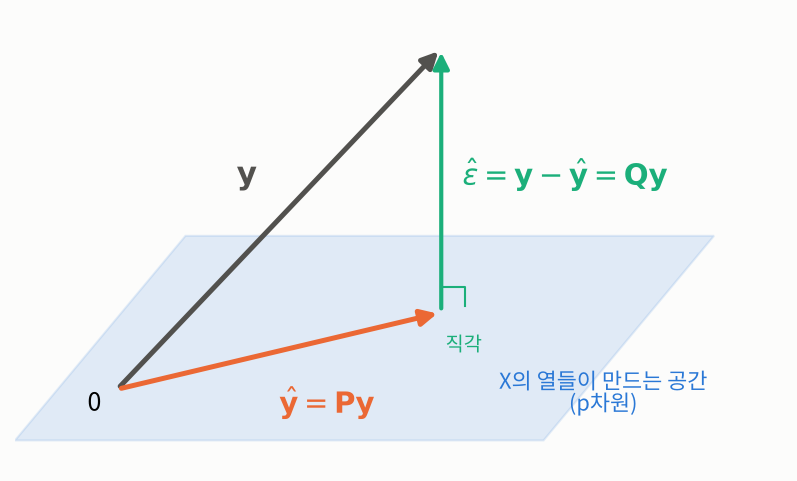

## 들어가며

지금까지 최소제곱법을 "잔차의 제곱합을 가장 작게 만드는 계수를 찾는 일"로 다루었습니다. 이번 글에서는 같은 일을 그림으로 다시 보겠습니다. 관측값 $n$개를 모은 벡터 $\mathbf{y}$를 $n$차원 공간의 한 점으로 보면, 최소제곱법은 그 점에서 어떤 평면으로 **수직으로 내리는 일**, 즉 **직교 사영**(orthogonal projection)이 됩니다.

이 관점이 쓸모 있는 이유는, [1.3](03-matrix-form-and-least-squares.qmd)과 [1.4](04-properties.qmd)에서 계산으로 얻은 사실들이 그림 하나로 설명되기 때문입니다. 그리고 아직 남아 있는 두 질문, 즉 오차의 분산 $\sigma^2$를 어떻게 추정하는지와 모델이 데이터를 얼마나 설명하는지에도 같은 그림이 답을 줍니다.

## 벡터공간과 직교

먼저 필요한 개념을 짧게 정리하겠습니다. 자세한 내용은 [선형대수학](../../../math/linear-algebra/index.qmd)을 참고하시기 바랍니다.

::: {.callout-note icon=false .callout-definition}
### 정의 1.5.1 (부분공간과 차원)
$\mathbb{R}^n$의 부분집합 $W$가 다음 두 조건을 만족하면 **부분공간**(subspace)이라고 합니다.

- $\mathbf{u}, \mathbf{v} \in W$이면 $\mathbf{u} + \mathbf{v} \in W$,
- $\mathbf{u} \in W$, $c \in \mathbb{R}$이면 $c\,\mathbf{u} \in W$.

$W$의 모든 원소를 일차독립인 벡터 $\mathbf{a}_1, \ldots, \mathbf{a}_k \in W$의 일차결합 $c_1\mathbf{a}_1 + \cdots + c_k\mathbf{a}_k$로 나타낼 수 있을 때 이 벡터들을 $W$의 **기저**(basis)라고 합니다. 기저의 원소 개수는 기저를 어떻게 고르든 같으며, 이를 $W$의 **차원** $\dim(W)$라고 합니다.
:::

선형 모델에서 가장 중요한 부분공간은 디자인 매트릭스 $\mathbf{X}$의 열들의 일차결합 전체, 즉 $\{\mathbf{X}\boldsymbol\beta : \boldsymbol\beta \in \mathbb{R}^p\}$입니다. 이것을 $\mathbf{X}$의 **열공간**(column space)이라고 합니다. 선형 예측자의 벡터 $\mathbf{X}\boldsymbol\beta$는 $\boldsymbol\beta$를 무엇으로 고르든 이 공간 안에 있습니다. 완전 계수 조건 $\mathrm{rank}(\mathbf{X}) = p$는 이 공간의 차원이 $p$라는 뜻입니다.

::: {.callout-note icon=false .callout-definition}
### 정의 1.5.2 (직교와 직교여공간)
- 같은 차원의 두 벡터가 $\mathbf{a}^t\mathbf{b} = \sum_i a_i b_i = 0$이면 **직교**(orthogonal)한다고 합니다.
- $\mathbf{a}^t\mathbf{a} = 1$이면 **정규화**(normalized)되어 있다고 합니다. 0이 아닌 벡터는 $\mathbf{a}/\sqrt{\mathbf{a}^t\mathbf{a}}$로 정규화할 수 있습니다. 서로 직교하고 각각 정규화된 기저를 **정규직교기저**(orthonormal basis)라고 합니다.
- 두 부분공간 $W_1, W_2$의 모든 원소끼리 직교하면 두 부분공간이 직교한다고 합니다.
- 부분공간 $W$의 모든 원소와 직교하는 벡터 전체 $W^\perp := \{\mathbf{u} \in \mathbb{R}^n : \mathbf{u}^t\mathbf{v} = 0 \text{ for all } \mathbf{v} \in W\}$를 $W$의 **직교여공간**(orthogonal complement)이라고 합니다. $\dim(W) = p$이면 $\dim(W^\perp) = n - p$입니다.
:::

## 사영 행렬

점 $\mathbf{y}$를 부분공간에 수직으로 내리는 일은 행렬 곱셈 하나로 할 수 있습니다.

::: {.callout-note icon=false .callout-definition}
### 정의 1.5.3 (사영 행렬)
$n \times n$ 행렬 $\mathbf{P}$가

$$\mathbf{P}^2 = \mathbf{P} \quad (\text{멱등}), \qquad \mathbf{P}^t = \mathbf{P} \quad (\text{대칭})$$

을 만족하면 **사영 행렬**(projection matrix)이라고 합니다. $\mathbf{P}$의 열공간을 $W_{\mathbf{P}}$라 할 때, $\mathbf{P}\mathbf{u}$는 $\mathbf{u}$를 $W_{\mathbf{P}}$에 사영한 벡터이고, $\dim(W_{\mathbf{P}}) = \mathrm{rank}(\mathbf{P})$입니다.
:::

멱등 조건 $\mathbf{P}^2 = \mathbf{P}$는 "이미 바닥에 내려온 점을 다시 내려도 그대로"라는 뜻이고, 대칭 조건은 비스듬히가 아니라 **수직으로** 내린다는 것을 보장합니다.

::: {.callout-important icon=false .callout-satz}
### 정리 1.5.4 (사영 행렬의 성질)
1. $n > p$이고 $\mathrm{rank}(\mathbf{A}) = p$인 $n \times p$ 행렬 $\mathbf{A}$에 대해 $\mathbf{P} = \mathbf{A}(\mathbf{A}^t\mathbf{A})^{-1}\mathbf{A}^t$는 $\mathbf{A}$의 열공간으로의 사영 행렬입니다.
2. 사영 행렬 $\mathbf{P}$의 고윳값은 0 또는 1이고, $\mathrm{rank}(\mathbf{P}) = \mathrm{tr}(\mathbf{P})$입니다. 계수가 $p$이면 고윳값 1이 $p$개, 0이 $n-p$개입니다.
3. $\mathbf{P}$가 부분공간 $W$로의 사영 행렬이면, $W$의 원소 $\mathbf{u}$에 대해 $\mathbf{P}\mathbf{u} = \mathbf{u}$이고 $W^\perp$의 원소 $\mathbf{u}$에 대해 $\mathbf{P}\mathbf{u} = \mathbf{0}$입니다. 그리고 $\mathbf{I} - \mathbf{P}$는 $W^\perp$로의 사영 행렬입니다.
4. 두 사영 행렬이 $\mathbf{P}\mathbf{Q} = \mathbf{Q}\mathbf{P} = \mathbf{0}$을 만족하면, 두 행렬의 열공간은 서로 직교합니다.
:::

::: {.callout-tip collapse="true" icon=false .callout-beweis}
### 증명
1. $\mathbf{P}^t = \mathbf{A}\big((\mathbf{A}^t\mathbf{A})^{-1}\big)^t\mathbf{A}^t = \mathbf{P}$이고, $\mathbf{P}^2 = \mathbf{A}(\mathbf{A}^t\mathbf{A})^{-1}\mathbf{A}^t\mathbf{A}(\mathbf{A}^t\mathbf{A})^{-1}\mathbf{A}^t = \mathbf{P}$입니다. $\mathbf{P}\mathbf{u} = \mathbf{A}\big((\mathbf{A}^t\mathbf{A})^{-1}\mathbf{A}^t\mathbf{u}\big)$이므로 $\mathbf{P}$의 열공간은 $\mathbf{A}$의 열공간에 들어 있고, $\mathbf{P}\mathbf{A} = \mathbf{A}$이므로 거꾸로도 들어 있습니다.
2. $\mathbf{P}\mathbf{v} = \lambda\mathbf{v}$, $\mathbf{v} \ne \mathbf{0}$이면 $\lambda\mathbf{v} = \mathbf{P}\mathbf{v} = \mathbf{P}^2\mathbf{v} = \lambda^2\mathbf{v}$이므로 $\lambda^2 = \lambda$, 즉 $\lambda \in \{0, 1\}$입니다. 대칭행렬의 계수는 0이 아닌 고윳값의 개수이고 대각합은 고윳값의 합이므로, 둘 다 고윳값 1의 개수와 같습니다.
3. $\mathbf{u} \in W$이면 $\mathbf{u} = \mathbf{P}\mathbf{w}$인 $\mathbf{w}$가 있어 $\mathbf{P}\mathbf{u} = \mathbf{P}^2\mathbf{w} = \mathbf{u}$입니다. $\mathbf{u} \in W^\perp$이면 $\mathbf{P}\mathbf{u}$는 $W$에 있으면서 $\|\mathbf{P}\mathbf{u}\|^2 = \mathbf{u}^t\mathbf{P}^t\mathbf{P}\mathbf{u} = \mathbf{u}^t(\mathbf{P}\mathbf{u}) = 0$이므로 $\mathbf{P}\mathbf{u} = \mathbf{0}$입니다. $\mathbf{I} - \mathbf{P}$는 대칭이고 $(\mathbf{I} - \mathbf{P})^2 = \mathbf{I} - 2\mathbf{P} + \mathbf{P}^2 = \mathbf{I} - \mathbf{P}$이며, 앞의 두 사실로부터 $W^\perp$의 원소는 그대로 두고 $W$의 원소는 0으로 보냅니다.
4. 두 열공간의 원소를 $\mathbf{P}\mathbf{a}$, $\mathbf{Q}\mathbf{b}$로 쓰면 $(\mathbf{P}\mathbf{a})^t(\mathbf{Q}\mathbf{b}) = \mathbf{a}^t\mathbf{P}\mathbf{Q}\mathbf{b} = 0$입니다. $\square$
:::

## 예측 행렬과 잔차 행렬

정리 1.5.4의 1번에서 $\mathbf{A}$ 자리에 디자인 매트릭스 $\mathbf{X}$를 넣으면, 낯익은 식이 나옵니다.

::: {.callout-note icon=false .callout-definition}
### 정의 1.5.5 (예측 행렬과 잔차 행렬)
완전 계수인 디자인 매트릭스 $\mathbf{X}$에 대해

$$\mathbf{P} := \mathbf{X}(\mathbf{X}^t\mathbf{X})^{-1}\mathbf{X}^t, \qquad \mathbf{Q} := \mathbf{I} - \mathbf{P}$$

를 각각 **예측 행렬**(prediction matrix)과 **잔차 행렬**(residual matrix)이라고 합니다.
:::

이름의 이유는 바로 보입니다.

$$\hat{\mathbf{y}} = \mathbf{X}\hat{\boldsymbol\beta} = \mathbf{X}(\mathbf{X}^t\mathbf{X})^{-1}\mathbf{X}^t\mathbf{y} = \mathbf{P}\mathbf{y}, \qquad \hat{\boldsymbol\varepsilon} = \mathbf{y} - \hat{\mathbf{y}} = \mathbf{Q}\mathbf{y}$$

예측 행렬은 $\mathbf{y}$를 예측값으로, 잔차 행렬은 $\mathbf{y}$를 잔차로 보냅니다. 많은 책에서는 $\mathbf{y}$에 모자(hat)를 씌운다는 뜻에서 예측 행렬을 **햇 행렬**(hat matrix) $\mathbf{H}$라고 부릅니다. [수리적 데이터 분석과 통계적 추론 3.3절](../../../ds-ai/data-analysis-inference/03-linear-models/03-projection.qmd)도 그 이름을 씁니다.

정리 1.5.4에 의해 $\mathbf{P}$는 $\mathbf{X}$의 $p$차원 열공간으로의 사영 행렬이고, $\mathbf{Q}$는 그 $(n-p)$차원 직교여공간으로의 사영 행렬입니다. 그리고 $\mathbf{P}\mathbf{Q} = \mathbf{P} - \mathbf{P}^2 = \mathbf{0}$이므로 두 공간은 직교합니다.

{fig-alt="최소제곱법을 사영으로 나타낸 개념도. 옅은 파란 평행사변형은 X의 열들이 만드는 p차원 공간이다. 원점 0에서 평면 위로 솟은 회색 화살표 y가 있고, 원점에서 평면 안의 한 점까지 주황색 화살표 ŷ = Py가 있다. ŷ의 끝에서 y의 끝까지 초록색 화살표 ε̂ = y − ŷ = Qy가 평면에 수직으로 서 있고, 그 밑동에 직각 표시가 있다." width=70%}

그림에서 평면은 $\mathbf{X}$의 열공간입니다. 선형 예측자 $\mathbf{X}\boldsymbol\beta$는 $\boldsymbol\beta$를 어떻게 고르든 이 평면 위의 점이므로, 최소제곱법은 **평면 위의 점 가운데 $\mathbf{y}$에 가장 가까운 점**을 찾는 일입니다. 잔차 제곱합 $\sum_i \hat\varepsilon_i^2$이 바로 $\mathbf{y}$와 그 점 사이의 거리의 제곱이기 때문입니다. 그리고 가장 가까운 점은 수직으로 내린 발입니다. 평면 위의 다른 점 $\mathbf{v}$를 고르면, $\mathbf{y} - \hat{\mathbf{y}}$가 평면에 수직이므로 피타고라스 정리에 의해

$$\|\mathbf{y} - \mathbf{v}\|^2 = \|\mathbf{y} - \hat{\mathbf{y}}\|^2 + \|\hat{\mathbf{y}} - \mathbf{v}\|^2 \ge \|\mathbf{y} - \hat{\mathbf{y}}\|^2$$

이 되기 때문입니다. 이것이 정리 1.3.6의 증명에서 대수적으로 본 사실의 기하학적인 모습입니다.

사영의 성질은 회귀의 말로 옮길 수 있습니다.

- $\mathbf{P}^2 = \mathbf{P}$: 예측값 $\hat{\mathbf{y}}$를 반응변수로 삼아 같은 디자인 매트릭스로 다시 회귀하면, 같은 추정값 $\hat{\boldsymbol\beta}$와 같은 예측값을 얻습니다. 이미 평면 위에 있는 점은 사영해도 그대로이기 때문입니다.
- $\mathbf{P}\mathbf{Q} = \mathbf{0}$: 잔차 $\hat{\boldsymbol\varepsilon}$을 반응변수로 삼아 다시 회귀하면, 추정값도 예측값도 모두 0이 됩니다. 잔차는 평면에 수직이라, 평면에 내린 그림자가 원점 하나뿐이기 때문입니다.

연비 데이터($n = 32$, $p = 2$)로 확인해 보겠습니다.

```python
import numpy as np
import pandas as pd

url = "https://raw.githubusercontent.com/vincentarelbundock/Rdatasets/master/csv/datasets/mtcars.csv"
cars = pd.read_csv(url)
y = (1 / cars["mpg"]).to_numpy()
X = np.column_stack([np.ones(len(y)), cars["wt"] * 1000])
n, p = X.shape

P = X @ np.linalg.inv(X.T @ X) @ X.T        # 예측 행렬 (n x n)
Q = np.eye(n) - P                           # 잔차 행렬
y_hat, res = P @ y, Q @ y

print(f"n = {n}, p = {p}")
print("P^2 = P ?", np.allclose(P @ P, P), "  P' = P ?", np.allclose(P.T, P))
print("trace(P) =", round(np.trace(P), 10), "  trace(Q) =", round(np.trace(Q), 10))
eig = np.linalg.eigvalsh(P)
print("고윳값이 1인 개수:", np.sum(np.isclose(eig, 1)), "  0인 개수:", np.sum(np.isclose(eig, 0)))
print("PQ = 0 ?", np.allclose(P @ Q, 0))
print(f"y_hat^t res = {y_hat @ res:.1e},  X^t res = {X.T @ res}")
print(f"y_hat의 평균 = {y_hat.mean():.6f},  y의 평균 = {y.mean():.6f}")

refit = lambda v: np.linalg.solve(X.T @ X, X.T @ v)
print("y로 적합    :", refit(y))
print("y_hat로 적합:", refit(y_hat))
print("res로 적합  :", refit(res))
```

```
n = 32, p = 2
P^2 = P ? True   P' = P ? True
trace(P) = 2.0   trace(Q) = 30.0
고윳값이 1인 개수: 2   0인 개수: 30
PQ = 0 ? True
y_hat^t res = 8.1e-17,  X^t res = [1.34267597e-15 4.90629759e-12]
y_hat의 평균 = 0.054227,  y의 평균 = 0.054227
y로 적합    : [6.16894286e-03 1.49376942e-05]
y_hat로 적합: [6.16894286e-03 1.49376942e-05]
res로 적합  : [-2.16273813e-17  1.97640859e-20]
```

$10^{-15}$, $10^{-17}$ 같은 값들은 컴퓨터의 소수 계산에서 생긴 반올림 오차로, 이론적으로는 모두 정확히 0입니다. 예측 행렬의 대각합이 2, 잔차 행렬의 대각합이 30이라는 것은 각각 $p$와 $n - p$입니다.

## 기하학이 알려 주는 성질들

그림에서 바로 읽히는 사실들을 정리해 두겠습니다.

::: {.callout-important icon=false .callout-satz}
### 정리 1.5.6 (최소제곱 추정의 기하학적 성질)
1. 반응 벡터는 $\mathbf{y} = \hat{\mathbf{y}} + \hat{\boldsymbol\varepsilon}$으로 나뉘고, $\hat{\mathbf{y}}$는 $\mathbf{X}$의 열공간에, $\hat{\boldsymbol\varepsilon}$은 그 직교여공간에 있습니다.
2. 예측값과 잔차는 직교합니다. 즉 $\hat{\mathbf{y}}^t\hat{\boldsymbol\varepsilon} = \sum_i \hat y_i \hat\varepsilon_i = 0$입니다.
3. 잔차는 디자인 매트릭스의 모든 열과 직교합니다. 즉 $\mathbf{X}^t\hat{\boldsymbol\varepsilon} = \mathbf{0}$입니다.

모델에 절편이 있으면 다음도 성립합니다.

4. 잔차의 합은 0입니다. 즉 $\sum_i \hat\varepsilon_i = 0$입니다.
5. 예측값의 평균은 반응의 평균과 같습니다. 즉 $\bar{\hat y} = \bar{y}$입니다.
6. 추정된 회귀 평면은 데이터의 무게중심을 지납니다. 즉 $\bar{x}_j = \frac{1}{n}\sum_i x_{ij}$에 대해 $\bar{y} = \hat\beta_0 + \hat\beta_1\bar{x}_1 + \cdots + \hat\beta_k\bar{x}_k$입니다.

마지막으로, 오차가 정규분포를 따르면 $\hat{\mathbf{y}}$와 $\hat{\boldsymbol\varepsilon}$은 서로 독립입니다.
:::

::: {.callout-tip collapse="true" icon=false .callout-beweis}
### 증명
1은 정의 1.5.5와 정리 1.5.4에서 바로 나옵니다. 2는 $\hat{\mathbf{y}}^t\hat{\boldsymbol\varepsilon} = \mathbf{y}^t\mathbf{P}^t\mathbf{Q}\mathbf{y} = \mathbf{y}^t\mathbf{P}\mathbf{Q}\mathbf{y} = 0$입니다. 3은 $\mathbf{X}^t\mathbf{Q} = \mathbf{X}^t - \mathbf{X}^t\mathbf{X}(\mathbf{X}^t\mathbf{X})^{-1}\mathbf{X}^t = \mathbf{0}$이기 때문입니다. 절편이 있으면 $\mathbf{X}$의 첫 열이 $\mathbf{1}$이므로 3에서 4가 나오고, $\mathbf{y} = \hat{\mathbf{y}} + \hat{\boldsymbol\varepsilon}$의 성분을 모두 더하면 5가 나옵니다. 6은 5의 좌변을 $\bar{\hat y} = \frac{1}{n}\sum_i \mathbf{x}_i^t\hat{\boldsymbol\beta}$로 풀어 쓴 것입니다.

독립성은 다음과 같이 이해할 수 있습니다. 오차가 정규분포이면 $(\hat{\mathbf{y}}, \hat{\boldsymbol\varepsilon}) = (\mathbf{P}\mathbf{y}, \mathbf{Q}\mathbf{y})$는 함께 정규분포를 따르고, 그 공분산은 $\mathbf{P}(\sigma^2\mathbf{I})\mathbf{Q}^t = \sigma^2\mathbf{P}\mathbf{Q} = \mathbf{0}$입니다. 함께 정규분포를 따르는 확률변수들은 상관이 없으면 독립입니다. $\square$
:::

4~6은 기초 통계학에서 최소제곱 직선에 대해 보았던 성질, 즉 잔차의 합이 0이고 직선이 $(\bar{x}, \bar{y})$를 지난다는 것을 공변량이 여러 개인 경우로 넓힌 것입니다. [1.3](03-matrix-form-and-least-squares.qmd)의 원점 통과 회귀에서 보았듯, 절편이 없으면 4~6은 일반적으로 성립하지 않습니다.

### 차원을 세어 보기

사영의 관점에서는 각 행렬과 벡터의 크기와 계수를 세는 일이 중요해집니다. 관측값 30개, 공변량 5개(서로 일차종속이 아님)인 모델을 예로 들어 보겠습니다.

| | 절편이 있을 때 ($p = 6$) | 절편이 없을 때 ($p = 5$) |
|:--|:--|:--|
| $\mathbf{y}$, $\boldsymbol\varepsilon$ | $30 \times 1$, 계수 1 | $30 \times 1$, 계수 1 |
| $\mathbf{X}$ | $30 \times 6$, 계수 6 | $30 \times 5$, 계수 5 |
| $\boldsymbol\beta$ | $6 \times 1$, 계수 1 | $5 \times 1$, 계수 1 |
| $\mathbf{X}^t\mathbf{X}$ | $6 \times 6$, 계수 6 | $5 \times 5$, 계수 5 |
| $\mathbf{P} = \mathbf{X}(\mathbf{X}^t\mathbf{X})^{-1}\mathbf{X}^t$ | $30 \times 30$, 계수 6 | $30 \times 30$, 계수 5 |
| $\mathbf{Q} = \mathbf{I} - \mathbf{P}$ | $30 \times 30$, 계수 24 | $30 \times 30$, 계수 25 |

예측 행렬은 $30 \times 30$짜리 큰 행렬이지만 계수는 $p$에 불과합니다. $\mathbf{y}$가 사는 30차원 공간 가운데, 모델이 "설명할 수 있는" 방향은 $p$개뿐이고 나머지 $n - p$개의 방향은 잔차의 몫이라는 뜻입니다.

## 오차 분산의 추정

이제 오차의 분산 $\sigma^2$를 추정하겠습니다. 오차 $\varepsilon_i$는 관측할 수 없으니 잔차 $\hat\varepsilon_i$로 대신하는 것이 자연스럽습니다. 그런데 잔차의 제곱합을 $n$으로 나눌까요, 다른 수로 나눌까요?

::: {.callout-important icon=false .callout-satz}
### 정리 1.5.7 (오차 분산의 추정량)
$\mathbb{E}(\boldsymbol\varepsilon) = \mathbf{0}$, $\mathrm{Cov}(\boldsymbol\varepsilon) = \sigma^2\mathbf{I}$이면

$$\hat\sigma^2 := \frac{1}{n-p}\sum_{i=1}^n \hat\varepsilon_i^2 = \frac{1}{n-p}\,\mathbf{y}^t\mathbf{Q}\mathbf{y}$$

는 $\sigma^2$의 불편추정량입니다. 반면 정규 오차에서의 최대우도 추정량

$$\hat\sigma^2_{\mathrm{ML}} := \frac{1}{n}\sum_{i=1}^n \hat\varepsilon_i^2$$

은 편향이 $\mathbb{E}(\hat\sigma^2_{\mathrm{ML}}) - \sigma^2 = -\frac{p}{n}\sigma^2$인 편향추정량입니다.
:::

::: {.callout-tip collapse="true" icon=false .callout-beweis}
### 증명
$\mathbf{Q}\mathbf{X} = \mathbf{0}$이므로 $\hat{\boldsymbol\varepsilon} = \mathbf{Q}\mathbf{y} = \mathbf{Q}(\mathbf{X}\boldsymbol\beta + \boldsymbol\varepsilon) = \mathbf{Q}\boldsymbol\varepsilon$이고, $\mathbf{Q}$가 대칭이고 멱등이므로

$$\sum_i \hat\varepsilon_i^2 = \boldsymbol\varepsilon^t\mathbf{Q}^t\mathbf{Q}\boldsymbol\varepsilon = \boldsymbol\varepsilon^t\mathbf{Q}\boldsymbol\varepsilon = \sum_{i,j} q_{ij}\varepsilon_i\varepsilon_j$$

입니다. 기대값을 취하면 $\mathbb{E}(\varepsilon_i\varepsilon_j)$는 $i = j$일 때 $\sigma^2$, 아니면 0이므로

$$\mathbb{E}\Big(\sum_i \hat\varepsilon_i^2\Big) = \sigma^2\sum_i q_{ii} = \sigma^2\,\mathrm{tr}(\mathbf{Q}) = \sigma^2(n - p)$$

입니다. 마지막 등호는 $\mathbf{Q}$가 계수 $n-p$인 사영 행렬이라는 것(정리 1.5.4의 2)에서 나옵니다. 따라서 $\mathbb{E}(\hat\sigma^2) = \sigma^2$이고 $\mathbb{E}(\hat\sigma^2_{\mathrm{ML}}) = \frac{n-p}{n}\sigma^2$입니다. $\square$
:::

왜 $n$이 아니라 $n - p$일까요? 그림을 다시 보면 이유가 보입니다. 오차 벡터 $\boldsymbol\varepsilon$은 $n$차원 공간 전체에 퍼져 있지만, 잔차 $\hat{\boldsymbol\varepsilon} = \mathbf{Q}\boldsymbol\varepsilon$은 그중 $\mathbf{X}$의 열공간에 수직인 $n - p$차원에만 있습니다. 오차 가운데 열공간 방향의 성분은 계수를 추정하는 데 "흡수"되어 예측값 속으로 사라졌기 때문입니다. 그래서 잔차의 제곱합은 오차의 제곱합보다 평균적으로 작고, 그 크기는 남아 있는 차원의 수 $n - p$에 비례합니다. 흔히 $n - p$를 잔차의 **자유도**(degrees of freedom)라고 부르고, "계수 $p$개를 추정하느라 자유도 $p$개를 썼다"고 말합니다.

절편만 있는 모델($p = 1$)에서는 $\hat y_i = \bar{y}$이므로

$$\hat\sigma^2 = \frac{1}{n-1}\sum_{i=1}^n (y_i - \bar{y})^2$$

이고, 이것은 기초 통계학의 **표본 분산**입니다. 표본 분산을 $n$이 아니라 $n - 1$로 나누는 이유가 바로 이것이었습니다. 평균 하나를 추정하느라 자유도 하나를 쓴 것입니다.

시뮬레이션으로 확인해 보겠습니다. $n = 10$, $p = 3$처럼 관측값에 비해 계수가 많을수록 차이가 잘 보입니다.

```python
import numpy as np

rng = np.random.default_rng(1557)
n, sigma2 = 10, 4.0
x1, x2 = rng.uniform(0, 1, n), rng.uniform(0, 1, n)
X = np.column_stack([np.ones(n), x1, x2])            # p = 3
p = X.shape[1]
Q = np.eye(n) - X @ np.linalg.inv(X.T @ X) @ X.T

sse = np.empty(20000)
for r in range(20000):
    y = X @ np.array([1.0, 2.0, -1.0]) + rng.normal(0, np.sqrt(sigma2), n)
    sse[r] = y @ Q @ y                               # 잔차 제곱합 = y^t Q y

print(f"SSE/(n-p)의 평균: {np.mean(sse / (n - p)):.3f}   (참값 sigma^2 = {sigma2})")
print(f"SSE/n의 평균    : {np.mean(sse / n):.3f}   (이론값 (n-p)/n * sigma^2 = {(n - p) / n * sigma2})")
```

```
SSE/(n-p)의 평균: 3.999   (참값 sigma^2 = 4.0)
SSE/n의 평균    : 2.800   (이론값 (n-p)/n * sigma^2 = 2.8)
```

$n$으로 나눈 추정량은 평균적으로 참값의 70%밖에 되지 않습니다. 관측값이 많고 계수가 적으면 $p/n$이 작아서 두 추정량의 차이도 작아지지만, 계수가 많은 모델에서는 이 차이를 무시할 수 없습니다.

정규 오차를 가정하면 $\hat\sigma^2$의 분포까지 정확히 알 수 있습니다. 증명은 [수리통계학](../../math-stats/index.qmd)에서 다루는 도구가 필요하므로 결과만 적어 두겠습니다.

::: {.callout-important icon=false .callout-satz}
### 정리 1.5.8 (정규 오차에서 추정량들의 분포)
$\boldsymbol\varepsilon \sim \mathcal{N}(\mathbf{0}, \sigma^2\mathbf{I})$이면 다음이 성립합니다.

1. $\hat{\boldsymbol\beta} \sim \mathcal{N}\big(\boldsymbol\beta, \, \sigma^2(\mathbf{X}^t\mathbf{X})^{-1}\big)$.
2. $\dfrac{(n-p)\,\hat\sigma^2}{\sigma^2} = \dfrac{n\,\hat\sigma^2_{\mathrm{ML}}}{\sigma^2} \sim \chi^2(n-p)$.
3. $\hat{\boldsymbol\beta}$와 $\hat\sigma^2$는 서로 독립입니다.
:::

1은 [정리 1.4.1](04-properties.qmd)에서 이미 보았습니다. 2와 3은 그림으로 이해할 수 있습니다. 잔차는 $n - p$차원 공간에 사는 정규분포 벡터이므로, 그 길이의 제곱을 $\sigma^2$로 나누면 표준정규분포 $n - p$개의 제곱합처럼 행동합니다. 그리고 $\hat{\boldsymbol\beta}$는 예측값 $\hat{\mathbf{y}}$에서, $\hat\sigma^2$는 잔차 $\hat{\boldsymbol\varepsilon}$에서 계산되는데, 정리 1.5.6에서 본 것처럼 정규 오차에서는 이 둘이 독립입니다. 예측값과 잔차가 서로 직교하는 공간에 산다는 사실이 두 추정량의 독립성으로 이어지는 것입니다.

이 정리는 2장의 출발점입니다. 기초 통계학에서 정규 모집단의 평균에 대한 t-구간을 만들 때 표본 평균의 정규분포, 표본 분산의 카이제곱분포, 그리고 둘의 독립성이 필요했던 것과 똑같은 구조이기 때문입니다.

## 제곱합 분해와 결정계수

마지막으로 그림에서 피타고라스 정리를 한 번 더 쓰겠습니다. $\hat{\mathbf{y}}$와 $\hat{\boldsymbol\varepsilon}$이 직교하므로, $\mathbf{y} = \hat{\mathbf{y}} + \hat{\boldsymbol\varepsilon}$의 길이의 제곱은 두 조각의 길이의 제곱의 합입니다.

::: {.callout-important icon=false .callout-satz}
### 정리 1.5.9 (제곱합 분해)
1. 언제나 다음이 성립합니다.

$$\underbrace{\sum_{i=1}^n y_i^2}_{\mathrm{SST}^*} = \underbrace{\sum_{i=1}^n (y_i - \hat y_i)^2}_{\mathrm{SSE}} + \underbrace{\sum_{i=1}^n \hat y_i^2}_{\mathrm{SSM}^*}, \qquad \text{즉 } \mathbf{y}^t\mathbf{y} = \hat{\boldsymbol\varepsilon}^t\hat{\boldsymbol\varepsilon} + \hat{\mathbf{y}}^t\hat{\mathbf{y}}.$$

2. 모델에 절편이 있으면 다음도 성립합니다.

$$\underbrace{\sum_{i=1}^n (y_i - \bar{y})^2}_{\mathrm{SST}} = \underbrace{\sum_{i=1}^n (y_i - \hat y_i)^2}_{\mathrm{SSE}} + \underbrace{\sum_{i=1}^n (\hat y_i - \bar{y})^2}_{\mathrm{SSM}}$$

여기서 SST는 전체 제곱합(sum of squares total), SSE는 오차 제곱합(sum of squares error), SSM은 모델 제곱합(sum of squares model)입니다. 1의 별표는 평균을 빼지 않은 제곱합이라는 표시입니다.
:::

::: {.callout-tip collapse="true" icon=false .callout-beweis}
### 증명
1은 $\mathbf{y}^t\mathbf{y} = (\hat{\mathbf{y}} + \hat{\boldsymbol\varepsilon})^t(\hat{\mathbf{y}} + \hat{\boldsymbol\varepsilon}) = \hat{\mathbf{y}}^t\hat{\mathbf{y}} + 2\hat{\mathbf{y}}^t\hat{\boldsymbol\varepsilon} + \hat{\boldsymbol\varepsilon}^t\hat{\boldsymbol\varepsilon}$에서 정리 1.5.6의 2를 쓰면 됩니다.

2는 $\mathbf{y} - \bar{y}\mathbf{1} = (\hat{\mathbf{y}} - \bar{y}\mathbf{1}) + \hat{\boldsymbol\varepsilon}$으로 나누어 같은 계산을 합니다. 교차항은 $(\hat{\mathbf{y}} - \bar{y}\mathbf{1})^t\hat{\boldsymbol\varepsilon} = \hat{\mathbf{y}}^t\hat{\boldsymbol\varepsilon} - \bar{y}\,\mathbf{1}^t\hat{\boldsymbol\varepsilon}$인데, 첫째 항은 언제나 0이고 둘째 항은 절편이 있으면 정리 1.5.6의 4에 의해 0입니다. $\square$
:::

보통 쓰는 것은 평균을 뺀 2번 분해입니다. "반응이 평균에서 얼마나 흩어져 있는가"(SST)를 "모델로 설명되는 흩어짐"(SSM)과 "설명되지 않고 남는 흩어짐"(SSE)으로 나눈 것입니다. 그러면 설명된 몫의 비율로 모델의 설명력을 잴 수 있습니다.

::: {.callout-note icon=false .callout-definition}
### 정의 1.5.10 (결정계수)
절편이 있는 선형 모델에서

$$R^2 := \frac{\mathrm{SSM}}{\mathrm{SST}} = 1 - \frac{\mathrm{SSE}}{\mathrm{SST}}$$

를 **결정계수**(coefficient of determination)라고 합니다. 정리 1.5.9에 의해 $0 \le R^2 \le 1$입니다.
:::

[기초 통계학 정의 4.5.3](../../basic-stats/04-two-variables/05-least-squares.qmd)의 결정계수와 같은 식이고, 공변량이 하나이면 기초 통계학 정리 4.5.4에 의해 $R^2 = r^2$입니다. 공변량이 여러 개일 때도 $R^2$는 반응과 예측값 사이의 상관계수의 제곱과 같다는 것이 알려져 있습니다.

뮌헨 임대료 데이터에서 1.2의 모델들을 비교해 보겠습니다.

```python
import numpy as np
import pyreadr
import statsmodels.formula.api as smf

rent = pyreadr.read_r("rent99.rda")["rent99"]
location = rent["location"].astype(int)
rent["glocation"] = (location == 2).astype(int)
rent["tlocation"] = (location == 3).astype(int)
rent["a"] = (rent["area"] - 70) / 10
rent["t"] = (rent["yearc"] - 1950) / 10

formulas = {
    "면적 + 연도":            "rentsqm ~ area + yearc",
    "면적 + 연도 + 위치":     "rentsqm ~ area + yearc + glocation + tlocation",
    "삼차 다항식 + 위치":     "rentsqm ~ a + I(a**2) + I(a**3) + t + I(t**2) + I(t**3)"
                              " + glocation + tlocation",
}
y = rent["rentsqm"].to_numpy()
for name, f in formulas.items():
    fit = smf.ols(f, data=rent).fit()
    sst = np.sum((y - y.mean()) ** 2)
    sse = np.sum(fit.resid ** 2)
    ssm = np.sum((fit.fittedvalues - y.mean()) ** 2)
    p = int(fit.df_model) + 1
    sigma_hat = np.sqrt(sse / (len(y) - p))
    print(f"{name}: p = {p}, SSE = {sse:.1f}, SSM = {ssm:.1f}, SSE + SSM = {sse + ssm:.1f}, "
          f"R^2 = {ssm / sst:.4f}, sigma_hat = {sigma_hat:.3f}")
print(f"SST = {np.sum((y - y.mean()) ** 2):.1f}")
```

```
면적 + 연도: p = 3, SSE = 14301.4, SSM = 3981.6, SSE + SSM = 18283.1, R^2 = 0.2178, sigma_hat = 2.155
면적 + 연도 + 위치: p = 5, SSE = 13757.5, SSM = 4525.6, SSE + SSM = 18283.1, R^2 = 0.2475, sigma_hat = 2.114
삼차 다항식 + 위치: p = 9, SSE = 12422.3, SSM = 5860.8, SSE + SSM = 18283.1, R^2 = 0.3206, sigma_hat = 2.011
SST = 18283.1
```

세 모델 모두 $\mathrm{SSE} + \mathrm{SSM}$이 SST와 정확히 같습니다. 반응이 같으니 SST는 모델과 관계없이 그대로이고, 모델이 바뀌면 그 SST를 SSE와 SSM이 나눠 갖는 비율만 달라집니다. 위치를 넣으면 $R^2$가 0.218에서 0.248로, 효과를 삼차 다항식으로 바꾸면 0.321로 오릅니다. 이에 맞춰 모델이 설명하지 못하는 ㎡당 월세의 흩어짐 $\hat\sigma$도 약 2.16유로에서 2.01유로로 줄어듭니다.

그런데 $R^2$가 0.32라는 것은 ㎡당 월세의 흩어짐 가운데 3분의 2 이상이 여전히 설명되지 않는다는 뜻이기도 합니다. 욕실과 부엌의 설비, 난방, 구역처럼 아직 넣지 않은 변수가 많고, 같은 조건의 집이라도 월세가 다른 이유는 데이터에 기록되지 않은 수많은 사정에 달려 있습니다. 개별 아파트의 월세를 정확히 맞히는 것은 어렵지만, 그래도 각 요인의 **평균적인 효과**는 꽤 정확하게 추정할 수 있습니다. 2장에서 이 "꽤 정확하게"를 신뢰구간으로 나타내 보겠습니다.

한 가지 주의할 점이 있습니다. 공변량을 추가하면 열공간이 넓어지므로, $\mathbf{y}$에서 그 공간까지의 거리인 SSE는 줄어들거나 그대로일 뿐 **절대 늘어나지 않습니다.** 그래서 $R^2$도 공변량을 넣을수록 올라가기만 합니다. 아무 의미 없는 변수를 넣어도 마찬가지입니다. 따라서 $R^2$가 높다는 것만으로 더 좋은 모델이라고 할 수는 없습니다. 모델을 고르는 더 좋은 기준은 5장에서 다룹니다.

## 정리

이번 글에서는 최소제곱법을 사영으로 다시 보았습니다.

- 최소제곱법은 반응 벡터 $\mathbf{y}$를 디자인 매트릭스의 열공간에 **직교 사영**하는 일입니다. 예측 행렬 $\mathbf{P} = \mathbf{X}(\mathbf{X}^t\mathbf{X})^{-1}\mathbf{X}^t$와 잔차 행렬 $\mathbf{Q} = \mathbf{I} - \mathbf{P}$는 각각 $p$차원 열공간과 $(n-p)$차원 직교여공간으로의 사영 행렬이고, $\hat{\mathbf{y}} = \mathbf{P}\mathbf{y}$, $\hat{\boldsymbol\varepsilon} = \mathbf{Q}\mathbf{y}$입니다.
- 예측값과 잔차는 직교하고, 잔차는 디자인 매트릭스의 모든 열과 직교합니다. 절편이 있으면 잔차의 합은 0이고 회귀 평면은 데이터의 무게중심을 지납니다.
- 오차 분산의 불편추정량은 $\hat\sigma^2 = \sum_i \hat\varepsilon_i^2/(n-p)$입니다. 잔차가 $n - p$차원 공간에만 살기 때문에 $n - p$로 나누며, 절편만 있는 모델에서는 표본 분산이 됩니다.
- 정규 오차에서 $(n-p)\hat\sigma^2/\sigma^2$는 $\chi^2(n-p)$를 따르고 $\hat{\boldsymbol\beta}$와 독립입니다.
- 절편이 있으면 $\mathrm{SST} = \mathrm{SSE} + \mathrm{SSM}$이고, 설명된 비율 $R^2 = \mathrm{SSM}/\mathrm{SST}$가 결정계수입니다. $R^2$는 공변량을 넣을수록 올라가기만 하므로 모델 선택의 기준으로는 부족합니다.

1장에서는 선형 모델을 세우고, 계수를 해석하고, 추정하고, 추정량의 성질을 살펴보았습니다. 2장에서는 정리 1.5.8을 바탕으로 회귀계수의 신뢰구간과 검정을 만들어, 추정한 효과가 우연이 아닌지 판단하는 방법을 다루겠습니다.

---

### 연결되는 개념
* $\leftarrow$ **이전 개념:** [1.4 최소제곱 추정량의 성질](04-properties.qmd)
* $\rightarrow$ **다음 개념:** 2 선형 모델에서의 추론 (추후 작성 예정)
