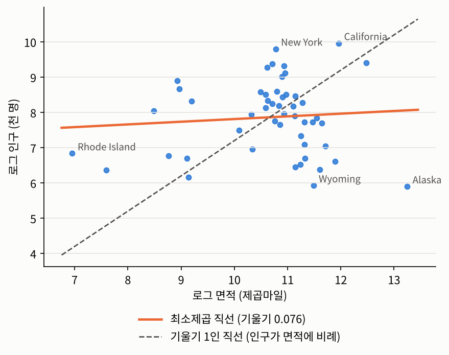

## 들어가며

[1.2](../01-linear-model/02-interpretation-and-linearity.qmd)에서 statsmodels로 선형 모델을 처음 적합했을 때, 출력 표에는 계수 추정값 말고도 `std err`, `t`, `P>|t|`, `[0.025 0.975]`라는 열이 있었습니다. 그때는 첫 열만 읽고 나머지는 2장으로 미루었습니다. 이번 글에서 그 나머지 열을 모두 읽을 수 있게 됩니다.

방법은 [기초 통계학](../../basic-stats/index.qmd)에서 정규 모집단의 평균에 대해 t-구간과 t-검정을 만들던 것과 똑같습니다. 그때는 표본 평균이 정규분포를 따르고, 표본 분산이 카이제곱분포를 따르고, 둘이 독립이라는 세 가지 사실이 필요했습니다. 선형 모델에서는 [정리 1.5.8](../01-linear-model/05-projection.qmd)이 같은 세 가지 사실을 줍니다.

## 표준오차와 t-통계량

정규 오차 $\boldsymbol\varepsilon \sim \mathcal{N}(\mathbf{0}, \sigma^2\mathbf{I})$ 아래에서 최소제곱 추정량은 $\hat{\boldsymbol\beta} \sim \mathcal{N}\big(\boldsymbol\beta, \sigma^2(\mathbf{X}^t\mathbf{X})^{-1}\big)$를 따르므로, 그 $j$번째 성분은

$$\hat\beta_j \sim \mathcal{N}\big(\beta_j, \, \sigma^2_{\hat\beta_j}\big), \qquad \sigma^2_{\hat\beta_j} := \sigma^2 \big[(\mathbf{X}^t\mathbf{X})^{-1}\big]_{jj}$$

입니다. 여기서 $[\,\cdot\,]_{jj}$는 행렬의 $j$번째 대각 성분입니다. 표준화하면 $(\hat\beta_j - \beta_j)/\sigma_{\hat\beta_j} \sim \mathcal{N}(0, 1)$이지만, $\sigma$를 모르니 이 식을 그대로 쓸 수는 없습니다. 기초 통계학에서 했던 것처럼 $\sigma$ 자리에 추정값 $\hat\sigma$를 넣습니다.

::: {.callout-note icon=false .callout-definition}
### 정의 2.1.1 (표준오차)
[정리 1.5.7](../01-linear-model/05-projection.qmd)의 오차 분산 추정값 $\hat\sigma^2 = \hat{\boldsymbol\varepsilon}^t\hat{\boldsymbol\varepsilon}/(n-p)$에 대해

$$\hat\sigma_{\hat\beta_j} := \hat\sigma \sqrt{\big[(\mathbf{X}^t\mathbf{X})^{-1}\big]_{jj}}$$

를 $\hat\beta_j$의 **표준오차**(standard error)라고 합니다.
:::

표준오차는 "이 추정값이 데이터에 따라 대략 얼마나 흔들리는가"를 데이터만으로 추정한 값입니다. 그 대가로 분포가 정규분포에서 조금 바뀝니다.

::: {.callout-important icon=false .callout-satz}
### 정리 2.1.2 (t-통계량의 분포)
정규 오차를 가정하면

$$\frac{\hat\beta_j - \beta_j}{\hat\sigma_{\hat\beta_j}} \sim t(n - p)$$

입니다. 즉 자유도가 $n - p$인 t-분포를 따릅니다.
:::

::: {.callout-tip collapse="true" icon=false .callout-beweis}
### 증명
분자와 분모를 $\sigma_{\hat\beta_j}$로 나누면

$$\frac{\hat\beta_j - \beta_j}{\hat\sigma_{\hat\beta_j}} = \frac{(\hat\beta_j - \beta_j)/\sigma_{\hat\beta_j}}{\hat\sigma/\sigma} = \frac{Z}{\sqrt{V/(n-p)}}, \qquad Z := \frac{\hat\beta_j - \beta_j}{\sigma_{\hat\beta_j}}, \quad V := \frac{(n-p)\hat\sigma^2}{\sigma^2}$$

입니다. [정리 1.5.8](../01-linear-model/05-projection.qmd)에 의해 $Z \sim \mathcal{N}(0, 1)$, $V \sim \chi^2(n-p)$이고 둘은 독립입니다. 표준정규분포를 따르는 확률변수를, 그와 독립이고 자유도 $m$인 카이제곱 확률변수를 $m$으로 나눈 값의 제곱근으로 나누면 자유도 $m$인 t-분포를 따른다는 것이 t-분포의 정의이므로 결론이 나옵니다. $\square$
:::

자유도가 $n - p$라는 점만 빼면 기초 통계학의 t-통계량과 같은 모양입니다. 자유도가 크면 t-분포는 표준정규분포와 거의 같아지므로, 관측값이 수천 개인 임대료 데이터에서는 사실상 정규분포를 쓰는 것과 차이가 없습니다. 관측값이 적을 때는 t-분포의 두꺼운 꼬리가 $\sigma$를 추정하면서 생긴 추가 불확실성을 반영해 줍니다.

## 계수 하나의 신뢰구간

t-통계량의 분포를 알면 신뢰구간은 바로 나옵니다. $t_{q}(m)$을 자유도 $m$인 t-분포의 $q$ 분위수라고 하겠습니다.

::: {.callout-important icon=false .callout-satz}
### 정리 2.1.3 (회귀계수의 신뢰구간)
정규 오차 아래에서

$$\hat\beta_j \pm t_{1-\alpha/2}(n-p) \, \hat\sigma_{\hat\beta_j}$$

는 $\beta_j$에 대한 $(1-\alpha)$ 신뢰구간입니다. 즉 $\mathbb{P}\big(\hat\beta_j - t_{1-\alpha/2}(n-p)\,\hat\sigma_{\hat\beta_j} \le \beta_j \le \hat\beta_j + t_{1-\alpha/2}(n-p)\,\hat\sigma_{\hat\beta_j}\big) = 1 - \alpha$입니다.
:::

::: {.callout-tip collapse="true" icon=false .callout-beweis}
### 증명
t-분포는 0에 대해 대칭이므로 $t_{\alpha/2}(n-p) = -t_{1-\alpha/2}(n-p)$이고, 정리 2.1.2에 의해

$$1 - \alpha = \mathbb{P}\left(-t_{1-\alpha/2}(n-p) \le \frac{\hat\beta_j - \beta_j}{\hat\sigma_{\hat\beta_j}} \le t_{1-\alpha/2}(n-p)\right)$$

입니다. 괄호 안의 부등식을 $\beta_j$에 대해 정리하면 원하는 식이 됩니다. $\square$
:::

1장의 위치 더미가 들어간 임대료 모델로 확인해 보겠습니다.

```python
import numpy as np
import pyreadr
import statsmodels.formula.api as smf
from scipy import stats

rent = pyreadr.read_r("rent99.rda")["rent99"]
location = rent["location"].astype(int)
rent["glocation"] = (location == 2).astype(int)
rent["tlocation"] = (location == 3).astype(int)

fit = smf.ols("rentsqm ~ glocation + tlocation + area + yearc", data=rent).fit()
print(fit.summary().tables[1])
```

```
==============================================================================
                 coef    std err          t      P>|t|      [0.025      0.975]
------------------------------------------------------------------------------
Intercept    -66.0144      3.509    -18.814      0.000     -72.894     -59.135
glocation      0.7358      0.080      9.205      0.000       0.579       0.893
tlocation      1.7864      0.246      7.270      0.000       1.305       2.268
area          -0.0288      0.002    -17.367      0.000      -0.032      -0.026
yearc          0.0382      0.002     21.492      0.000       0.035       0.042
==============================================================================
```

`[0.025 0.975]` 열이 각 계수의 95% 신뢰구간입니다. 면적의 계수로 이 값을 직접 계산해 보겠습니다.

```python
X = fit.model.exog                                  # 디자인 매트릭스
n, p = X.shape
sigma2_hat = np.sum(fit.resid ** 2) / (n - p)      # 1.5의 오차 분산 추정값
se = np.sqrt(sigma2_hat * np.diag(np.linalg.inv(X.T @ X)))
t_q = stats.t.ppf(0.975, df=n - p)                  # t(n-p) 분포의 0.975 분위수

j = 3                                               # area의 위치 (0: 절편)
b = fit.params.iloc[j]
print(f"n - p = {n - p}, t 분위수 = {t_q:.4f}")
print(f"area: 추정값 {b:.5f}, 표준오차 {se[j]:.5f}")
print(f"95% 신뢰구간: [{b - t_q * se[j]:.5f}, {b + t_q * se[j]:.5f}]")
print(f"검정통계량 t = {b / se[j]:.3f}, p-값 = {2 * stats.t.sf(abs(b / se[j]), df=n - p):.2e}")
```

```
n - p = 3077, t 분위수 = 1.9607
area: 추정값 -0.02880, 표준오차 0.00166
95% 신뢰구간: [-0.03206, -0.02555]
검정통계량 t = -17.367, p-값 = 1.60e-64
```

출력 표의 `std err`, 신뢰구간과 같은 값이 나옵니다. 자유도가 3077이라 t 분위수가 표준정규분포의 1.96과 거의 같다는 것도 보입니다. 마지막 줄의 t와 p-값은 잠시 뒤에 설명하겠습니다.

이 구간은 이렇게 읽습니다. 건축 연도와 위치가 같을 때 면적이 1㎡ 넓은 아파트의 ㎡당 월세가 평균적으로 얼마나 다른지, 그 참값은 95% 신뢰수준에서 $-0.032$유로와 $-0.026$유로 사이에 있다고 말할 수 있습니다. 기초 통계학에서처럼 "95%"는 이 구간 하나가 참값을 포함할 확률이 아니라, 같은 방법으로 데이터를 모아 구간을 만드는 일을 되풀이할 때 그중 95%가 참값을 포함한다는 뜻입니다.

기초 통계학과의 연결도 확인해 두겠습니다. 절편만 있는 모델 $y_i = \mu + \varepsilon_i$에서는 $[(\mathbf{X}^t\mathbf{X})^{-1}]_{11} = 1/n$이고 $\hat\sigma$는 표본 표준편차 $s$이므로, 정리 2.1.3의 구간은 $\bar{y} \pm t_{1-\alpha/2}(n-1)\, s/\sqrt{n}$, 즉 정규 모집단의 평균에 대한 t-구간이 됩니다.

```python
y = rent["rentsqm"].to_numpy()
mean_model = smf.ols("rentsqm ~ 1", data=rent).fit()     # 절편만 있는 모델
print(mean_model.conf_int().round(4))

n = len(y)
half = stats.t.ppf(0.975, df=n - 1) * y.std(ddof=1) / np.sqrt(n)
print(f"기초 통계학의 t-구간: [{y.mean() - half:.4f}, {y.mean() + half:.4f}]")
```

```
                0       1
Intercept  7.0252  7.1973
기초 통계학의 t-구간: [7.0252, 7.1973]
```

## 유의성 검정

회귀 분석에서 가장 자주 묻는 질문은 "이 공변량이 반응과 관련이 있는가"입니다. 다른 공변량이 같을 때 $x_j$가 달라져도 반응의 기대값이 달라지지 않는다면 $\beta_j = 0$이므로, 이 질문은 다음 가설로 쓸 수 있습니다.

$$H_0 : \beta_j = 0 \qquad \text{대} \qquad H_1 : \beta_j \ne 0$$

$H_0$가 참이면 정리 2.1.2에서 $\beta_j = 0$을 넣은 t-통계량

$$T_j := \frac{\hat\beta_j}{\hat\sigma_{\hat\beta_j}}$$

가 $t(n-p)$를 따릅니다. 추정값이 표준오차 몇 개만큼 0에서 떨어져 있는지를 재는 값입니다. 이 값이 0에서 많이 떨어져 있을수록 $H_0$와 맞지 않는 데이터입니다. 유의수준 $\alpha$에서 판단하는 방법은 세 가지가 있고, 셋은 언제나 같은 결론을 줍니다.

1. **기각역**: $|T_j| > t_{1-\alpha/2}(n-p)$이면 $H_0$를 기각합니다.
2. **p-값**: $H_0$ 아래에서 지금보다 더 극단적인 t-통계량이 나올 확률 $2\,\mathbb{P}\big(t(n-p) \ge |T_j|\big)$이 $\alpha$보다 작으면 $H_0$를 기각합니다. statsmodels 출력의 `P>|t|` 열이 이 값입니다.
3. **신뢰구간**: $(1-\alpha)$ 신뢰구간이 0을 포함하지 않으면 $H_0$를 기각합니다.

위의 임대료 모델에서 면적의 t-통계량은 $-17.37$로, 추정값이 0에서 표준오차 17개 이상 떨어져 있습니다. p-값은 $1.6 \times 10^{-64}$로 사실상 0이고, 신뢰구간도 0을 포함하지 않습니다. 이런 결과를 보통 "면적의 효과는 **통계적으로 유의하다**(statistically significant)"고 말합니다. 출력 표의 다른 계수들도 모두 p-값이 0.000으로 표시되어 있으니, 이 모델의 공변량은 모두 5% 유의수준에서 유의합니다.

유의성에 대해 두 가지를 덧붙이겠습니다.

- **유의하다는 것은 크다는 뜻이 아닙니다.** 면적의 효과는 1㎡당 0.03유로에 불과하지만 관측값이 3082개나 되어 아주 정확하게 추정되었기 때문에 유의합니다. 효과가 실제로 중요한지는 p-값이 아니라 신뢰구간과 내용을 보고 판단해야 합니다.
- **유의하지 않다는 것은 효과가 없다는 뜻이 아닙니다.** 데이터가 $\beta_j = 0$과 맞지 않는다고 말할 만큼 충분한 증거를 주지 못했다는 뜻일 뿐입니다. 다음 예에서 이 점을 자세히 보겠습니다.

## 검정과 신뢰구간의 쌍대성

위의 세 번째 방법은 사실 우연이 아닙니다. 검정과 신뢰구간 사이에는 더 일반적인 관계가 있습니다. 가설을 $H_0 : \beta_j = b$처럼 0이 아닌 값 $b$로 바꿔도, $H_0$ 아래에서

$$\frac{\hat\beta_j - b}{\hat\sigma_{\hat\beta_j}} \sim t(n-p)$$

이므로 똑같이 검정할 수 있습니다.

::: {.callout-important icon=false .callout-satz}
### 정리 2.1.4 (검정과 신뢰구간의 쌍대성)
1. **신뢰구간에서 검정으로**: $H_0 : \beta_j = b$를 유의수준 $\alpha$로 검정할 때, $(1-\alpha)$ 신뢰구간이 $b$를 포함하지 않으면 기각하는 검정은 위의 t-검정과 같습니다.
2. **검정에서 신뢰구간으로**: 유의수준 $\alpha$의 t-검정이 $H_0 : \beta_j = b$를 기각하지 않는 값 $b$를 모두 모은 집합

$$\{\, b : H_0 : \beta_j = b \text{가 기각되지 않음} \,\}$$

은 정리 2.1.3의 $(1-\alpha)$ 신뢰구간입니다.
:::

::: {.callout-tip collapse="true" icon=false .callout-beweis}
### 증명
두 주장 모두 다음 동치에서 나옵니다.

$$\left|\frac{\hat\beta_j - b}{\hat\sigma_{\hat\beta_j}}\right| \le t_{1-\alpha/2}(n-p) \quad \Longleftrightarrow \quad \hat\beta_j - t_{1-\alpha/2}(n-p)\,\hat\sigma_{\hat\beta_j} \le b \le \hat\beta_j + t_{1-\alpha/2}(n-p)\,\hat\sigma_{\hat\beta_j}$$

왼쪽은 "$H_0 : \beta_j = b$가 기각되지 않는다", 오른쪽은 "$b$가 신뢰구간 안에 있다"입니다. $\square$
:::

그러니까 신뢰구간은 **데이터와 맞는 모든 값의 목록**입니다. 구간 안의 값은 어느 것을 가설로 세워도 기각되지 않고, 구간 밖의 값은 모두 기각됩니다. 그래서 신뢰구간 하나가 수많은 검정의 결과를 한꺼번에 알려 줍니다.

### 예: 미국 주의 면적과 인구

1975년 무렵 미국 50개 주의 인구(천 명)와 면적(제곱마일) 데이터로 확인해 보겠습니다.[^states] 면적이 넓은 주일수록 인구도 많을까요? 면적과 인구는 모두 오른쪽으로 크게 치우친 변수라서 양쪽에 로그를 취해 모델을 세웁니다.

$$\log(\text{인구}_i) = \beta_0 + \beta_1 \log(\text{면적}_i) + \varepsilon_i$$

[1.2](../01-linear-model/02-interpretation-and-linearity.qmd)에서 본 곱셈 모형으로 돌려 쓰면 $\text{인구} = e^{\beta_0}\cdot\text{면적}^{\beta_1}\cdot e^{\varepsilon}$이므로, $\beta_1$은 "면적이 1% 넓으면 인구가 대략 $\beta_1$% 많다"는 **탄력성**(elasticity)으로 읽을 수 있습니다. 특히 $\beta_1 = 1$이면 인구가 면적에 비례하는, 즉 인구 밀도가 주마다 같은 경우이고, $\beta_1 = 0$이면 면적과 인구가 관계없는 경우입니다.

```python
import numpy as np
import pandas as pd
import statsmodels.formula.api as smf

url = "https://raw.githubusercontent.com/vincentarelbundock/Rdatasets/master/csv/datasets/state.x77.csv"
states = pd.read_csv(url)
states["log_pop"] = np.log(states["Population"])    # 인구 (천 명)
states["log_area"] = np.log(states["Area"])         # 면적 (제곱마일)

fit = smf.ols("log_pop ~ log_area", data=states).fit()
print(f"n = {int(fit.nobs)}, R^2 = {fit.rsquared:.4f}")
print(fit.params.round(4))
print("99% 신뢰구간:")
print(fit.conf_int(alpha=0.01).round(4))
for b in [0, 1]:
    test = fit.t_test(f"log_area = {b}")
    print(f"H0: 기울기 = {b}  ->  t = {test.tvalue.item():.3f}, p-값 = {test.pvalue.item():.2e}")
```

```
n = 50, R^2 = 0.0073
Intercept    7.0514
log_area     0.0762
dtype: float64
99% 신뢰구간:
                0        1
Intercept  3.3627  10.7401
log_area  -0.2678   0.4201
H0: 기울기 = 0  ->  t = 0.594, p-값 = 5.55e-01
H0: 기울기 = 1  ->  t = -7.205, p-값 = 3.57e-09
```

{fig-alt="미국 50개 주의 로그 면적(가로축)과 로그 인구(세로축) 산점도. 점들은 넓게 흩어져 있고, 주황색 최소제곱 직선은 기울기 0.076으로 거의 수평이다. 회색 점선은 같은 중심을 지나는 기울기 1인 직선으로, 점들의 흩어짐과 맞지 않는다. 면적이 가장 작은 Rhode Island, 면적이 가장 크면서 인구는 가장 적은 Alaska, 인구가 가장 많은 California와 New York, 인구가 두 번째로 적은 Wyoming에 이름이 붙어 있다." width=75%}

기울기의 추정값은 0.076이고, 99% 신뢰구간은 $[-0.268, 0.420]$입니다. 쌍대성으로 읽으면 다음과 같습니다.

- 구간이 **0을 포함**하므로 $H_0 : \beta_1 = 0$은 1% 유의수준에서 기각되지 않습니다. 실제로 p-값은 0.555로, 5% 유의수준에서도 기각되지 않습니다. 이 데이터만으로는 "넓은 주일수록 인구가 많다"고 말할 근거가 없습니다.
- 구간이 **1을 포함하지 않으므로** $H_0 : \beta_1 = 1$은 기각됩니다. p-값은 $3.6 \times 10^{-9}$입니다. 인구가 면적에 비례한다는 가설은 데이터와 전혀 맞지 않습니다. 그림에서도 기울기 1인 점선은 점들의 흩어짐과 어긋납니다.

첫 번째 결과를 "면적은 인구와 관계가 없다"로 읽으면 안 됩니다. 신뢰구간에는 0뿐 아니라 0.4처럼 꽤 큰 양의 탄력성도 들어 있습니다. 데이터가 말해 주는 것은 "탄력성은 $-0.27$에서 $0.42$ 사이 어딘가일 것이고, 그 범위 안에서는 정확히 어디인지 알 수 없다"는 것입니다. 결정계수가 0.007인 데서 보듯, 주의 인구는 면적보다 기후, 역사, 산업 같은 다른 요인에 훨씬 크게 좌우됩니다.

## 정리

이번 글에서는 회귀계수 하나에 대한 추론을 다루었습니다.

- 계수 추정량의 **표준오차**는 $\hat\sigma_{\hat\beta_j} = \hat\sigma\sqrt{[(\mathbf{X}^t\mathbf{X})^{-1}]_{jj}}$이고, 정규 오차 아래에서 $(\hat\beta_j - \beta_j)/\hat\sigma_{\hat\beta_j}$는 $t(n-p)$를 따릅니다.
- 이로부터 $(1-\alpha)$ **신뢰구간** $\hat\beta_j \pm t_{1-\alpha/2}(n-p)\,\hat\sigma_{\hat\beta_j}$와 $H_0 : \beta_j = 0$에 대한 **t-검정**이 나옵니다. 절편만 있는 모델에서는 기초 통계학의 t-구간과 같습니다.
- 기각역, p-값, 신뢰구간의 세 판단 방법은 같은 결론을 줍니다. 더 일반적으로 신뢰구간은 기각되지 않는 가설값의 모임이라는 **쌍대성**이 성립합니다.
- 유의하다는 것은 효과가 크다는 뜻이 아니고, 유의하지 않다는 것은 효과가 없다는 뜻이 아닙니다. 신뢰구간이 둘 다를 판단하는 데 더 많은 정보를 줍니다.

계수 하나만으로는 답할 수 없는 질문도 있습니다. 위치 효과는 더미 두 개로 표현되는데, "위치가 월세와 관련이 있는가"를 물으려면 두 계수를 함께 검정해야 합니다. 다음 글에서는 여러 계수에 대한 가설을 하나의 틀로 다루는 F-검정을 살펴보겠습니다.

---

### 연결되는 개념
* $\leftarrow$ **이전 개념:** [2 선형 모델에서의 추론](index.qmd)
* $\rightarrow$ **다음 개념:** [2.2 일반 선형 가설과 F-검정](02-f-test.qmd)

[^states]: R에 기본으로 들어 있는 `state.x77` 데이터로, 미국 상무부 인구조사국의 *Statistical Abstract of the United States*(1977)에 실린 자료를 모은 것입니다. 여기서는 Rdatasets 저장소에서 CSV로 내려받아 씁니다.
