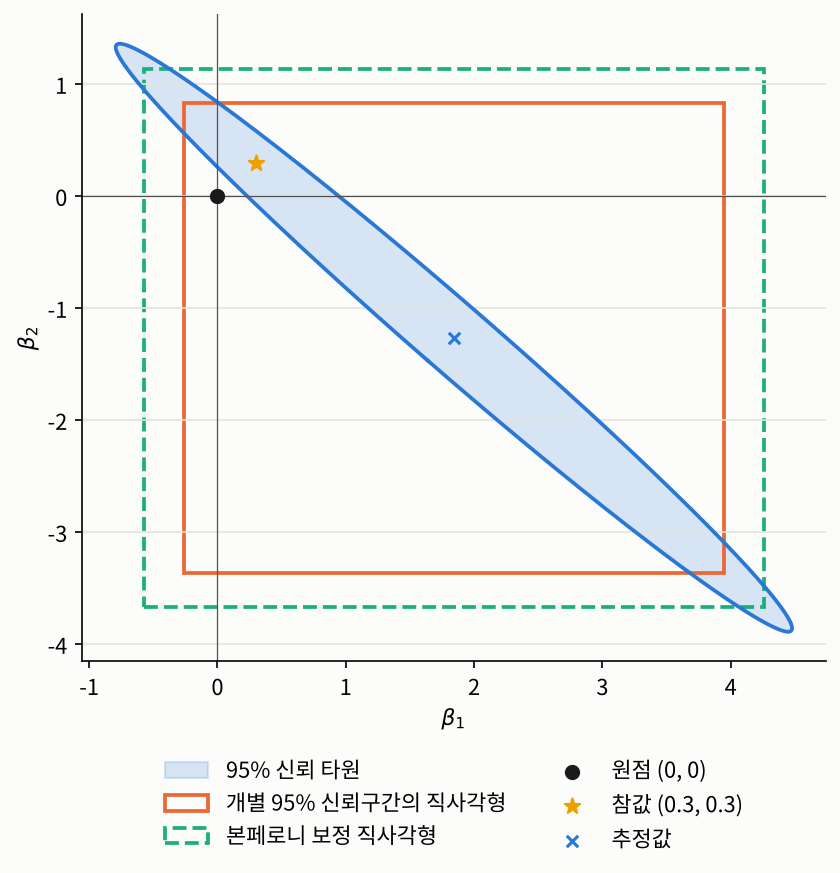

## 들어가며

[2.2](02-f-test.qmd)에서 여러 계수를 한꺼번에 검정하는 F-검정을 만들었습니다. 그런데 이런 의문이 들 수 있습니다. 위치 더미 두 개가 모두 0인지 알고 싶다면, 그냥 [2.1](01-t-test.qmd)의 t-검정을 두 번 하면 되지 않을까요? 둘 중 하나라도 유의하면 위치가 중요하다고 결론 내리면 될 것 같습니다.

이 방법에는 두 가지 문제가 있습니다. 첫째, 검정을 여러 번 하면 그중 하나쯤은 우연히 유의하게 나올 확률이 커집니다. 둘째, 계수 추정량들은 서로 상관되어 있을 수 있어서, 하나씩 보는 것과 함께 보는 것이 전혀 다른 결론을 줄 수 있습니다. 이번 글에서는 두 문제를 차례로 살펴보겠습니다.

## 다중 검정 문제

유의수준 5%의 검정은 귀무가설이 참일 때 5%의 확률로 잘못 기각합니다. 검정이 하나라면 감수할 만한 위험이지만, 검정을 20번 하면 이야기가 달라집니다. 평균적으로 $20 \times 0.05 = 1$번은 **아무 효과가 없는데도** 유의하다는 결과가 나옵니다. 신뢰구간도 마찬가지로, 95% 신뢰구간을 20개 만들면 평균적으로 하나는 참값을 놓칩니다. 이것을 **다중 검정 문제**(multiple testing problem)라고 합니다.

시뮬레이션으로 확인해 보겠습니다. 관측값 100개에 반응과 **아무 관계가 없는** 공변량 20개를 넣고 선형 모델을 적합한 뒤, 20개 기울기 각각을 5% 유의수준에서 t-검정합니다. 참모형에서는 모든 기울기가 0이므로, 유의하게 나온 기울기는 모두 잘못된 결과입니다.

```python
import numpy as np
from scipy import stats

rng = np.random.default_rng(1557)
n, K, reps = 100, 20, 2000
any_rejected, any_rejected_bonf, n_rejected = 0, 0, []
for r in range(reps):
    X = np.column_stack([np.ones(n), rng.normal(size=(n, K))])   # 반응과 아무 관계 없는 공변량 20개
    y = rng.normal(size=n)                                        # 참모형: 모든 기울기가 0
    XtX_inv = np.linalg.inv(X.T @ X)
    beta_hat = XtX_inv @ X.T @ y
    resid = y - X @ beta_hat
    sigma2_hat = resid @ resid / (n - K - 1)
    t = beta_hat[1:] / np.sqrt(sigma2_hat * np.diag(XtX_inv)[1:])
    pvals = 2 * stats.t.sf(np.abs(t), df=n - K - 1)
    n_rejected.append(np.sum(pvals < 0.05))
    any_rejected += np.any(pvals < 0.05)
    any_rejected_bonf += np.any(pvals < 0.05 / K)              # 본페로니 보정

print(f"한 번의 분석에서 '유의한' 기울기 수의 평균: {np.mean(n_rejected):.3f}  (기대값 K * 0.05 = {K * 0.05})")
print(f"하나라도 유의하게 나온 비율: {any_rejected / reps:.3f}  (독립이라면 1 - 0.95^20 = {1 - 0.95**K:.3f})")
print(f"본페로니 보정 후 하나라도 유의한 비율: {any_rejected_bonf / reps:.3f}")
```

```
한 번의 분석에서 '유의한' 기울기 수의 평균: 0.984  (기대값 K * 0.05 = 1.0)
하나라도 유의하게 나온 비율: 0.568  (독립이라면 1 - 0.95^20 = 0.642)
본페로니 보정 후 하나라도 유의한 비율: 0.049
```

분석 한 번에 평균 약 1개의 기울기가 "유의하게" 나오고, 2000번의 분석 가운데 절반이 넘는 57%에서 적어도 하나의 기울기가 유의하게 나왔습니다. 20개의 공변량을 넣고 유의한 것만 골라서 보고하면, 반응과 아무 관계없는 변수를 절반 넘는 확률로 "발견"하게 되는 것입니다.

검정들이 서로 독립이라면 이 비율은 $1 - 0.95^{20} \approx 0.64$가 되어야 합니다. 시뮬레이션의 0.57이 그보다 조금 작은 것은, 20개의 t-통계량이 같은 $\hat\sigma$를 분모로 나눠 쓰기 때문에 서로 완전히 독립은 아니기 때문입니다. 그래도 5%와는 비교할 수 없이 큰 값입니다.

## 본페로니 보정

이 문제를 막는 가장 간단한 방법은 검정 하나하나의 유의수준을 낮추는 것입니다. 얼마나 낮추면 될까요? 다음 부등식이 답을 줍니다.

::: {.callout-important icon=false .callout-satz}
### 정리 2.3.1 (본페로니 부등식)
사건 $A_1, \ldots, A_K$에 대해, 이 사건들이 서로 독립인지, 서로소인지와 관계없이

$$\mathbb{P}\Big(\bigcup_{j=1}^K A_j\Big) \le \sum_{j=1}^K \mathbb{P}(A_j)$$

가 성립합니다.
:::

확률론의 기본 성질인 합집합의 확률에 대한 부등식으로, 겹치는 부분을 여러 번 세면 실제 확률보다 커질 수는 있어도 작아질 수는 없다는 뜻입니다. 이제 $A_j$를 "$\beta_j$에 대한 신뢰구간이 참값을 포함하지 않는 사건"으로 두겠습니다. 그러면 $\bigcup_j A_j$는 "적어도 하나의 구간이 참값을 놓치는 사건"이고, 그 여사건은 "모든 구간이 참값을 포함하는 사건"입니다.

::: {.callout-important icon=false .callout-satz}
### 정리 2.3.2 (본페로니 보정)
계수 $K$개 각각에 대해 신뢰수준 $1 - \alpha/K$의 신뢰구간을 만들면, $K$개의 구간이 **모두** 참값을 포함할 확률은 적어도 $1 - \alpha$입니다. 마찬가지로 $K$개의 검정을 각각 유의수준 $\alpha/K$로 하면, 귀무가설이 모두 참일 때 하나라도 잘못 기각할 확률은 $\alpha$ 이하입니다.
:::

::: {.callout-tip collapse="true" icon=false .callout-beweis}
### 증명
구간마다 $\mathbb{P}(A_j) = \alpha/K$이므로 정리 2.3.1에 의해

$$\mathbb{P}\Big(\bigcap_{j=1}^K A_j^c\Big) = 1 - \mathbb{P}\Big(\bigcup_{j=1}^K A_j\Big) \ge 1 - \sum_{j=1}^K \frac{\alpha}{K} = 1 - \alpha$$

입니다. 검정에 대해서도 $A_j$를 "$j$번째 귀무가설을 잘못 기각하는 사건"으로 두면 같은 계산이 됩니다. $\square$
:::

위의 시뮬레이션 마지막 줄이 본페로니 보정을 적용한 결과입니다. 기울기 20개를 각각 유의수준 $0.05/20 = 0.0025$로 검정하자, 하나라도 잘못 유의하게 나온 비율이 4.9%로 5% 안에 들어왔습니다.

본페로니 보정은 사건들의 관계를 전혀 쓰지 않기 때문에 어떤 경우에도 성립하지만, 그 대가로 **보수적**(conservative)입니다. 실제 오류 확률이 $\alpha$보다 꽤 작을 수 있고, 그만큼 진짜 효과를 놓치기도 쉽습니다. 이를 개선한 방법으로 홀름–본페로니(Holm–Bonferroni) 방법이 있고, "기각한 것들 가운데 잘못 기각한 것의 비율"인 거짓 발견율(false discovery rate)을 통제하는 벤야미니–호흐베르크(Benjamini–Hochberg) 방법도 널리 쓰입니다. 파이썬에서는 `statsmodels.stats.multitest.multipletests`로 이런 보정을 할 수 있습니다.

실제 선형 모델 분석에서는 다중 검정 문제가 생각보다 덜 주목받는 편입니다. 출력 표의 p-값을 하나하나 읽으면서 보정 없이 해석하는 일이 흔합니다. 그러니 공변량이 많은 모델에서 p-값이 0.03인 계수 하나를 발견했다면, 그것이 여러 번 시도한 끝에 나온 우연일 수 있다는 점을 늘 염두에 두어야 합니다.

## 신뢰 타원

이제 두 번째 문제로 넘어가겠습니다. 계수 두 개에 대해 "두 참값이 함께 들어 있을 만한 영역"을 만들고 싶다고 해 보겠습니다. 가장 쉬운 방법은 계수마다 신뢰구간을 만들어 두 구간으로 이루어진 **직사각형**을 쓰는 것입니다. 본페로니 보정을 하면 이 직사각형은 적어도 $1 - \alpha$의 확률로 두 참값을 함께 포함합니다.

하지만 더 좋은 방법이 있습니다. [2.1](01-t-test.qmd)에서 신뢰구간은 기각되지 않는 가설값의 모임이라는 쌍대성을 보았습니다. 같은 생각을 [2.2](02-f-test.qmd)의 F-검정에 적용하면, 여러 계수를 동시에 감싸는 영역이 나옵니다.

::: {.callout-important icon=false .callout-satz}
### 정리 2.3.3 (동시 신뢰영역)
정규 오차 아래에서

$$\Big\{ \mathbf{b} \in \mathbb{R}^a : (\mathbf{A}\hat{\boldsymbol\beta} - \mathbf{b})^t \big[\mathbf{A}(\mathbf{X}^t\mathbf{X})^{-1}\mathbf{A}^t\big]^{-1} (\mathbf{A}\hat{\boldsymbol\beta} - \mathbf{b}) \le a\,\hat\sigma^2\,F_{1-\alpha}(a, n-p) \Big\}$$

은 $\mathbf{A}\boldsymbol\beta$에 대한 $(1-\alpha)$ 동시 신뢰영역입니다. 특히 $\mathbf{A} = \mathbf{I}_p$로 두면

$$\Big\{ \mathbf{b} \in \mathbb{R}^p : (\hat{\boldsymbol\beta} - \mathbf{b})^t (\mathbf{X}^t\mathbf{X}) (\hat{\boldsymbol\beta} - \mathbf{b}) \le p\,\hat\sigma^2\,F_{1-\alpha}(p, n-p) \Big\}$$

은 계수 벡터 전체에 대한 $(1-\alpha)$ 신뢰영역입니다.
:::

::: {.callout-tip collapse="true" icon=false .callout-beweis}
### 증명
부등식은 $H_0 : \mathbf{A}\boldsymbol\beta = \mathbf{b}$에 대한 [정리 2.2.2](02-f-test.qmd)의 F-통계량이 $F_{1-\alpha}(a, n-p)$ 이하라는 것, 즉 이 가설이 기각되지 않는다는 것과 같습니다. 참값 $\mathbf{b} = \mathbf{A}\boldsymbol\beta$에서는 F-통계량이 정확히 $F(a, n-p)$를 따르므로, 참값이 이 영역에 들어갈 확률은 $1 - \alpha$입니다. $\square$
:::

부등식의 왼쪽은 $\mathbf{b}$에 대한 이차식이므로, 이 영역은 2차원에서는 **타원**, 더 높은 차원에서는 타원체(ellipsoid)입니다. 그래서 **신뢰 타원**(confidence ellipse)이라고 부릅니다. 타원의 방향과 길쭉한 정도는 행렬 $\mathbf{A}(\mathbf{X}^t\mathbf{X})^{-1}\mathbf{A}^t$의 고유벡터와 고윳값이 정합니다. 계수 추정량끼리 상관이 없으면 축에 나란한 타원이 되고, 상관이 강할수록 비스듬하고 가늘어집니다.

### 예: 강하게 상관된 두 공변량

신뢰 타원과 직사각형의 차이가 가장 극적으로 드러나는 것은 두 공변량이 강하게 상관되어 있을 때입니다. 가상의 데이터를 만들어 보겠습니다. 관측값 200개에 상관계수가 0.99인 두 공변량 $x_1, x_2$를 만들고, 참모형 $y = 1 + 0.3x_1 + 0.3x_2 + \varepsilon$, $\varepsilon \sim \mathcal{N}(0, 2^2)$에서 반응을 만듭니다. 두 공변량 모두 실제로 반응에 영향을 주는 경우입니다.

```python
import numpy as np
import pandas as pd
import statsmodels.formula.api as smf

rng = np.random.default_rng(1557)
n, rho = 200, 0.99
cov = np.array([[1.0, rho], [rho, 1.0]])
x = rng.multivariate_normal([0.0, 0.0], cov, size=n)       # 상관계수 0.99인 두 공변량
y = 1.0 + 0.3 * x[:, 0] + 0.3 * x[:, 1] + rng.normal(0, 2.0, size=n)
sim = pd.DataFrame({"y": y, "x1": x[:, 0], "x2": x[:, 1]})

fit = smf.ols("y ~ x1 + x2", data=sim).fit()
print(fit.summary().tables[1])
joint = fit.f_test("x1 = 0, x2 = 0")
print(f"H0: beta1 = beta2 = 0  ->  F = {float(joint.fvalue):.3f}, p-값 = {float(joint.pvalue):.4f}")
```

```
==============================================================================
                 coef    std err          t      P>|t|      [0.025      0.975]
------------------------------------------------------------------------------
Intercept      0.8732      0.153      5.717      0.000       0.572       1.174
x1             1.8429      1.069      1.724      0.086      -0.265       3.950
x2            -1.2637      1.064     -1.188      0.236      -3.362       0.835
==============================================================================
H0: beta1 = beta2 = 0  ->  F = 7.060, p-값 = 0.0011
```

얼핏 모순처럼 보이는 결과가 나왔습니다. $x_1$과 $x_2$의 기울기는 각각 p-값이 0.086, 0.236으로 5% 유의수준에서 둘 다 유의하지 않습니다. 그런데 "두 기울기가 모두 0"이라는 가설은 p-값 0.001로 분명히 기각됩니다. 하나하나는 반응과 관련이 있다고 말할 수 없는데, 함께 보면 적어도 하나는 관련이 있다는 것입니다. 추정값도 이상합니다. 참값은 둘 다 0.3인데 추정값은 1.84와 $-1.26$입니다.

신뢰구간과 신뢰 타원을 함께 계산해 보면 무슨 일이 일어나는지 알 수 있습니다.

```python
from scipy import stats

print("개별 95% 신뢰구간:")
print(fit.conf_int(alpha=0.05).loc[["x1", "x2"]].round(3))
print("본페로니 보정 95% 신뢰구간 (각각 97.5%):")
print(fit.conf_int(alpha=0.05 / 2).loc[["x1", "x2"]].round(3))

# 신뢰 타원: (b_hat - b)^t [A (X^t X)^{-1} A^t]^{-1} (b_hat - b) <= a * sigma2_hat * F_{0.95}(a, n - p)
X = fit.model.exog
n, p = X.shape
A = np.array([[0, 1, 0], [0, 0, 1]])
M = np.linalg.inv(A @ np.linalg.inv(X.T @ X) @ A.T)
sigma2_hat = fit.scale                           # statsmodels가 계산한 sigma^2 추정값
bound = 2 * sigma2_hat * stats.f.ppf(0.95, 2, n - p)
b_hat = fit.params[["x1", "x2"]].to_numpy()
for name, b in [("원점 (0, 0)", np.array([0.0, 0.0])), ("참값 (0.3, 0.3)", np.array([0.3, 0.3]))]:
    q = (b_hat - b) @ M @ (b_hat - b)
    print(f"{name}: 이차형식 {q:.2f}, 경계 {bound:.2f} -> {'타원 안' if q <= bound else '타원 밖'}")
print(f"두 추정량의 상관계수: {fit.cov_params().loc['x1', 'x2'] / np.sqrt(fit.cov_params().loc['x1', 'x1'] * fit.cov_params().loc['x2', 'x2']):.4f}")
print(f"x1 + x2 계수 합의 추정값: {b_hat.sum():.3f}")
```

```
개별 95% 신뢰구간:
        0      1
x1 -0.265  3.950
x2 -3.362  0.835
본페로니 보정 95% 신뢰구간 (각각 97.5%):
        0      1
x1 -0.571  4.257
x2 -3.667  1.140
원점 (0, 0): 이차형식 65.15, 경계 28.07 -> 타원 밖
참값 (0.3, 0.3): 이차형식 9.98, 경계 28.07 -> 타원 안
두 추정량의 상관계수: -0.9880
x1 + x2 계수 합의 추정값: 0.579
```

{fig-alt="가로축 β1, 세로축 β2 평면에 세 영역이 그려져 있다. 파란 95퍼센트 신뢰 타원은 왼쪽 위(약 -0.8, 1.3)에서 오른쪽 아래(약 4.4, -3.9)로 비스듬히 뻗은 매우 가는 타원이다. 주황 실선 직사각형(개별 95퍼센트 신뢰구간)과 초록 점선 직사각형(본페로니 보정)은 이 타원을 감싸는 큰 상자로, 둘 다 원점을 포함한다. 검은 점으로 표시한 원점 (0, 0)은 두 직사각형 안에 있지만 타원 바깥에 있고, 노란 별로 표시한 참값 (0.3, 0.3)은 타원 안에 있다. 파란 x로 표시한 추정값 (1.84, -1.26)은 타원의 가운데에 있다." width=75%}

그림에서 무슨 일이 일어났는지 보입니다.

- 두 추정량의 상관계수가 $-0.988$입니다. 두 공변량이 거의 같이 움직이기 때문에, 데이터는 "$x_1$의 효과"와 "$x_2$의 효과"를 따로 구분하지 못합니다. $\beta_1$을 크게 잡고 $\beta_2$를 그만큼 작게 잡아도 예측값이 거의 달라지지 않습니다. 그래서 각 계수의 표준오차가 1 이상으로 크고, 추정값 1.84와 $-1.26$은 참값 0.3에서 멀리 떨어져 있습니다.
- 반면 **두 효과의 합**은 잘 정해집니다. 추정값 $1.843 - 1.264 = 0.579$는 참값의 합 0.6에 가깝습니다. 타원이 $\beta_1 + \beta_2 \approx 0.6$인 대각선 방향으로만 가늘게 뻗어 있는 것이 이 때문입니다.
- 두 직사각형은 타원을 감싸면서 타원 바깥의 넓은 영역까지 포함합니다. 원점 $(0, 0)$이 그런 곳입니다. 직사각형으로 보면 원점은 "데이터와 맞는 값"이지만, 타원으로 보면 원점은 데이터와 맞지 않습니다. 원점에서는 두 효과의 합이 0인데, 데이터는 합이 0.6 근처라고 강하게 말하고 있기 때문입니다. 개별 t-검정은 직사각형, 결합 F-검정은 타원의 판단과 같습니다.

이 결과가 이 데이터에서만 우연히 일어난 일은 아닌지, 같은 설정에서 데이터를 2000번 새로 만들어 확인해 보겠습니다.

```python
rng = np.random.default_rng(1557)
reps, count = 2000, 0
for r in range(reps):
    x = rng.multivariate_normal([0.0, 0.0], cov, size=n)
    y = 1.0 + 0.3 * x[:, 0] + 0.3 * x[:, 1] + rng.normal(0, 2.0, size=n)
    f = smf.ols("y ~ x1 + x2", data=pd.DataFrame({"y": y, "x1": x[:, 0], "x2": x[:, 1]})).fit()
    individual_ns = (f.pvalues[["x1", "x2"]] > 0.05).all()
    joint_sig = float(f.f_test("x1 = 0, x2 = 0").pvalue) < 0.05
    count += individual_ns and joint_sig
print(f"개별 검정은 둘 다 유의하지 않은데 결합 검정은 유의한 비율: {count / reps:.3f}")
```

```
개별 검정은 둘 다 유의하지 않은데 결합 검정은 유의한 비율: 0.871
```

이 설정에서는 열에 아홉 가까이 같은 일이 생깁니다. 공변량끼리 강하게 상관되어 있을 때 계수 하나하나의 t-검정만 보고 "이 변수들은 반응과 관계가 없다"고 결론 내리면 크게 틀릴 수 있다는 뜻입니다. 이 현상은 4장에서 **다중공선성**(multicollinearity)이라는 이름으로 다시 다룹니다.

## 정리

이번 글에서는 여러 계수를 동시에 다룰 때의 문제를 살펴보았습니다.

- 검정을 여러 번 하면 우연히 유의한 결과가 나올 확률이 커집니다. 아무 관계없는 공변량 20개를 넣으면 절반 넘는 확률로 적어도 하나가 "유의하게" 나옵니다. 이것이 **다중 검정 문제**입니다.
- **본페로니 보정**은 검정 $K$개 각각의 유의수준을 $\alpha/K$로 낮추어, 하나라도 잘못 기각할 확률을 $\alpha$ 이하로 묶습니다. 어떤 경우에도 성립하지만 보수적입니다.
- F-검정과 신뢰영역의 쌍대성으로 여러 계수를 동시에 감싸는 **신뢰 타원**을 만들 수 있습니다. 타원의 모양은 추정량들의 공분산 구조를 그대로 반영합니다.
- 공변량이 강하게 상관되어 있으면 계수 하나하나는 유의하지 않은데 함께 검정하면 유의할 수 있습니다. 데이터가 각 효과는 구분하지 못해도 효과의 합은 정확하게 알려 주기 때문입니다.

지금까지는 계수에 대한 추론을 다루었습니다. 다음 글에서는 시선을 계수에서 반응으로 돌려, 새 관측값을 예측하고 그 불확실성을 구간으로 나타내 보겠습니다.

---

### 연결되는 개념
* $\leftarrow$ **이전 개념:** [2.2 일반 선형 가설과 F-검정](02-f-test.qmd)
* $\rightarrow$ **다음 개념:** [2.4 예측과 예측구간](04-prediction.qmd)
