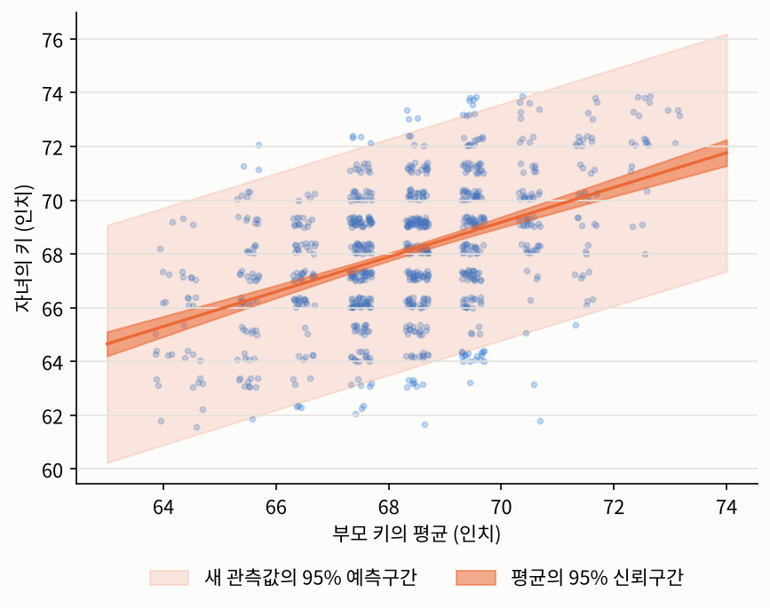

## 들어가며

[2.1](01-t-test.qmd)부터 [2.3](03-multiple-testing.qmd)까지는 계수에 대한 추론을 다루었습니다. 그런데 선형 모델을 쓰는 이유가 계수의 해석만은 아닙니다. 부모의 키로 자녀의 키를, 집의 특성으로 월세를 **예측**하는 것도 중요한 쓰임새입니다. 이번 글에서는 새 공변량 값이 주어졌을 때 반응을 예측하고, 그 예측이 얼마나 정확한지를 구간으로 나타내 보겠습니다.

예측에 앞서 질문을 분명히 해야 합니다. 부모 키의 평균이 72인치인 집안에 대해 다음 두 질문은 서로 다릅니다.

- 이런 집안의 자녀들은 **평균적으로** 키가 얼마일까요?
- 이런 집안에서 **다음에 태어날 아이 한 명**은 키가 얼마일까요?

두 질문에 대한 최선의 추측은 같지만, 그 추측이 빗나갈 수 있는 정도는 다릅니다.

## 무엇을 예측하는가

공변량 벡터가 $\mathbf{x}_0$인 새 관측값의 반응을 $y_0$라고 하겠습니다. 모델이 새 관측값에도 똑같이 성립한다면

$$y_0 = \mathbf{x}_0^t\boldsymbol\beta + \varepsilon_0, \qquad \mathbb{E}(y_0) = \mathbf{x}_0^t\boldsymbol\beta$$

이고, 새 오차 $\varepsilon_0$는 기존 데이터의 오차들과 독립이며 같은 분포 $\mathcal{N}(0, \sigma^2)$를 따른다고 가정합니다. 예측의 대상은 두 가지입니다.

1. **반응의 기대값** $\mathbb{E}(y_0) = \mathbf{x}_0^t\boldsymbol\beta$: 같은 공변량을 가진 관측값들의 평균입니다. 위의 첫 번째 질문입니다.
2. **새 관측값 자체** $y_0 = \mathbf{x}_0^t\boldsymbol\beta + \varepsilon_0$: 평균에 그 관측값만의 오차가 더해진 값입니다. 두 번째 질문입니다.

어느 경우든 점 예측은 같습니다.

$$\hat y_0 := \mathbf{x}_0^t\hat{\boldsymbol\beta}$$

새 오차 $\varepsilon_0$는 기존 데이터와 독립이라 기존 데이터로는 전혀 예측할 수 없으므로, 그 최선의 추측은 기대값 0입니다. 차이는 불확실성에서 생깁니다.

::: {.callout-important icon=false .callout-satz}
### 정리 2.4.1 (예측의 불확실성)
$\mathbb{E}(\boldsymbol\varepsilon) = \mathbf{0}$, $\mathrm{Cov}(\boldsymbol\varepsilon) = \sigma^2\mathbf{I}$이고 $\varepsilon_0$가 $\boldsymbol\varepsilon$과 독립이며 평균 0, 분산 $\sigma^2$이면

1. $\hat y_0$는 $\mathbb{E}(y_0)$의 불편추정량이고 $\mathrm{Var}(\hat y_0) = \sigma^2\,\mathbf{x}_0^t(\mathbf{X}^t\mathbf{X})^{-1}\mathbf{x}_0$입니다.
2. 예측 오차 $\hat y_0 - y_0$는 기대값이 0이고 $\mathrm{Var}(\hat y_0 - y_0) = \sigma^2\big(1 + \mathbf{x}_0^t(\mathbf{X}^t\mathbf{X})^{-1}\mathbf{x}_0\big)$입니다.
:::

::: {.callout-tip collapse="true" icon=false .callout-beweis}
### 증명
1. [정리 1.4.1](../01-linear-model/04-properties.qmd)에 의해 $\mathbb{E}(\hat y_0) = \mathbf{x}_0^t\mathbb{E}(\hat{\boldsymbol\beta}) = \mathbf{x}_0^t\boldsymbol\beta$이고, $\mathrm{Var}(\mathbf{x}_0^t\hat{\boldsymbol\beta}) = \mathbf{x}_0^t\,\mathrm{Cov}(\hat{\boldsymbol\beta})\,\mathbf{x}_0 = \sigma^2\mathbf{x}_0^t(\mathbf{X}^t\mathbf{X})^{-1}\mathbf{x}_0$입니다.
2. $\hat y_0 - y_0 = (\hat y_0 - \mathbf{x}_0^t\boldsymbol\beta) - \varepsilon_0$입니다. 첫째 항은 기존 데이터의 오차만으로 정해지고 $\varepsilon_0$는 그것과 독립이므로, 분산은 두 분산의 합 $\sigma^2\mathbf{x}_0^t(\mathbf{X}^t\mathbf{X})^{-1}\mathbf{x}_0 + \sigma^2$입니다. $\square$
:::

새 관측값의 예측 오차에는 두 가지 불확실성이 들어 있습니다.

- $\sigma^2\,\mathbf{x}_0^t(\mathbf{X}^t\mathbf{X})^{-1}\mathbf{x}_0$: **계수를 추정하면서 생긴** 불확실성입니다. 데이터가 많아지면 0으로 줄어듭니다.
- $\sigma^2$: **새 관측값 자신의 오차**에서 오는 불확실성입니다. 데이터를 아무리 많이 모아도 줄어들지 않습니다. 참 계수를 정확히 알아도 자녀 한 명의 키는 여전히 흩어지기 때문입니다.

## 두 가지 구간

정규 오차를 가정하고 $\sigma$를 $\hat\sigma$로 바꾸면, [2.1](01-t-test.qmd)과 같은 이유로 t-분포가 나옵니다.

::: {.callout-important icon=false .callout-satz}
### 정리 2.4.2 (신뢰구간과 예측구간)
정규 오차 아래에서

1. $\displaystyle \hat y_0 \pm t_{1-\alpha/2}(n-p)\,\hat\sigma\sqrt{\mathbf{x}_0^t(\mathbf{X}^t\mathbf{X})^{-1}\mathbf{x}_0}$는 기대값 $\mathbb{E}(y_0)$에 대한 $(1-\alpha)$ **신뢰구간**이고,
2. $\displaystyle \hat y_0 \pm t_{1-\alpha/2}(n-p)\,\hat\sigma\sqrt{1 + \mathbf{x}_0^t(\mathbf{X}^t\mathbf{X})^{-1}\mathbf{x}_0}$는 새 관측값 $y_0$에 대한 $(1-\alpha)$ **예측구간**(prediction interval)입니다.
:::

::: {.callout-tip collapse="true" icon=false .callout-beweis}
### 증명
정규 오차 아래에서 $\hat y_0 - \mathbb{E}(y_0)$와 $\hat y_0 - y_0$는 모두 평균 0인 정규분포를 따르고, 분산은 정리 2.4.1과 같습니다. 이 둘은 $\hat{\boldsymbol\beta}$와 $\varepsilon_0$로만 정해지는데, [정리 1.5.8](../01-linear-model/05-projection.qmd)에 의해 $\hat{\boldsymbol\beta}$는 $\hat\sigma^2$와 독립이고 $\varepsilon_0$도 기존 데이터와 독립이므로 $\hat\sigma^2$와 독립입니다. 따라서 [정리 2.1.2](01-t-test.qmd)의 증명과 같은 방법으로, 각각을 $\sigma$ 대신 $\hat\sigma$로 표준화한 값이 $t(n-p)$를 따르고, 이를 정리하면 두 구간이 나옵니다. $\square$
:::

둘 다 "구간"이지만 감싸는 대상이 다릅니다. 신뢰구간은 고정된 값 $\mathbb{E}(y_0)$를 감싸고, 예측구간은 아직 관측되지 않은 **확률변수** $y_0$를 감쌉니다. 그래서 이름도 구분합니다.

### 골턴의 키 데이터로 비교하기

골턴의 데이터로 부모 키의 평균이 64인치, 평균(68.31인치), 72인치인 세 경우를 예측해 보겠습니다. 먼저 정리 2.4.2의 식을 그대로 계산합니다.

```python
import numpy as np
import pandas as pd
import statsmodels.formula.api as smf
from scipy import stats

url = "https://raw.githubusercontent.com/vincentarelbundock/Rdatasets/master/csv/HistData/Galton.csv"
galton = pd.read_csv(url)
fit = smf.ols("child ~ parent", data=galton).fit()

X = fit.model.exog
n, p = X.shape
XtX_inv = np.linalg.inv(X.T @ X)
sigma_hat = np.sqrt(fit.scale)
t_q = stats.t.ppf(0.975, df=n - p)
print(f"sigma_hat = {sigma_hat:.3f}, 부모 키 평균 = {galton['parent'].mean():.2f}")
for x_new in [64.0, 68.31, 72.0]:
    x0 = np.array([1.0, x_new])
    y0 = x0 @ fit.params.to_numpy()
    h0 = x0 @ XtX_inv @ x0                          # x0^t (X^t X)^{-1} x0
    ci = t_q * sigma_hat * np.sqrt(h0)
    pi = t_q * sigma_hat * np.sqrt(1 + h0)
    print(f"x0 = {x_new:5.2f}: 예측 {y0:.2f}, 평균의 95% 구간 ±{ci:.3f}, 새 관측값의 95% 예측구간 ±{pi:.3f}")
```

```
sigma_hat = 2.239, 부모 키 평균 = 68.31
x0 = 64.00: 예측 65.30, 평균의 95% 구간 ±0.377, 새 관측값의 95% 예측구간 ±4.409
x0 = 68.31: 예측 68.09, 평균의 95% 구간 ±0.144, 새 관측값의 95% 예측구간 ±4.396
x0 = 72.00: 예측 70.47, 평균의 95% 구간 ±0.331, 새 관측값의 95% 예측구간 ±4.406
```

statsmodels에서는 `get_prediction`이 두 구간을 한꺼번에 계산해 줍니다. `mean_ci_lower`, `mean_ci_upper`가 기대값의 신뢰구간이고, `obs_ci_lower`, `obs_ci_upper`가 새 관측값의 예측구간입니다.

```python
new = pd.DataFrame({"parent": [64.0, 68.31, 72.0]})
frame = fit.get_prediction(new).summary_frame(alpha=0.05)
print(frame[["mean", "mean_ci_lower", "mean_ci_upper", "obs_ci_lower", "obs_ci_upper"]].round(3))
```

```
     mean  mean_ci_lower  mean_ci_upper  obs_ci_lower  obs_ci_upper
0  65.304         64.928         65.681        60.895        69.713
1  68.090         67.945         68.234        63.694        72.485
2  70.474         70.143         70.806        66.069        74.880
```

{fig-alt="골턴 데이터의 산점도 위에 최소제곱 직선과 두 띠가 그려져 있다. 진한 주황 띠(평균의 95퍼센트 신뢰구간)는 직선을 감싸는 아주 좁은 띠로, 가운데(68인치 부근)에서 가장 좁고 양 끝으로 갈수록 조금씩 넓어진다. 옅은 주황 띠(새 관측값의 95퍼센트 예측구간)는 직선 위아래로 약 4.4인치씩 벌어진 넓은 띠로, 점들의 대부분을 감싸며 폭이 거의 일정하다." width=75%}

두 구간의 차이가 확연합니다.

- 평균의 신뢰구간은 부모 키가 평균일 때 $\pm 0.14$인치에 불과합니다. 928명의 데이터로 직선을 꽤 정확하게 추정했기 때문입니다. 반면 새 아이 한 명의 예측구간은 약 $\pm 4.4$인치입니다. 부모 키가 평균인 집안의 아이도 63.7인치에서 72.5인치 사이 어디쯤일 것이라는, 꽤 넓은 범위입니다.
- 예측구간의 폭은 거의 $\pm t_{0.975}\,\hat\sigma \approx \pm 1.96 \times 2.24 \approx \pm 4.4$입니다. 이 데이터에서 예측의 불확실성은 대부분 새 관측값 자신의 오차 $\sigma^2$에서 오고, 계수 추정의 불확실성은 아주 작은 몫입니다. 데이터를 더 모으면 신뢰구간은 계속 좁아지지만 예측구간은 $\pm 1.96\sigma$ 아래로는 좁아지지 않습니다.
- 두 구간 모두 부모 키가 평균에서 멀어질수록 넓어집니다. 평균에서는 $\pm 0.14$인데 64인치에서는 $\pm 0.38$, 72인치에서는 $\pm 0.33$입니다. $\mathbf{x}_0^t(\mathbf{X}^t\mathbf{X})^{-1}\mathbf{x}_0$가 데이터의 중심에서 멀어질수록 커지기 때문입니다. 단순 회귀에서는 이 값이 $1/n + (x_0 - \bar{x})^2/S_{xx}$로, [1.4](../01-linear-model/04-properties.qmd)에서 본 절편 분산의 식에서 $\bar{x}$를 $\bar{x} - x_0$로 바꾼 것과 같습니다. 시소의 받침점에서 멀수록 크게 흔들린다는 그 이야기입니다.

마지막 점은 **외삽**에 대한 경고이기도 합니다. 데이터 범위 밖으로 멀리 나가면 구간이 넓어질 뿐 아니라, 무엇보다 그곳에서도 모델이 맞는다는 보장이 없습니다. 정리 2.4.2의 구간은 "모델이 새 관측값에도 성립한다"는 가정 위에서만 의미가 있습니다.

## 예측구간은 정말 맞을까

예측구간이 약속대로 95%의 확률로 새 관측값을 감싸는지 실제 데이터로 확인해 보겠습니다. [2.1](01-t-test.qmd)의 미국 주 데이터에서 주 하나를 빼고 나머지 49개 주로 로그 인구를 로그 면적으로 설명하는 모델을 적합한 뒤, 뺀 주의 인구에 대한 95% 예측구간을 만듭니다. 이 일을 50개 주에 대해 모두 반복하고, 예측구간이 실제 인구를 포함한 경우를 셉니다.

```python
import numpy as np
import pandas as pd
import statsmodels.formula.api as smf

url = "https://raw.githubusercontent.com/vincentarelbundock/Rdatasets/master/csv/datasets/state.x77.csv"
states = pd.read_csv(url).rename(columns={"rownames": "state"})
states["log_pop"] = np.log(states["Population"])
states["log_area"] = np.log(states["Area"])

missed = []
for i in states.index:
    fit_i = smf.ols("log_pop ~ log_area", data=states.drop(index=i)).fit()   # 주 i를 빼고 적합
    frame = fit_i.get_prediction(states.loc[[i]]).summary_frame(alpha=0.05)
    lo, hi = frame["obs_ci_lower"].iloc[0], frame["obs_ci_upper"].iloc[0]
    if not (lo <= states.loc[i, "log_pop"] <= hi):
        missed.append((states.loc[i, "state"], states.loc[i, "Population"], np.exp(lo), np.exp(hi)))

print(f"예측구간이 실제 인구를 포함한 주: {len(states) - len(missed)} / {len(states)}")
for name, pop, lo, hi in missed:
    print(f"  벗어난 주: {name}, 실제 {pop}천 명, 예측구간 [{lo:.0f}, {hi:.0f}]천 명")
```

```
예측구간이 실제 인구를 포함한 주: 48 / 50
  벗어난 주: Alaska, 실제 365천 명, 예측구간 [493, 36669]천 명
  벗어난 주: California, 실제 21198천 명, 예측구간 [322, 21179]천 명
```

50개 주 가운데 48개, 즉 96%에서 예측구간이 실제 인구를 포함했습니다. 약속한 95%와 거의 맞습니다. 구간을 벗어난 두 주는 인구가 가장 많은 California와, 면적은 가장 넓은데 인구는 가장 적은 Alaska로, 둘 다 데이터의 가장자리에 있는 주입니다.

코드에서 로그 척도의 구간 끝점에 지수함수를 취해 원래 척도(천 명)로 되돌렸습니다. 지수함수는 증가함수이므로 "$\log y_0$가 구간 $[l, u]$ 안에 있다"는 사건과 "$y_0$가 $[e^l, e^u]$ 안에 있다"는 사건은 같고, 따라서 되돌린 구간도 95% 예측구간입니다. 다만 점 예측을 되돌린 $e^{\hat y_0}$는 원래 척도에서 인구의 **기대값**이 아니라 대략 **중앙값**에 해당한다는 점은 주의해야 합니다. 지수함수가 선형이 아니라서 $\mathbb{E}(e^{\log y_0}) \ne e^{\mathbb{E}(\log y_0)}$이기 때문입니다.

구간의 폭도 눈여겨볼 만합니다. California의 예측구간은 32만 명에서 2118만 명까지로 무려 60배가 넘는 범위입니다. [2.1](01-t-test.qmd)에서 보았듯 면적은 인구를 거의 설명하지 못하므로($R^2 = 0.007$), 면적만 보고 인구를 예측하면 이 정도로밖에 말할 수 없는 것입니다. 예측구간은 모델이 얼마나 쓸모 있는 예측을 하는지 정직하게 보여 줍니다.

## 예측구간은 정규성에 더 민감합니다

마지막으로 주의할 점이 하나 있습니다. [1.4](../01-linear-model/04-properties.qmd)에서 오차가 정규분포가 아니어도 표본이 크면 $\hat{\boldsymbol\beta}$는 근사적으로 정규분포를 따른다는 것을 보았습니다. 그래서 계수의 신뢰구간이나 평균 반응의 신뢰구간은 정규성이 조금 어긋나도 표본이 크면 대체로 믿을 만합니다.

예측구간은 사정이 다릅니다. 예측 오차 $\hat y_0 - y_0$에는 새 관측값의 오차 $\varepsilon_0$가 **그대로** 들어 있고, 이것은 여러 값의 평균이 아니라 오차 하나이므로 중심극한정리의 도움을 받지 못합니다. 오차가 한쪽으로 치우친 분포라면, 데이터가 아무리 많아도 정규분포로 만든 예측구간은 한쪽 끝에서 너무 넓고 다른 쪽 끝에서 너무 좁습니다. 예측구간을 쓰기 전에는 오차의 분포 모양을 꼭 점검해야 하고, 그 방법은 4장에서 다룹니다.

## 정리

이번 글에서는 새 관측값의 예측을 다루었습니다.

- 새 공변량 $\mathbf{x}_0$에서의 점 예측은 $\hat y_0 = \mathbf{x}_0^t\hat{\boldsymbol\beta}$입니다. 반응의 **기대값**을 예측하든 **새 관측값 하나**를 예측하든 점 예측은 같습니다.
- 불확실성은 다릅니다. 기대값의 신뢰구간은 계수 추정의 불확실성 $\sigma^2\mathbf{x}_0^t(\mathbf{X}^t\mathbf{X})^{-1}\mathbf{x}_0$만 반영하고, 새 관측값의 **예측구간**은 여기에 새 오차의 분산 $\sigma^2$를 더합니다.
- 데이터가 많아지면 신뢰구간은 0으로 좁아지지만 예측구간은 $\pm 1.96\sigma$ 아래로 좁아지지 않습니다. 두 구간 모두 데이터의 중심에서 멀어질수록 넓어집니다.
- 예측구간은 모델이 새 관측값에도 성립한다는 가정과 오차의 정규성에 크게 기댑니다. 특히 정규성이 어긋나면 표본이 커져도 바로잡히지 않습니다.

2장에서는 1장의 추정량에 신뢰구간, 검정, 예측구간이라는 꼬리표를 붙였습니다. 그런데 모든 결과가 1장의 모델, 특히 공변량이 모델에 어떤 모양으로 들어가는지에 달려 있었습니다. 3장에서는 범주형 공변량과 비선형 효과를 모델에 넣는 방법을 더 자세히 살펴보겠습니다.

---

### 연결되는 개념
* $\leftarrow$ **이전 개념:** [2.3 다중 검정과 신뢰 타원](03-multiple-testing.qmd)
* $\rightarrow$ **다음 개념:** 3 설명변수 다루기 (추후 작성 예정)
