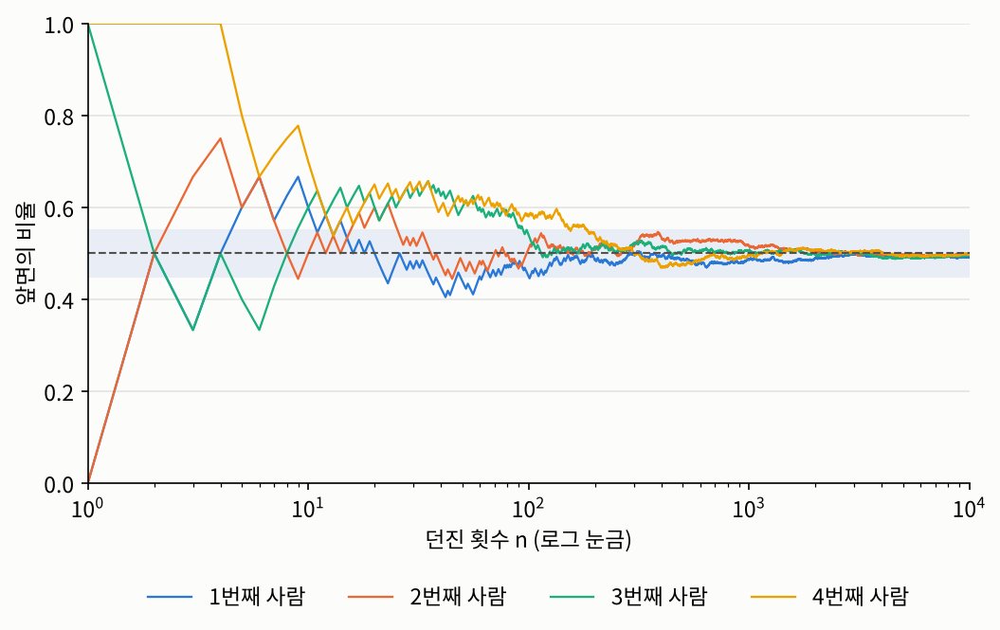

## 들어가며

[1장 소개 글](index.qmd)에서 던진 첫 번째 질문은 이것이었습니다. 박종우 씨가 동전을 끝없이 던진다면, 박종우 씨의 앞면 비율은 결국 $1/2$에 도달할까요?

이 질문은 **한 사람의 기록 전체**에 대한 질문입니다. 박종우 씨가 던진 결과는 앞면, 뒷면, 뒷면, 앞면, … 하는 하나의 무한한 기록이고, 그 기록에서 계산한 앞면 비율 $\bar{X}_1, \bar{X}_2, \bar{X}_3, \ldots$은 그냥 실수의 열입니다. 그러니 질문은 결국 "이 실수열이 $1/2$로 수렴하는가?"가 됩니다. 이번 글에서는 이 생각을 정확하게 만든 것이 **거의 확실한 수렴**(almost sure convergence)이라는 것을 보고, 동전의 앞면 비율이 실제로 그렇게 수렴한다는 것을 직접 증명해 보겠습니다.

## 네 사람의 기록 따라가기

먼저 컴퓨터로 네 사람에게 동전을 1만 번씩 던지게 하고, 각자의 앞면 비율이 어떻게 변하는지 기록해 보겠습니다. $1/2$에서 $0.05$ 이내, 즉 $[0.45, 0.55]$를 "띠"라고 부르고, 각 사람이 이 띠 밖에 **마지막으로** 있었던 시점도 함께 찾아보겠습니다.

```python
import numpy as np

rng = np.random.default_rng(1557)
people, n_max = 4, 10_000

X = rng.integers(0, 2, size=(people, n_max))      # 앞면 = 1, 뒷면 = 0
n = np.arange(1, n_max + 1)
S = X.cumsum(axis=1)                               # 앞면의 개수 S_1, ..., S_n
Xbar = S / n                                       # 앞면의 비율 X̄_1, ..., X̄_n

for j in range(people):
    # |X̄_n - 1/2| > 0.05 를 정수 연산으로: |2 S_n - n| * 10 > n
    outside = np.nonzero(np.abs(2 * S[j] - n) * 10 > n)[0]
    last = outside[-1] + 1 if len(outside) > 0 else 0
    vals = ", ".join(f"{Xbar[j, m - 1]:.4f}" for m in [10, 100, 1000, 10_000])
    print(f"{j + 1}번째 사람: X̄_n (n=10, 100, 1000, 10000) = {vals} | 띠 밖에 마지막으로 있었던 n = {last}")
```

```
1번째 사람: X̄_n (n=10, 100, 1000, 10000) = 0.6000, 0.4500, 0.4860, 0.4916 | 띠 밖에 마지막으로 있었던 n = 101
2번째 사람: X̄_n (n=10, 100, 1000, 10000) = 0.5000, 0.5100, 0.5170, 0.4971 | 띠 밖에 마지막으로 있었던 n = 45
3번째 사람: X̄_n (n=10, 100, 1000, 10000) = 0.6000, 0.5400, 0.5060, 0.4960 | 띠 밖에 마지막으로 있었던 n = 98
4번째 사람: X̄_n (n=10, 100, 1000, 10000) = 0.7000, 0.5800, 0.4960, 0.4975 | 띠 밖에 마지막으로 있었던 n = 185
```

비교를 정수 연산으로 한 것은, $0.55 - 0.5$ 같은 소수 계산이 컴퓨터 안에서 정확히 $0.05$가 되지 않아 띠의 경계에 걸친 값이 잘못 분류되는 일을 막기 위해서입니다.

{fig-alt="네 사람이 동전을 1만 번씩 던질 때 앞면 비율의 변화를 로그 눈금의 가로축 위에 그린 그림. 처음 몇십 번까지는 비율이 0에서 1 사이를 크게 오르내리지만, 수십 번에서 200번 사이에 네 선이 차례로 0.45에서 0.55 사이의 옅은 띠 안으로 들어오고, 그 뒤로는 띠 밖으로 나가지 않은 채 0.5를 나타내는 회색 점선 쪽으로 점점 모인다." width=80%}

네 사람 모두 처음에는 비율이 크게 흔들리지만, 어느 시점부터는 띠 안에 들어와서 다시는 나가지 않습니다. 그 시점은 사람마다 다릅니다. 2번째 사람은 46번째부터, 4번째 사람은 186번째부터 계속 띠 안에 있었습니다. 띠를 더 좁게, 예컨대 $0.01$로 잡으면 이 시점은 더 늦어지겠지만, 그래도 언젠가는 찾아올 것 같습니다.

물론 1만 번까지만 보고 "다시는 나가지 않는다"고 말할 수는 없습니다. 1만 1번째 이후의 일은 시뮬레이션이 알려 주지 않습니다. 끝없는 기록 전체에 대해 무언가를 말하려면 수학이 필요합니다.

## 표본점마다 하나씩, 실수열

동전을 끝없이 던진 한 사람의 기록은 $0$과 $1$로 이루어진 무한수열 하나입니다. 그래서 표본공간을 이런 수열 전체의 집합 $\Omega = \{0, 1\}^{\mathbb{N}}$으로 잡고, $\omega = (\omega_1, \omega_2, \ldots) \in \Omega$에 대해 $X_i(\omega) := \omega_i$로 두면 자연스럽습니다. 각 $X_i$가 $\mathrm{Bin}(1, \tfrac12)$를 따르고 서로 독립이 되는 확률측도 $P$가 이 위에 존재한다는 것은 측도론적 확률론에서 무한곱 측도로 보장됩니다.

이렇게 놓고 보면 표본점 $\omega$ 하나가 곧 **한 사람의 기록 전체**이고, $\omega$를 하나 고정할 때마다 실수열

$$\bar{X}_1(\omega), \bar{X}_2(\omega), \bar{X}_3(\omega), \ldots$$

이 하나 생깁니다. 위의 그림은 서로 다른 네 $\omega$에 대한 네 실수열을 그린 것입니다. 그러니 "한 사람의 앞면 비율이 결국 $1/2$에 도달하는가"는 "$\bar{X}_n(\omega) \to 1/2$인가"라는 실수열의 질문이 됩니다.

그렇다면 모든 $\omega$에 대해 $\bar{X}_n(\omega) \to 1/2$일까요? 그렇지 않습니다. 계속 앞면만 나오는 기록 $\omega = (1, 1, 1, \ldots)$에서는 $\bar{X}_n(\omega) = 1$이 모든 $n$에서 성립합니다. 앞면이 세 번에 한 번꼴로만 나오는 기록 $(1, 0, 0, 1, 0, 0, \ldots)$에서는 비율이 $1/3$으로 갑니다. 이런 기록은 $\Omega$ 안에 엄연히 존재하고, 그 수는 셀 수 없이 많습니다.

하지만 이런 기록이 실제로 나올 가능성은 어떨까요? 처음 $n$번이 모두 앞면일 확률은 $2^{-n}$이므로, 끝없이 앞면만 나올 확률은 $0$입니다. 따라서 "모든 $\omega$에 대해"를 요구하는 것은 지나치고, **확률이 $0$인 예외는 허용**하는 것이 자연스럽습니다.

::: {.callout-note icon=false .callout-definition}
### 정의 1.1.1 (거의 확실한 수렴)
$X, X_1, X_2, \ldots$를 확률공간 $(\Omega, \mathcal{A}, P)$ 위의 실수 값 확률변수라고 합시다. 다음이 성립하면 $X_n$이 $X$로 **거의 확실하게 수렴**한다(converges almost surely)고 하고, $X_n \xrightarrow{\text{a.s.}} X$로 씁니다.

$$P\Big(\big\{\omega \in \Omega : \lim_{n \to \infty} X_n(\omega) = X(\omega)\big\}\Big) = 1$$
:::

정의 안의 집합이 정말 사건인지, 즉 $\mathcal{A}$에 속하는지는 한 번 확인해 둘 만합니다. 실수열의 수렴을 $\varepsilon$-$N$ 논법으로 풀어 쓰고 $\varepsilon$을 $1/k$로 바꾸면

$$\Big\{\lim_{n \to \infty} X_n = X\Big\} = \bigcap_{k=1}^{\infty} \bigcup_{n=1}^{\infty} \bigcap_{m \ge n} \Big\{|X_m - X| \le \tfrac{1}{k}\Big\}$$

이고, 오른쪽은 사건들의 셀 수 있는 교집합과 합집합이므로 사건입니다. 각 기호는 "모든 정밀도 $1/k$에 대해", "어떤 시점 $n$이 있어서", "그 이후의 모든 $m$에서", "$1/k$ 안에 있다"로 읽으면 됩니다.

정의를 말로 옮기면, **확률 $1$로 고른 한 사람의 기록에서 $X_n(\omega)$가 실수열로서 $X(\omega)$로 수렴한다**는 뜻입니다. 극한이 거의 확실하게 유일하다는 것도 바로 나옵니다. $X_n \xrightarrow{\text{a.s.}} X$이고 $X_n \xrightarrow{\text{a.s.}} Y$이면, 두 사건 $\{X_n \to X\}$와 $\{X_n \to Y\}$의 교집합도 확률이 $1$이고, 그 위에서는 실수열의 극한이 유일하므로 $X = Y$ a.s.입니다.

## 언젠가 이후로는 계속 띠 안에

시뮬레이션에서 본 모습, 즉 "어느 시점 이후로는 다시는 띠 밖으로 나가지 않는다"를 식으로 써 보겠습니다. $\varepsilon > 0$에 대해 시점 $n$에 띠 밖에 있는 사건을

$$A_n(\varepsilon) := \{|X_n - X| > \varepsilon\}$$

라고 합시다. "어느 시점 이후로는 다시 나가지 않는다"는, 그 "어느 시점" 이전에만 띠 밖으로 나가고, 그 이후로는 띠 밖으로 나가지 않는다는 의미가 되니, "띠 밖으로 나가는 일이 **무한히 자주** 일어나지는 않는다"와 같은 말입니다. 무한히 많은 $n$에서 $A_n$이 일어나는 사건(띠 밖으로 나가는 일이 무한히 자주 일어나는 사건)은 상극한 사건

$$\limsup_{n \to \infty} A_n := \bigcap_{n=1}^{\infty} \bigcup_{m \ge n} A_m = \{\omega : \text{무한히 많은 } n \text{에 대해 } \omega \in A_n\}$$

으로 씁니다. 이제 거의 확실한 수렴은 이 사건이 일어나지 않는다, 이 사건의 확률이 0이라는 형태로 다시 표현할 수 있습니다.

::: {.callout-important icon=false .callout-satz}
### 정리 1.1.2 (거의 확실한 수렴의 특성화)
다음 세 조건은 서로 동치입니다.

1. $X_n \xrightarrow{\text{a.s.}} X$
2. 모든 $\varepsilon > 0$에 대해 $P\big(\limsup_{n} A_n(\varepsilon)\big) = 0$, 즉 $P(|X_n - X| > \varepsilon \text{ 이 무한히 자주 일어남}) = 0$
3. 모든 $\varepsilon > 0$에 대해 $P\Big(\bigcup_{m \ge n} A_m(\varepsilon)\Big) \xrightarrow[n \to \infty]{} 0$
:::

::: {.callout-tip collapse="false" icon=false .callout-beweis}
### 증명
**(1 ⇔ 2)** 실수열 $X_n(\omega)$가 $X(\omega)$로 수렴하지 않는다는 것은, 어떤 정밀도 $1/k$에 대해 무한히 많은 $n$에서 $|X_n(\omega) - X(\omega)| > 1/k$라는 뜻입니다. 따라서

$$\{X_n \to X\}^c = \bigcup_{k=1}^{\infty} \limsup_{n} A_n(1/k)$$

입니다. 1이 성립하면 왼쪽의 확률이 $0$이므로, 그 부분집합인 각 $\limsup_n A_n(1/k)$의 확률도 $0$입니다. 임의의 $\varepsilon > 0$에 대해 $1/k < \varepsilon$인 $k$를 고르면 $A_n(\varepsilon) \subset A_n(1/k)$이므로 2가 나옵니다. 거꾸로 2가 성립하면 오른쪽은 확률 $0$인 사건들의 셀 수 있는 합집합이므로 확률이 $0$이고, 1이 나옵니다.

**(2 ⇔ 3)** $B_n := \bigcup_{m \ge n} A_m(\varepsilon)$은 $n$이 커질수록 작아지는 사건의 열이고, 그 교집합이 $\limsup_n A_n(\varepsilon)$입니다. 확률측도의 위로부터의 연속성에 의해 $P(B_n) \to P(\limsup_n A_n(\varepsilon))$이므로, 2와 3은 같은 말입니다.
:::

세 번째 조건은 실전에서 가장 쓸모 있는 형태입니다. $\bigcup_{m \ge n} A_m(\varepsilon) = \{\sup_{m \ge n} |X_m - X| > \varepsilon\}$이므로, 3은

$$P\Big(\sup_{m \ge n} |X_m - X| > \varepsilon\Big) \xrightarrow[n \to \infty]{} 0$$

과 같습니다. 즉 **시점 $n$ 이후로 단 한 번이라도 띠 밖으로 나갈 확률**이 $0$으로 간다는 것입니다. 시점 $n$ 한 곳만이 아니라 **그 이후의 미래 전체**를 한꺼번에 묻고 있다는 점을 기억해 두시기 바랍니다. 다음 글에서 볼 확률수렴과 갈라지는 지점이 바로 여기입니다.

시뮬레이션의 "띠 밖에 마지막으로 있었던 시점"으로 말하면 이렇습니다. 그 시점을 $T_\varepsilon(\omega)$라고 하면, 조건 2는 $T_\varepsilon < \infty$가 확률 $1$로 성립한다는 뜻이고, 조건 3은 $P(T_\varepsilon \ge n) \to 0$이라는 뜻입니다. 시뮬레이션에서 $T_{0.05}$는 사람마다 45, 98, 101, 185로 달랐습니다. 거의 확실한 수렴은 이 시점이 유한하다는 것만 보장할 뿐, **언제인지**는 말해 주지 않습니다.

## 무한히 자주 일어나지 않게 하는 조건: 보렐-칸텔리 보조정리

정리 1.1.2에 따르면, 거의 확실한 수렴을 보이려면 "띠 밖으로 나가는 일이 무한히 자주 일어날 확률은 $0$"임을 보이면 됩니다. 사건들이 무한히 자주 일어나지 않는다는 것을 보이는 가장 간단한 도구가 보렐-칸텔리 보조정리입니다.

::: {.callout-important icon=false .callout-satz}
### 정리 1.1.3 (보렐-칸텔리 보조정리, 첫째 부분)
사건 $A_1, A_2, \ldots \in \mathcal{A}$가 $\sum_{n=1}^{\infty} P(A_n) < \infty$를 만족하면 $P(\limsup_n A_n) = 0$입니다. 사건들이 독립일 필요는 없습니다.
:::

::: {.callout-tip collapse="false" icon=false .callout-beweis}
### 증명
모든 $n$에 대해 $\limsup_k A_k \subset \bigcup_{m \ge n} A_m$이므로, 확률의 셀 수 있는 준가법성에 의해

$$P\big(\limsup_k A_k\big) \le P\Big(\bigcup_{m \ge n} A_m\Big) \le \sum_{m = n}^{\infty} P(A_m)$$

입니다. 가정에 의해 급수 $\sum_m P(A_m)$이 수렴하므로, 그 꼬리 $\sum_{m \ge n} P(A_m)$은 $n \to \infty$일 때 $0$으로 갑니다.
:::

확률들의 합이 유한하다는 것은 사건들이 일어날 "예산"이 유한하다는 것으로 생각할 수 있습니다. 예산이 유한하면 무한히 많은 사건이 일어날 수는 없다는 것이 이 보조정리의 직관입니다. 이것을 정리 1.1.2와 합치면 바로 다음을 얻습니다.

::: {.callout-important icon=false .callout-satz}
### 따름정리 1.1.4 (빨리 줄어드는 오차 확률)
모든 $\varepsilon > 0$에 대해 $\sum_{n=1}^{\infty} P(|X_n - X| > \varepsilon) < \infty$이면 $X_n \xrightarrow{\text{a.s.}} X$입니다.
:::

::: {.callout-tip collapse="false" icon=false .callout-beweis}
### 증명
정리 1.1.3을 $A_n = A_n(\varepsilon)$에 적용하면 모든 $\varepsilon > 0$에 대해 $P(\limsup_n A_n(\varepsilon)) = 0$이고, 정리 1.1.2의 조건 2가 성립합니다.
:::

여기서 중요한 것은 각 시점에서 크게 틀릴 확률이 $0$으로 가는 것만으로는 부족하고, 그 확률들의 **합이 유한할 만큼 빨리** 줄어들어야 한다는 점입니다. 오차 확률이 줄어드는 **속도**가 수렴의 종류를 가르는 셈입니다.

## 앞면 비율은 정말 1/2로 갈까요?

이제 동전의 앞면 비율이 거의 확실하게 $1/2$로 수렴한다는 것을 직접 증명해 보겠습니다. 따름정리 1.1.4를 쓰려면 $P(|\bar{X}_n - \tfrac12| > \varepsilon)$이 합이 유한할 만큼 빨리 줄어든다는 것을 보여야 합니다. 확률을 기대값으로 누르는 도구가 필요한데, 2장에서 자세히 다룰 마르코프 부등식을 먼저 빌려 오겠습니다.

::: {.callout-important icon=false .callout-satz}
### 보조정리 1.1.5 (마르코프 부등식)
실수 값 확률변수 $Y$와 실수 $r > 0$에 대해 다음이 성립합니다.

$$P(|Y| \ge \varepsilon) \le \frac{E(|Y|^r)}{\varepsilon^r} \qquad \text{모든 } \varepsilon > 0$$
:::

::: {.callout-tip collapse="false" icon=false .callout-beweis}
### 증명
사건 $\{|Y| \ge \varepsilon\}$ 위에서는 $|Y|^r \ge \varepsilon^r$이고, 그 밖에서는 $|Y|^r \ge 0$이므로 $\varepsilon^r \mathbf{1}_{\{|Y| \ge \varepsilon\}} \le |Y|^r$입니다. 양변의 기대값을 취하면 $\varepsilon^r P(|Y| \ge \varepsilon) \le E(|Y|^r)$입니다.
:::

$r = 2$로 두고 체비셰프 부등식처럼 쓰면 $P(|\bar{X}_n - \tfrac12| \ge \varepsilon) \le V(\bar{X}_n)/\varepsilon^2 = 1/(4n\varepsilon^2)$을 얻습니다. 그런데 $\sum_n 1/n = \infty$이므로 이것으로는 따름정리 1.1.4를 쓸 수 없습니다. 그래서 한 단계 더 높은 **4차 적률**을 쓰겠습니다.

::: {.callout-important icon=false .callout-satz}
### 명제 1.1.6 (동전 던지기의 강한 큰 수의 법칙)
$X_1, X_2, \ldots$가 $\mathrm{Bin}(1, \tfrac12)$를 따르는 i.i.d. 확률변수이면 다음이 성립합니다.

$$\bar{X}_n \xrightarrow{\text{a.s.}} \frac{1}{2}$$
:::

::: {.callout-tip collapse="false" icon=false .callout-beweis}
### 증명
$Y_i := X_i - \tfrac12$로 두면 $Y_i$는 $\pm\tfrac12$를 각각 확률 $\tfrac12$로 가지는 독립인 확률변수이고, $E(Y_i) = 0$, $E(Y_i^2) = \tfrac14$, $E(Y_i^4) = \tfrac{1}{16}$입니다. 또 $S_n - \tfrac{n}{2} = Y_1 + \cdots + Y_n$입니다.

**1단계: 4차 적률 계산.** 네제곱을 전개하면

$$E\Big(\big(\textstyle\sum_{i=1}^n Y_i\big)^4\Big) = \sum_{i, j, k, l = 1}^{n} E(Y_i Y_j Y_k Y_l)$$

입니다. 네 첨자 가운데 **한 번만 나타나는 첨자**가 있는 항은, 독립성에 의해 그 $Y$의 기대값 $0$이 곱해지므로 사라집니다. 남는 것은 네 첨자가 모두 같은 항($n$개, 각각 $E(Y_i^4) = \tfrac{1}{16}$)과, 서로 다른 두 첨자가 두 번씩 나타나는 항($3n(n-1)$개, 각각 $E(Y_i^2)E(Y_j^2) = \tfrac{1}{16}$)뿐입니다. 따라서

$$E\Big(\big(S_n - \tfrac{n}{2}\big)^4\Big) = \frac{n + 3n(n-1)}{16} \le \frac{3n^2}{16}$$

입니다.

**2단계: 확률 누르기.** 마르코프 부등식(보조정리 1.1.5)을 $r = 4$로 쓰면, 모든 $\varepsilon > 0$에 대해

$$P\big(|\bar{X}_n - \tfrac12| > \varepsilon\big) \le P\big(|S_n - \tfrac{n}{2}| \ge n\varepsilon\big) \le \frac{E\big((S_n - \tfrac{n}{2})^4\big)}{n^4 \varepsilon^4} \le \frac{3}{16\, n^2 \varepsilon^4}$$

입니다.

**3단계: 합이 유한함.** $\sum_n 1/n^2 < \infty$이므로 $\sum_n P(|\bar{X}_n - \tfrac12| > \varepsilon) < \infty$이고, 따름정리 1.1.4에 의해 $\bar{X}_n \xrightarrow{\text{a.s.}} \tfrac12$입니다.
:::

2차 적률로는 오차 확률이 $1/n$ 정도로만 줄어든다는 것밖에 알 수 없었지만, 4차 적률을 쓰면 $1/n^2$ 정도로 줄어든다는 것을 알 수 있었고, 그 차이가 급수의 수렴 여부를 갈랐습니다. 확률을 얼마나 정밀하게 누르느냐에 따라 얻을 수 있는 결론이 달라진다는 것은 2장의 주제이기도 합니다.

같은 논증은 $E(X_1^4) < \infty$인 i.i.d. 확률변수 전체에 그대로 통합니다. 실제로는 $E(|X_1|) < \infty$만 있으면 $\bar{X}_n \xrightarrow{\text{a.s.}} E(X_1)$이 성립하는데, 이것이 콜모고로프의 강한 큰 수의 법칙입니다. 그 증명은 훨씬 길어서 3장에서 줄기만 살펴보고, 전체 증명은 [측도론적 확률론](../../measure-prob/index.qmd)으로 미루겠습니다.

## 정리

- 확률변수의 열 $X_n$은 표본점 $\omega$마다 실수열 $X_n(\omega)$ 하나를 줍니다. **거의 확실한 수렴**은 확률이 $1$인 표본점들에서 이 실수열이 수렴한다는 것이고, 동전 던지기로 말하면 **한 사람의 끝없는 기록**을 따라갔을 때의 수렴입니다.
- 계속 앞면만 나오는 기록처럼 수렴하지 않는 표본점은 실제로 존재합니다. 그래서 "모든 $\omega$"가 아니라 "확률 $1$"을 요구합니다.
- 거의 확실한 수렴은 "띠 밖으로 나가는 일이 무한히 자주 일어나지는 않는다"와 같고, 다시 "시점 $n$ 이후로 한 번이라도 나갈 확률이 $0$으로 간다"와 같습니다. 시점 하나가 아니라 **미래 전체**를 묻는 조건입니다.
- 오차 확률의 합이 유한하면 보렐-칸텔리 보조정리에 의해 거의 확실한 수렴이 따라옵니다. 이것과 4차 적률로 동전의 앞면 비율이 거의 확실하게 $1/2$로 간다는 것을 증명했습니다.
- 통계학에서는 추정량이 참값으로 거의 확실하게 수렴할 때 **강한 일치성**(strong consistency)을 가진다고 합니다. 데이터를 하나의 긴 기록으로 계속 쌓아 가는 상황, 예컨대 하나의 긴 시뮬레이션을 계속 돌리는 상황이 이 수렴이 자연스럽게 들어맞는 곳입니다.

그런데 현실에서는 한 사람의 끝없는 기록을 볼 일이 드뭅니다. 여론조사는 1000명에게 한 번 묻고 끝납니다. 그때 궁금한 것은 "이 $n$에서 크게 틀렸을 확률"입니다. 다음 글에서는 이 질문에서 출발하는 확률수렴을 다룹니다.

---

### 연결되는 개념
* $\leftarrow$ **이전 개념:** [1 확률변수가 가까워진다는 것](index.qmd)
* $\rightarrow$ **다음 개념:** [1.2 확률수렴](02-in-probability.qmd)
