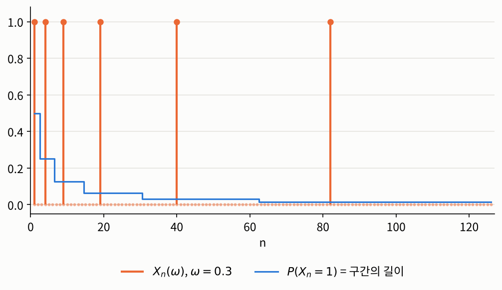

## 들어가며

[1.1](01-almost-sure.qmd)에서는 한 사람이 동전을 끝없이 던지는 기록을 따라가며 거의 확실한 수렴을 정의했습니다. 하지만 실제로 데이터를 다룰 때 우리가 보는 것은 대개 끝없는 기록이 아니라, **정해진 $n$에서 한 번 얻은 결과**입니다. 여론조사는 1000명에게 묻고 끝나고, 실험은 정해진 횟수만큼 반복하고 끝납니다.

그럴 때 궁금한 것은 "이 사람의 기록이 언젠가 $1/2$에 닿는가"가 아니라 "**지금 이 $n$에서** 크게 틀렸을 확률이 얼마나 되는가"입니다. 이번 글에서는 이 질문에서 출발하는 **확률수렴**(convergence in probability)을 정의하고, 거의 확실한 수렴과 무엇이 같고 무엇이 다른지 살펴보겠습니다.

## 만 명이 동시에 던진다면

이번에는 한 사람을 오래 따라가는 대신, 시점 $n$을 하나 정해 두고 **만 명**이 각자 동전을 $n$번씩 던지게 해 보겠습니다. 그리고 앞면 비율이 띠 $[0.45, 0.55]$ 밖에 있는 사람의 비율을 셉니다. 이 비율은 확률 $P(|\bar{X}_n - \tfrac12| > 0.05)$의 추정값이므로, 이항분포로 계산한 정확한 값과 나란히 놓아 보겠습니다. 마지막 열은 체비셰프 부등식이 주는 상한 $V(\bar{X}_n)/\varepsilon^2 = 1/(4n\varepsilon^2)$입니다.

```python
import numpy as np
from scipy.stats import binom

rng = np.random.default_rng(1557)
people, eps = 10_000, 0.05

def far(S, n):
    # |S/n - 1/2| > 0.05 를 정수 연산으로: |2S - n| * 10 > n (반올림 오차를 피하기 위해)
    return np.abs(2 * S - n) * 10 > n

print("     n | 띠 밖에 있는 사람의 비율 | 정확한 확률 | 체비셰프 상한")
for n in [10, 100, 1000, 10_000]:
    S = rng.binomial(n, 0.5, size=people)          # 각 사람이 n번 던져 얻은 앞면 수
    frac = np.mean(far(S, n))
    k = np.arange(n + 1)
    exact = binom.pmf(k, n, 0.5)[far(k, n)].sum()
    cheb = 0.25 / (n * eps**2)
    print(f"{n:>6} | {frac:>22.4f} | {exact:>11.4g} | {cheb:>12.4f}")
```

```
     n | 띠 밖에 있는 사람의 비율 | 정확한 확률 | 체비셰프 상한
    10 |                 0.7553 |      0.7539 |      10.0000
   100 |                 0.2704 |      0.2713 |       1.0000
  1000 |                 0.0008 |    0.001392 |       0.1000
 10000 |                 0.0000 |   1.267e-23 |       0.0100
```

10번씩 던진 시점에서는 열 명 중 일곱 명 넘게 띠 밖에 있지만, 1000번씩 던진 시점에서는 만 명 중 여덟 명뿐이고, 1만 번씩 던진 시점에서는 아무도 없습니다. 정확한 확률은 $n = 10000$에서 $10^{-23}$ 정도까지 떨어집니다.

체비셰프 상한은 $n = 10$과 $n = 100$에서 $1$ 이상이어서 아무 정보도 주지 않고, 그 뒤로도 정확한 값보다 훨씬 큽니다. 그래도 $n \to \infty$일 때 $0$으로 간다는 것만큼은 보장합니다. 이 상한이 얼마나 느슨한지, 그리고 더 좋은 상한은 없는지는 2장에서 다시 다룹니다.

이 실험에서 주목할 점은, 시점마다 **새로운 만 명**을 뽑았다는 것입니다. 각 줄은 서로 다른 시점의 단면일 뿐, 같은 사람을 따라간 것이 아닙니다. 그래서 이 표는 "각 시점에서 크게 틀릴 확률이 작아지는가"에는 답하지만, "한 사람이 언젠가부터 계속 띠 안에 머무는가"에는 아무 말도 하지 않습니다.

## 확률수렴

::: {.callout-note icon=false .callout-definition}
### 정의 1.2.1 (확률수렴)
$X, X_1, X_2, \ldots$를 확률공간 $(\Omega, \mathcal{A}, P)$ 위의 실수 값 확률변수라고 합시다. 모든 $\varepsilon > 0$에 대해

$$P(|X_n - X| > \varepsilon) \xrightarrow[n \to \infty]{} 0$$

이 성립하면 $X_n$이 $X$로 **확률수렴**한다(converges in probability)고 하고, $X_n \xrightarrow{P} X$로 씁니다.
:::

정의에 들어 있는 사건 $\{|X_n - X| > \varepsilon\}$은 **시점 $n$ 하나**에서 띠 밖에 있는 사건입니다. [1.1의 정리 1.1.2](01-almost-sure.qmd)에서 거의 확실한 수렴은 시점 $n$ **이후의 미래 전체**에 대한 사건 $\bigcup_{m \ge n} \{|X_m - X| > \varepsilon\}$으로 표현되었던 것과 비교해 보시기 바랍니다. 확률수렴은 매 시점의 단면만 봅니다.

통계학에서 추정량 $T_n$이 참값 $\theta$로 확률수렴할 때, $T_n$을 $\theta$의 **일치추정량**(consistent estimator)이라고 합니다. 즉 일치성이라는 말은 "표본이 충분히 크면 크게 틀릴 확률이 작다"는 뜻이고, 그 이상도 이하도 아닙니다.

두 수렴 사이의 첫 번째 관계는 정의를 나란히 놓으면 바로 보입니다.

::: {.callout-important icon=false .callout-satz}
### 정리 1.2.2 (거의 확실한 수렴은 확률수렴을 보장)
$X_n \xrightarrow{\text{a.s.}} X$이면 $X_n \xrightarrow{P} X$입니다.
:::

::: {.callout-tip collapse="false" icon=false .callout-beweis}
### 증명
$\varepsilon > 0$에 대해 $\{|X_n - X| > \varepsilon\} \subset \bigcup_{m \ge n} \{|X_m - X| > \varepsilon\}$이므로

$$P(|X_n - X| > \varepsilon) \le P\Big(\bigcup_{m \ge n} \{|X_m - X| > \varepsilon\}\Big) \xrightarrow[n \to \infty]{} 0$$

입니다. 마지막 수렴은 [정리 1.1.2](01-almost-sure.qmd)의 조건 3입니다.
:::

동전의 경우는 [명제 1.1.6](01-almost-sure.qmd)과 정리 1.2.2로 $\bar{X}_n \xrightarrow{P} \tfrac12$가 이미 나옵니다. 하지만 확률수렴만 원한다면 4차 적률까지 갈 필요 없이, 위 표의 마지막 열이 그대로 증명이 됩니다.

::: {.callout-important icon=false .callout-satz}
### 명제 1.2.3 (동전 던지기의 약한 큰 수의 법칙)
$X_1, X_2, \ldots$가 $\mathrm{Bin}(1, \tfrac12)$를 따르는 i.i.d. 확률변수이면, 모든 $\varepsilon > 0$과 모든 $n$에 대해

$$P\big(|\bar{X}_n - \tfrac12| \ge \varepsilon\big) \le \frac{1}{4n\varepsilon^2}$$

이고, 특히 $\bar{X}_n \xrightarrow{P} \tfrac12$입니다.
:::

::: {.callout-tip collapse="false" icon=false .callout-beweis}
### 증명
독립인 확률변수의 합의 분산은 분산의 합이므로 $V(S_n) = n V(X_1) = n/4$이고 $V(\bar{X}_n) = V(S_n)/n^2 = 1/(4n)$입니다. [마르코프 부등식](01-almost-sure.qmd)을 $Y = \bar{X}_n - \tfrac12$, $r = 2$로 쓰면

$$P\big(|\bar{X}_n - \tfrac12| \ge \varepsilon\big) \le \frac{E\big((\bar{X}_n - \tfrac12)^2\big)}{\varepsilon^2} = \frac{V(\bar{X}_n)}{\varepsilon^2} = \frac{1}{4n\varepsilon^2}$$

입니다. 이 식은 체비셰프 부등식 그 자체이며, 2장에서 일반적인 형태로 다시 다룹니다.
:::

## 거꾸로는 성립하지 않습니다

그렇다면 확률수렴하면 거의 확실하게도 수렴할까요? 각 시점에서 크게 틀릴 확률이 $0$으로 가는데도, 한 사람 한 사람은 끝없이 다시 크게 틀리는 일이 가능할까요? 가능합니다. 두 가지 예를 보겠습니다.

### 훑고 지나가는 빛

어두운 무대 위를 좁은 조명이 왼쪽 끝에서 오른쪽 끝까지 훑고 지나간다고 해 봅시다. 한 번 다 훑고 나면 조명의 폭을 절반으로 줄여서 다시 왼쪽 끝부터 훑습니다. 그다음에는 또 절반으로 줄여서 훑습니다. 어느 순간에도 조명을 받는 부분은 아주 좁지만, 무대 위의 **모든 지점**은 조명이 한 바퀴 돌 때마다 한 번씩, 영원히 다시 조명을 받습니다.

::: {.callout-note icon=false}
### 예제 1.2.4 (타자기 수열)
확률공간 $([0, 1), \mathcal{B}([0,1)), \lambda)$ 위에서, $[0,1)$을 2등분, 4등분, 8등분, …한 구간들의 지시함수를 차례로 늘어놓습니다.

$$X_1 = \mathbf{1}_{[0, \frac12)},\; X_2 = \mathbf{1}_{[\frac12, 1)},\; X_3 = \mathbf{1}_{[0, \frac14)},\; X_4 = \mathbf{1}_{[\frac14, \frac24)},\; X_5 = \mathbf{1}_{[\frac24, \frac34)},\; X_6 = \mathbf{1}_{[\frac34, 1)},\; X_7 = \mathbf{1}_{[0, \frac18)},\; \ldots$$

그러면 $X_n \xrightarrow{P} 0$이지만, 어떤 $\omega \in [0,1)$에서도 $X_n(\omega)$는 수렴하지 않습니다.
:::

$X_n$이 $1$이 되는 구간의 길이는 $\tfrac12, \tfrac12, \tfrac14, \tfrac14, \tfrac14, \tfrac14, \tfrac18, \ldots$로 $0$으로 갑니다. 따라서 $0 < \varepsilon < 1$에 대해 $P(|X_n - 0| > \varepsilon) = P(X_n = 1) \to 0$이고, $X_n \xrightarrow{P} 0$입니다. 한편 $\omega$를 하나 고정하면, $\omega$는 매 묶음마다 정확히 한 구간에 속하므로 $X_n(\omega) = 1$이 무한히 자주 일어나고, 나머지 $n$에서는 $X_n(\omega) = 0$입니다. $0$과 $1$을 끝없이 오가니 수렴하지 않습니다.

{fig-alt="타자기 수열을 n = 1부터 126까지 그린 그림. 파란 계단선은 X_n이 1일 확률, 즉 구간의 길이로 0.5에서 시작해 0.25, 0.125, … 로 계단처럼 내려간다. 주황색 막대는 ω = 0.3에서 X_n(ω)가 1이 되는 시점으로, n = 1, 4, 9, 19, 40, 82에 서 있다. 막대 사이의 간격은 점점 벌어지지만 막대는 계속 다시 나타난다." width=80%}

그림의 주황색 막대는 $\omega = 0.3$에서 $X_n(\omega) = 1$이 되는 시점입니다. 막대 사이의 간격은 점점 벌어지지만, 막대는 결코 끝나지 않습니다.

### 점점 드물어지는 사건

타자기 수열은 인위적으로 보일 수 있습니다. 좀 더 자연스러운 예를 보겠습니다. 매일 한 번씩 사고가 날 수 있는데, $n$번째 날에 사고가 날 확률은 $1/n$이고 날마다 독립이라고 해 봅시다. 사고가 날 확률은 날이 갈수록 줄어드니, 언젠가부터는 사고가 멈출 것 같습니다. 정말 그럴까요?

이 질문에 답하려면 보렐-칸텔리 보조정리의 나머지 절반이 필요합니다. [1.1](01-almost-sure.qmd)의 첫째 부분은 확률의 합이 유한하면 무한히 자주 일어나지 않는다고 했습니다. 둘째 부분은, 사건들이 **독립**이라면 그 반대도 성립한다고 말합니다.

::: {.callout-important icon=false .callout-satz}
### 정리 1.2.5 (보렐-칸텔리 보조정리, 둘째 부분)
사건 $A_1, A_2, \ldots$가 독립이고 $\sum_{n=1}^{\infty} P(A_n) = \infty$이면 $P(\limsup_n A_n) = 1$입니다.
:::

::: {.callout-tip collapse="false" icon=false .callout-beweis}
### 증명
여사건으로 보이겠습니다. $n \le N$에 대해, 독립성과 부등식 $1 - x \le e^{-x}$에 의해

$$P\Big(\bigcap_{m=n}^{N} A_m^c\Big) = \prod_{m=n}^{N} \big(1 - P(A_m)\big) \le \exp\Big(-\sum_{m=n}^{N} P(A_m)\Big)$$

입니다. $N \to \infty$이면 지수 안의 합이 $\infty$로 가므로, 위로부터의 연속성에 의해 $P(\bigcap_{m \ge n} A_m^c) = 0$입니다. 즉 모든 $n$에 대해 $P(\bigcup_{m \ge n} A_m) = 1$이고, 이 사건들의 교집합인 $\limsup_n A_n$도 확률이 $1$입니다.
:::

::: {.callout-note icon=false}
### 예제 1.2.6 (점점 드물어지는 사고)
$X_n \sim \mathrm{Bin}(1, \tfrac1n)$, $n \in \mathbb{N}$이 서로 독립이라고 합시다. 그러면 $X_n \xrightarrow{P} 0$이지만, $X_n$은 확률 $1$로 수렴하지 않습니다.
:::

$0 < \varepsilon < 1$에 대해 $P(|X_n| > \varepsilon) = P(X_n = 1) = \tfrac1n \to 0$이므로 $X_n \xrightarrow{P} 0$입니다. 한편 $\sum_n P(X_n = 1) = \sum_n \tfrac1n = \infty$이므로 정리 1.2.5에 의해 $X_n = 1$이 무한히 자주 일어날 확률이 $1$입니다. 마찬가지로 $\sum_n P(X_n = 0) = \sum_n (1 - \tfrac1n) = \infty$이므로 $X_n = 0$도 무한히 자주 일어날 확률이 $1$입니다. 따라서 확률 $1$로 $X_n$은 $0$과 $1$을 끝없이 오가고 수렴하지 않습니다. 사고가 날 확률은 매일 줄어들지만, 사고는 결코 완전히 멈추지 않습니다.

100만 일 동안 실제로 사고가 언제 나는지 시뮬레이션해 보겠습니다.

```python
import numpy as np

rng = np.random.default_rng(1557)
n_max = 1_000_000
n = np.arange(1, n_max + 1)
X = rng.random(n_max) < 1 / n            # X_n ~ Bin(1, 1/n), 서로 독립

hits = np.nonzero(X)[0] + 1
print(f"X_n = 1이 된 횟수: {len(hits)}")
print(f"X_n = 1이 된 n: {hits.tolist()}")
print(f"참고: 1 + 1/2 + ... + 1/n_max = {np.sum(1 / n):.2f}")
```

```
X_n = 1이 된 횟수: 22
X_n = 1이 된 n: [1, 16, 28, 47, 49, 54, 69, 95, 119, 120, 271, 351, 1362, 1981, 2051, 5060, 7194, 11316, 23650, 110420, 275966, 796505]
참고: 1 + 1/2 + ... + 1/n_max = 14.39
```

100만 일 동안 사고는 22번 났고, 마지막 사고는 79만 6505번째 날이었습니다. 사고 사이의 간격은 점점 길어지지만, 11만 번째, 27만 번째, 79만 번째 날에도 여전히 사고가 납니다. 사고 횟수의 기대값은 $\sum_{n \le 10^6} 1/n \approx 14.39$로, 날 수의 로그 정도로 아주 느리게 늘어날 뿐 멈추지 않습니다.

이 예와 [1.1의 따름정리 1.1.4](01-almost-sure.qmd)를 나란히 놓으면 교훈이 분명해집니다. 크게 틀릴 확률이 $1/n^2$처럼 합이 유한할 만큼 빨리 줄어들면 거의 확실한 수렴이 따라오지만, $1/n$처럼 느리게 줄어들면 확률수렴에 그칠 수 있습니다.

## 부분수열로 되돌아가기

확률수렴이 거의 확실한 수렴을 보장하지는 않지만, 둘이 완전히 남남인 것도 아닙니다. 타자기 수열에서 각 묶음의 첫 번째 항만 골라내면 $X_1, X_3, X_7, X_{15}, \ldots = \mathbf{1}_{[0, \frac12)}, \mathbf{1}_{[0, \frac14)}, \mathbf{1}_{[0, \frac18)}, \mathbf{1}_{[0, \frac1{16})}, \ldots$이고, 이 부분수열은 $\omega > 0$인 모든 점에서 $0$으로 수렴합니다. 이것은 우연이 아닙니다.

::: {.callout-important icon=false .callout-satz}
### 정리 1.2.7 (부분수열 정리)
1. $X_n \xrightarrow{P} X$이면, 어떤 부분수열 $(n_k)$가 있어서 $X_{n_k} \xrightarrow{\text{a.s.}} X$입니다.
2. $X_n \xrightarrow{P} X$일 필요충분조건은, 모든 부분수열 $(n_k)$가 다시 부분수열 $(n_{k_i})$를 가져서 $X_{n_{k_i}} \xrightarrow{\text{a.s.}} X$가 되는 것입니다.
:::

::: {.callout-tip collapse="false" icon=false .callout-beweis}
### 증명
**1.** 각 $k \in \mathbb{N}$에 대해 $P(|X_n - X| > \tfrac1k) \to 0$이므로, $P(|X_{n_k} - X| > \tfrac1k) < 2^{-k}$인 $n_k$를 $n_1 < n_2 < \cdots$가 되도록 고를 수 있습니다. 임의의 $\varepsilon > 0$에 대해 $\tfrac1k < \varepsilon$인 $k$부터는 $P(|X_{n_k} - X| > \varepsilon) \le P(|X_{n_k} - X| > \tfrac1k) < 2^{-k}$이므로 $\sum_k P(|X_{n_k} - X| > \varepsilon) < \infty$입니다. [따름정리 1.1.4](01-almost-sure.qmd)에 의해 $X_{n_k} \xrightarrow{\text{a.s.}} X$입니다.

**2.** ($\Rightarrow$) 부분수열 $X_{n_k}$도 $X$로 확률수렴하므로 1을 적용하면 됩니다. ($\Leftarrow$) $X_n$이 $X$로 확률수렴하지 않는다면, 어떤 $\varepsilon, \delta > 0$과 부분수열 $(n_k)$가 있어서 모든 $k$에 대해 $P(|X_{n_k} - X| > \varepsilon) > \delta$입니다. 그러면 이 부분수열의 어떤 부분수열도 $X$로 확률수렴하지 않고, 정리 1.2.2에 의해 거의 확실하게 수렴하지도 않습니다. 가정에 모순입니다.
:::

1번은 확률수렴에 대한 문제를 거의 확실한 수렴, 즉 실수열의 수렴 문제로 바꿔 생각할 수 있게 해 주는 다리입니다. 그 덕분에 실수열에서 알던 사실들을 확률수렴으로 옮겨 올 수 있습니다.

::: {.callout-important icon=false .callout-satz}
### 정리 1.2.8 (극한의 유일성과 연속함수)
1. $X_n \xrightarrow{P} X$이고 $X_n \xrightarrow{P} Y$이면 $X = Y$ a.s.입니다.
2. $X_n \xrightarrow{P} X$이고 $g: \mathbb{R} \to \mathbb{R}$가 연속이면 $g(X_n) \xrightarrow{P} g(X)$입니다.
:::

::: {.callout-tip collapse="false" icon=false .callout-beweis}
### 증명
**1.** 정리 1.2.7의 1에 의해 $X_{n_k} \xrightarrow{\text{a.s.}} X$인 부분수열이 있습니다. 이 부분수열도 $Y$로 확률수렴하므로, 다시 그 부분수열 $X_{n_{k_i}} \xrightarrow{\text{a.s.}} Y$를 고를 수 있습니다. $X_{n_{k_i}}$는 $X$로도 거의 확실하게 수렴하므로, 거의 확실한 극한의 유일성([1.1](01-almost-sure.qmd))에 의해 $X = Y$ a.s.입니다.

**2.** 임의의 부분수열 $(n_k)$에 대해, 정리 1.2.7의 2에 의해 $X_{n_{k_i}} \xrightarrow{\text{a.s.}} X$인 부분수열이 있습니다. 그런 $\omega$에서는 $g$의 연속성에 의해 $g(X_{n_{k_i}}(\omega)) \to g(X(\omega))$이므로 $g(X_{n_{k_i}}) \xrightarrow{\text{a.s.}} g(X)$입니다. 다시 정리 1.2.7의 2에 의해 $g(X_n) \xrightarrow{P} g(X)$입니다.
:::

2번은 통계학에서 아주 자주 쓰입니다. 예를 들어 동전의 앞면 확률 $p$를 모른다고 하면, $\bar{X}_n$은 $p$의 일치추정량이고, $g(x) = x(1-x)$는 연속이므로 $\bar{X}_n(1 - \bar{X}_n)$은 분산 $p(1-p)$의 일치추정량입니다. 일치추정량을 연속함수에 넣으면 다시 일치추정량이 됩니다.

## 정리

- **확률수렴**은 각 시점 $n$의 단면에서 크게 틀릴 확률이 $0$으로 가는 수렴입니다. 동전 던지기로 말하면 "$n$번씩 던진 사람들 가운데 크게 틀린 사람의 비율이 줄어드는가"입니다. 통계학의 **일치성**이 바로 이 수렴입니다.
- 거의 확실한 수렴은 시점 이후의 미래 전체를 묻고, 확률수렴은 시점 하나만 묻습니다. 그래서 거의 확실한 수렴이 더 강하고(정리 1.2.2), 그 반대는 성립하지 않습니다(예제 1.2.4, 1.2.6).
- 크게 틀릴 확률의 합이 유한할 만큼 빨리 줄어드는지가 둘을 가르는 기준이 됩니다. 독립인 사건이라면 보렐-칸텔리 보조정리의 두 부분이 정확한 경계를 줍니다.
- 확률수렴하는 열은 거의 확실하게 수렴하는 부분수열을 가지고, 이를 통해 극한의 유일성과 연속함수에 대한 안정성을 얻습니다.

그런데 확률수렴은 크게 틀리는 일이 **드물어진다**는 것만 말할 뿐, 틀릴 때 **얼마나 크게** 틀리는지는 말하지 않습니다. 드물지만 엄청나게 크게 틀린다면 어떨까요? 다음 글에서는 오차의 크기를 평균으로 재는 $r$차 평균수렴을 다룹니다.

---

### 연결되는 개념
* $\leftarrow$ **이전 개념:** [1.1 거의 확실한 수렴](01-almost-sure.qmd)
* $\rightarrow$ **다음 개념:** [1.3 $r$차 평균수렴](03-in-mean.qmd)
