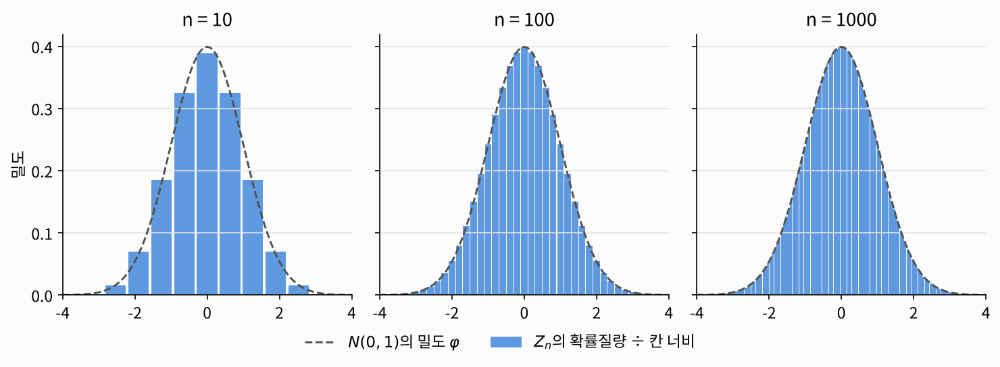

## 들어가며

[1.3](03-in-mean.qmd)에서 동전의 앞면 비율은 평균적으로 $\frac{1}{2\sqrt{n}}$만큼 틀린다는 것을 보았습니다. 오차가 $0$으로 줄어든다는 것은 이제 충분히 확인했으니, 이번에는 질문을 바꿔 보겠습니다. 오차는 **어떤 모양으로** 흩어질까요? 오차가 $0.05$를 넘을 확률이 정확히 얼마인지, 95%의 확률로 오차가 들어가는 범위가 어디까지인지를 알려면 평균적인 크기만으로는 부족하고, 오차의 **분포**를 알아야 합니다.

문제는 오차 $\bar{X}_n - \tfrac12$ 자체는 $0$으로 줄어들기 때문에, 그대로 들여다보면 모양이 한 점으로 찌그러져 버린다는 것입니다. 그래서 현미경의 배율을 높이듯 오차를 확대해서 봅니다. 평균적인 크기가 $\frac{1}{2\sqrt{n}}$이므로, 그 역수인 $2\sqrt{n}$배로 확대하면 크기가 $n$에 상관없이 일정해집니다.

$$Z_n := 2\sqrt{n}\,\big(\bar{X}_n - \tfrac12\big) = \frac{S_n - \frac{n}{2}}{\sqrt{n/4}} = \frac{S_n - E(S_n)}{\sqrt{V(S_n)}}$$

$Z_n$은 합 $S_n$을 평균이 $0$, 분산이 $1$이 되도록 맞춘 **표준화된 합**입니다. 이번 글에서는 이 $Z_n$의 모양이 어디로 가는지 살펴보고, 그 과정에서 필요한 **분포수렴**(convergence in distribution)을 정의하겠습니다.

## 확대한 오차의 모양

$Z_n$은 $\frac{k - n/2}{\sqrt{n/4}}$ ($k = 0, 1, \ldots, n$)라는 값을 이항분포의 확률로 가집니다. 이 확률을 칸 너비로 나누어 밀도처럼 그리고, 표준정규분포 $N(0, 1)$의 밀도 $\varphi$와 겹쳐 보겠습니다.

{fig-alt="n = 10, 100, 1000일 때 표준화된 앞면 수 Z_n의 확률질량을 칸 너비로 나눈 파란 막대와 표준정규분포의 밀도 곡선(회색 점선)을 나란히 그린 세 그림. n = 10에서는 막대가 열한 개뿐이라 곡선과 계단처럼 어긋나지만, n = 100에서는 막대가 곡선을 거의 따라가고, n = 1000에서는 막대의 윗변이 곡선과 구별되지 않을 만큼 겹친다." width=95%}

$n$이 커질수록 막대가 종 모양의 곡선에 들러붙습니다. 숫자로도 확인해 보겠습니다. 표준정규분포의 분포함수를 $\Phi$라 하고, $Z_n$의 분포함수 $F_n(x) := P(Z_n \le x)$와 $\Phi$가 가장 크게 벌어지는 정도 $\sup_x |F_n(x) - \Phi(x)|$를 이항분포로 정확히 계산합니다. $F_n$은 계단함수이므로, 이 최댓값은 계단이 뛰는 점에서 뛰기 직전과 직후의 값을 비교하면 얻을 수 있습니다.

```python
import numpy as np
from scipy.stats import binom, norm

print("     n | P(Z_n ≤ 1.96) | Φ(1.96) | sup_x |F_n(x) - Φ(x)|")
for n in [10, 100, 1000, 10_000]:
    k = np.arange(n + 1)
    z = (k - n / 2) / np.sqrt(n / 4)          # Z_n = (S_n - n/2) / sqrt(n/4)가 가질 수 있는 값
    F = binom.cdf(k, n, 0.5)                  # 점프한 뒤의 값 F_n(z_k)
    F_left = F - binom.pmf(k, n, 0.5)         # 점프하기 직전의 값 F_n(z_k -)
    dist = max(np.max(np.abs(F - norm.cdf(z))), np.max(np.abs(F_left - norm.cdf(z))))
    p196 = binom.cdf(np.floor(n / 2 + 1.96 * np.sqrt(n / 4)), n, 0.5)
    print(f"{n:>6} | {p196:>13.4f} | {norm.cdf(1.96):.4f} | {dist:.4f}")
```

```
     n | P(Z_n ≤ 1.96) | Φ(1.96) | sup_x |F_n(x) - Φ(x)|
    10 |        0.9893 | 0.9750 | 0.1230
   100 |        0.9716 | 0.9750 | 0.0398
  1000 |        0.9732 | 0.9750 | 0.0126
 10000 |        0.9756 | 0.9750 | 0.0040
```

두 분포함수가 가장 크게 벌어지는 정도는 $n$을 100배 늘릴 때마다 대략 10분의 1이 됩니다. 이 차이가 적어도 $1/\sqrt{n}$의 속도로 줄어든다는 것은 4장에서 볼 베리-에센 정리가 보장해 줍니다.

그런데 이렇게 분포가 가까워진다고 해서 $Z_n$ **자체**가 어떤 확률변수에 가까워지는 것은 아닙니다. $Z_n$과 $Z_{2n}$을 비교해 보겠습니다. $Z_{2n}$은 처음 $n$번과 나중 $n$번의 결과를 합친 것이므로, 나중 $n$번만으로 만든 표준화된 합을 $Z_n'$이라 하면 $Z_{2n} = (Z_n + Z_n')/\sqrt{2}$이고, $Z_n'$은 $Z_n$과 독립이며 같은 분포를 따릅니다. 따라서

$$E\big((Z_{2n} - Z_n)^2\big) = \Big(\tfrac{1}{\sqrt2} - 1\Big)^2 + \Big(\tfrac{1}{\sqrt2}\Big)^2 = 2 - \sqrt{2} \approx 0.586$$

이 $n$에 상관없이 일정합니다. 나중 $n$번의 새로운 동전이 매번 $Z_{2n}$을 크게 흔들어 놓기 때문입니다. 그러니 $Z_n$은 평균제곱의 의미에서 어떤 극한에도 가까워지지 않고, [1.5](05-relations.qmd)의 도구를 쓰면 확률수렴도 하지 않는다는 것을 보일 수 있습니다. 가까워지는 것은 확률변수의 **값**이 아니라 **분포**뿐입니다. 그래서 분포만을 보는 수렴 개념이 따로 필요합니다.

## 분포수렴

분포가 가까워진다는 것을 분포함수가 가까워진다는 것으로 정의하는 것이 자연스러워 보입니다. 다만 한 가지 조심할 점이 있습니다.

::: {.callout-note icon=false}
### 예제 1.4.1 (한 점으로 다가가는 질량)
$X_n \equiv \frac1n$이라는 상수 확률변수를 생각합시다. 누가 보아도 $X_n$은 $0$으로 수렴합니다. 그런데 분포함수는 $F_n = \mathbf{1}_{[\frac1n, \infty)}$이고, 극한 $X \equiv 0$의 분포함수는 $F = \mathbf{1}_{[0, \infty)}$이므로

$$F_n(0) = 0 \not\to 1 = F(0)$$

입니다. $x \ne 0$인 점에서는 $F_n(x) \to F(x)$가 성립합니다.
:::

질량 $1$이 오른쪽에서 $0$으로 다가오는 동안, 분포함수의 계단은 $0$의 바로 오른쪽에 있다가 극한에서 $0$ 위로 올라섭니다. 계단이 정확히 어디에서 뛰는지는 극한에서 바뀔 수 있으므로, **극한 분포함수가 뛰는 점에서는 수렴을 요구하지 않는 것**이 맞습니다.

::: {.callout-note icon=false .callout-definition}
### 정의 1.4.2 (약수렴과 분포수렴)
1. $(\mathbb{R}, \mathcal{B}(\mathbb{R}))$ 위의 확률측도 $\mu, \mu_1, \mu_2, \ldots$의 분포함수를 각각 $F(x) := \mu((-\infty, x])$, $F_n(x) := \mu_n((-\infty, x])$라 하고, $F$의 연속점 전체의 집합을 $C_F$라고 합시다. 모든 $x \in C_F$에 대해 $F_n(x) \to F(x)$이면 $\mu_n$이 $\mu$로 **약수렴**한다(converges weakly)고 합니다.
2. $X_n$이 확률공간 $(\Omega_n, \mathcal{A}_n, P_n)$ 위의, $X$가 확률공간 $(\Omega, \mathcal{A}, P)$ 위의 실수 값 확률변수라고 합시다. 분포 $P_n^{X_n}$이 $P^X$로 약수렴하면, 즉

$$F_{X_n}(x) = P_n(X_n \le x) \xrightarrow[n \to \infty]{} P(X \le x) = F_X(x) \qquad \text{모든 } x \in C_{F_X}$$

이면 $X_n$이 $X$로 **분포수렴**한다(converges in distribution)고 하고, $X_n \xrightarrow{D} X$로 씁니다.
:::

정의에는 두 가지 눈여겨볼 점이 있습니다.

첫째, 분포수렴은 $X_n$과 $X$의 **분포만** 봅니다. 그래서 $X_n$들과 $X$가 서로 다른 확률공간 위에 있어도 상관없습니다. 거의 확실한 수렴, 확률수렴, 평균수렴은 모두 $|X_n - X|$를 계산해야 하므로 같은 확률공간이 필요했던 것과 대조적입니다. 같은 이유로 극한을 확률변수 대신 분포로 써서 $X_n \xrightarrow{D} N(0, 1)$처럼 쓰기도 합니다. "어떤 $X \sim N(0,1)$에 대해 $X_n \xrightarrow{D} X$"라는 뜻입니다.

둘째, $F$가 연속이 아닌 점은 셀 수 있는 개수밖에 없으므로, $C_F$는 $\mathbb{R}$에서 셀 수 있는 개수의 점만 뺀 집합입니다. 극한이 $N(0,1)$처럼 연속분포이면 $C_F = \mathbb{R}$이므로 모든 점에서 수렴을 요구하게 됩니다.

동전의 경우 위의 그림과 표가 보여 준 것은 다음 정리입니다. 증명은 특성함수를 이용하며 4장에서 다룹니다.

::: {.callout-important icon=false .callout-satz}
### 정리 1.4.3 (드무아브르-라플라스 중심극한정리)
$0 < p < 1$이고 $X_1, X_2, \ldots$가 $\mathrm{Bin}(1, p)$를 따르는 i.i.d. 확률변수이면 다음이 성립합니다.

$$\frac{S_n - np}{\sqrt{np(1-p)}} \xrightarrow{D} N(0, 1)$$
:::

## 분포수렴을 다르게 보는 방법들

분포함수로 한 정의는 실수 위에서는 직관적이지만, 쓰기에는 불편할 때가 많습니다. 다음 정리는 같은 개념을 다른 언어로 바꿔 줍니다.

::: {.callout-important icon=false .callout-satz}
### 정리 1.4.4 (포르트망토 정리)
$(\mathbb{R}, \mathcal{B}(\mathbb{R}))$ 위의 확률측도 $\mu, \mu_1, \mu_2, \ldots$에 대해 다음은 서로 동치입니다.

1. $\mu_n$이 $\mu$로 약수렴합니다.
2. 연속이고 유계인 모든 함수 $f: \mathbb{R} \to \mathbb{R}$에 대해 $\int f \, d\mu_n \to \int f \, d\mu$입니다.
3. 립시츠 연속이고 유계인 모든 함수 $f$에 대해 $\int f \, d\mu_n \to \int f \, d\mu$입니다.
4. 경계 $\partial A$가 $\mu(\partial A) = 0$을 만족하는 모든 $A \in \mathcal{B}(\mathbb{R})$에 대해 $\mu_n(A) \to \mu(A)$입니다.
:::

::: {.callout-tip collapse="false" icon=false .callout-beweis}
### 증명 (줄기)
(1 ⇒ 2)는 $f$를 유계 구간 위에서 계단함수로 근사하고, 그 구간 바깥의 질량이 작다는 것을 이용합니다. (2 ⇒ 3)은 당연하고, (3 ⇒ 4)는 닫힌집합 $C$의 지시함수를 위에서 누르는 립시츠 함수 $f_k(x) = (1 - k \cdot d(x, C))^+$로 근사해 $\limsup_n \mu_n(C) \le \mu(C)$를 얻는 것이 핵심입니다. (4 ⇒ 1)은 $A = (-\infty, x]$, $x \in C_F$로 두면 됩니다. 자세한 증명은 [측도론적 확률론](../../measure-prob/index.qmd)의 약수렴 부분을 참고하시기 바랍니다.
:::

확률변수로 옮기면, 2는 $X_n \xrightarrow{D} X$일 필요충분조건이 연속이고 유계인 모든 $f$에 대해

$$E\big(f(X_n)\big) \to E\big(f(X)\big)$$

라는 것입니다. 이 형태는 분포함수가 없는 공간, 예컨대 $\mathbb{R}^d$나 함수들의 공간에서도 그대로 쓸 수 있어서, 분포수렴의 일반적인 정의로 쓰입니다. 4는 실용적으로 가장 많이 쓰는 형태입니다. 극한이 $N(0,1)$이면 모든 구간의 경계가 확률 $0$이므로, 큰 $n$에서

$$P(a < Z_n \le b) \approx \Phi(b) - \Phi(a)$$

로 근사해도 된다는 근거가 됩니다. 다만 4가 **모든** 집합에서 성립하는 것은 아닙니다. 예제 1.4.1에서 $\mu_n(\{0\}) = 0$은 $\mu(\{0\}) = 1$로 가지 않습니다. 이때 집합 $\{0\}$의 경계는 $\{0\}$ 자신이고 극한 분포에서 확률이 $1$이므로 4의 조건에 맞지 않습니다.

## 확률수렴과의 관계

분포수렴은 분포만 보므로, 확률변수 자체가 가까워지는 확률수렴보다 약한 개념일 것으로 예상됩니다.

::: {.callout-important icon=false .callout-satz}
### 정리 1.4.5 (확률수렴은 분포수렴을 보장)
$X, X_1, X_2, \ldots$가 하나의 확률공간 위에 있고 $X_n \xrightarrow{P} X$이면 $X_n \xrightarrow{D} X$입니다.
:::

::: {.callout-tip collapse="false" icon=false .callout-beweis}
### 증명
포르트망토 정리의 3을 확인하겠습니다. $f$가 립시츠 상수 $L$을 가지고 $|f| \le \|f\|_\infty$로 유계라고 합시다. $\varepsilon > 0$에 대해 사건 $\{|X_n - X| > \varepsilon\}$ 위에서는 $|f(X_n) - f(X)| \le 2\|f\|_\infty$이고, 그 여사건 위에서는 $|f(X_n) - f(X)| \le L\varepsilon$이므로

$$\big|E(f(X_n)) - E(f(X))\big| \le E\big(|f(X_n) - f(X)|\big) \le 2\|f\|_\infty \, P(|X_n - X| > \varepsilon) + L\varepsilon$$

입니다. $n \to \infty$이면 첫째 항이 $0$으로 가므로 극한은 $L\varepsilon$ 이하이고, $\varepsilon$은 임의이므로 $E(f(X_n)) \to E(f(X))$입니다.
:::

반대는 성립하지 않습니다. 분포가 같다고 값이 같은 것은 아니기 때문입니다.

::: {.callout-note icon=false}
### 예제 1.4.6 (분포는 같지만 값은 정반대)
$X \sim \mathrm{Bin}(1, \tfrac12)$이라 하고 모든 $n$에 대해 $X_n := 1 - X$로 둡시다. $1 - X$도 $\mathrm{Bin}(1, \tfrac12)$를 따르므로 $X_n$과 $X$의 분포는 같고, 당연히 $X_n \xrightarrow{D} X$입니다. 그런데 $|X_n - X| = |1 - 2X| = 1$이므로 $P(|X_n - X| > \tfrac12) = 1$이 모든 $n$에서 성립하고, $X_n \xrightarrow{P} X$가 아닙니다.

같은 예에서 $Y_n := X$, $Y := X$로 두면 $X_n \xrightarrow{D} X$이고 $Y_n \xrightarrow{D} Y$이지만, $X_n + Y_n \equiv 1$은 $X + Y = 2X$로 분포수렴하지 않습니다. $2X$는 $0$과 $2$를 각각 확률 $\tfrac12$로 가지기 때문입니다. 분포수렴은 덧셈과 잘 어울리지 않습니다.
:::

하지만 극한이 **상수**라면 이야기가 달라집니다. 상수는 분포가 곧 값이기 때문입니다.

::: {.callout-important icon=false .callout-satz}
### 정리 1.4.7 (상수로의 수렴)
$a \in \mathbb{R}$에 대해 $X_n \xrightarrow{P} a$일 필요충분조건은 $X_n \xrightarrow{D} a$입니다. 이때 $X_n$들은 서로 다른 확률공간 위에 있어도 됩니다.
:::

::: {.callout-tip collapse="false" icon=false .callout-beweis}
### 증명
($\Rightarrow$)는 정리 1.4.5입니다. ($\Leftarrow$) 극한 $a$의 분포함수는 $\mathbf{1}_{[a, \infty)}$이고 $a$를 뺀 모든 점에서 연속입니다. $\varepsilon > 0$에 대해 $a - \varepsilon$과 $a + \varepsilon$은 연속점이므로

$$P_n(|X_n - a| > \varepsilon) \le P_n(X_n \le a - \varepsilon) + 1 - P_n(X_n \le a + \varepsilon) \xrightarrow[n \to \infty]{} 0 + 1 - 1 = 0$$

입니다.
:::

## 분포수렴을 다루는 두 도구

분포수렴은 덧셈과 잘 어울리지 않았지만, 연속함수와는 잘 어울립니다.

::: {.callout-important icon=false .callout-satz}
### 정리 1.4.8 (연속 사상 정리)
$X_n \xrightarrow{D} X$이고 $g: \mathbb{R} \to \mathbb{R}$가 연속이면 $g(X_n) \xrightarrow{D} g(X)$입니다.
:::

::: {.callout-tip collapse="false" icon=false .callout-beweis}
### 증명
$f$가 연속이고 유계이면 $f \circ g$도 연속이고 유계입니다. 포르트망토 정리의 2에 의해 $E(f(g(X_n))) = E((f \circ g)(X_n)) \to E((f \circ g)(X)) = E(f(g(X)))$이고, 다시 포르트망토 정리의 2에 의해 $g(X_n) \xrightarrow{D} g(X)$입니다.
:::

예를 들어 $Z_n \xrightarrow{D} N(0,1)$이므로 $Z_n^2 \xrightarrow{D} Z^2$ ($Z \sim N(0,1)$)이고, $Z^2$의 분포는 자유도 $1$인 카이제곱분포입니다. 사실 $g$가 가측이고 극한 분포에서 확률 $0$인 점들에서만 불연속이어도 같은 결론이 성립합니다.

덧셈 문제에 대한 해답은, 더하는 쪽 하나가 **상수로** 수렴하면 된다는 것입니다.

::: {.callout-important icon=false .callout-satz}
### 정리 1.4.9 (슬러츠키 정리)
$X_n$과 $Y_n$이 각 $n$마다 같은 확률공간 위에 있고, $a \in \mathbb{R}$에 대해 $Y_n \xrightarrow{D} a$, $X_n \xrightarrow{D} X$이면 다음이 성립합니다.

$$Y_n + X_n \xrightarrow{D} a + X, \qquad Y_n \cdot X_n \xrightarrow{D} a \cdot X$$
:::

증명은 [측도론적 확률론](../../measure-prob/index.qmd)으로 미루겠습니다. 통계학에서 이 정리가 가장 많이 쓰이는 곳은 모르는 분산을 추정값으로 바꿔 넣을 때입니다. 동전의 앞면 확률 $p$를 모를 때, 정리 1.4.3에 따르면 $\sqrt{n}(\bar{X}_n - p)/\sqrt{p(1-p)} \xrightarrow{D} N(0,1)$인데, 분모의 $p$를 모르니 이 식을 그대로 쓸 수는 없습니다. 그런데 [1.2의 정리 1.2.8](02-in-probability.qmd)에 의해 $\hat\sigma_n := \sqrt{\bar{X}_n(1-\bar{X}_n)} \xrightarrow{P} \sigma := \sqrt{p(1-p)} > 0$입니다. 극한이 상수일 때는 $g$가 그 상수에서만 연속이어도 같은 논리가 통하므로($|\hat\sigma_n - \sigma|$가 작으면 $|g(\hat\sigma_n) - g(\sigma)|$도 작습니다), $g(x) = \sigma/x$를 쓰면 $\sigma/\hat\sigma_n \xrightarrow{P} 1$입니다. $\bar{X}_n$이 $0$이나 $1$이 되어 $\hat\sigma_n = 0$인 경우는 그 확률이 $0$으로 가므로 무시해도 됩니다. 이제 슬러츠키 정리의 곱셈을 쓰면

$$\frac{\sqrt{n}\,(\bar{X}_n - p)}{\sqrt{\bar{X}_n(1 - \bar{X}_n)}} \xrightarrow{D} N(0, 1)$$

입니다. 분모에 모르는 값이 없으므로 이 식으로 신뢰구간을 만들 수 있습니다. 여론조사의 "±3.1%포인트"가 이렇게 만들어지며, 4장에서 자세히 다룹니다.

## 정리

- **분포수렴**은 확률변수의 값이 아니라 **분포**가 가까워지는 수렴이며, 분포함수가 극한 분포함수의 연속점에서 수렴하는 것으로 정의합니다. 연속점만 보는 이유는 질량이 한 점으로 다가가는 자연스러운 경우를 포함하기 위해서입니다.
- 분포수렴은 분포만 보므로 확률변수들이 서로 다른 확률공간 위에 있어도 됩니다. 동전의 오차를 $2\sqrt{n}$배 확대한 $Z_n$은 분포만 $N(0,1)$로 가까워지고, 값 자체는 어디로도 수렴하지 않습니다.
- 포르트망토 정리에 의해 분포수렴은 "연속이고 유계인 모든 $f$에 대해 $E(f(X_n)) \to E(f(X))$"와 같고, 경계의 확률이 $0$인 집합의 확률이 수렴한다는 것과도 같습니다.
- 확률수렴하면 분포수렴하지만 반대는 성립하지 않습니다. 다만 극한이 상수이면 둘은 같습니다.
- 연속함수는 분포수렴을 보존하고(연속 사상 정리), 상수로 수렴하는 항을 더하거나 곱해도 분포수렴은 유지됩니다(슬러츠키 정리).

이제 네 가지 수렴이 모두 나왔습니다. 마지막 글에서는 이들 사이의 관계를 한 그림에 모으고, 지금까지 여러 번 미뤄 둔 질문, 즉 **확률수렴에서 언제 기대값의 수렴을 얻을 수 있는가**에 답합니다.

---

### 연결되는 개념
* $\leftarrow$ **이전 개념:** [1.3 $r$차 평균수렴](03-in-mean.qmd)
* $\rightarrow$ **다음 개념:** [1.5 수렴들 사이의 관계](05-relations.qmd)
