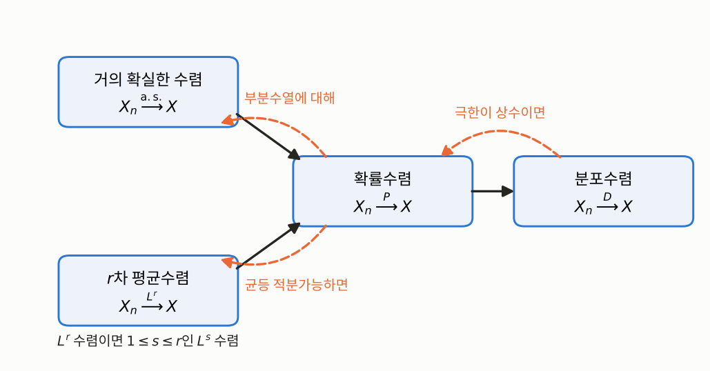

## 들어가며

[1.1](01-almost-sure.qmd)부터 [1.4](04-in-distribution.qmd)까지 네 가지 수렴을 차례로 보았습니다. 이번 글에서는 먼저 이들 사이의 관계를 한 그림에 모읍니다. 어느 수렴이 어느 수렴을 보장하는지, 보장하지 않는다면 어떤 반례가 있는지를 정리하겠습니다.

그다음에는 지금까지 몇 번 미뤄 둔 질문에 답합니다. 확률수렴이나 분포수렴만 알고 있을 때, **언제 기대값과 적률의 수렴까지 얻을 수 있을까요?** 통계학으로 옮기면 "일치추정량의 평균제곱오차는 언제 $0$으로 가는가"라는 질문이고, 답은 **균등 적분가능성**(uniform integrability)입니다.

## 한눈에 보기

{fig-alt="네 가지 수렴의 관계도. 왼쪽 위의 거의 확실한 수렴과 왼쪽 아래의 r차 평균수렴에서 가운데의 확률수렴으로 검은 실선 화살표가 가고, 확률수렴에서 오른쪽의 분포수렴으로 검은 실선 화살표가 간다. 주황색 점선 화살표는 부분적인 역방향으로, 확률수렴에서 거의 확실한 수렴으로 '부분수열에 대해', 확률수렴에서 r차 평균수렴으로 '균등 적분가능하면', 분포수렴에서 확률수렴으로 '극한이 상수이면'이라고 적혀 있다. 아래에는 L^r 수렴이면 1 ≤ s ≤ r인 L^s 수렴이라는 설명이 있다." width=85%}

검은 실선 화살표는 언제나 성립하는 함의이고, 주황색 점선 화살표는 조건이 붙을 때만 성립하는 역방향입니다. 각 화살표가 어디에서 증명되었는지 정리하면 다음과 같습니다.

| 함의 | 근거 |
|:--|:--|
| $X_n \xrightarrow{\text{a.s.}} X \;\Rightarrow\; X_n \xrightarrow{P} X$ | [정리 1.2.2](02-in-probability.qmd) |
| $X_n \xrightarrow{L^r} X \;\Rightarrow\; X_n \xrightarrow{P} X$ | [정리 1.3.2](03-in-mean.qmd) |
| $X_n \xrightarrow{L^r} X \;\Rightarrow\; X_n \xrightarrow{L^s} X$ ($1 \le s \le r$) | [정리 1.3.2](03-in-mean.qmd) |
| $X_n \xrightarrow{P} X \;\Rightarrow\; X_n \xrightarrow{D} X$ | [정리 1.4.5](04-in-distribution.qmd) |
| $X_n \xrightarrow{P} X \;\Rightarrow\;$ 어떤 부분수열이 $X_{n_k} \xrightarrow{\text{a.s.}} X$ | [정리 1.2.7](02-in-probability.qmd) |
| $X_n \xrightarrow{D} a$ (상수) $\;\Rightarrow\; X_n \xrightarrow{P} a$ | [정리 1.4.7](04-in-distribution.qmd) |
| $X_n \xrightarrow{P} X$이고 $\lvert X_n\rvert^r$이 균등 적분가능 $\;\Rightarrow\; X_n \xrightarrow{L^r} X$ | 이 글의 정리 1.5.5 |

성립하지 않는 함의에는 모두 반례가 있습니다. 대부분은 이미 보았고, 하나만 새로 추가하겠습니다.

::: {.callout-note icon=false}
### 예제 1.5.1 (낮은 차수에서만 수렴)
확률공간 $([0,1], \mathcal{B}([0,1]), \lambda)$ 위에서 $X_n := \sqrt{n} \cdot \mathbf{1}_{[0, 1/n]}$으로 두면 $E(|X_n|) = \sqrt{n} \cdot \frac1n = \frac{1}{\sqrt n} \to 0$이므로 $X_n \xrightarrow{L^1} 0$입니다. 하지만 $E(|X_n|^2) = n \cdot \frac1n = 1$이므로 $X_n \xrightarrow{L^2} 0$은 아닙니다.
:::

| 성립하지 않는 함의 | 반례 |
|:--|:--|
| $\xrightarrow{P} \;\not\Rightarrow\; \xrightarrow{\text{a.s.}}$ | 타자기 수열([예제 1.2.4](02-in-probability.qmd)), 점점 드물어지는 사고([예제 1.2.6](02-in-probability.qmd)) |
| $\xrightarrow{\text{a.s.}} \;\not\Rightarrow\; \xrightarrow{L^r}$ | 복권 $n \cdot \mathbf{1}_{[0,1/n]}$([예제 1.3.3](03-in-mean.qmd)) |
| $\xrightarrow{L^r} \;\not\Rightarrow\; \xrightarrow{\text{a.s.}}$ | 타자기 수열([예제 1.3.4](03-in-mean.qmd)) |
| $\xrightarrow{L^s} \;\not\Rightarrow\; \xrightarrow{L^r}$ ($s < r$) | $\sqrt{n} \cdot \mathbf{1}_{[0,1/n]}$(예제 1.5.1) |
| $\xrightarrow{D} \;\not\Rightarrow\; \xrightarrow{P}$ | $X_n = 1 - X$, $X \sim \mathrm{Bin}(1, \tfrac12)$([예제 1.4.6](04-in-distribution.qmd)) |

반례들을 다시 훑어보면 실패의 원인은 두 종류뿐입니다. 타자기 수열과 점점 드물어지는 사고는 **틀리는 사람이 계속 바뀌는** 경우이고, 복권과 $\sqrt{n} \cdot \mathbf{1}_{[0,1/n]}$은 **드물게 아주 크게 틀리는** 경우입니다. 앞의 것은 부분수열을 골라 내면 해결되고, 뒤의 것을 다스리는 것이 균등 적분가능성입니다.

## 일치추정량인데 평균제곱오차가 발산한다면

뒤의 원인이 통계학에서 어떤 모습으로 나타나는지 보겠습니다. 동전의 앞면 확률 $\tfrac12$를 추정하는데, 다음과 같은 장난스러운 추정량을 쓴다고 해 봅시다.

$$T_n := \bar{X}_n + 2^n \cdot \mathbf{1}_{A_n}, \qquad A_n := \{\text{처음 } n\text{번이 모두 앞면}\}$$

평소에는 앞면 비율을 그대로 쓰다가, 처음 $n$번이 모두 앞면이라는 아주 드문 일이 생기면 엉뚱하게 $2^n$을 더하는 추정량입니다.

- $P(A_n) = 2^{-n}$이고 $\sum_n 2^{-n} < \infty$이므로, [보렐-칸텔리 보조정리](01-almost-sure.qmd)에 의해 확률 $1$로 $A_n$은 유한 번만 일어납니다. 따라서 $T_n - \bar{X}_n \xrightarrow{\text{a.s.}} 0$이고, $\bar{X}_n \xrightarrow{\text{a.s.}} \tfrac12$와 합치면 $T_n \xrightarrow{\text{a.s.}} \tfrac12$입니다. 강한 일치성까지 가진 추정량입니다.
- 그런데 기대값은 $E(T_n) = \tfrac12 + 2^n \cdot 2^{-n} = \tfrac32$로, $n$이 아무리 커도 참값 $\tfrac12$에서 $1$만큼 비켜나 있습니다.
- 평균제곱오차는 더 나쁩니다. $A_n$ 위에서는 $\bar{X}_n = 1$이므로 $T_n - \tfrac12 = \tfrac12 + 2^n$이고, 따라서

$$E\big((T_n - \tfrac12)^2\big) \ge P(A_n) \cdot \big(\tfrac12 + 2^n\big)^2 \ge 2^{-n} \cdot 2^{2n} = 2^n \xrightarrow[n \to \infty]{} \infty$$

입니다.

거의 모든 표본에서 결국 정확한 값에 도달하는 추정량인데도, 평균제곱오차는 $0$으로 가기는커녕 무한대로 발산합니다. 확률 $2^{-n}$짜리 사건 하나에 $2^n$이라는 값이 실려서, 꼬리에 숨은 무게가 사라지지 않기 때문입니다. 따라서 일치성을 보였다고 해서 평균제곱오차나 기대값에 대해 무언가를 주장할 수는 없습니다.

## 균등 적분가능성

꼬리에 숨은 무게를 재는 양은 $\int_{\{|X| \ge k\}} |X| \, dP$, 즉 $|X|$가 $k$ 이상인 부분이 기대값에 기여하는 정도입니다. 확률변수 하나라면 $X \in L^1$일 때 이 양은 $k \to \infty$에서 $0$으로 갑니다(지배수렴 정리). 문제는 확률변수가 **여러 개**일 때, 이 양이 모든 $n$에 대해 **한꺼번에** 작아지는가입니다.

::: {.callout-note icon=false .callout-definition}
### 정의 1.5.2 (균등 적분가능성)
확률공간 $(\Omega_n, \mathcal{A}_n, P_n)$ 위의 실수 값 확률변수 $X_n$, $n \in \mathbb{N}$이 다음을 만족하면 **균등 적분가능하다**(uniformly integrable)고 합니다. 모든 $\varepsilon > 0$에 대해 어떤 $k \in \mathbb{R}$가 있어서

$$\int_{\{|X_n| \ge k\}} |X_n| \, dP_n \le \varepsilon \qquad \text{모든 } n \in \mathbb{N}$$
:::

조건에서 $k$가 $n$에 의존하지 않는다는 것, 즉 **하나의 $k$가 모든 $n$에 동시에 통한다**는 것이 핵심입니다. 또 이 조건은 각 $X_n$의 분포에만 의존합니다.

복권 $X_n = n \cdot \mathbf{1}_{[0, 1/n]}$은 균등 적분가능하지 않습니다. 어떤 $k$를 잡더라도 $n \ge k$인 모든 $n$에서 $\int_{\{|X_n| \ge k\}} |X_n| \, dP = n \cdot \frac1n = 1$이기 때문입니다. 위의 추정량 $T_n$도 같은 이유로 균등 적분가능하지 않습니다. 반면 동전의 앞면 비율처럼 $|X_n| \le 1$로 유계인 경우는, $k = 2$로 잡으면 적분 영역이 공집합이 되므로 당연히 균등 적분가능합니다. 이를 조금 일반화한 두 가지 판정법이 실전에서 많이 쓰입니다.

::: {.callout-important icon=false .callout-satz}
### 보조정리 1.5.3 (적분가능한 함수로 눌리면 균등 적분가능)
$X_n$, $n \in \mathbb{N}$과 $Y$가 하나의 확률공간 위에 있고, $Y \in L^1$이며 모든 $n$에 대해 $|X_n| \le Y$이면, $X_n$들은 균등 적분가능합니다.
:::

::: {.callout-tip collapse="false" icon=false .callout-beweis}
### 증명
$\{|X_n| \ge k\} \subset \{Y \ge k\}$이고 $|X_n| \le Y$이므로 $\int_{\{|X_n| \ge k\}} |X_n| \, dP \le \int_{\{Y \ge k\}} Y \, dP$입니다. 오른쪽은 $n$과 무관하고, $\mathbf{1}_{\{Y \ge k\}} Y \le Y$이며 $k \to \infty$일 때 $\mathbf{1}_{\{Y \ge k\}} Y \to 0$ a.s.이므로 지배수렴 정리에 의해 $0$으로 갑니다.
:::

::: {.callout-important icon=false .callout-satz}
### 보조정리 1.5.4 (조금 더 높은 적률이 유계이면 균등 적분가능)
$1 \le r < \infty$라 합시다. 어떤 $\delta > 0$과 $C < \infty$가 있어서 모든 $n$에 대해 $E(|X_n|^{r + \delta}) \le C$이면, $|X_n|^r$, $n \in \mathbb{N}$은 균등 적분가능합니다.
:::

::: {.callout-tip collapse="false" icon=false .callout-beweis}
### 증명
사건 $\{|X_n|^r \ge k\}$ 위에서는 $|X_n|^\delta \ge k^{\delta/r}$이므로 $|X_n|^r \le |X_n|^{r+\delta} / k^{\delta/r}$입니다. 따라서 모든 $n$에 대해

$$\int_{\{|X_n|^r \ge k\}} |X_n|^r \, dP_n \le \frac{1}{k^{\delta/r}} \int |X_n|^{r+\delta} \, dP_n \le \frac{C}{k^{\delta/r}}$$

이고, $k$를 충분히 크게 잡으면 오른쪽을 원하는 만큼 작게 만들 수 있습니다.
:::

$\delta > 0$이 꼭 필요하다는 것도 확인해 둘 만합니다. 복권은 모든 $n$에서 $E(|X_n|) = 1$로 $r = 1$차 적률이 유계이지만 균등 적분가능하지 않았습니다. 같은 차수의 적률이 유계인 것만으로는 부족하고, **조금이라도 더 높은 차수**의 적률이 유계여야 꼬리의 무게를 한꺼번에 누를 수 있습니다. 예제 1.5.1의 $\sqrt{n} \cdot \mathbf{1}_{[0,1/n]}$은 $1 \le r < 2$이고 $0 < \delta < 2 - r$일 때 $E(|X_n|^{r+\delta}) = n^{(r+\delta)/2 - 1} \le 1$이므로, $|X_n|^r$이 균등 적분가능합니다.

## 확률수렴에서 평균수렴으로

이제 그림의 점선 화살표 하나를 정확한 정리로 쓸 수 있습니다.

::: {.callout-important icon=false .callout-satz}
### 정리 1.5.5 (균등 적분가능성과 평균수렴)
$1 \le r < \infty$이고 $X, X_1, X_2, \ldots$가 하나의 확률공간 위에 있을 때, 다음 세 조건은 서로 동치입니다.

1. $X_n \xrightarrow{P} X$이고, $|X_n|^r$, $n \in \mathbb{N}$이 균등 적분가능합니다.
2. $X_n, X \in L^r$이고 $X_n \xrightarrow{L^r} X$입니다.
3. $X_n \xrightarrow{P} X$이고, $X_n, X \in L^r$이며 $E(|X_n|^r) \to E(|X|^r)$입니다.
:::

::: {.callout-tip collapse="false" icon=false .callout-beweis}
### 증명 (줄기)
가장 많이 쓰는 (1 ⇒ 2)의 아이디어만 보이겠습니다. 균등 적분가능성으로부터 먼저 다음을 얻습니다. 모든 $\eta > 0$에 대해 어떤 $\delta > 0$이 있어서, $P(A) < \delta$인 모든 사건 $A$와 모든 $n$에 대해 $\int_A |X_n|^r \, dP < \eta$입니다. 또 부분수열 정리와 파투의 보조정리로 $X \in L^r$임을 보일 수 있습니다.

이제 $\varepsilon > 0$에 대해 표본공간을 $\{|X_n - X| \le \varepsilon\}$과 $A_n := \{|X_n - X| > \varepsilon\}$으로 나누면

$$E(|X_n - X|^r) \le \varepsilon^r + \int_{A_n} |X_n - X|^r \, dP \le \varepsilon^r + 2^{r-1}\Big(\int_{A_n} |X_n|^r \, dP + \int_{A_n} |X|^r \, dP\Big)$$

입니다. 확률수렴에 의해 $P(A_n) \to 0$이므로, 충분히 큰 $n$에서 $P(A_n) < \delta$가 되어 괄호 안이 작아집니다. 따라서 $\limsup_n E(|X_n - X|^r) \le \varepsilon^r + (\text{작은 값})$이고, $\varepsilon$과 $\eta$가 임의이므로 $E(|X_n - X|^r) \to 0$입니다.

나머지 방향을 포함한 전체 증명은 [측도론적 확률론](../../measure-prob/index.qmd)의 균등 적분가능성 부분을 참고하시기 바랍니다.
:::

정리를 말로 옮기면 이렇습니다. 크게 틀리는 일이 드물어지고(확률수렴), **꼬리에 숨은 무게가 모든 $n$에서 한꺼번에 작다면**(균등 적분가능성), 평균적인 오차도 $0$으로 갑니다. 복권과 추정량 $T_n$은 앞의 조건은 만족하지만 뒤의 조건을 만족하지 않았습니다.

3번 조건도 흥미롭습니다. 확률수렴하면서 $r$차 적률까지 수렴한다면, 꼬리에서 새는 무게가 없다는 뜻이고, 그것만으로 평균수렴이 보장됩니다. 다만 절댓값이 없는 $E(X_n) \to E(X)$만으로는 부족합니다. 예컨대 $([0,1), \mathcal{B}([0,1)), \lambda)$ 위에서 $n \ge 2$에 대해 $X_n := n \cdot \mathbf{1}_{[0, 1/n)} - n \cdot \mathbf{1}_{[1/n, 2/n)}$으로 두면, $X_n$은 $0$으로 확률수렴하고 기대값도 늘 $0$이지만, 큰 양수와 큰 음수가 서로 상쇄되었을 뿐 꼬리의 무게는 그대로이므로 평균수렴하지 않습니다.

## 분포수렴에서 적률의 수렴으로

균등 적분가능성은 분포만 보는 조건이므로, 분포수렴과도 짝을 이룰 수 있습니다.

::: {.callout-important icon=false .callout-satz}
### 정리 1.5.6 (분포수렴과 적률의 수렴)
$1 \le r < \infty$라 합시다. $X_n \xrightarrow{D} X$이고 $|X_n|^r$, $n \in \mathbb{N}$이 균등 적분가능하면 다음이 성립합니다.

1. $E(|X_n|^r) \to E(|X|^r)$
2. $r \in \mathbb{N}$이면 $E(X_n^r) \to E(X^r)$
:::

::: {.callout-tip collapse="false" icon=false .callout-beweis}
### 증명 (줄기)
스코로호드 정리에 의해, $X_n$, $X$와 각각 분포가 같으면서 하나의 확률공간 위에서 모든 점에서 수렴하는 확률변수 $Y_n \to Y$를 만들 수 있습니다. 균등 적분가능성과 적률은 분포에만 의존하므로 $Y_n$, $Y$에 대해 보이면 충분하고, 그러면 정리 1.5.5로 돌아갑니다. 자세한 내용은 [측도론적 확률론](../../measure-prob/index.qmd)을 참고하시기 바랍니다.
:::

이 정리를 동전에 써 보겠습니다. [1.4](04-in-distribution.qmd)의 표준화된 합 $Z_n = (S_n - \frac n2)/\sqrt{n/4}$는 $N(0,1)$로 분포수렴합니다. 그리고 [1.1의 명제 1.1.6](01-almost-sure.qmd)의 증명에서 계산한 4차 적률을 그대로 쓰면

$$E(Z_n^4) = \frac{16}{n^2} \, E\Big(\big(S_n - \tfrac n2\big)^4\Big) = \frac{16}{n^2} \cdot \frac{n + 3n(n-1)}{16} = 3 - \frac{2}{n} \le 3$$

입니다. 보조정리 1.5.4($r + \delta = 4$)에 의해 $1 \le r < 4$인 모든 $r$에 대해 $|Z_n|^r$이 균등 적분가능하므로, 정리 1.5.6에 의해 예컨대

$$E(|Z_n|) \xrightarrow[n \to \infty]{} E(|Z|) = \sqrt{2/\pi} \approx 0.7979 \qquad (Z \sim N(0,1))$$

입니다. 이항분포로 정확히 계산해 확인해 보겠습니다.

```python
import numpy as np
from scipy.stats import binom

print("     n | E|Z_n| (정확한 값) | E(Z_n^4)")
for n in [10, 100, 1000, 10_000]:
    k = np.arange(n + 1)
    z = (k - n / 2) / np.sqrt(n / 4)          # Z_n = (S_n - n/2) / sqrt(n/4)
    p = binom.pmf(k, n, 0.5)
    print(f"{n:>6} | {np.sum(np.abs(z) * p):>18.4f} | {np.sum(z**4 * p):.4f}")
print(f"참고: Z ~ N(0,1)이면 E|Z| = sqrt(2/π) = {np.sqrt(2 / np.pi):.4f}, E(Z^4) = 3")
```

```
     n | E|Z_n| (정확한 값) | E(Z_n^4)
    10 |             0.7782 | 2.8000
   100 |             0.7959 | 2.9800
  1000 |             0.7977 | 2.9980
 10000 |             0.7979 | 2.9998
참고: Z ~ N(0,1)이면 E|Z| = sqrt(2/π) = 0.7979, E(Z^4) = 3
```

$E(Z_n^4)$은 정확히 $3 - 2/n$이고, $E(|Z_n|)$은 $\sqrt{2/\pi}$로 다가갑니다. $\bar{X}_n - \tfrac12 = Z_n / (2\sqrt{n})$이므로, 이것은 앞면 비율의 **평균 절대 오차**가 큰 $n$에서

$$E\big(|\bar{X}_n - \tfrac12|\big) = \frac{E(|Z_n|)}{2\sqrt{n}} \approx \frac{0.399}{\sqrt{n}}$$

라는 뜻입니다. [1.3](03-in-mean.qmd)의 평균제곱근오차 $\frac{0.5}{\sqrt n}$보다 조금 작은데, 제곱해서 평균을 내면 큰 오차가 더 무겁게 반영되기 때문입니다.

같은 도구로 [1.4](04-in-distribution.qmd)에서 미뤄 둔 주장도 마무리할 수 있습니다.

::: {.callout-note icon=false}
### 예제 1.5.7 (표준화된 합은 확률수렴하지 않음)
$Z_n$이 어떤 확률변수 $Z$로 확률수렴한다고 가정해 봅시다. 그러면 $Z_{2n}$도 $Z$로 확률수렴하므로 $W_n := Z_{2n} - Z_n \xrightarrow{P} 0$입니다. 한편 $(a + b)^4 \le 8(a^4 + b^4)$에 의해 $E(W_n^4) \le 8\big(E(Z_{2n}^4) + E(Z_n^4)\big) \le 48$이므로, 보조정리 1.5.4($r = 2$, $\delta = 2$)에 의해 $W_n^2$은 균등 적분가능합니다. 정리 1.5.5에 의해 $W_n \xrightarrow{L^2} 0$이어야 하는데, 1.4에서 계산했듯이 $E(W_n^2) = 2 - \sqrt2$로 일정하므로 모순입니다. 따라서 $Z_n$은 어떤 확률변수로도 확률수렴하지 않습니다.
:::

마지막으로, 측도론적 확률론에서 배운 지배수렴 정리도 분포수렴만으로 쓸 수 있도록 넓어집니다.

::: {.callout-important icon=false .callout-satz}
### 따름정리 1.5.8 (분포수렴에 대한 지배수렴 정리)
$X_n$, $n \in \mathbb{N}$과 $Y$가 하나의 확률공간 위에 있고, $X_n \xrightarrow{D} X$이며 모든 $n$에 대해 $|X_n| \le Y \in L^1$이면 $E(X_n) \to E(X)$입니다.
:::

::: {.callout-tip collapse="false" icon=false .callout-beweis}
### 증명
보조정리 1.5.3에 의해 $X_n$들은 균등 적분가능하므로, 정리 1.5.6을 $r = 1$로 적용하면 됩니다.
:::

## 정리

이 장에서 다룬 네 가지 수렴을, 처음에 던진 질문과 다음 과목들에서 만나는 이름과 함께 정리하겠습니다.

| 질문 | 수렴 | 다음 과목에서 만나는 모습 |
|:--|:--|:--|
| 한 사람의 기록은 끝내 참값에 닿는가? | $\xrightarrow{\text{a.s.}}$ | 강한 일치성, 하나의 긴 시뮬레이션 |
| 지금 이 $n$에서 크게 틀릴 확률은 작은가? | $\xrightarrow{P}$ | 일치성, $o_P(1)$ |
| 평균적으로 얼마나 틀리는가? | $\xrightarrow{L^r}$ | 평균제곱오차, 확률적분 |
| 오차는 어떤 모양으로 흩어지는가? | $\xrightarrow{D}$ | 점근 정규성, 신뢰구간, 검정 |

- 거의 확실한 수렴과 평균수렴은 각각 확률수렴을 보장하고, 확률수렴은 분포수렴을 보장합니다. 그 밖의 방향은 모두 반례가 있습니다.
- 반례의 원인은 **틀리는 사람이 계속 바뀌는 것**과 **드물게 아주 크게 틀리는 것** 두 가지입니다. 앞의 것은 부분수열로, 뒤의 것은 균등 적분가능성으로 다스립니다.
- 확률수렴과 균등 적분가능성이 함께 있으면 평균수렴이 되고, 분포수렴과 균등 적분가능성이 함께 있으면 적률이 수렴합니다. 반대로 일치추정량이라는 사실만으로는 평균제곱오차가 줄어든다고 말할 수 없습니다.

이 장을 지나는 동안 수렴의 정의 자체는 어느 것도 수렴의 **속도**를 말해 주지 않는다는 것을 여러 번 확인했습니다. 그런데도 동전 던지기에서는 $1/(4n\varepsilon^2)$, $3/(16n^2\varepsilon^4)$, $1/(2\sqrt{n})$ 같은 구체적인 숫자를 얻을 수 있었고, 그 숫자들은 모두 마르코프 부등식과 적률 계산에서 나왔습니다. 2장에서는 이 도구들, 즉 오차의 크기를 유한한 $n$에서 직접 재는 확률 부등식을 본격적으로 다룹니다.

---

### 연결되는 개념
* $\leftarrow$ **이전 개념:** [1.4 분포수렴](04-in-distribution.qmd)
* $\rightarrow$ **다음 개념:** 추후 작성 예정
