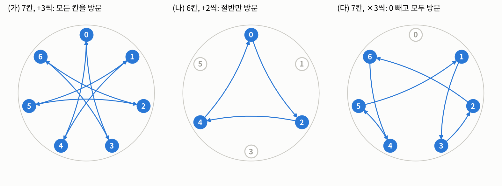
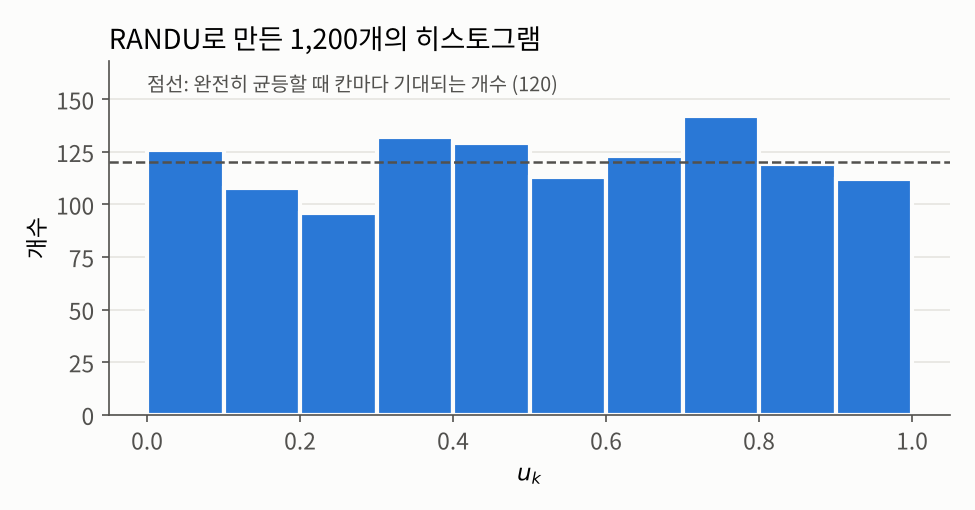
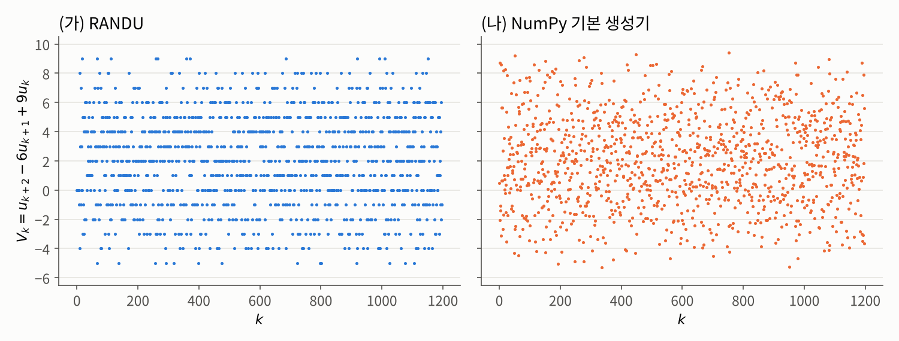

## 들어가며

[지난 글](index.qmd)에서는 무작위로 점을 찍어 원주율 $\pi$를 구하고, 같은 아이디어로 정적분을 계산했습니다. 그런데 두 알고리즘을 다시 보면 첫 줄이 똑같습니다. "**$[0,1]$ 위의 균등난수를 생성합니다.**" 지난 글은 이 한 줄을 당연하게 넘어갔고, 글의 끝에서 "균등난수는 어디서 오는가?"라는 질문을 남겼습니다.

[과목 소개 글](../index.qmd)에서는 이 질문에 대해 비유로만 답했습니다. 컴퓨터의 유사 난수 생성기는 아주 긴 난수표 책을 들고 다니는 대신, 책갈피(상태)를 정해진 규칙에 따라 한 칸씩 옮기며 다음 숫자를 계산해 낸다는 것이었습니다. 이번 글에서는 그 "규칙"의 가장 고전적인 예인 **선형 합동 생성기**(linear congruential generator, LCG)를 실제로 살펴봅니다.

참고로 이 과목에서 정수론을 직접 다루는 것은 이 글이 유일합니다. 이 글 이후로는 정수론에 관련된 이야기는 (아마) 다시는 등장하지 않으며, 정수론이 등장하는 파트가 어렵다면, 그냥 딱 LCG의 정의를 이해하는 수준의 정수론 내용만 보고 넘어가셔도 무방합니다. 그 이후로는  "$[0,1]$ 위의 i.i.d. 균등난수를 얻을 수 있다"는 것을 주어진 사실로 두고, 그것을 이용해 무엇을 할 수 있는지에 집중합니다.

그리고 선형 합동 생성기는 상당히 오래되어, 더이상 사용되지 않는 구시대의 산물입니다. 우리는 그냥 균등난수를 얻을 수 있다는 이론적 근거를 얻기 위한 하나의 예시로서만 선형 합동 생성기를 다룰 뿐임을 유의하셔야합니다.

## 문제 상황: 결정론적인 규칙으로 균등난수 흉내 내기

우리가 원하는 것은 서로 독립이고 모두 $\mathrm{Unif}[0,1]$을 따르는 확률변수들 $U_1, U_2, \ldots$의 **실현값**처럼 보이는 숫자 $u_1, u_2, \ldots \in [0,1]$입니다. 그런데 [과목 소개 글](../index.qmd)에서 이야기했듯이, 컴퓨터는 정해진 명령을 정해진 대로 수행하는 기계라서 진짜로 무작위인 숫자를 스스로 만들어 낼 수 없습니다.

그렇다면 타협이 필요합니다. 수열 자체는 **완전히 결정론적인 규칙**으로 만들되, 그 결과가 "i.i.d. 균등분포를 따르는 수열"이라고 봐도 이상할 것이 없을 만큼 그럴듯하게 만드는 것입니다. 이런 수를 **유사 난수**(pseudo-random number, PRN)라고 부릅니다. 말 그대로 난수와 유사한 무언가를 의미하는거죠. 이번 글의 질문은 이것입니다.

> 아주 단순한 계산 규칙만으로, 균등분포를 흉내 내는 긴 수열을 어떻게 만들 수 있을까요?

## 접근 아이디어: 시계 위의 점프

시곗바늘을 떠올려 봅시다. 시계에는 $0$부터 $m-1$까지 $m$개의 칸이 있고, 바늘은 지금 칸에서 **정해진 규칙에 따라** 다음 칸으로 점프합니다. 다음 칸이 어디인지는 오직 지금 시계바늘이 위치한 칸에 의해 결정됩니다. 바늘이 서 있는 칸 $j\in\{0,...,m-1\}$를 $m$으로 나누면, 그 결과물은 $\frac{j}{m} \in [0,1)$이 만족되는데, 이것을 난수로 쓰자는 것이 기본 아이디어입니다.

이 그림만으로도 중요한 사실 하나를 바로 알 수 있습니다. 칸은 $m$개뿐이므로, 바늘이 $m+1$번 서고 나면 적어도 한 칸은 두 번 밟게 됩니다(비둘기집 원리). 그리고 다음 칸은 지금 칸만으로 결정되므로, 한 번 밟았던 칸으로 돌아온 순간부터는 **이전과 똑같은 경로가 그대로 반복**됩니다. 즉 이런 방식으로 만든 수열은 언젠가 반드시 되풀이되며, 반복 없이 나올 수 있는 숫자는 많아야 $m$개입니다.
반복 자체는 피할 수 없으니, 우리가 할 수 있는 일은 다음과 같습니다.

- 시계의 칸 수 $m$을 아주 크게 잡습니다.
- 바늘이 처음 칸으로 돌아오기 전에 **가능한 한 많은 칸을 밟도록** 점프 규칙을 잘 고릅니다.
- 바늘이 $0, 1, 2, 3, \ldots$처럼 바로 옆 칸으로만 움직이면 다음 숫자를 뻔히 예측할 수 있으므로, **다음 칸을 쉽게 예측할 수 없도록** 뒤섞어서 점프하게 만듭니다.

{fig-alt="세 개의 원형 시계 그림. 왼쪽은 7칸 시계에서 3칸씩 더하며 0, 3, 6, 2, 5, 1, 4를 거쳐 0으로 돌아오며 모든 칸을 방문한다. 가운데는 6칸 시계에서 2칸씩 더하며 0, 2, 4만 방문하고 1, 3, 5는 방문하지 않는다. 오른쪽은 7칸 시계에서 3배씩 곱하며 1, 3, 2, 6, 4, 5를 거쳐 1로 돌아오며 0을 제외한 모든 칸을 방문한다."}

위 그림은 점프 규칙에 따라 결과가 얼마나 달라지는지 보여 줍니다.

- **(가)** 7칸 시계에서 0에서 출발해 매번 3칸씩 앞으로 갑니다. 결과가 6을 넘으면 7을 빼 줍니다(예: $6 + 3 = 9 \to 9 - 7 = 2$). 이렇게 하면 $0, 3, 6, 2, 5, 1, 4$를 거쳐 모든 칸을 다 밟고 $0$으로 돌아옵니다.
- **(나)** 6칸 시계에서 0에서 출발해 매번 2칸씩 앞으로 갑니다. 결과가 5를 넘으면 6을 빼 줍니다(예: $4 + 2 = 6 \to 6 - 6 = 0$). 이 경우에는 $0, 2, 4$만 맴돌고, $1, 3, 5$는 한 번도 밟지 못합니다.
- **(다)** 7칸 시계에서 1에서 출발해 매번 3을 곱한 뒤, 7로 나눈 나머지 칸으로 이동합니다(예: $3 \times 3 = 9 \to 9 \bmod 7 = 2$). 이렇게 하면 $1, 3, 2, 6, 4, 5$를 거쳐 $1$로 돌아오며, $0$을 제외한 모든 칸을 거칩니다.

이 차이가 어디서 오는지 정확히 말하려면 먼저 "시계 위의 계산"을 수학적으로 정의해야 합니다.

## 필요한 개념들

시계 위의 계산은 정수론의 **합동**(congruence)과 **나머지 연산**으로 표현할 수 있습니다.

::: {.callout-note icon=false .callout-definition}
### 정의 1.1.1 (합동과 나머지 연산)
자연수 $m \ge 2$와 정수 $x, y$에 대해, $x - y$가 $m$의 배수이면 $x$와 $y$가 **법 $m$에 대해 합동**이라고 하고
$$x \equiv y \pmod{m}$$
로 씁니다. 이는 쉽게 생각해서, $x$와 $y$는 모두 $m$으로 나눴을 때, 같은 나머지를 갖게 된다는 의미를 가집니다.

또한 $x \bmod m$은 $x$를 $m$으로 나눈 나머지, 즉 $x \equiv r \pmod m$을 만족하는 유일한 $r \in \{0, 1, \ldots, m-1\}$을 뜻합니다.
:::

$m$칸짜리 시계에서 바늘의 위치가 바로 $x \bmod m$입니다. 합동 관계는 덧셈과 곱셈을 보존하므로($x \equiv x'$, $y \equiv y'$이면 $x + y \equiv x' + y'$, $xy \equiv x'y'$), 계산 중간에 언제 나머지를 취하든 결과는 같습니다.

이제 점프 규칙으로 "곱하고 더한 뒤 나머지를 취하는" 가장 단순한 형태를 택하면, 그것이 선형 합동 생성기입니다.

::: {.callout-note icon=false}
### 알고리즘 1.1.2 (선형 합동 생성기)
**입력:** 정수 파라미터 $a, c \ge 0$, $m \ge 2$, 시드 $0 \le z_0 < m$<br>
**출력:** 유사 난수 $u_1, u_2, \ldots$

1. $k = 1, 2, \ldots$에 대해 $z_k := (a z_{k-1} + c) \bmod m$으로 둡니다.
2. $u_k := z_k / m$를 계산하여 출력합니다.
:::

$a$를 **곱수**(multiplier), $c$를 **증분**(increment), $m$을 **법**(modulus)이라고 부릅니다. $z_k$는 결국 어떤 수를 $m$으로 나눈 나머지가 되므로, 항상 $z_k \in \{0, 1, \ldots, m-1\}$이고, 따라서  $u_k \in [0, 1)$입니다. 고전적인 파라미터 선택으로는 $m = 2^{31} - 1$, $a = 16807$, $c = 0$이 있는데, 이 선택은 뒤에서 다시 살펴보겠습니다.

여기서 시드 $z_0$이 바로 [과목 소개 글](../index.qmd)에서 이야기한 "첫 책갈피의 위치"입니다. 같은 시드를 넣으면 $z_1, z_2, \ldots$가 똑같이 계산되므로 같은 수열이 나오고, 이것이 시드를 고정하면 결과가 재현되는 이유입니다. 파이썬에서 `numpy.random.rand(n)`으로 균등난수 $n$개를 만들고 `numpy.random.seed(...)`로 시작점을 고정하는 것도 같은 원리입니다. NumPy의 기본 생성기는 LCG보다 훨씬 정교하지만, "상태를 정해진 규칙으로 갱신한다"는 구조는 같습니다.

결국 우리가 i.i.d. 균등난수라고 부르며 쓰는 수열은 **실제로는 완전히 결정론적인 수열**입니다. 이 수열이 얼마나 오래 반복되지 않는지를 재는 양이 주기입니다.

::: {.callout-note icon=false .callout-definition}
### 정의 1.1.3 (주기)
수열 $z_0, z_1, z_2, \ldots$에 대해, 어떤 $k_0 \ge 0$이 있어 모든 $k \ge k_0$에서 $z_{k+p} = z_k$가 성립하는 가장 작은 자연수 $p \ge 1$을 이 수열의 **주기**(period)라고 합니다.
:::

앞의 시계 논증에 따르면 LCG의 수열은 항상 주기를 가지며, 그 주기는 $m$을 넘을 수 없습니다. 또 $a$가 $m$과 서로소이면 $z_{k-1} \equiv a^{-1}(z_k - c) \pmod m$처럼 한 칸 **뒤로** 되돌리는 계산도 가능합니다. 이때는 수열이 처음부터 곧바로 순환하므로, 주기는 "$z_k = z_0$이 처음으로 다시 성립하는 $k$"와 같습니다. 이 사실은 아래 명제의 증명에서 사용합니다.

주기를 분석할 때는 $z_k$를 점화식 대신 $z_0$에 대한 식으로 한 번에 써 두면 편리합니다.

::: {.callout-important icon=false .callout-satz}
### 보조정리 1.1.4 ($z_k$의 닫힌 형태)
모든 $k \ge 0$에 대해
$$z_k \equiv a^k z_0 + c \sum_{j=0}^{k-1} a^j \pmod m$$
이 성립합니다. 단, $k = 0$일 때 합은 $0$으로 둡니다.
:::

::: {.callout-tip collapse="false" icon=false .callout-beweis}
### 증명
$k$에 대한 귀납법을 씁니다. $k = 0$일 때는 합이 비어 있으므로 식은 $z_0 \equiv z_0$이 되어 성립합니다. $k$에서 성립한다고 가정하면, 합동이 덧셈과 곱셈을 보존하므로
$$z_{k+1} \equiv a z_k + c \equiv a^{k+1} z_0 + c \sum_{j=1}^{k} a^j + c = a^{k+1} z_0 + c \sum_{j=0}^{k} a^j \pmod m$$
이고, 이는 $k+1$에서의 식입니다. $\blacksquare$
:::

합 부분은 등비수열의 합이므로, $a \ne 1$이면 $\sum_{j=0}^{k-1} a^j = (a^k - 1)/(a - 1)$이고 $a = 1$이면 $k$입니다.

## 해결: 파라미터를 어떻게 골라야 할까

위에서 다룬 목표인

- 시계의 칸 수 $m$을 아주 크게 잡습니다.
- 바늘이 처음 칸으로 돌아오기 전에 **가능한 한 많은 칸을 밟도록** 점프 규칙을 잘 고릅니다.
- 바늘이 $0, 1, 2, 3, \ldots$처럼 바로 옆 칸으로만 움직이면 다음 숫자를 뻔히 예측할 수 있으므로, **다음 칸을 쉽게 예측할 수 없도록** 뒤섞어서 점프하게 만듭니다.

들을 달성할 수 있을지는 LCG의 맥락에서 결국 모두 파라미터 $a$, $c$, $m$을 어떻게 고르냐에 달려있습니다.

### 대충 고르면 생기는 일

먼저 파라미터를 별생각 없이 고르면 어떻게 되는지 보겠습니다.

::: {.callout-note icon=false}
### 예제 1.1.5 (엉성한 파라미터 선택)
$a = c = z_0 = 5$, $m = 10$으로 두면
$$z_1 = (5 \cdot 5 + 5) \bmod 10 = 0, \quad z_2 = (5 \cdot 0 + 5) \bmod 10 = 5, \quad z_3 = 0, \quad \ldots$$
이 되어 수열이 $5, 0, 5, 0, \ldots$을 반복합니다. 주기가 $2$이므로 $u_k$는 $1/2$과 $0$만 번갈아 나옵니다. 열 칸짜리 시계에서 두 칸만 쓰는 셈입니다.
:::

직접 확인해 보겠습니다. 아래 함수는 알고리즘 1.1.2를 그대로 옮긴 것입니다.

```python
import numpy as np

def lcg(a, c, m, z0, n):
    """z_k = (a z_{k-1} + c) mod m 을 n번 반복해 z_1, ..., z_n 을 돌려줍니다."""
    z = z0
    zs = []
    for _ in range(n):
        z = (a * z + c) % m
        zs.append(z)
    return zs

print(lcg(5, 5, 10, 5, 8))   # 예제 1.1.5: 엉성한 파라미터
```

```
[0, 5, 0, 5, 0, 5, 0, 5]
```

보시다시피, $m = 10$인 10칸짜리 시계를 사용했음에도, 결국 나오는 시계바늘이 밟는 칸은 0과 5밖에 없음을 알 수 있습니다.

### 주기를 최대로 만드는 조건

파라미터를 신중하게 고르면 훨씬 긴 주기를 얻을 수 있습니다. 그 조건을 말하려면 정수론의 도구가 하나 더 필요합니다. 오른쪽 시계 그림 (다)처럼 곱셈으로 점프할 때, **몇 번 곱해야 처음 자리로 돌아오는가**를 재는 양입니다.

::: {.callout-note icon=false .callout-definition}
### 정의 1.1.6 (위수와 원시근)
$m$이 소수이고 $a \not\equiv 0 \pmod m$일 때, $a^d \equiv 1 \pmod m$을 만족하는 가장 작은 자연수 $d \ge 1$을 법 $m$에 대한 $a$의 **위수**(multiplicative order)라고 합니다. 위수가 $m - 1$인 $a$를 법 $m$에 대한 **원시근**(primitive root)이라고 합니다.
:::

말로만 보면 추상적이니, 7칸 시계에서 직접 확인해 보겠습니다. 아래 표는 $a = 1, \ldots, 6$ 각각에 대해 $a, a^2, a^3, \ldots$을 7로 나눈 나머지를 차례로 적고, 처음으로 $1$이 나오는 곳에서 멈춘 것입니다.

| $a$ | $a^1, a^2, a^3, \ldots \pmod 7$ | 위수 |
|:--:|:--|:--:|
| 1 | $1$ | 1 |
| 2 | $2, 4, 1$ | 3 |
| 3 | $3, 2, 6, 4, 5, 1$ | **6** |
| 4 | $4, 2, 1$ | 3 |
| 5 | $5, 4, 6, 2, 3, 1$ | **6** |
| 6 | $6, 1$ | 2 |

예를 들어 $a = 2$이면 $2^1 = 2$, $2^2 = 4$, $2^3 = 8 \equiv 1$이므로 세 번 곱하면 $1$로 돌아오고, 위수는 $3$입니다. 시계로 말하면 $1$에서 출발해 $2$를 계속 곱하는 바늘은 $1 \to 2 \to 4 \to 1$로 세 칸만 돌고 제자리로 돌아옵니다.

반면 $a = 3$과 $a = 5$는 여섯 번을 곱해야 처음으로 $1$이 나옵니다. 그 사이에 $1$부터 $6$까지의 모든 수가 한 번씩 나타나므로, 이 곱수로 점프하면 $0$을 뺀 모든 칸을 다 밟고 돌아옵니다. 이렇게 "끝까지 다 돌고 나서야 돌아오는" 곱수가 원시근입니다. 즉 법 $7$에 대한 원시근은 $3$과 $5$이고, 앞의 시계 그림 (다)가 바로 $a = 3$인 경우입니다.

::: {.callout-important icon=false .callout-satz}
### 정리 1.1.7 (페르마의 소정리와 위수의 성질)
$m$이 소수이고 $a \not\equiv 0 \pmod m$이면 다음이 성립합니다.

1. (페르마의 소정리) $a^{m-1} \equiv 1 \pmod m$.
2. $a^n \equiv 1 \pmod m$이면 $a$의 위수 $d$는 $n$을 나눕니다. 특히 $d$는 $m - 1$의 약수입니다.
:::

::: {.callout-tip collapse="false" icon=false .callout-beweis}
### 증명
이 부분은 증명은 생략합니다. 그냥 의미 설명만 보셔도 충분합니다.
:::

위의 표를 다시 보면 정리 1.1.7이 말하는 내용을 그대로 확인할 수 있습니다.

1번은 **어떤 $a$로 시작하든 $m - 1$번 곱하면 반드시 $1$로 돌아온다**는 뜻입니다. 7칸 시계라면 $a$가 무엇이든 $a^6 \equiv 1$입니다. 표에서 위수가 $3$인 $a = 2$도 $2^6 = (2^3)^2 \equiv 1^2 = 1$이고, 위수가 $2$인 $a = 6$도 $6^6 = (6^2)^3 \equiv 1$입니다. 곱셈 점프는 $0$을 뺀 $m - 1$칸 안에서만 움직이므로, 아무리 길어도 $m - 1$번 안에는 돌아와야 한다는 시계 논증과도 잘 맞습니다.

2번은 **처음으로 돌아오는 횟수(위수)는 $m - 1$의 약수일 수밖에 없다**는 뜻입니다. 실제로 표의 위수는 $1, 3, 6, 3, 6, 2$로, 모두 $6$의 약수입니다. $4$나 $5$ 같은 위수는 나올 수 없습니다.

2번은 1번만 알면 바로 보일 수 있습니다. $a^n \equiv 1$이라고 하고, $n$을 위수 $d$로 나눈 몫과 나머지를 $n = qd + r$ ($0 \le r < d$)이라고 둡시다. 그러면
$$1 \equiv a^n = (a^d)^q \cdot a^r \equiv 1^q \cdot a^r = a^r \pmod m$$
이므로 $a^r \equiv 1$입니다. 그런데 $d$는 $a^d \equiv 1$을 만족하는 **가장 작은** 자연수였으므로, $d$보다 작은 $r$이 $a^r \equiv 1$을 만족하려면 $r = 0$일 수밖에 없습니다. 즉 $d$는 $n$을 나눕니다. 여기에 1번의 $n = m - 1$을 넣으면 $d$가 $m - 1$의 약수라는 결론을 얻습니다.

시계 그림으로 말하면 이렇습니다. 바늘은 $d$번마다 똑같은 경로를 되풀이하므로, $1$로 돌아오는 시점은 $d, 2d, 3d, \ldots$뿐입니다. 그런데 1번에 의해 $m - 1$번째에도 반드시 $1$에 있으므로, $m - 1$은 $d$의 배수여야 합니다.

이 사실 덕분에 원시근인지 확인하는 일이 훨씬 쉬워집니다. 위수가 될 수 있는 후보가 $m - 1$의 약수뿐이므로, $m - 1$보다 작은 약수에서 일찍 돌아오지 않는지만 확인하면 됩니다. 아래 명제 1.1.8의 조건이 바로 이 확인을 효율적으로 하는 방법입니다.

곱셈 점프의 관점에서 보면, 정리 1.1.7은 "몇 번을 곱하든 $m-1$번 곱하면 반드시 $1$로 돌아오고, 처음으로 돌아오는 횟수는 $m-1$의 약수일 수밖에 없다"는 뜻입니다. 이제 주기가 최대가 되는 조건을 말할 수 있습니다.

::: {.callout-important icon=false .callout-satz}
### 명제 1.1.8 (긴 주기를 보장하는 조건)
$m$이 홀수인 소수라고 합시다.

1. $c$가 $m$과 서로소이고 $a \equiv 1 \pmod m$이면, 주기는 $m$입니다.
2. $c = 0$, $a \not\equiv 0$, $z_0 \not\equiv 0 \pmod m$이고, $m - 1$의 **모든 소인수** $r$에 대해 $a^{(m-1)/r} \not\equiv 1 \pmod m$이면, 주기는 $m - 1$입니다.
:::

::: {.callout-tip collapse="false" icon=false .callout-beweis}
### 증명
두 경우 모두 $a$가 $m$과 서로소이므로, 앞에서 말했듯 주기는 $z_k \equiv z_0$이 처음으로 다시 성립하는 $k$와 같습니다.

**1번.** $a \equiv 1$이므로 보조정리 1.1.4에서 $z_k \equiv z_0 + kc \pmod m$입니다. 따라서 $z_k \equiv z_0$은 $m \mid kc$와 같고, $c$가 $m$과 서로소이므로 이는 $m \mid k$와 같습니다. 그러므로 처음으로 $z_0$에 돌아오는 것은 $k = m$일 때이고, 주기는 $m$입니다.

**2번.** $c = 0$이므로 보조정리 1.1.4에서 $z_k \equiv a^k z_0 \pmod m$입니다. $m$이 소수이고 $z_0 \not\equiv 0$이므로 $z_0$은 법 $m$에서 역원을 가지고, 따라서 $z_k \equiv z_0$은 $a^k \equiv 1$과 같습니다. 즉 주기는 $a$의 위수 $d$와 같습니다.

정리 1.1.7에 의해 $d$는 $m - 1$을 나눕니다. 만약 $d < m - 1$이라면 $(m-1)/d > 1$이므로 소인수 $r$을 하나 가지고, 그러면 $d$는 $(m-1)/r$을 나눕니다. 그런데 $a^d \equiv 1$이므로 $a^{(m-1)/r} = (a^d)^{(m-1)/(rd)} \equiv 1$이 되어 가정에 모순입니다. 따라서 $d = m - 1$이고, 주기는 $m - 1$입니다. $\blacksquare$
:::

두 조건을 시계 그림으로 다시 읽어 보겠습니다.

- **1번은 덧셈 점프입니다.** $a = 1$이면 바늘은 매번 $c$칸씩 앞으로 갑니다. 그림 (가)처럼 7칸 시계에서 3칸씩 가면 모든 칸을 밟지만, (나)처럼 6칸 시계에서 2칸씩 가면 일부 칸만 맴돕니다. 점프 폭과 시계 크기가 공약수를 가지면 안 된다는 것이 "$c$와 $m$이 서로소"라는 조건입니다.
- **2번은 곱셈 점프입니다.** 곱셈은 $0$을 $0$으로 보내므로 $0$은 피해야 하고, 나머지 $m - 1$칸을 모두 돌게 만드는 것이 목표입니다. 그러려면 $a$가 원시근이어야 합니다. 그런데 위수는 항상 $m - 1$의 약수이므로, $m - 1$보다 작은 약수들 중 "가장 큰 후보들", 즉 $(m-1)/r$에서 일찍 돌아오지 않는지만 확인하면 됩니다. 더 작은 약수에서 돌아온다면 그 약수의 배수인 이 후보들 중 하나에서도 반드시 돌아오기 때문입니다.

조건이 "$m - 1$의 모든 약수"가 아니라 "**모든 소인수** $r$"인 데에도 이유가 있습니다. $r = 1$까지 허용하면 $a^{m-1} \not\equiv 1$을 요구하게 되는데, 이는 페르마의 소정리 때문에 절대 만족될 수 없습니다. 또 2번의 경우 $z_k \equiv a^k z_0$은 결코 $0$이 되지 않으므로, $u_k$는 항상 열린 구간 $(0, 1)$ 안에 있습니다.

::: {.callout-note icon=false}
### 예제 1.1.9 (작은 원시근: $m = 7$, $a = 3$)
$m - 1 = 6$의 소인수는 $2$와 $3$입니다. $3^{6/2} = 27 \equiv 6 \not\equiv 1$, $3^{6/3} = 9 \equiv 2 \not\equiv 1 \pmod 7$이므로 명제 1.1.8의 2번 조건이 성립합니다. 실제로 $z_0 = 1$에서 시작하면
$$1,\ 3,\ 2,\ 6,\ 4,\ 5,\ 1,\ \ldots$$
이 되어 $0$을 제외한 여섯 칸을 모두 밟고 돌아옵니다. 주기는 $6 = m - 1$이고, 앞 그림의 (다)가 바로 이 경우입니다.
:::

```python
print(lcg(3, 0, 7, 1, 8))    # 예제 1.1.9: m = 7, a = 3
```

```
[3, 2, 6, 4, 5, 1, 3, 2]
```

명제 1.1.8의 조건은 파라미터가 아무리 커도 몇 번의 거듭제곱 계산만으로 확인할 수 있다는 장점이 있습니다. 앞에서 언급한 고전적인 선택을 확인해 보겠습니다.

::: {.callout-note icon=false}
### 예제 1.1.10 (고전적인 파라미터: $m = 2^{31} - 1$, $a = 16807$)
$m = 2^{31} - 1 = 2147483647$은 소수(메르센 소수)이고, $a = 16807 = 7^5$, $c = 0$입니다. 이 조합은 1988년 파크(S. K. Park, 참고로 한국인 아닙니다.)과 밀러(K. W. Miller)가 "적어도 이 정도는 되어야 하는 생성기"라는 뜻의 **최소 표준**(minimal standard)으로 권장하면서 널리 알려졌습니다.[^parkmiller] $m - 1 = 2 \cdot 3^2 \cdot 7 \cdot 11 \cdot 31 \cdot 151 \cdot 331$의 각 소인수 $r$에 대해 $a^{(m-1)/r} \bmod m$을 계산해 보면 어느 것도 $1$이 아니므로, 명제 1.1.8에 의해 주기는 $m - 1 = 2147483646$입니다.
:::

```python
m, a = 2**31 - 1, 16807
prime_factors = [2, 3, 7, 11, 31, 151, 331]   # m - 1 = 2 · 3² · 7 · 11 · 31 · 151 · 331
print([pow(a, (m - 1) // r, m) for r in prime_factors])
```

```
[2147483646, 634005911, 1600955193, 298192073, 16384, 1013763951, 759513457]
```

첫 번째 값 $2147483646 = m - 1$은 $-1 \pmod m$과 같으므로 역시 $1$이 아닙니다. 파이썬의 `pow(a, e, m)`은 $a^e \bmod m$을 빠르게 계산하는 내장 함수입니다. 실제로 이 생성기로 만든 처음 몇 개의 수는 다음과 같습니다.

```python
zs = lcg(16807, 0, 2**31 - 1, 1, 5)
print(zs)
print([round(z / (2**31 - 1), 6) for z in zs])
```

```
[16807, 282475249, 1622650073, 984943658, 1144108930]
[8e-06, 0.131538, 0.755605, 0.45865, 0.532767]
```

시드가 $z_0 = 1$이라 첫 값은 $7^5$로 아주 작지만, 그 뒤로는 $[0,1]$ 위를 제멋대로 오가는 것처럼 보입니다. 주기가 약 21억이므로, 웬만한 시뮬레이션에서는 반복되는 구간에 닿을 일이 없습니다.

## 주기가 길면 좋은 난수일까?

여기까지 보면 "주기를 최대로 만들면 문제가 해결된다"고 생각하기 쉽습니다. 하지만 **주기가 긴 것은 좋은 난수의 필요조건일 뿐, 충분조건이 아닙니다.**

가장 극단적인 예는 명제 1.1.8의 1번입니다. $a = 1$, $c = 1$로 두면 주기는 최대인 $m$이지만, 수열은 $z_0, z_0 + 1, z_0 + 2, \ldots$처럼 한 칸씩 올라갈 뿐입니다. 모든 값을 정확히 한 번씩 고르게 거치니 "균등"하기는 하지만, 다음 값을 완벽하게 예측할 수 있으므로 "독립"과는 거리가 멉니다.

2번 조건을 만족하는 곱셈형 생성기에서도 비슷한 문제가 더 은밀한 형태로 나타납니다. 역사적으로 가장 유명한 사례를 보겠습니다.

::: {.callout-note icon=false}
### 예제 1.1.11 (RANDU)
**RANDU**는 1960년대 IBM 컴퓨터에서 널리 쓰였던 LCG로, 파라미터는
$$a = 2^{16} + 3 = 65539, \qquad c = 0, \qquad m = 2^{31}$$
입니다. $m$이 2의 거듭제곱이라 나머지 연산을 매우 빠르게 계산할 수 있다는 것이 장점이었습니다.
:::

먼저 1,200개를 만들어 히스토그램을 그려 보겠습니다.

```python
nsim = 1200
A, M = 2**16 + 3, 2**31
S = np.empty(nsim, dtype=np.int64)
S[0] = 1
for i in range(1, nsim):
    S[i] = (S[i - 1] * A) % M
U = S / M
print(np.histogram(U, bins=10, range=(0, 1))[0])   # 0.1 간격 10칸에 들어간 개수
```

```
[126 108  96 132 129 113 123 142 119 112]
```

{fig-alt="RANDU로 만든 1200개 값의 히스토그램. 0.1 간격 10개 막대의 높이가 96에서 142 사이로, 균등분포일 때의 기대 개수 120을 나타내는 점선 주변에 고르게 분포한다." width=75%}

각 칸의 개수가 기대값 $120$ 근처에 고르게 흩어져 있어, 히스토그램만 보면 아무 문제가 없어 보입니다. 이제 연속된 세 값을 묶어서 다음 양을 계산해 보겠습니다.

$$V_k := u_{k+2} - 6u_{k+1} + 9u_k$$

```python
V = U[2:] - 6 * U[1:-1] + 9 * U[:-2]
print(np.unique(V))
```

```
[-5. -4. -3. -2. -1.  0.  1.  2.  3.  4.  5.  6.  7.  8.  9.]
```

{fig-alt="두 개의 산점도. 왼쪽 RANDU의 V_k 값은 -5부터 9까지의 정수 위에만 가로줄 모양으로 찍혀 있다. 오른쪽 NumPy 기본 생성기의 V_k 값은 -6과 10 사이에 연속적으로 흩어져 있다."}

1,198개의 $V_k$가 **$-5$부터 $9$까지의 정수, 단 15가지 값**만 가집니다. 진짜 i.i.d. 균등난수라면 $V_k$는 $-6$과 $10$ 사이의 실수 값을 연속적으로 가져야 하고, 실제로 오른쪽 그림처럼 NumPy의 기본 생성기로 같은 계산을 하면 값이 고르게 흩어집니다.

이유는 곱수 $a = 2^{16} + 3$에 숨어 있습니다. $2^{32}$은 $2^{31}$의 배수이므로
$$a^2 = 2^{32} + 6 \cdot 2^{16} + 9 \equiv 6 \cdot 2^{16} + 9 = 6(2^{16} + 3) - 9 = 6a - 9 \pmod{2^{31}}$$
입니다. 따라서
$$z_{k+2} \equiv a^2 z_k \equiv (6a - 9) z_k = 6 z_{k+1} - 9 z_k \pmod{2^{31}},$$
즉 $z_{k+2} - 6z_{k+1} + 9z_k$는 항상 $2^{31}$의 배수입니다. 양변을 $2^{31}$로 나누면 $V_k$는 **정수**이고, $u_k \in [0, 1)$이므로 $V_k$는 $-6$과 $10$ 사이의 정수, 즉 $-5, -4, \ldots, 9$ 중 하나일 수밖에 없습니다. 코드로도 확인할 수 있습니다.

```python
print(np.all((S[2:] - 6 * S[1:-1] + 9 * S[:-2]) % M == 0))
```

```
True
```

이 사실을 기하학적으로 보면 더 충격적입니다. 연속된 세 값을 묶은 점 $(u_k, u_{k+1}, u_{k+2})$를 단위 정육면체 안에 찍으면, 진짜 난수라면 정육면체를 고르게 채워야 합니다. 그런데 RANDU의 점들은 모두 $9x - 6y + z = n$ ($n = -5, \ldots, 9$) 꼴의 **평행한 평면 15장 위에만** 놓입니다. 이 평면들을 한 축에 비춰 본 그림자, 즉 히스토그램은 여전히 고르게 보이기 때문에 히스토그램만으로는 이 결함을 볼 수 없습니다. 1968년 마살리아(G. Marsaglia)는 곱셈형 LCG가 만든 점들이 언제나 이런 평면 구조를 가진다는 것을 보였고, 이 결과는 "난수는 주로 평면 위에 떨어진다"라는 제목으로 유명해졌습니다.[^marsaglia]

교훈은 분명합니다. **균등분포를 따르는지(주변분포)만 확인해서는 부족하고, 연속된 값들이 서로 독립처럼 행동하는지(결합분포)까지 확인해야 합니다.**

## 정리

이번 글에서 본 내용을 정리하면 다음과 같습니다.

- 선형 합동 생성기는 $z_k = (a z_{k-1} + c) \bmod m$, $u_k = z_k/m$이라는 아주 단순한 규칙으로 균등난수를 흉내 냅니다. 시드 $z_0$이 같으면 같은 수열이 나오며, 이 수열은 완전히 결정론적입니다.
- 상태가 $m$개뿐이므로 주기는 $m$을 넘을 수 없고, 명제 1.1.8은 주기가 최대($m$ 또는 $m-1$)가 되도록 파라미터를 고르는 조건을 줍니다.
- 그러나 주기가 길다고 좋은 난수는 아닙니다. RANDU는 히스토그램으로는 완벽해 보이지만, 연속된 세 값이 15장의 평면 위에만 놓이는 심각한 결함을 가지고 있었습니다.

오늘날 파이썬과 R의 기본 생성기는 메르센 트위스터나 PCG처럼 LCG보다 훨씬 정교한 알고리즘을 쓰고, 이런 단순한 결함을 피하도록 설계되어 있습니다. 하지만 "결정론적인 상태를 정해진 규칙으로 갱신한다"는 뼈대는 LCG와 같습니다.

그렇다면 남는 질문은 이것입니다. RANDU의 결함은 우리가 $V_k$라는 특별한 조합을 미리 알고 있었기 때문에 찾을 수 있었습니다. 그런 지식 없이, 주어진 수열이 "i.i.d. 균등분포를 따른다"고 봐도 되는지를 **어떻게 체계적으로 판정**할 수 있을까요? 다음 글에서는 이 질문을 통계적 검정의 관점에서 다룹니다.

---

### 연결되는 개념
* $\leftarrow$ **이전 개념:** [1 몬테카를로 시뮬레이션](index.qmd)
* $\rightarrow$ **다음 개념:** 추후 작성 예정

[^parkmiller]: S. K. Park & K. W. Miller, "Random number generators: good ones are hard to find", *Communications of the ACM* 31(10), 1988, pp. 1192–1201.

[^marsaglia]: G. Marsaglia, "Random numbers fall mainly in the planes", *Proceedings of the National Academy of Sciences* 61(1), 1968, pp. 25–28.
