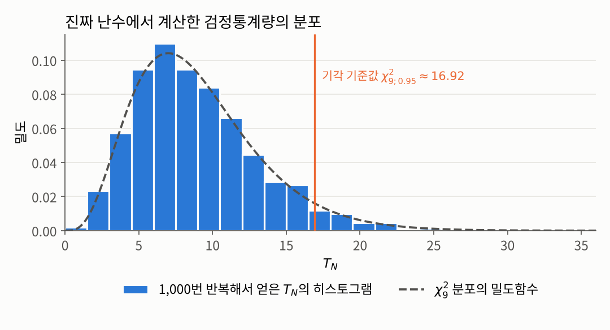
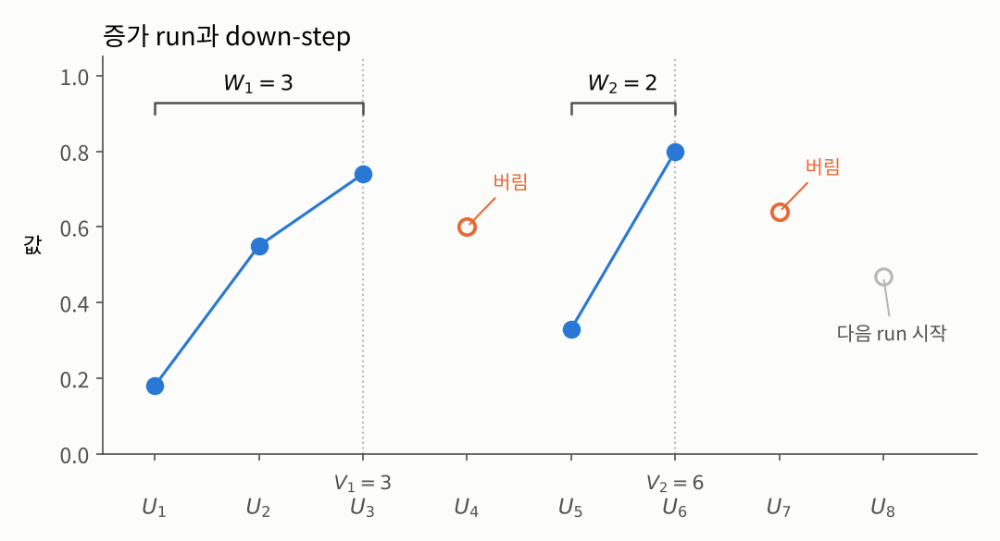
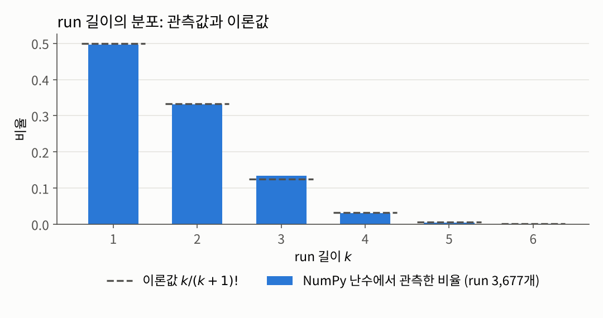

## 들어가며

[지난 글](01-lcg.qmd)에서는 선형 합동 생성기(LCG)로 균등난수를 흉내 내는 방법을 보았고, 주기가 길어도 나쁜 난수일 수 있다는 것을 RANDU의 예로 확인했습니다. 그런데 RANDU의 결함은 $u_{k+2} - 6u_{k+1} + 9u_k$라는 특별한 조합을 미리 알고 있었기 때문에 찾을 수 있었습니다. 그래서 지난 글은 이런 질문을 남겼습니다.

> 그런 사전 지식 없이, 주어진 수열이 "i.i.d. 균등분포를 따른다"고 봐도 되는지를 어떻게 체계적으로 판정할 수 있을까요?

이번 글에서는 이 질문을 **통계적 가설검정**의 문제로 바꾸어 답합니다. 값들이 $[0,1]$ 위에 고르게 퍼져 있는지 보는 **균등성 검정**과, 연속된 값들이 서로 독립처럼 행동하는지 보는 **run 검정**을 차례로 만들고, 둘을 실제 생성기들에 적용해 보겠습니다.

## "좋은 난수인가?"를 가설검정으로 바꾸기

생성기가 만든 수 $\boldsymbol{u}_N := (u_1, \ldots, u_N)$이 주어졌다고 합시다. 우리가 확인하고 싶은 주장은 다음과 같습니다.

$$H_0:\ u_1, \ldots, u_N \text{은 i.i.d. } \mathsf{Unif}(0,1) \text{ 확률변수 } U_1, \ldots, U_N \text{의 실현값이다.}$$

물론 [과목 소개 글](../index.qmd)과 [지난 글](01-lcg.qmd)에서 보았듯이 이 수들은 실제로는 결정론적으로 계산된 값이므로, 엄밀히 말하면 $H_0$은 거짓입니다. 그래서 질문을 이렇게 바꿉니다. "**이 수열을 보고 진짜 i.i.d. 균등난수와 구별할 수 있는가?**" 구별할 수 없다면, 시뮬레이션에서 진짜 난수 대신 써도 괜찮다고 판단하는 것입니다.

여기에는 보통의 통계 분석과 반대인 점이 하나 있습니다. 평소에는 귀무가설을 기각하는 것이 "무언가를 발견했다"는 반가운 결과입니다. 하지만 여기서 $H_0$은 우리가 바라는 이상적인 상태이므로, **기각되지 않기를 바라면서** 검정을 합니다.

## 값들이 고르게 퍼져 있는가: 균등성 검정

### 히스토그램이 얼마나 들쭉날쭉한가

가장 먼저 떠오르는 방법은 히스토그램입니다. 구간 $[0,1]$을 길이가 같은 $r$개의 칸으로 나누고, 각 칸에 들어간 수를 셉니다. 진짜 균등난수라면 각 칸에는 평균적으로 $N/r$개씩 들어가야 합니다.

그렇다고 막대 높이가 정확히 $N/r$이 되지는 않습니다. 무작위이니 조금씩 들쭉날쭉한 것이 오히려 자연스럽습니다. 그러므로 물어야 할 것은 "막대가 $N/r$과 같은가?"가 아니라 "**막대가 $N/r$에서 벗어난 정도가 우연이라고 보기에 너무 큰가?**"입니다. 이 판단을 숫자로 하려면 벗어난 정도를 하나의 수로 요약하는 방법과, 그 수가 우연만으로 얼마나 커질 수 있는지에 대한 기준이 필요합니다. 이것이 가설검정의 틀입니다.

### 가설검정과 카이제곱분포

::: {.callout-note icon=false .callout-definition}
### 정의 1.2.1 (가설검정)
**귀무가설**(null hypothesis) $H_0$은 검정하려는 기본 주장입니다. 데이터로부터 계산하는 값 $T$를 **검정통계량**(test statistic)이라고 하고, $T$가 정해진 **기각역**(rejection region)에 들어가면 $H_0$을 **기각**합니다. $H_0$이 참인데도 기각할 확률이 $\alpha$ 이하가 되도록 기각역을 정할 때, $\alpha$를 **유의수준**(significance level)이라고 합니다.
:::

유의수준 $\alpha$는 "진짜 난수인데도 가짜라고 잘못 판정하는 비율"을 얼마까지 허용할지 정하는 값이며, 흔히 $\alpha = 0.05$를 씁니다. 가설검정의 기초는 [기초 통계학](../../basic-stats/index.qmd)을 참고하시기 바랍니다.

한 가지 주의할 점이 있습니다. $H_0$을 기각하지 못했다고 해서 $H_0$이 참이라고 **증명**된 것은 아닙니다. "이 검정으로는 진짜 난수와 구별되는 증거를 찾지 못했다"는 뜻일 뿐입니다. 이 점은 글의 뒷부분에서 중요하게 다시 등장합니다.

기각 기준을 정할 때 쓰는 분포가 카이제곱분포입니다.

::: {.callout-note icon=false .callout-definition}
### 정의 1.2.2 (카이제곱분포와 분위수)
$Z_1, \ldots, Z_k$가 i.i.d. 표준정규분포를 따를 때, $Z_1^2 + \cdots + Z_k^2$의 분포를 **자유도 $k$인 카이제곱분포**(chi-squared distribution)라고 하고 $\chi^2_k$로 씁니다. 또한 $0 < q < 1$에 대해 $X \sim \chi^2_k$가 $\mathbb{P}(X \le x) = q$를 만족하는 값 $x$를 $\chi^2_k$의 **$q$-분위수**(quantile)라고 하고 $\chi^2_{k;q}$로 씁니다.
:::

예를 들어 $\chi^2_{9;0.95} \approx 16.919$는 자유도 $9$인 카이제곱분포에서 $95\%$의 값이 이보다 작다는 뜻입니다. 이 값보다 큰 통계량은 $5\%$ 확률로만 나오는 "드문" 값입니다. 정의에서 바로 $\chi^2_k$의 평균은 $k$, 분산은 $2k$임을 알 수 있습니다($\mathbb{E}[Z^2] = 1$, $\mathrm{Var}(Z^2) = 2$).

이제 히스토그램이 들쭉날쭉한 정도를 요약하는 통계량과, 그 분포에 대한 정리를 쓸 수 있습니다. 아래에서 $\boldsymbol{u}_N \cap I$는 $u_1, \ldots, u_N$ 중 구간 $I$에 들어가는 것들을 뜻하고, $|\boldsymbol{u}_N \cap I|$는 그 개수를 뜻합니다.

::: {.callout-important icon=false .callout-satz}
### 정리 1.2.3 (피어슨의 카이제곱 정리)
$\boldsymbol{U}_N := (U_1, \ldots, U_N)$이 i.i.d.이고, 공간을 $r$개의 칸 $A_1, \ldots, A_r$로 나누었을 때 각 $U_i$가 $A_j$에 들어갈 확률이 $p_j > 0$이라고 합시다($p_1 + \cdots + p_r = 1$). $A_j$에 들어간 개수를 $N_j := |\boldsymbol{U}_N \cap A_j|$라 하면
$$\sum_{j \le r} \frac{(N_j - N p_j)^2}{N p_j} \xrightarrow[N \to \infty]{} \chi^2_{r-1} \qquad \text{분포수렴}$$
이 성립합니다.
:::

::: {.callout-tip collapse="true" icon=false .callout-beweis}
### 증명 (스케치)
각 $U_i$는 $r$개의 칸 중 정확히 하나에 들어가므로, $(N_1, \ldots, N_r)$은 다항분포를 따르고
$$\mathbb{E}[N_j] = N p_j, \qquad \mathrm{Cov}(N_j, N_k) = N\,(p_j \delta_{jk} - p_j p_k)$$
입니다($\delta_{jk}$는 $j = k$일 때 $1$, 아니면 $0$). 표준화한 벡터 $\boldsymbol{Y}^{(N)} := (Y_1, \ldots, Y_r)$, $Y_j := (N_j - N p_j)/\sqrt{N p_j}$를 생각하면 공분산행렬은
$$\mathrm{Cov}(Y_j, Y_k) = \delta_{jk} - \sqrt{p_j p_k}, \quad \text{즉} \quad \Sigma = I_r - \boldsymbol{q}\boldsymbol{q}^\top, \qquad \boldsymbol{q} := (\sqrt{p_1}, \ldots, \sqrt{p_r})^\top$$
입니다. $\boldsymbol{Y}^{(N)}$은 i.i.d. 벡터들(각 $U_i$가 어느 칸에 들어갔는지를 나타내는 지시벡터)의 합을 표준화한 것이므로, 다변량 중심극한정리에 의해 $\boldsymbol{Y}^{(N)} \to \mathcal{N}(\boldsymbol{0}, \Sigma)$로 분포수렴합니다.

$\boldsymbol{q}$는 길이가 $1$인 벡터이므로 $\Sigma$는 $\boldsymbol{q}$에 수직인 $(r-1)$차원 부분공간으로의 **정사영 행렬**입니다. 따라서 $\boldsymbol{Z} \sim \mathcal{N}(\boldsymbol{0}, I_r)$에 대해 $\Sigma \boldsymbol{Z} \sim \mathcal{N}(\boldsymbol{0}, \Sigma\Sigma^\top) = \mathcal{N}(\boldsymbol{0}, \Sigma)$이고, $\boldsymbol{q}$를 첫 번째 벡터로 하는 정규직교기저에서 보면 $\|\Sigma \boldsymbol{Z}\|^2$는 서로 독립인 표준정규 $r - 1$개의 제곱합, 즉 $\chi^2_{r-1}$입니다. 검정통계량은 $\|\boldsymbol{Y}^{(N)}\|^2$이므로 연속사상 정리에 의해 $\chi^2_{r-1}$로 분포수렴합니다. 다변량 중심극한정리와 연속사상 정리는 [수리통계학](../../math-stats/index.qmd)을 참고하시기 바랍니다. $\blacksquare$
:::

정리의 의미를 풀어 보겠습니다. 각 칸의 개수 $N_j$는 평균이 $Np_j$이고 분산이 대략 $Np_j$인 확률변수라서, $(N_j - Np_j)^2/(Np_j)$는 "표준화된 차이의 제곱"이고 칸 하나당 대략 $1$ 정도의 크기를 가집니다. 이것을 $r$개 더한 것이 검정통계량입니다.

그렇다면 자유도는 왜 $r$이 아니라 $r - 1$일까요? 모든 칸의 개수를 더하면 반드시 $N_1 + \cdots + N_r = N$이 되기 때문입니다. $r - 1$개 칸의 개수를 알면 마지막 칸은 저절로 정해지므로 자유롭게 움직이는 양은 $r - 1$개뿐이고, 증명에서 정사영의 차원이 $r - 1$이었던 것이 바로 이 제약을 반영합니다. 또 이 정리는 극한분포에 관한 것이므로, 실무에서는 각 칸의 기대 개수 $Np_j$가 대략 $5$ 이상이 되도록 $N$을 충분히 크게 잡습니다.

### 균등성 검정과 적용

$[0,1]$을 길이 $1/r$인 칸으로 나누면 $H_0$ 아래에서 $p_j = 1/r$이므로, 정리 1.2.3을 그대로 적용할 수 있습니다.

::: {.callout-note icon=false}
### 알고리즘 1.2.4 (균등성 검정)
**입력:** 칸의 개수 $r \ge 2$, 유의수준 $\alpha > 0$<br>
**출력:** $H_0$을 기각할지 여부

1. $[0,1]$을 $r$개의 칸 $[(j-1)/r,\ j/r]$, $j = 1, \ldots, r$로 나눕니다.
2. 유사 난수 $\boldsymbol{u}_N := (u_1, \ldots, u_N)$을 생성합니다.
3. 검정통계량을 계산합니다.
$$T_N(\boldsymbol{u}_N) := \sum_{j \le r} \frac{\bigl(|\boldsymbol{u}_N \cap [(j-1)/r,\ j/r]| - N/r\bigr)^2}{N/r}$$
4. $T_N(\boldsymbol{u}_N) > \chi^2_{r-1;1-\alpha}$이면 유의수준 $\alpha$에서 $H_0$을 기각합니다.
:::

정리 1.2.3에 의해 $H_0$ 아래에서 $T_N$은 근사적으로 $\chi^2_{r-1}$을 따르므로, $T_N$이 $\chi^2_{r-1;1-\alpha}$보다 클 확률은 근사적으로 $\alpha$입니다. 즉 진짜 난수를 잘못 기각할 확률이 $\alpha$로 조절됩니다. 한편 관측된 통계량 값 $t$에 대해 $\mathbb{P}(\chi^2_{r-1} > t)$를 **p-값**(p-value)이라고 부릅니다. "진짜 난수였다면 이만큼 또는 이보다 더 들쭉날쭉한 히스토그램이 나올 확률"이며, p-값이 $\alpha$보다 작은 것과 $t > \chi^2_{r-1;1-\alpha}$인 것은 같은 말입니다.

세 가지 수열에 적용해 보겠습니다. NumPy의 기본 생성기, [지난 글](01-lcg.qmd)의 RANDU, 그리고 $0$부터 $1$까지 일정한 간격으로 **정렬된** 수열 $u_i = (i - 1/2)/N$입니다.

```python
import numpy as np
from math import factorial
from scipy.stats import chi2

def uniformity_test(u, r=10, alpha=0.05):
    """균등성 검정: (검정통계량 T_N, 기각 기준값, p-값)을 돌려줍니다."""
    N = len(u)
    counts = np.histogram(u, bins=r, range=(0, 1))[0]   # |u_N ∩ [(j-1)/r, j/r]|, j = 1, ..., r
    T = np.sum((counts - N / r) ** 2 / (N / r))
    return T, chi2.ppf(1 - alpha, r - 1), chi2.sf(T, r - 1)

N = 10_000
np.random.seed(1557)
u_numpy = np.random.rand(N)                      # NumPy 기본 생성기

z = np.empty(N, dtype=np.int64)                  # RANDU (지난 글)
z[0] = 1
for i in range(1, N):
    z[i] = (z[i - 1] * 65539) % 2**31
u_randu = z / 2**31

u_sorted = (np.arange(1, N + 1) - 0.5) / N       # 0.00005, 0.00015, ..., 0.99995

for name, u in [("NumPy", u_numpy), ("RANDU", u_randu), ("sorted", u_sorted)]:
    T, crit, p = uniformity_test(u)
    print(f"{name:7s} T = {T:6.3f}  기준값 = {crit:.3f}  p-값 = {p:.4f}  ->  {'기각' if T > crit else '기각하지 않음'}")
```

```
NumPy   T =  6.092  기준값 = 16.919  p-값 = 0.7307  ->  기각하지 않음
RANDU   T =  8.634  기준값 = 16.919  p-값 = 0.4717  ->  기각하지 않음
sorted  T =  0.000  기준값 = 16.919  p-값 = 1.0000  ->  기각하지 않음
```

세 수열 모두 균등성 검정을 통과했습니다. NumPy가 통과한 것은 당연하지만, 지난 글에서 심각한 결함을 확인한 RANDU도 통과했습니다. 지난 글의 히스토그램이 멀쩡해 보였던 것과 같은 이야기입니다.

가장 눈여겨볼 것은 정렬된 수열입니다. 각 칸에 정확히 $N/r$개씩 들어가므로 $T_N = 0$으로 **완벽하게** 통과합니다. 하지만 이 수열은 다음 값을 완벽하게 예측할 수 있으므로 난수와는 거리가 멉니다. 사실 진짜 난수에서 $T_N$이 이렇게 작게 나오는 일은 거의 없으므로 지나치게 작은 값도 수상한 신호이지만, 큰 쪽만 보는 위의 검정은 이를 잡아내지 못합니다.

이것이 균등성 검정의 근본적인 한계입니다. 이 검정은 값들을 칸에 나눠 담은 **주변분포**(marginal distribution)만 볼 뿐이고, 값들이 **어떤 순서로** 나왔는지는 전혀 보지 않습니다. 독립성은 정리 1.2.3의 가정으로 깔려 있을 뿐 검정이 확인해 주지는 않습니다. 수열을 아무렇게나 섞어도 $T_N$이 바뀌지 않는다는 점을 생각하면 분명합니다.

### 검정이 약속을 지키는지 시뮬레이션으로 확인하기

정리 1.2.3은 $N \to \infty$일 때의 이야기입니다. $N = 10{,}000$, $r = 10$이라는 유한한 상황에서도 "진짜 난수를 잘못 기각할 확률이 $5\%$"라는 약속이 지켜질까요? 이것이야말로 시뮬레이션으로 확인하기 좋은 질문입니다. 길이 $10{,}000$짜리 수열을 새로 만들어 검정하는 일을 $1{,}000$번 반복해 보겠습니다.

```python
T_values = np.array([uniformity_test(np.random.rand(N))[0] for _ in range(1000)])
crit = chi2.ppf(0.95, 9)
print(f"기각 비율 = {np.mean(T_values > crit):.3f}")
print(f"T의 평균 = {T_values.mean():.3f},  T의 분산 = {T_values.var():.3f}")
```

```
기각 비율 = 0.045
T의 평균 = 8.896,  T의 분산 = 17.394
```

{fig-alt="NumPy 난수로 균등성 검정을 1000번 반복해서 얻은 검정통계량의 히스토그램. 자유도 9인 카이제곱분포의 밀도함수 곡선과 잘 겹치며, 기각 기준값 16.92를 넘는 막대는 오른쪽 꼬리의 일부뿐이다." width=85%}

기각 비율은 $4.5\%$로 약속한 $5\%$ 근처이고, $T_N$의 평균과 분산도 $\chi^2_9$의 평균 $9$, 분산 $18$에 가깝습니다. 히스토그램 역시 $\chi^2_9$의 밀도함수와 잘 겹칩니다.

여기서 중요한 교훈이 하나 있습니다. **좋은 생성기도 $1{,}000$번 중 $45$번은 기각되었습니다.** 유의수준 $5\%$인 검정은 진짜 난수조차 $20$번에 한 번꼴로 기각하도록 만들어져 있기 때문입니다. 그러므로 검정을 한 번 해서 기각되었다고 바로 생성기를 버리는 것이 아니라, 반복했을 때 기각 비율이 $\alpha$보다 뚜렷하게 큰지, p-값들이 고르게 퍼져 있는지를 보는 것이 올바른 사용법입니다.

## 연속된 값들이 서로 독립인가: run 검정

### 주가 차트처럼 그려 보기

난수를 순서대로 꺾은선 그래프로 그리면 주가 차트처럼 보입니다. 진짜 i.i.d. 난수라면 이 그래프는 오르락내리락을 자주 반복해야 합니다. 바로 앞의 값이 무엇이든 다음 값은 그와 상관없이 정해지기 때문입니다.

반대로 그래프가 여러 번 연속으로 계속 오르기만 한다면 "앞의 값이 다음 값을 끌어올리는" 의존성이 있다는 신호입니다. 그래서 **한 번 오르기 시작하면 몇 번이나 연속으로 오르는가**, 즉 증가 구간의 길이를 세어서 진짜 난수에서 기대되는 분포와 비교하자는 것이 run 검정의 아이디어입니다. 이를 위해서는 증가 구간의 길이를 정확히 정의하고, 진짜 i.i.d. 균등난수에서 그 길이가 어떤 분포를 따르는지 계산해야 합니다.

### down-step과 run의 길이

::: {.callout-note icon=false .callout-definition}
### 정의 1.2.5 (down-step과 증가 run의 길이)
수열 $U_1, U_2, \ldots$에서 바로 다음 값이 작아지는 위치를 **down-step**이라고 하고, 그 위치를 차례로
$$V_1 := \min\{i \ge 1 : U_{i+1} < U_i\}, \qquad V_{j+1} := \min\{i \ge V_j + 2 : U_{i+1} < U_i\}$$
로 정의합니다. 그리고 $j$번째 **증가 run의 길이**를
$$W_1 := V_1, \qquad W_{j+1} := V_{j+1} - V_j - 1$$
로 정의합니다.
:::

정의만 보면 복잡하지만 그림으로 보면 간단합니다.

{fig-alt="여덟 개의 값 U1부터 U8까지를 점으로 그린 그림. U1, U2, U3은 증가하며 파란 선으로 이어져 있고 W1 = 3으로 표시되어 있다. U4는 U3보다 작아 첫 down-step을 완성하며 주황색 빈 원으로 '버림' 표시가 되어 있다. U5, U6은 증가하며 W2 = 2로 표시되어 있고, U7은 다시 작아져 주황색 빈 원으로 '버림' 표시가 되어 있다. U8은 회색 빈 원으로 '다음 run 시작'이라고 표시되어 있다. x축 아래에 V1 = 3, V2 = 6이 표시되어 있다." width=85%}

- $U_1 < U_2 < U_3$으로 오르다가 $U_4 < U_3$에서 처음 내려갑니다. 따라서 $V_1 = 3$이고, 첫 번째 run $(U_1, U_2, U_3)$의 길이는 $W_1 = 3$입니다.
- down-step을 완성한 값 $U_4$는 **버리고**, 다음 run은 $U_5$부터 시작합니다. 정의에서 $i \ge V_j + 2$라고 한 것이 이 뜻입니다.
- $U_5 < U_6$으로 오르다가 $U_7 < U_6$에서 내려가므로 $V_2 = 6$이고, $W_2 = V_2 - V_1 - 1 = 2$입니다.

그렇다면 왜 굳이 $U_4$를 버릴까요? $U_4$는 "바로 앞의 값보다 작다"는 조건이 붙은 값이라 작은 쪽으로 치우쳐 있습니다. 이 값에서 다음 run을 시작하면 다음 run이 길어지는 경향이 생겨, 연속된 run의 길이들이 서로 독립이 아니게 됩니다. 한 칸을 버리면 각 run이 **서로 겹치지 않는** 구간의 값들만으로 정해지므로, 아래 명제처럼 run의 길이들이 독립이 됩니다.

::: {.callout-important icon=false .callout-satz}
### 명제 1.2.6 (run 길이의 분포)
$U_1, U_2, \ldots$가 i.i.d. $\mathsf{Unif}(0,1)$이면 $W_1, W_2, \ldots$는 i.i.d.이고, 그 분포는
$$\mathbb{P}(W_j = k) = \frac{k}{(k+1)!}, \qquad k \ge 1$$
입니다.
:::

::: {.callout-tip collapse="true" icon=false .callout-beweis}
### 증명
**1단계: $W_1$의 분포.** $W_1 \ge k$라는 것은 $i = 1, \ldots, k-1$에서 down-step이 없다는 것, 즉 $U_1 \le U_2 \le \cdots \le U_k$라는 뜻입니다. i.i.d. 연속확률변수 $k$개를 늘어놓는 $k!$가지 순서는 대칭성에 의해 모두 같은 확률을 가지고, 값이 같아질 확률은 $0$이므로 $\mathbb{P}(U_1 \le \cdots \le U_k) = 1/k!$입니다. 따라서
$$\mathbb{P}(W_1 = k) = \mathbb{P}(U_1 \le \cdots \le U_k) - \mathbb{P}(U_1 \le \cdots \le U_k \le U_{k+1}) = \frac{1}{k!} - \frac{1}{(k+1)!} = \frac{k}{(k+1)!}$$
입니다.

**2단계: 독립성과 같은 분포.** $f(k) := \mathbb{P}(W_1 = k) = \mathbb{P}(U_1 \le \cdots \le U_k > U_{k+1})$로 둡니다. 정의에서 $V_{j+1} = V_j + W_{j+1} + 1$이므로, $\ell_i := k_1 + k_2 + \cdots + k_i + (i - 1)$이라 두면
$$\mathbb{P}(W_1 = k_1, \ldots, W_N = k_N) = \mathbb{P}(V_1 = \ell_1, V_2 = \ell_2, \ldots, V_N = \ell_N)$$
입니다. 이 사건은 다음 사건들의 교집합으로 쓸 수 있습니다.
$$\{U_1 \le \cdots \le U_{\ell_1} > U_{\ell_1 + 1}\},\ \{U_{\ell_1 + 2} \le \cdots \le U_{\ell_2} > U_{\ell_2 + 1}\},\ \ldots,\ \{U_{\ell_{N-1} + 2} \le \cdots \le U_{\ell_N} > U_{\ell_N + 1}\}$$
$j$번째 사건은 인덱스 $\ell_{j-1} + 2, \ldots, \ell_j + 1$의 값($k_j + 1$개)만 사용하고, 이 구간들은 서로 겹치지 않습니다. $U_i$들이 독립이고 같은 분포를 따르므로
$$\mathbb{P}(W_1 = k_1, \ldots, W_N = k_N) = f(k_1) f(k_2) \cdots f(k_N)$$
입니다. 결합확률이 같은 함수 $f$의 곱으로 분해되므로 $W_1, W_2, \ldots$는 i.i.d.입니다. $\blacksquare$
:::

1단계는 카드 섞기로 생각하면 직관적입니다. 서로 다른 숫자가 적힌 카드 $k$장을 무작위로 섞었을 때 정확히 오름차순으로 나올 확률은 $k!$가지 순서 중 하나, 즉 $1/k!$입니다. 이 증명은 값들의 **순서만** 사용하므로, run 길이의 분포는 $U_i$가 균등분포가 아니어도 연속분포이기만 하면 똑같습니다. 그래서 run 검정은 균등성과 상관없이 "순서의 무작위성"만 보는 검정이 됩니다.

구체적인 숫자로 보면 다음과 같습니다.

| $k$ | $1$ | $2$ | $3$ | $4$ | $\ge 5$ |
|:--:|:--:|:--:|:--:|:--:|:--:|
| $\mathbb{P}(W = k)$ | $1/2$ | $1/3$ | $1/8$ | $1/30$ | $1/120$ |

run의 절반은 길이가 $1$이고, 길이가 $5$ 이상인 run은 $120$번에 한 번꼴입니다. 평균 길이는
$$\mathbb{E}[W] = \sum_{k \ge 1} \mathbb{P}(W \ge k) = \sum_{k \ge 1} \frac{1}{k!} = e - 1 \approx 1.718$$
입니다. 진짜 난수의 증가 구간은 생각보다 훨씬 짧아서, 길이가 $10$인 run이 자주 나온다면 바로 의심해야 합니다.

NumPy의 난수로 명제 1.2.6을 확인해 보겠습니다.

```python
def run_lengths(u):
    """증가 run의 길이 w_1, w_2, ... 를 돌려줍니다 (끝나지 않은 마지막 run은 버림)."""
    w, start, i = [], 0, 0
    while i + 1 < len(u):
        if u[i + 1] < u[i]:          # down-step: run이 u[start], ..., u[i]로 끝남
            w.append(i - start + 1)
            start = i + 2            # down-step을 완성한 값 u[i+1]은 버리고 그다음부터 새 run
            i = start
        else:
            i += 1
    return np.array(w)

w = run_lengths(u_numpy)
print(f"run 개수 m = {len(w)}, 평균 길이 = {w.mean():.4f}, e - 1 = {np.e - 1:.4f}")
for k in range(1, 7):
    print(f"k = {k}:  관측 비율 {np.mean(w == k):.4f}   이론값 {k / factorial(k + 1):.4f}")
```

```
run 개수 m = 3677, 평균 길이 = 1.7191, e - 1 = 1.7183
k = 1:  관측 비율 0.4969   이론값 0.5000
k = 2:  관측 비율 0.3318   이론값 0.3333
k = 3:  관측 비율 0.1343   이론값 0.1250
k = 4:  관측 비율 0.0305   이론값 0.0333
k = 5:  관측 비율 0.0054   이론값 0.0069
k = 6:  관측 비율 0.0011   이론값 0.0012
```

{fig-alt="run 길이 1부터 6까지의 막대그래프. 파란 막대는 NumPy 난수에서 관측한 비율로 0.4969, 0.3318, 0.1343, 0.0305, 0.0054, 0.0011이고, 회색 점선으로 표시된 이론값 k/(k+1)!인 0.5, 0.333, 0.125, 0.033, 0.007, 0.001과 거의 일치한다." width=85%}

관측 비율이 이론값과 잘 맞습니다.

### run 검정과 적용

run 길이의 분포를 알았으니, 관측된 run 길이들이 이 분포를 따르는지를 정리 1.2.3으로 검정할 수 있습니다. 명제 1.2.6에 의해 run 길이들은 i.i.d.이므로 정리의 가정이 성립합니다. run 길이는 끝없이 커질 수 있으므로, 칸은 유한 개의 구간으로 묶어서 만듭니다.

::: {.callout-note icon=false}
### 알고리즘 1.2.7 (run 검정)
**입력:** 유사 난수 $u_1, u_2, \ldots$, 유의수준 $\alpha > 0$<br>
**출력:** $H_0$을 기각할지 여부

1. $[a_1, b_1] \cup \cdots \cup [a_r, b_r] = \mathbb{Z}_{\ge 1}$이 되도록 자연수를 구간으로 나눕니다($a_1 = 1$, $a_{j+1} = b_j + 1$이고, 마지막 구간 $[a_r, b_r]$은 $a_r$ 이상의 모든 자연수). 이때 확률
$$p_j := \sum_{a_j \le k \le b_j} \frac{k}{(k+1)!}$$
들이 대략 비슷해지도록 나눕니다.
2. 유사 난수 $u_1, u_2, \ldots$로부터 run 길이 $w_1, w_2, \ldots$를 만듭니다.
3. $\boldsymbol{w}_m := (w_1, \ldots, w_m)$에 대해 검정통계량을 계산합니다.
$$T_m(\boldsymbol{w}_m) := \sum_{j \le r} \frac{\bigl(|\boldsymbol{w}_m \cap [a_j, b_j]| - m p_j\bigr)^2}{m p_j}$$
4. $T_m(\boldsymbol{w}_m) > \chi^2_{r-1;1-\alpha}$이면 "$u_1, u_2, \ldots$는 독립인 유사 난수이다"라는 $H_0$을 유의수준 $\alpha$에서 기각합니다.
:::

예를 들어 구간을 $[a_1, b_1] = \{1\}$, $[a_2, b_2] = \{2\}$, $[a_3, b_3] = \{3, 4, \ldots\}$로 나누면 $p = (1/2,\ 1/3,\ 1/6)$이고 $r = 3$, 자유도는 $2$입니다. 마지막 확률은 $\mathbb{P}(W \ge 3) = 1/3! = 1/6$입니다. 셋이 똑같지는 않지만, run이 수천 개라면 가장 작은 칸의 기대 개수도 수백 개이므로 근사에는 충분합니다.

이번에는 NumPy, RANDU와 함께 **덧셈형 LCG**를 검정해 보겠습니다. [지난 글](01-lcg.qmd)의 명제 1.1.6 1번처럼 $a = 1$이라 주기는 최대이지만, 매번 같은 폭만큼 앞으로 가기만 하는 생성기입니다. 여기서는 $m = 2^{31} - 1$, $c = 123456789$로 둡니다.

```python
def run_test(u, alpha=0.05):
    """run 검정: 구간 {1}, {2}, {3, 4, ...}로 나눈 카이제곱 검정."""
    w = run_lengths(u)
    m = len(w)
    p = np.array([1/2, 1/3, 1/6])                                    # p_1, p_2, p_3
    observed = np.array([np.sum(w == 1), np.sum(w == 2), np.sum(w >= 3)])
    T = np.sum((observed - m * p) ** 2 / (m * p))
    return T, chi2.ppf(1 - alpha, len(p) - 1), chi2.sf(T, len(p) - 1)

M_add, C_add = 2**31 - 1, 123456789              # a = 1인 덧셈형 LCG
u_add = ((1 + C_add * np.arange(1, N + 1)) % M_add) / M_add

for name, u in [("NumPy", u_numpy), ("RANDU", u_randu), ("덧셈형", u_add)]:
    T1, c1, p1 = uniformity_test(u)
    T2, c2, p2 = run_test(u)
    print(f"{name:6s} 균등성 T = {T1:6.3f} (p = {p1:.3f})   run T = {T2:8.3f} (p = {p2:.3f})")
print(f"기준값: 균등성 {c1:.3f}, run {c2:.3f}")
```

```
NumPy  균등성 T =  6.092 (p = 0.731)   run T =    0.579 (p = 0.749)
RANDU  균등성 T =  8.634 (p = 0.472)   run T =    5.461 (p = 0.065)
덧셈형    균등성 T =  0.018 (p = 1.000)   run T = 2870.000 (p = 0.000)
기준값: 균등성 16.919, run 5.991
```

결과를 하나씩 읽어 보겠습니다.

- **NumPy**는 두 검정을 모두 여유 있게 통과합니다.
- **덧셈형 LCG**는 균등성 검정을 $T = 0.018$로 "너무 잘" 통과합니다. 값이 일정한 간격으로 촘촘히 깔리기 때문입니다. 하지만 run 검정에서는 $T = 2870$으로 기준값의 수백 배가 나와 확실히 기각됩니다. 실제로 이 수열의 run 길이는 거의 모두 $16$이나 $17$이라, 한 번 오르기 시작하면 열여섯 번 넘게 연속으로 오릅니다. 균등성 검정이 놓친 결함을 run 검정이 잡아낸 것입니다. 앞에서 본 정렬된 수열은 더 극단적이어서, down-step이 한 번도 없으니 run이 하나도 완성되지 않습니다.
- **RANDU**는 두 검정을 모두 통과합니다. run 검정의 p-값 $0.065$는 $0.05$에 가깝지만 기각되지는 않습니다. 그런데 [지난 글](01-lcg.qmd)에서 보았듯이 RANDU의 연속된 세 값은 15장의 평면 위에만 놓입니다. 이 결함은 "몇 번 연속으로 오르는가"라는 관점에서는 잘 드러나지 않습니다.

## 정리

이번 글에서는 "우리의 난수 생성기는 믿을 만한가?"라는 질문을 통계적 가설검정으로 바꾸어 다루었습니다.

- **균등성 검정**은 $[0,1]$을 $r$칸으로 나눈 히스토그램이 우연이라고 보기에 너무 들쭉날쭉한지를 피어슨의 카이제곱 정리로 판정합니다. 시뮬레이션으로 확인해 보니 유한한 $N$에서도 유의수준을 잘 지켰지만, 주변분포만 보기 때문에 순서에 숨은 의존성은 잡지 못합니다.
- **run 검정**은 증가 구간의 길이가 i.i.d. 난수에서 기대되는 분포 $k/(k+1)!$를 따르는지를 봅니다. 값의 순서만 보는 검정이라 균등성 검정이 놓치는 결함을 잡아낼 수 있습니다.
- 그러나 **하나의 검정이 모든 종류의 결함을 잡아내지는 못합니다.** RANDU는 두 검정을 모두 통과했지만, 지난 글에서 본 평면 구조라는 심각한 결함을 가지고 있습니다.

검정을 통과했다는 것은 "그 검정이 보는 관점에서는 진짜 난수와 구별되지 않는다"는 뜻일 뿐입니다. 그래서 실제로 새 생성기를 평가할 때는 서로 다른 관점의 검정을 수십, 수백 개 모아 놓은 검정 모음을 통째로 돌려 봅니다. 대표적인 예가 TestU01이며,[^testu01] 오늘날 널리 쓰이는 생성기들은 이런 검정 모음으로 꼼꼼히 평가를 받은 것들입니다.

이로써 "균등난수는 어디서 오는가?"라는 질문에 대한 이야기를 마칩니다. 좋은 균등난수를 만드는 일은 생각보다 섬세하지만, 현대의 생성기들은 이 문제를 충분히 잘 해결하고 있습니다. 그래서 다음 글부터는 좋은 i.i.d. $\mathsf{Unif}(0,1)$ 난수를 얻을 수 있다는 것을 주어진 사실로 두고, 몬테카를로 추정값이 **얼마나 정확한지**, 그리고 원하는 정확도를 얻으려면 시뮬레이션을 몇 번 돌려야 하는지를 다룹니다.

---

### 연결되는 개념
* $\leftarrow$ **이전 개념:** [1.1 선형 합동 생성기](01-lcg.qmd)
* $\rightarrow$ **다음 개념:** 추후 작성 예정

[^testu01]: P. L'Ecuyer & R. Simard, "TestU01: A C library for empirical testing of random number generators", *ACM Transactions on Mathematical Software* 33(4), 2007, Article 22.
