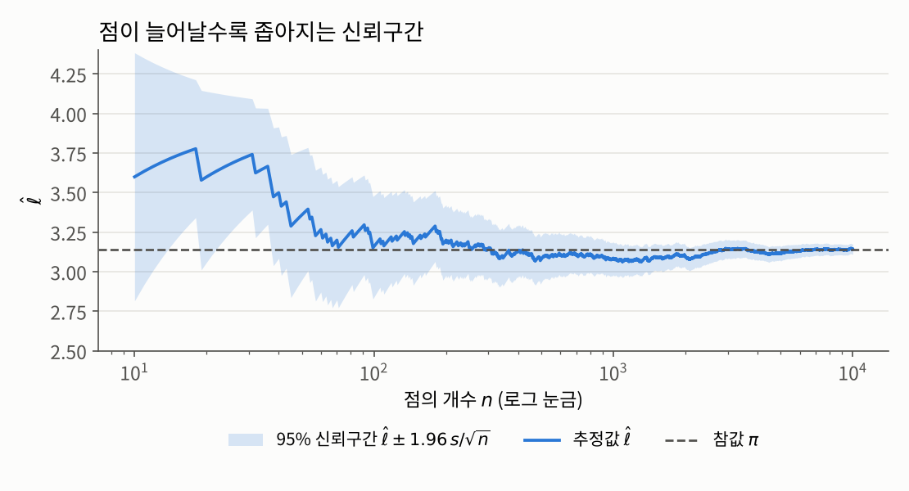

## 들어가며

[장 소개 글](index.qmd)에서는 점 $10{,}000$개를 찍어 원주율을 $\hat\pi = 3.1432$로 추정했습니다. [1.1](01-lcg.qmd)과 [1.2](02-statistical-tests.qmd)에서는 그 점들을 찍는 데 쓴 균등난수가 어디서 오고, 그것을 믿어도 되는지를 살펴보았습니다. 이제부터는 좋은 i.i.d. $U(0,1)$ 난수를 얻을 수 있다는 것을 주어진 사실로 두겠습니다.

그러면 남는 질문은 이것입니다. $3.1432$라는 숫자를 얼마나 믿어도 될까요? 소수 둘째 자리까지는 맞는 것 같지만, 그걸 어떻게 알 수 있을까요? 참값 $\pi$를 모르는 문제였다면 우리는 이 추정값이 얼마나 틀렸는지조차 알 수 없었을 것입니다. 그리고 더 정확한 답이 필요하다면, 점을 **몇 개나** 더 찍어야 할까요?

> 원하는 정확도를 얻으려면 시뮬레이션을 몇 번 돌려야 할까요?

이번 글에서는 이 질문에 답합니다. 먼저 추정값 옆에 "이 정도까지는 틀릴 수 있다"는 범위, 즉 **신뢰구간**을 붙이는 방법을 만들고, 이것이 드문 사건을 시뮬레이션할 때 어떻게 무너지는지 본 다음, 필요한 시뮬레이션 횟수를 미리 정하는 **2단계 절차**를 살펴보겠습니다.

## 추정값은 얼마나 틀릴 수 있는가: 신뢰구간

### 설정

[장 소개 글](index.qmd)의 두 예제는 모두 같은 구조였습니다. 구하고 싶은 값을 어떤 확률변수 $Z$의 기대값
$$\ell := E(Z)$$
로 쓰고, $Z$와 같은 분포를 따르는 독립인 값 $Z_1, \ldots, Z_N$을 시뮬레이션으로 만들어 그 평균으로 $\ell$을 추정합니다.
$$\hat\ell := \frac{1}{N} \sum_{i \le N} Z_i$$
원주율 예제라면 $B_i := \mathbf{1}_{\{X_i^2 + Y_i^2 \le 1\}}$에 대해 $Z_i := 4B_i$이고 $\ell = \pi$입니다. 큰 수의 법칙은 $N \to \infty$일 때 $\hat\ell$이 $\ell$로 수렴한다는 것만 보장할 뿐, **유한한 $N$에서 얼마나 가까운지**는 말해 주지 않습니다.

### 수렴에서 오차 분석으로

시뮬레이션이라는 아이디어는 기본적으로 수렴에 관한 이론에서 출발합니다. $N$을 키우면 $\hat\ell$이 $\ell$에 가까워진다는 것, 즉 수렴이 가능하다는 것 자체는 방금 말한 대로 큰 수의 법칙이 보장해 줍니다. 그런데 실제로 돌릴 수 있는 것은 언제나 유한한 $N$번뿐이고, 극한에 관한 정리만으로는 지금 손에 든 $\hat\ell$이 참값에서 얼마나 떨어져 있는지 알 수 없습니다.

이것은 시뮬레이션만의 문제가 아닙니다. 뉴턴 방법 같은 반복 알고리즘이나 사다리꼴 공식 같은 수치적분처럼, 극한으로 참값에 다가가는 근사 방법(convergence-based approximation)은 모두 같은 문제를 안고 있습니다. 그래서 수치해석에서는 오차가 $N$에 따라 **얼마나 빨리** 줄어드는지를 분석하고, 이를 바탕으로 유한한 $N$에서 오차가 커 봐야 얼마인지를 계산합니다. 시뮬레이션에서도 마찬가지로, 유한한 $N$에서 오차가 커 봐야 얼마인지를 계산해야 합니다.

다만 두 경우에 $N$이 뜻하는 바는 다르다는 점을 알아 둘 필요가 있습니다. 수치해석의 오차 분석에서 $N$은 보통 근사 알고리즘을 몇 번 반복했는지, 적분이라면 구간을 몇 조각으로 잘게 나누었는지를 뜻합니다. 반면 확률적 시뮬레이션에서 $N$은 **표본의 크기**, 즉 독립인 $Z_i$를 몇 개 만들었는지입니다. 그래서 우리가 결국 묻게 되는 질문도 "원하는 정확도를 얻으려면 표본이 몇 개 필요한가"가 됩니다.

이 차이는 적분 문제에서 차원이 높아질 때 분명하게 드러납니다. 곧 보겠지만 몬테카를로 적분의 오차는 $\sigma/\sqrt{N}$ 정도로 줄어듭니다. 반면 매끄러운 함수라면 1차원 사다리꼴 공식의 오차는 $1/N^2$의 속도로 줄어드니, 1차원 적분에서는 전통적인 수치적분이 압도적으로 유리합니다. 그런데 $d$차원 정육면체에서 사다리꼴 공식을 쓰려면 좌표마다 점을 $m$개씩 놓은 격자 전체, 즉 $N = m^d$개의 점에서 함수를 계산해야 합니다. 오차는 여전히 한 좌표 방향의 간격으로 정해지는 $1/m^2$ 정도이므로, 계산 횟수 $N$으로 다시 쓰면 $N^{-2/d}$가 됩니다. 차원이 높아질수록 지수가 작아져서 $d = 4$에서 몬테카를로의 $N^{-1/2}$와 같아지고, 그보다 높은 차원에서는 오히려 더 느립니다. 10차원에서는 좌표마다 겨우 $10$개씩만 놓아도 함수를 $100$억 번 계산해야 합니다. 이렇게 차원이 높아질수록 필요한 계산량이 지수적으로 불어나는 현상을 **차원의 저주**(curse of dimensionality)라고 합니다. 반면 몬테카를로의 $\sigma/\sqrt{N}$은 지수 $1/2$가 차원과 무관합니다. 차원이 높아지면 $\sigma$나 표본 하나를 만드는 비용은 달라질 수 있지만, $N$에 대한 속도 자체는 1차원이든 100차원이든 같습니다. 고차원 적분에서 몬테카를로 방법이 널리 쓰이는 가장 큰 이유입니다. 격자와 몬테카를로의 더 자세한 비교는 [1.4](04-quasi-random.qmd)에서 다룹니다.

또 하나의 차이는 수치해석의 근삿값은 결정론적이지만 $\hat\ell$은 확률변수라는 점입니다. 이 때문에 오차의 상한도 확률을 붙인 형태로 말하게 되는데, 이것은 아래 중심극한정리에서 다시 보겠습니다.

### 오차의 크기는 $1/\sqrt{N}$

오차 $\hat\ell - \ell$의 크기를 가늠하는 가장 간단한 방법은 분산을 계산하는 것입니다. $Z_i$의 분산을 $\sigma^2 := V(Z_1)$이라 하면, 독립인 확률변수들의 합의 분산은 분산들의 합이므로
$$V(\hat\ell) = \frac{1}{N^2} \sum_{i \le N} V(Z_i) = \frac{\sigma^2}{N}, \qquad \text{즉 표준편차는 } \frac{\sigma}{\sqrt{N}}$$
입니다. 오차의 전형적인 크기가 $\sigma/\sqrt{N}$이라는 뜻입니다.

이 식에는 몬테카를로 방법의 성격이 그대로 담겨 있습니다. 오차는 $N$이 아니라 $\sqrt{N}$에 반비례해서 줄어들기 때문에, 오차를 절반으로 줄이려면 시뮬레이션을 **네 배** 돌려야 하고, 한 자리 더 정확하게(오차를 $1/10$로) 하려면 **백 배** 돌려야 합니다. [장 소개 글](index.qmd)에서 점 $10{,}000$개로 겨우 두 자리를 맞힌 것도 이 때문입니다.

하지만 표준편차만으로는 "참값이 대략 이 범위 안에 있다"고 확률을 붙여 말할 수 없습니다. 그러려면 오차가 **어떤 분포**를 따르는지 알아야 하고, 이를 알려 주는 것이 중심극한정리입니다.

### 중심극한정리와 신뢰구간

::: {.callout-important icon=false .callout-satz}
### 정리 1.3.1 (린데베르그-레비 중심극한정리)
$Z_1, Z_2, \ldots$가 i.i.d. 확률변수이고 $0 < \sigma^2 := V(Z_1) < \infty$, $\ell := E(Z_1)$이라 합시다. 그러면 $\hat\ell = \frac{1}{N}\sum_{i \le N} Z_i$에 대해
$$\sqrt{N}\,(\hat\ell - \ell) \xrightarrow[N \to \infty]{D} N(0, \sigma^2)$$
가 성립합니다.
:::

::: {.callout-tip collapse="true" icon=false .callout-beweis}
### 증명
특성함수를 이용한 증명은 [측도론적 확률론](../../measure-prob/index.qmd)을, 분포수렴의 의미와 직관은 [확률적 수렴과 오차 분석](../../stochastic-convergence/index.qmd)을 참고하시기 바랍니다.
:::

정리를 말로 풀면, $N$이 클 때 오차 $\hat\ell - \ell$은 대략 평균이 $0$이고 표준편차가 $\sigma/\sqrt{N}$인 정규분포를 따른다는 뜻입니다. $Z_i$가 이상한 분포여도 i.i.d.이기만 하다면 상관없습니다. 많이 더하면 결국 정규분포 모양이 됩니다. 이러한 점(우리가 다루는 분포가 어떤 분포인지와 무관함)이 바로 CLT의 강점이며, 정규 분포의 중요도를 보여주는 대목이기도 합니다.

여기서 앞에서 말한 차이가 드러납니다. 수치해석에서는 주어진 조건 아래에서 예외 없이 성립하는 오차의 상한을 줄 수 있지만, 시뮬레이션에는 그런 상한이 없습니다. 원주율 예제에서 $N$개의 점이 모두 사분원 안에 떨어질 확률 $(\pi/4)^N$은 아주 작지만 $0$은 아니고, 그때는 $\hat\ell = 4$가 되니까요. 그래서 우리가 줄 수 있는 것은 "**높은 확률로** 오차가 이 정도 이하"라는 형태의 상한이고, 중심극한정리가 바로 이것을 줍니다.

과정을 따라가 보겠습니다. 오차를 그 전형적인 크기 $\sigma/\sqrt{N}$으로 나누어 표준화하면, 정리 1.3.1에 의해 $\sqrt{N}(\hat\ell - \ell)/\sigma \xrightarrow{D} N(0,1)$입니다. 표준정규분포의 분포함수 $\Phi$는 연속이므로, 모든 $c > 0$에 대해
$$P\Bigl(\lvert\hat\ell - \ell\rvert \le c\,\frac{\sigma}{\sqrt{N}}\Bigr) = P\Bigl(\Bigl\lvert\frac{\sqrt{N}\,(\hat\ell - \ell)}{\sigma}\Bigr\rvert \le c\Bigr) \xrightarrow[N \to \infty]{} 2\Phi(c) - 1$$
입니다. 즉 $N$이 크면 오차가 $\sigma/\sqrt{N}$의 $c$배를 넘을 확률은 $c$만으로 정해지는 값 $2(1 - \Phi(c))$에 가까워집니다. $c = 1$이면 약 $32\%$, $c = 2$이면 약 $4.6\%$, $c = 3$이면 약 $0.27\%$입니다. 원하는 확률 수준을 정하면 그에 맞는 $c$를 고르고, 그 확률로 성립하는 오차의 상한 $c\,\sigma/\sqrt{N}$을 얻는 셈입니다. 어떤 수준을 고르든 상한은 $\sigma/\sqrt{N}$에 비례하므로, $\sigma/\sqrt{N}$은 확률적인 의미에서 오차의 상한 역할을 한다고 볼 수 있습니다. 이렇게 확률을 붙여 오차의 크기를 재는 방법을 더 정확히 알고 싶다면 [확률적 수렴과 오차 분석](../../stochastic-convergence/index.qmd)을 참고하시기 바랍니다.

가장 흔히 쓰는 수준은 $95\%$입니다. $\Phi(1.96) \approx 0.975$이므로 $c = 1.96$을 고르면
$$P\Bigl(\lvert\hat\ell - \ell\rvert \le \frac{1.96\,\sigma}{\sqrt{N}}\Bigr) \approx 0.95$$
입니다. 이를 $\ell$에 대해 정리하면 다음 구간을 얻습니다.

::: {.callout-note icon=false .callout-definition}
### 정의 1.3.2 (근사 95% 신뢰구간)
정리 1.3.1의 설정에서 구간
$$\Bigl[\hat\ell - \frac{1.96\,\sigma}{\sqrt{N}},\ \hat\ell + \frac{1.96\,\sigma}{\sqrt{N}}\Bigr]$$
을 $\ell$의 **근사 95% 신뢰구간**(confidence interval, CI)이라고 하고, 간단히 $\hat\ell \pm 1.96\,\sigma/\sqrt{N}$으로 씁니다. 구간 폭의 절반 $1.96\,\sigma/\sqrt{N}$을 **반폭**(half-width)이라고 부릅니다.
:::

여기서 "95%"의 뜻을 정확히 짚어 둘 필요가 있습니다. 무작위인 것은 참값 $\ell$이 아니라 **구간**입니다. 시뮬레이션을 새로 할 때마다 $\hat\ell$이 달라지고 구간도 움직이는데, 그렇게 만든 구간들 중 약 95%가 고정된 참값 $\ell$을 포함한다는 뜻입니다. 또 "근사"라는 말이 붙은 이유는 정리 1.3.1이 $N \to \infty$에서의 극한에 관한 것이기 때문입니다.

반폭이 $N$에 따라 어떻게 줄어드는지 보면 앞에서 본 $1/\sqrt{N}$ 법칙이 그대로 드러납니다. 예를 들어 $\sigma^2 = 1$이면 다음과 같습니다.

| $N$ | $100$ | $10{,}000$ | $1{,}000{,}000$ |
|:--:|:--:|:--:|:--:|
| 반폭 $1.96/\sqrt{N}$ | $0.196$ | $0.0196$ | $0.00196$ |

$N$을 $100$배 늘릴 때마다 정확한 자릿수가 하나씩 늘어납니다.

### 분산을 모를 때

신뢰구간에는 한 가지 문제가 있습니다. 구간을 만들려면 $\sigma$가 필요한데, 기대값 $\ell$조차 몰라서 시뮬레이션을 하는 상황에서 분산 $\sigma^2$을 알 리가 없습니다. 그래서 $\sigma^2$도 같은 시뮬레이션 결과로 추정합니다.
$$s^2 := \frac{1}{N - 1} \sum_{i \le N} (Z_i - \hat\ell)^2$$
$s^2$은 큰 수의 법칙에 의해 $\sigma^2$으로 수렴하므로, $\sigma$ 자리에 $s$를 넣어도 극한분포가 바뀌지 않을 것이라고 기대할 수 있습니다. 이를 정확히 보장하는 것이 슬러츠키 정리(Slutsky's theorem)입니다.

::: {.callout-important icon=false .callout-satz}
### 정리 1.3.3 (슬러츠키 정리)
$X_N \xrightarrow{D} X$이고 $Y_N \xrightarrow{P} c$($c$는 상수)이면 $X_N Y_N \xrightarrow{D} cX$이고 $X_N + Y_N \xrightarrow{D} X + c$입니다.
:::

::: {.callout-tip collapse="true" icon=false .callout-beweis}
### 증명
[확률적 수렴과 오차 분석](../../stochastic-convergence/index.qmd) 또는 [측도론적 확률론](../../measure-prob/index.qmd)을 참고하시기 바랍니다.
:::

정리 1.3.1에서 $\sqrt{N}(\hat\ell - \ell)/\sigma \xrightarrow{D} N(0,1)$이고, $s^2 \xrightarrow{\text{a.s.}} \sigma^2$이므로 $\sigma/s \xrightarrow{P} 1$입니다. 두 결과를 슬러츠키 정리로 곱하면
$$\frac{1}{s}\sqrt{N}\,(\hat\ell - \ell) \xrightarrow[N \to \infty]{D} N(0, 1)$$
이고, 따라서 $\sigma$를 $s$로 바꾼 구간 $\hat\ell \pm 1.96\,s/\sqrt{N}$도 근사 95% 신뢰구간이 됩니다. 이 구간은 시뮬레이션 결과만으로 계산할 수 있으므로, 실제로 쓰는 것은 이쪽입니다.

[장 소개 글](index.qmd)의 원주율 추정에 신뢰구간을 붙여 보겠습니다. 시드와 점은 장 소개 글과 똑같습니다.

```python
import numpy as np
from scipy.stats import norm

np.random.seed(1557)
N = 10_000
coords = np.random.rand(2, N)                # 장 소개 글과 같은 점 10,000개
B = np.sum(coords**2, axis=0) <= 1
Z = 4 * B                                    # Z_i = 4 B_i,  E(Z_i) = π
ell_hat = np.mean(Z)
s = np.std(Z, ddof=1)                        # 표본표준편차 s (N - 1로 나눔)
half = 1.96 * s / np.sqrt(N)
print(f"ℓ̂ = {ell_hat:.4f},  s = {s:.4f},  95% 신뢰구간 = [{ell_hat - half:.4f}, {ell_hat + half:.4f}]")
```

```
ℓ̂ = 3.1432,  s = 1.6411,  95% 신뢰구간 = [3.1110, 3.1754]
```

이제 추정값 하나만 말하는 대신 "$\pi$는 대략 $3.11$에서 $3.18$ 사이에 있다"고 말할 수 있습니다. 참값 $3.14159\ldots$는 이 구간 안에 있습니다. 참고로 이 문제의 참값 표준편차는 $\sigma = \sqrt{\pi(4 - \pi)} \approx 1.6422$로, 추정한 $s = 1.6411$과 거의 같습니다.

아래 그림은 같은 점들을 하나씩 늘려 가면서 매번 계산한 추정값과 신뢰구간입니다. 점이 늘어날수록 구간이 $1/\sqrt{n}$의 속도로 좁아지는 것을 볼 수 있습니다.

{fig-alt="점의 개수 n을 10부터 10000까지 로그 눈금으로 늘려 가며 계산한 원주율 추정값과 95퍼센트 신뢰구간. 처음에는 구간이 2.8에서 4.3 넘게까지 넓지만, n이 늘수록 좁아져 n = 10000에서는 3.11에서 3.18 사이로 줄어들고, 참값 π를 나타내는 점선 근처에 모인다." width=85%}

### 정말 95%일까: 시뮬레이션으로 확인하기

"근사 95%"가 유한한 $N$에서도 맞는지는 시뮬레이션으로 직접 확인할 수 있습니다. 신뢰구간을 $1{,}000$번 새로 만들어서 그중 몇 개가 참값 $\pi$를 포함하는지 세어 보겠습니다.

```python
def pi_ci_covers(N, reps=1000):
    """점 N개로 π의 95% 신뢰구간을 reps번 만들어, π를 포함한 비율을 돌려줍니다."""
    hit = 0
    for _ in range(reps):
        Zs = 4 * (np.sum(np.random.rand(2, N)**2, axis=0) <= 1)
        hit += abs(Zs.mean() - np.pi) <= 1.96 * Zs.std(ddof=1) / np.sqrt(N)
    return hit / reps

for n in [100, 10_000]:
    print(f"N = {n:>6,}:  신뢰구간이 π를 포함한 비율 = {pi_ci_covers(n):.3f}")
```

```
N =    100:  신뢰구간이 π를 포함한 비율 = 0.945
N = 10,000:  신뢰구간이 π를 포함한 비율 = 0.950
```

참값을 포함한 비율을 **포함 확률**(coverage probability)이라고 부릅니다. 원주율 예제에서는 $N = 100$이라는 적은 개수에서도 포함 확률이 약속한 $95\%$에 가깝습니다. "포함 확률"이라는 이름 떄문에 헷갈리실 수 있는데요, 위에서 설명한대로 이는 "구간이 참값을 포함할 확률"을 의미하는거지, "참값이 95% 확률로 구간에 들어있다"라는 의미가 아닙니다!!

## 드문 사건을 시뮬레이션할 때

### 상대오차라는 함정

시뮬레이션이 자주 쓰이는 문제 중 하나는 **드문 사건의 확률**을 구하는 것입니다. 보험사가 한 해 손실이 아주 커질 확률, 시스템이 고장 날 확률처럼, 공식으로 구하기 어렵고 값 자체가 매우 작은 확률입니다.

::: {.callout-note icon=false}
### 예제 1.3.4 (드문 사건의 확률 시뮬레이션)
확률변수 $X_1, X_2, \ldots$를 시뮬레이션할 수 있을 때 $\ell := P(X_1 > x)$를 구하고 싶다고 합시다. $Z_i := \mathbf{1}_{\{X_i > x\}}$로 두면 $\ell = E(Z_i)$이고, $Z_i \sim \mathrm{Bin}(1, \ell)$이므로 $\sigma^2 = \ell(1 - \ell)$입니다. 예를 들어 $\ell = 0.01$이면 $\sigma^2 = 0.0099 \approx 0.01$이고, 근사 95% 신뢰구간은
$$\Bigl[\hat\ell - \frac{0.196}{\sqrt{N}},\ \hat\ell + \frac{0.196}{\sqrt{N}}\Bigr]$$
입니다.
:::

반폭 $0.196/\sqrt{N}$만 보면 앞의 $\sigma^2 = 1$인 경우보다 열 배나 좁으니 좋아 보입니다. 하지만 구하려는 값 자체가 $0.01$로 아주 작다는 것을 잊으면 안 됩니다. $N = 10{,}000$이면 반폭은 $0.00196$인데, 이는 참값 $0.01$의 약 $20\%$입니다. 즉 **절대오차는 작아 보여도 상대오차는 큽니다.** "확률이 약 $1\%$"라는 정도만 맞혔지, $0.8\%$인지 $1.2\%$인지는 구별하지 못하는 셈입니다.

### $N$이 작으면 신뢰구간이 무너진다

드문 사건에서는 신뢰구간 자체도 문제를 일으킵니다. $X_i \sim N(0,1)$이고 $x$를 $P(X_1 > x) = 0.01$이 되도록 고른 경우에, 앞에서처럼 포함 확률을 확인해 보겠습니다. 이번에는 참값을 정확히 알고 있으므로($\ell = 1 - \Phi(x) = 0.01$) 확인이 가능합니다.

```python
x = norm.ppf(0.99)                           # X ~ N(0,1)일 때 P(X > x) = 0.01이 되는 x
ell = 1 - norm.cdf(x)

def rare_ci_covers(N, reps=2000):
    """Z_i = 1{X_i > x}로 만든 95% 신뢰구간이 ℓ을 포함한 비율과, 사건이 한 번도 안 나온 비율."""
    hit = zero = 0
    for _ in range(reps):
        Zs = (np.random.randn(N) > x).astype(float)
        hit += abs(Zs.mean() - ell) <= 1.96 * Zs.std(ddof=1) / np.sqrt(N)
        zero += (Zs.sum() == 0)
    return hit / reps, zero / reps

print(f"x = {x:.4f},  ℓ = {ell:.4f}")
for n in [100, 1_000, 10_000]:
    cover, zero = rare_ci_covers(n)
    print(f"N = {n:>6,}:  포함 비율 = {cover:.3f},  사건이 한 번도 안 나온 비율 = {zero:.3f}")
```

```
x = 2.3263,  ℓ = 0.0100
N =    100:  포함 비율 = 0.611,  사건이 한 번도 안 나온 비율 = 0.390
N =  1,000:  포함 비율 = 0.918,  사건이 한 번도 안 나온 비율 = 0.000
N = 10,000:  포함 비율 = 0.939,  사건이 한 번도 안 나온 비율 = 0.000
```

$N = 100$에서는 포함 확률이 $61\%$밖에 되지 않습니다. 원인은 둘째 열에 있습니다. 확률이 $1\%$인 사건을 $100$번 시도하면 한 번도 일어나지 않을 확률이 $0.99^{100} \approx 0.37$이나 됩니다. 사건이 한 번도 안 나오면 $\hat\ell = 0$이고 $s = 0$이어서, 신뢰구간이 $[0, 0]$이라는 한 점으로 쪼그라듭니다. "확률은 정확히 $0$이고 오차도 없다"는, 자신만만하지만 틀린 결론을 내는 것입니다.

$N$이 커질수록 포함 확률은 $95\%$에 다가가지만, 원주율 예제보다 훨씬 느립니다. 정리 1.3.1의 정규근사는 $Z_i$의 분포가 한쪽으로 심하게 치우쳐 있을수록 더 큰 $N$이 있어야 잘 맞기 때문입니다. 대략적인 기준으로, 사건이 적어도 수십 번은 관측될 만큼 $N$이 커야 이 신뢰구간을 믿을 수 있습니다.

## 몇 번 돌려야 하는가: 2단계 절차

### 정확도를 정하고 $N$을 역산하기

신뢰구간을 거꾸로 쓰면 필요한 시뮬레이션 횟수를 계산할 수 있습니다. 정확도는 보통 두 가지 중 하나로 정합니다.

- **절대 정확도**(absolute accuracy): $\ell$을 오차 $\varepsilon$ 이내로 구합니다.
- **상대 정확도**(relative accuracy): $\ell$을 오차 $\varepsilon\ell$ 이내로, 즉 참값의 $\varepsilon$배 이내로 구합니다.

신뢰구간의 반폭 $1.96\,\sigma/\sqrt{N}$을 각각 $\varepsilon$, $\varepsilon\ell$과 같게 놓고 $N$에 대해 풀면 다음 어림 규칙을 얻습니다.
$$\text{절대 정확도: } N \approx \Bigl(\frac{1.96\,\sigma}{\varepsilon}\Bigr)^2, \qquad \text{상대 정확도: } N \approx \Bigl(\frac{1.96\,\sigma}{\varepsilon\ell}\Bigr)^2$$

::: {.callout-note icon=false}
### 예제 1.3.5 (드문 사건에 필요한 시뮬레이션 횟수)
예제 1.3.4를 이어서, 상대 오차를 $\ell$의 $1/10$로 맞추고 싶다고 합시다. 즉 $\varepsilon = 1/10$이고 반폭이 $\ell/10$이어야 합니다. $\sigma^2 = \ell(1 - \ell)$이므로
$$N = \frac{1.96^2\,\ell(1-\ell)}{\bigl(\frac{1}{10}\ell\bigr)^2} = \frac{1.96^2 \cdot 100}{\ell}\,(1 - \ell)$$
이고, $\ell$이 작으면 대략 $1.96^2 \cdot 100/\ell$입니다. $\ell = 0.01$이면 $N \approx 1.96^2 \cdot 10^4 \approx 3.8$만, $\ell = 10^{-6}$이면 $N \approx 1.96^2 \cdot 10^8 \approx 3.8$억입니다.
:::

```python
for l in [0.01, 1e-6]:
    print(f"ℓ = {l:g}:  N = {1.96**2 * l * (1 - l) / (l / 10)**2:,.0f}")
```

```
ℓ = 0.01:  N = 38,032
ℓ = 1e-06:  N = 384,159,616
```

상대 정확도를 기준으로 하면 필요한 횟수가 $1/\ell$에 비례해서 늘어납니다. 확률이 백만분의 일인 사건을 $10\%$ 정확도로 구하려면 시뮬레이션을 약 $3.8$억 번 돌려야 합니다. 그래서 아주 드문 사건은 지금처럼 그대로 시뮬레이션하는 대신, 같은 정확도를 더 적은 횟수로 얻도록 시뮬레이션 방식 자체를 바꾸는 **분산 감소**(variance reduction) 기법이 필요합니다. 이 과목의 4장에서 그런 기법들을 다룹니다.

### 2단계 절차

어림 규칙에도 문제가 하나 남아 있습니다. $N$을 계산하려면 $\sigma$가 필요하고, 상대 정확도라면 $\ell$까지 필요합니다. 둘 다 모르니까 시뮬레이션을 하는 것인데 말입니다. 해결책은 간단합니다. 먼저 작은 규모로 한 번 돌려서 $\sigma$와 $\ell$을 대충 가늠하고, 그 값으로 필요한 횟수를 정한 뒤 본격적으로 돌리는 것입니다.

::: {.callout-note icon=false}
### 알고리즘 1.3.6 (2단계 절차)
**입력:** 목표 정확도 $\varepsilon > 0$<br>
**출력:** 필요한 시뮬레이션 횟수 $N$

1. 적은 수의 **시험 실행**(trial run)으로 추정값 $\hat\ell_{\mathsf{trial}}$과 $\hat\sigma^2_{\mathsf{trial}}$을 계산합니다.
2. 주어진 정확도 $\varepsilon$에 대해 필요한 **본 실행**(production run)의 횟수를 계산합니다.
$$N_{\mathsf{abs}} \approx \bigl(1.96\,\hat\sigma_{\mathsf{trial}}/\varepsilon\bigr)^2 \qquad \text{또는} \qquad N_{\mathsf{rel}} \approx \bigl(1.96\,\hat\sigma_{\mathsf{trial}}/(\varepsilon\,|\hat\ell_{\mathsf{trial}}|)\bigr)^2$$
:::

예제 1.3.4의 드문 사건($\ell = 0.01$)에 상대 정확도 $\varepsilon = 0.1$로 적용해 보겠습니다. 시험 실행은 $1{,}000$번 하고, 본 실행에서는 시험 실행에 쓴 값을 다시 쓰지 않고 **새로** 뽑습니다.

```python
eps = 0.1                                                    # 상대 정확도 10%
Z_trial = (np.random.randn(1_000) > x).astype(float)         # 시험 실행 1,000번
ell_trial, sigma_trial = Z_trial.mean(), Z_trial.std(ddof=1)
N_rel = int(np.ceil((1.96 * sigma_trial / (eps * abs(ell_trial)))**2))
print(f"시험 실행:  ℓ̂_trial = {ell_trial:.4f},  σ̂_trial = {sigma_trial:.4f},  N_rel = {N_rel:,}")

Z_prod = (np.random.randn(N_rel) > x).astype(float)          # 본 실행: 새로 뽑은 난수
ell_hat, s = Z_prod.mean(), Z_prod.std(ddof=1)
half = 1.96 * s / np.sqrt(N_rel)
print(f"본 실행:    ℓ̂ = {ell_hat:.5f},  95% 신뢰구간 = [{ell_hat - half:.5f}, {ell_hat + half:.5f}],  상대 반폭 = {half / ell_hat:.3f}")
```

```
시험 실행:  ℓ̂_trial = 0.0080,  σ̂_trial = 0.0891,  N_rel = 47,684
본 실행:    ℓ̂ = 0.01017,  95% 신뢰구간 = [0.00927, 0.01107],  상대 반폭 = 0.089
```

시험 실행에서는 사건이 $1{,}000$번 중 $8$번 나와 $\ell$을 $0.008$로 조금 작게 추정했습니다. 그 결과 필요한 횟수를 이론값 $38{,}032$보다 많은 $47{,}684$로 잡았고, 덕분에 본 실행의 상대 반폭은 목표 $0.1$보다 조금 작은 $0.089$가 되었습니다. 시험 실행이 $\ell$을 반대로 크게 추정했다면 $N$을 너무 적게 잡아 목표 정확도에 못 미쳤을 것입니다. 2단계 절차가 주는 $N$은 어디까지나 **어림값**입니다.

### 2단계 절차를 쓸 때의 주의점

- **시험 실행에서 사건이 한 번도 안 나올 수 있습니다.** 앞에서 보았듯이 확률이 $1\%$인 사건은 $100$번 시도에서 $37\%$의 확률로 한 번도 일어나지 않습니다. 그러면 $\hat\ell_{\mathsf{trial}} = 0$, $\hat\sigma_{\mathsf{trial}} = 0$이 되어 $N_{\mathsf{abs}} = 0$이 나오고, $N_{\mathsf{rel}}$은 $0$으로 나누게 되어 정의조차 되지 않습니다. 이것은 "시뮬레이션이 필요 없다"는 뜻이 아니라 "시험 실행이 너무 작았다"는 뜻입니다. 시험 실행의 크기를 늘려 다시 해야 합니다.
- **본 실행은 새로 뽑아야 합니다.** 시험 실행의 결과를 보고 $N$을 정했으므로 $N$ 자체가 데이터에 따라 달라지는 확률변수입니다. 시험 실행의 값을 본 실행에 다시 섞어 쓰면, 그 값들이 "어떤 결과가 나왔는지 보고 나서 정한 크기"의 표본에 들어가게 되어 신뢰구간의 근거가 흔들립니다. 본 실행을 독립적으로 새로 뽑으면 이 문제를 피할 수 있습니다.
- **그래도 시험 실행이 작으면 어림값도 불안정합니다.** 위의 예처럼 시험 실행의 추정이 조금만 빗나가도 $N$은 제곱으로 크게 달라집니다. 정규근사로 정한 신뢰수준 자체도 어디까지나 근사라는 점을 기억해야 합니다.

## 정리

이번 글에서는 "시뮬레이션을 몇 번 돌려야 충분한가?"라는 질문을 다루었습니다.

- 몬테카를로 추정값 $\hat\ell$의 오차는 대략 $\sigma/\sqrt{N}$ 크기이고, 중심극한정리에 의해 정규분포를 따릅니다. 그래서 근사 95% 신뢰구간 $\hat\ell \pm 1.96\,s/\sqrt{N}$을 붙일 수 있으며, 모르는 $\sigma$는 표본표준편차 $s$로 바꿔도 됩니다(슬러츠키 정리).
- 오차가 $1/\sqrt{N}$으로만 줄어들기 때문에, 한 자리 더 정확하게 하려면 시뮬레이션을 $100$배 돌려야 합니다.
- 드문 사건에서는 상대오차가 커지고, $N$이 작으면 신뢰구간 자체가 무너질 수 있습니다. 상대 정확도를 기준으로 하면 필요한 횟수가 $1/\ell$에 비례해서 늘어납니다.
- 필요한 횟수는 시험 실행으로 $\sigma$와 $\ell$을 가늠한 뒤 계산하는 2단계 절차로 정합니다.

결국 몬테카를로 방법의 가장 큰 약점은 $1/\sqrt{N}$이라는 느린 수렴 속도입니다. 그렇다면 이런 질문이 자연스럽게 떠오릅니다. 점을 **무작위로** 찍는 대신 더 고르게, 계획적으로 찍으면 이 속도를 이길 수 있지 않을까요? 다음 글에서는 이 아이디어에서 출발한 준난수(quasi-random number)를 다룹니다.

---

### 연결되는 개념
* $\leftarrow$ **이전 개념:** [1.2 난수 생성기의 통계적 검정](02-statistical-tests.qmd)
* $\rightarrow$ **다음 개념:** [1.4 고르게 찍으면 더 빠를까: 준난수와 불일치도](04-quasi-random.qmd)
