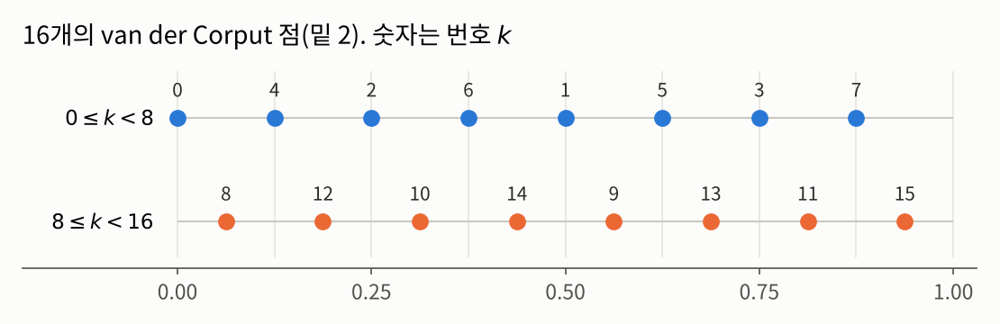
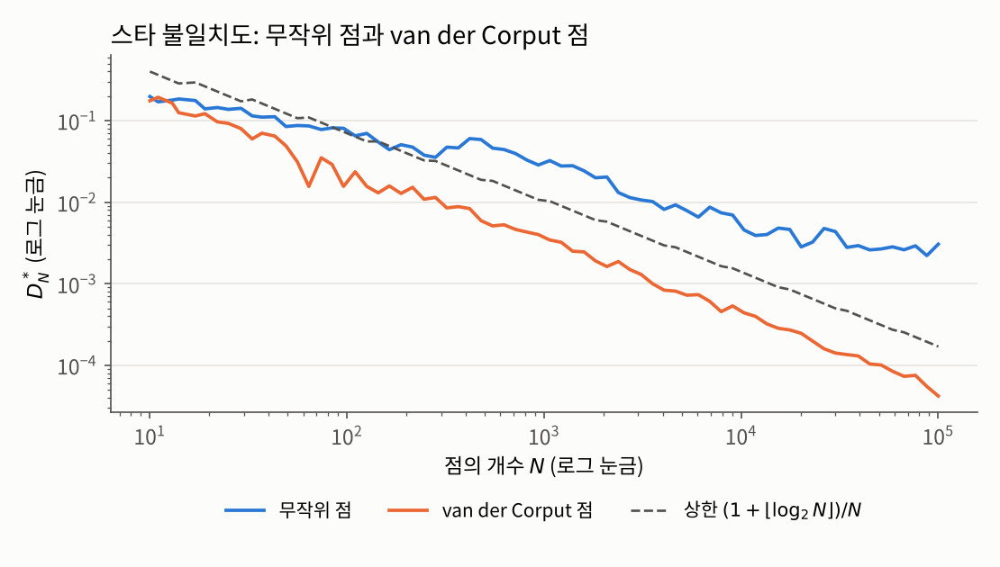
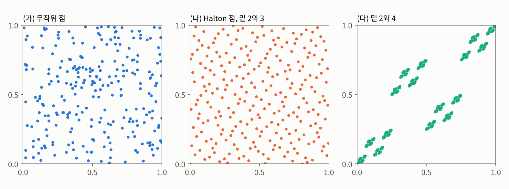
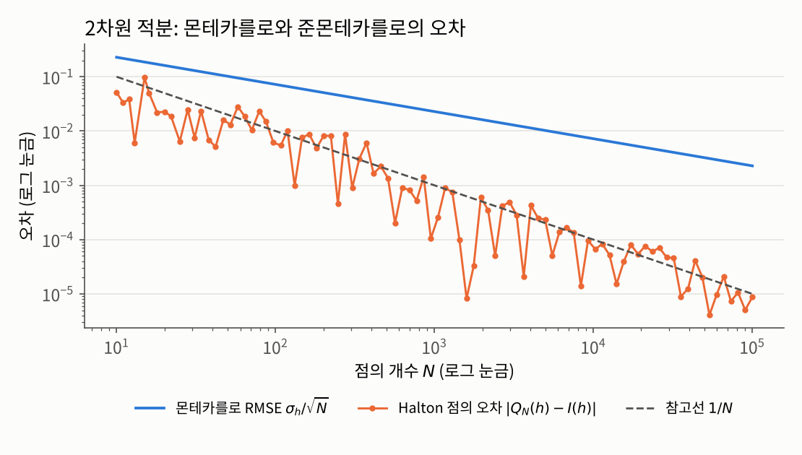

## 들어가며

[1.3](03-output-analysis.qmd)에서 우리는 몬테카를로 추정값의 오차가 $\sigma/\sqrt{N}$ 정도로 줄어든다는 것을 보았습니다. 한 자리 더 정확하게 하려면 시뮬레이션을 $100$배 돌려야 한다는 뜻이고, 이것이 몬테카를로 방법의 가장 큰 약점입니다.

그런데 [장 소개 글](index.qmd)의 원주율 그림을 다시 떠올려 보면, 무작위로 찍은 점들은 생각보다 고르지 않습니다. 어떤 곳에는 점이 뭉쳐 있고, 어떤 곳은 텅 비어 있습니다. 점이 몰린 곳은 넓이를 실제보다 크게, 빈 곳은 작게 세게 되니 이것이 곧 오차가 됩니다. 그렇다면 자연스럽게 이런 질문이 떠오릅니다.

> 점을 무작위로 찍지 말고 처음부터 **고르게** 배치하면, $1/\sqrt{N}$보다 빨리 정확해지지 않을까요?

이번 글에서는 이 아이디어에서 출발한 **준몬테카를로**(quasi-Monte Carlo, QMC) 방법을 다룹니다. 먼저 무작위 점과 바둑판처럼 규칙적인 격자를 비교해 각자의 장단점을 보고, "점이 고르게 퍼져 있다"는 것을 숫자로 재는 **불일치도**(discrepancy)를 정의합니다. 그다음 불일치도가 적분 오차를 어떻게 제어하는지 보여 주는 부등식과, 실제로 불일치도가 작은 점을 만드는 방법인 van der Corput 수열과 Halton 수열을 살펴보겠습니다.

이번 글에서는 주로 해석학의 도구(미분적분학의 기본정리, 푸비니 정리)를 씁니다. 확률은 비교 대상인 몬테카를로 쪽에만 나옵니다.

## 무작위 점과 격자 비교하기

### 설정

차원 $d \ge 1$을 고정하고, 단위 정육면체 위의 적분
$$I(h) := \int_{[0,1]^d} h(u)\, du$$
를 계산하는 문제를 생각합니다. 점 $N$개의 목록 $P_N = (x_1, \ldots, x_N)$ ($x_i \in [0,1)^d$, 같은 점이 여러 번 나와도 됨)이 주어지면, 그 점들에서의 함숫값 평균
$$Q_N(h) := \frac{1}{N} \sum_{i \le N} h(x_i)$$
로 $I(h)$를 근사합니다. 어느 방법이든 $h$를 $N$번 계산한다는 점은 같고, **점을 어떻게 고르느냐**만 다릅니다. 앞으로 오차의 빠르기를 말할 때는 $d$와 $h$를 고정하고 $N$만 키우는 상황을 뜻합니다.

### 몬테카를로: 차원과 무관한 $N^{-1/2}$

몬테카를로는 점을 i.i.d. 균등분포로 뽑습니다. $U_1, \ldots, U_N$이 $[0,1)^d$ 위에서 i.i.d.로 균등분포를 따를 때
$$\hat I_N := \frac{1}{N} \sum_{i \le N} h(U_i)$$
입니다. $h$가 제곱적분 가능하면 $\sigma_h^2 := \int_{[0,1]^d} (h(u) - I(h))^2\, du = V(h(U_1))$로 두고, [1.3](03-output-analysis.qmd)에서 본 대로
$$\mathrm{RMSE}(\hat I_N) := \bigl(E((\hat I_N - I(h))^2)\bigr)^{1/2} = \frac{\sigma_h}{\sqrt{N}}$$
입니다. 여기서 RMSE는 평균제곱근오차(root mean squared error)입니다. 이 식에서 눈여겨볼 점은 지수 $1/2$가 **차원 $d$와 무관하다**는 것입니다. 물론 $\sigma_h$나 $h$ 한 번을 계산하는 비용은 차원에 따라 커질 수 있지만, $N$에 대한 속도 자체는 1차원이든 100차원이든 같습니다. 다만 이것은 시뮬레이션을 여러 번 했을 때의 평균적인 오차이고, 한 번의 결과가 반드시 이 안에 든다는 보장은 아닙니다.

### 격자: 낮은 차원에서는 빠르지만

이번에는 점을 바둑판처럼 놓아 봅시다. 정수 $m \ge 1$을 골라 단위 정육면체를 한 변이 $1/m$인 작은 정육면체 $C_1, \ldots, C_N$ ($N = m^d$개)으로 나누고, $x_i$를 $C_i$의 중심으로 잡습니다. $h$가 립시츠 상수 $L$을 가진다고, 즉 모든 $u, v$에 대해 $\lvert h(u) - h(v)\rvert \le L \lVert u - v \rVert_2$라고 합시다. 각 $C_i$의 부피가 $1/N$이므로
$$Q_N(h) - I(h) = \sum_{i \le N} \int_{C_i} \bigl(h(x_i) - h(u)\bigr)\, du$$
이고, $C_i$의 모든 점은 중심에서 거리 $\sqrt{d}/(2m)$ 안에 있으므로
$$\lvert Q_N(h) - I(h)\rvert \le \sum_{i \le N} \int_{C_i} L \frac{\sqrt{d}}{2m}\, du = \frac{L\sqrt{d}}{2m} = \frac{L\sqrt{d}}{2}\, N^{-1/d}$$
입니다. $h$가 두 번 연속 미분 가능하면 각 정육면체 안에서 테일러 전개의 1차항이 서로 상쇄되어 오차가 $O(N^{-2/d})$로 좋아집니다.

1차원이면 $N^{-1}$이나 $N^{-2}$이니 몬테카를로의 $N^{-1/2}$보다 훨씬 빠릅니다. 그런데 지수에 $1/d$가 들어 있다는 것이 문제입니다.

| 차원 $d$ | 좌표마다 $10$개씩 놓을 때의 점 수 | 격자의 오차 (립시츠) | 몬테카를로의 오차 |
|:--:|:--:|:--:|:--:|
| $1$ | $10$ | $N^{-1}$ | $N^{-1/2}$ |
| $2$ | $100$ | $N^{-1/2}$ | $N^{-1/2}$ |
| $4$ | $10{,}000$ | $N^{-1/4}$ | $N^{-1/2}$ |
| $10$ | $10^{10}$ | $N^{-1/10}$ | $N^{-1/2}$ |

좌표마다 해상도를 두 배로 올리면 점의 수는 $2^d$배가 되고, 10차원에서는 좌표마다 겨우 $10$개씩만 놓아도 $h$를 $100$억 번 계산해야 합니다. 이렇게 차원이 늘수록 필요한 점의 수가 지수적으로 커지는 현상을 **차원의 저주**(curse of dimensionality)라고 합니다.

### 준몬테카를로가 노리는 것

그렇다면 격자처럼 고르게 퍼져 있으면서도, 격자처럼 모든 좌표 방향으로 촘촘하게 다 채우지는 않는 점 $N$개를 만들 수는 없을까요? 이것이 준몬테카를로의 출발점입니다. 결론부터 말하면, $d$를 고정하고 $h$가 충분히 매끄러우면($h \in C^d([0,1]^d)$) 잘 알려진 구성법들로 오차를
$$\frac{(\log(N+1))^d}{N}$$
정도로 만들 수 있습니다(상수는 $h$, $d$, 구성법에 따라 다릅니다).[^niederreiter] 로그 인자를 빼면 $N^{-1}$에 가까우니 몬테카를로의 $N^{-1/2}$보다 훨씬 빠릅니다.

이를 위해 해야 할 일은 두 가지입니다. 첫째, "점이 고르게 퍼져 있다"는 것을 숫자로 재야 하고, 둘째, 그 숫자가 작으면 적분 오차도 작다는 것을 보여야 합니다.

## 고르게 퍼져 있다는 것을 재기: 불일치도

점들이 고르게 퍼져 있다면, 어떤 상자를 잡아도 그 안에 들어 있는 점의 비율이 상자의 부피와 비슷해야 합니다. 부피가 $0.3$인 상자에는 점의 약 $30\%$가 들어 있어야 한다는 것이죠. 모든 상자를 다 확인하는 대신, 원점에 한 꼭짓점을 둔 상자만 확인하기로 합니다.

::: {.callout-note icon=false .callout-definition}
### 정의 1.4.1 (스타 불일치도)
$t = (t_1, \ldots, t_d) \in [0,1]^d$에 대해 $[0, t) := \prod_{j \le d} [0, t_j)$로 씁니다. 점 목록 $P_N = (x_1, \ldots, x_N)$의 **스타 불일치도**(star discrepancy)를
$$D_N^*(P_N) := \sup_{t \in [0,1]^d} \Bigl\lvert \frac{1}{N} \sum_{i \le N} \mathbf{1}_{[0,t)}(x_i) - \prod_{j \le d} t_j \Bigr\rvert$$
로 정의합니다.
:::

절댓값 안의 첫째 항은 상자 $[0,t)$에 들어간 점의 비율이고, 둘째 항은 그 상자의 부피입니다. 즉 $D_N^*$는 "점의 비율로 상자의 부피를 어림했을 때의 최대 오차"입니다. 점이 한쪽에 뭉쳐 있거나 어딘가가 비어 있으면 그 근처의 상자에서 오차가 커지므로 $D_N^*$가 커집니다.

1차원에서는 이 정의가 훨씬 단순해집니다. 점들의 경험적 분포함수를
$$F_N(t) := \frac{1}{N} \sum_{i \le N} \mathbf{1}_{\{x_i < t\}}$$
라 하면 $D_N^*(P_N) = \sup_{t \in [0,1]} \lvert F_N(t) - t\rvert$입니다. $U(0,1)$의 분포함수가 $t$이므로, $D_N^*$는 점들의 경험적 분포함수와 균등분포의 분포함수가 가장 크게 벌어지는 정도입니다. 점이 무작위라면 이것은 바로 콜모고로프-스미르노프 검정(Kolmogorov–Smirnov test)의 검정통계량이고, 그 크기는 $1/\sqrt{N}$ 정도입니다.

### 1차원의 콕스마 부등식

이제 불일치도가 작으면 적분 오차도 작다는 것을 1차원에서 먼저 보이겠습니다. 함수 쪽에서는 그 함수가 얼마나 오르내리는지를 재는 양이 필요합니다. $h: [0,1] \to \mathbb{R}$이 절대연속(absolutely continuous), 즉 거의 모든 점에서 미분 가능하고 $h(x) = h(0) + \int_0^x h'(t)\, dt$가 성립하는 함수라고 합시다(연속 미분 가능한 함수면 충분합니다). 이때
$$\mathrm{TV}(h) := \int_0^1 \lvert h'(t)\rvert\, dt$$
를 $h$의 **전변동**(total variation)이라고 합니다.[^tv] 그래프가 위아래로 움직인 거리를 모두 더한 양입니다.

::: {.callout-important icon=false .callout-satz}
### 정리 1.4.2 (1차원 콕스마 부등식)
$d = 1$이고 $h$가 절대연속이면
$$\lvert Q_N(h) - I(h)\rvert \le \mathrm{TV}(h)\, D_N^*(P_N)$$
가 성립합니다.
:::

::: {.callout-tip collapse="true" icon=false .callout-beweis}
### 증명
$Q_N(h)$와 $I(h)$를 같은 도함수 $h'$를 써서 다시 씁니다. 미분적분학의 기본정리에 의해 모든 $x \in [0,1]$에 대해
$$h(x) = h(1) - \int_x^1 h'(t)\, dt = h(1) - \int_0^1 h'(t)\, \mathbf{1}_{\{x < t\}}\, dt$$
입니다. 둘째 등호는 지시함수가 정확히 $t \in (x, 1]$에서 $1$이기 때문입니다.

$x = x_i$를 대입해 $i$에 대해 평균을 내고, 유한합과 적분의 순서를 바꾸면
$$Q_N(h) = h(1) - \int_0^1 h'(t)\, F_N(t)\, dt$$
입니다. 한편 같은 식을 $x$에 대해 $[0,1]$에서 적분하고 푸비니 정리로 순서를 바꾸면
$$I(h) = h(1) - \int_0^1 h'(t) \int_0^1 \mathbf{1}_{\{x < t\}}\, dx\, dt = h(1) - \int_0^1 h'(t)\, t\, dt$$
입니다. 두 식을 빼면 $h(1)$이 사라져
$$Q_N(h) - I(h) = -\int_0^1 h'(t)\, \bigl(F_N(t) - t\bigr)\, dt$$
를 얻습니다. 스타 불일치도의 정의에 의해 모든 $t$에서 $\lvert F_N(t) - t\rvert \le D_N^*(P_N)$이므로
$$\lvert Q_N(h) - I(h)\rvert \le \int_0^1 \lvert h'(t)\rvert\, \lvert F_N(t) - t\rvert\, dt \le D_N^*(P_N) \int_0^1 \lvert h'(t)\rvert\, dt = \mathrm{TV}(h)\, D_N^*(P_N)$$
입니다.
:::

이 부등식은 적분 오차를 두 요인의 곱으로 나눕니다. $\mathrm{TV}(h)$는 **함수가 얼마나 울퉁불퉁한지**, $D_N^*(P_N)$은 **점들이 얼마나 고르지 못한지**를 잽니다. 함수는 우리가 고를 수 없으니, 오차를 줄이려면 불일치도가 작은 점을 쓰면 됩니다.

여기에는 확률이 전혀 등장하지 않는다는 점도 중요합니다. [1.3](03-output-analysis.qmd)의 중심극한정리는 "여러 번 반복하면 오차가 대략 이런 분포를 따른다"는 근사적인 진술이었지만, 콕스마 부등식은 **주어진 그 점들에 대해 항상** 성립하는 결정론적인 상한입니다. 두 진술은 서로 다른 방식으로 뽑은 점과 서로 다른 가정에 관한 것입니다.

예를 들어 1차원 중점 규칙 $x_i = (i - 1/2)/N$은 $D_N^* = 1/(2N)$입니다. 이웃한 두 점 사이에서 $F_N(t) - t$는 기울기 $-1$인 직선이고, 그 양 끝값의 절댓값이 $1/(2N)$이기 때문입니다. 따라서 $\lvert Q_N(h) - I(h)\rvert \le \mathrm{TV}(h)/(2N)$이고, 몬테카를로의 $N^{-1/2}$보다 훨씬 빠릅니다.

그렇다면 1차원에서는 그냥 중점 규칙을 쓰면 될 텐데, 왜 다른 점이 필요할까요? 중점 규칙에는 **$N$을 미리 정해야 한다**는 불편함이 있습니다. 점 $N$개로 계산해 보고 부족해서 $N+1$개로 늘리려면 점의 위치가 모두 바뀌므로 처음부터 다시 계산해야 합니다. [1.3](03-output-analysis.qmd)에서처럼 결과를 보며 점을 더 찍어 나가려면, **앞에서부터 몇 개를 잘라도 항상 고르게 퍼져 있는 수열**이 필요합니다. 게다가 여러 차원으로 가면 격자는 앞에서 본 차원의 저주에 걸립니다. 이 두 문제를 함께 해결하는 것이 다음에 볼 수열들입니다.

## van der Corput 수열

### 자릿수를 거꾸로 뒤집기

아이디어는 놀랍도록 단순합니다. 정수 $k$를 $b$진법으로 쓴 다음, 그 자릿수를 소수점 아래로 **거꾸로 뒤집어** 붙입니다. 예를 들어 $b = 2$일 때 $k = 6$은 이진법으로 $110_2$이고, 이것을 뒤집어 소수점 아래에 붙이면 $0.011_2 = 3/8$입니다.

::: {.callout-note icon=false .callout-definition}
### 정의 1.4.3 (van der Corput 수열)
정수 $b \ge 2$를 고정합니다. $k \ge 0$을 $b$진법으로 $k = \sum_{j \ge 0} a_j(k)\, b^j$ ($a_j(k) \in \{0, \ldots, b-1\}$, 유한 개만 $0$이 아님)로 쓰고
$$\phi_b(k) := \sum_{j \ge 0} a_j(k)\, b^{-j-1}$$
로 정의합니다. 이 $\phi_b$를 **radical inverse** 함수라고 하고,
$$P_N^{(b)} := \bigl(\phi_b(0), \phi_b(1), \ldots, \phi_b(N-1)\bigr)$$
을 밑이 $b$인 **van der Corput 수열**의 처음 $N$개 점이라고 합니다.
:::

$k$의 가장 낮은 자릿수가 소수점 바로 아래, 즉 가장 큰 자리로 갑니다. 그래서 $k$가 $1$씩 늘 때마다 가장 큰 자리가 가장 빠르게 바뀌고, 점이 $[0,1]$의 왼쪽 절반과 오른쪽 절반을 번갈아 찾아가게 됩니다. 직접 만들어 보겠습니다.

```python
import numpy as np

def radical_inverse(k, b):
    """k를 b진법으로 쓴 자릿수를 소수점 아래로 뒤집어 붙인 값 φ_b(k)"""
    x, f = 0.0, 1.0 / b
    while k > 0:
        k, a = divmod(k, b)       # a: 아직 처리하지 않은 가장 낮은 자릿수
        x += a * f
        f /= b
    return x

def van_der_corput(N, b=2):
    return np.array([radical_inverse(k, b) for k in range(N)])

print(van_der_corput(16).reshape(2, 8))
```

```
[[0.     0.5    0.25   0.75   0.125  0.625  0.375  0.875 ]
 [0.0625 0.5625 0.3125 0.8125 0.1875 0.6875 0.4375 0.9375]]
```

$0$, $1/2$, $1/4$, $3/4$, $1/8$, $5/8$, …처럼, 새 점은 항상 지금까지 비어 있던 가장 큰 틈의 한가운데쯤에 들어갑니다. 그림으로 보면 구조가 더 잘 드러납니다.

{fig-alt="밑이 2인 van der Corput 점 16개를 두 줄로 나누어 그린 그림. 윗줄은 번호 0부터 7까지의 점으로 0, 1/8, 2/8, …, 7/8의 왼쪽 끝점을 하나씩 차지하고, 아랫줄은 번호 8부터 15까지의 점으로 길이 1/8인 각 구간의 가운데를 하나씩 차지한다."}

번호 $0$부터 $7$까지의 점 $8$개는 길이가 $1/8$인 구간 $[j/8, (j+1)/8)$에 정확히 하나씩 들어가고, 번호 $8$부터 $15$까지의 다음 $8$개도 마찬가지입니다. 이 성질이 불일치도를 작게 만드는 핵심입니다.

### van der Corput 수열의 불일치도

::: {.callout-important icon=false .callout-satz}
### 명제 1.4.4 (van der Corput 점의 불일치도)
모든 정수 $m \ge 0$과 $N \ge 1$에 대해
$$D_{b^m}^*\bigl(P_{b^m}^{(b)}\bigr) \le b^{-m}, \qquad D_N^*\bigl(P_N^{(b)}\bigr) \le \frac{(b-1)(1 + \lfloor \log_b N \rfloor)}{N}$$
이 성립합니다.
:::

::: {.callout-tip collapse="true" icon=false .callout-beweis}
### 증명
**1단계: 길이 $b^m$인 블록.** 첫 번호가 $b^m$의 배수인 연속된 번호 $b^m$개를 생각합니다. 즉 $q \ge 0$을 고정하고 $k = q b^m + r$ ($0 \le r < b^m$)로 씁니다. $r$의 $b$진 자릿수는 $0, \ldots, m-1$번째 자리만 쓰고, $q b^m$의 자릿수는 $m$번째 자리부터 시작하므로 두 자릿수를 합칠 때 받아올림이 생기지 않습니다. 따라서 자릿수를 뒤집으면
$$\phi_b(q b^m + r) = \phi_b(r) + b^{-m} \phi_b(q)$$
입니다. $r = \sum_{j < m} a_j b^j$라 하면 $b^m \phi_b(r) = \sum_{j < m} a_j b^{m-1-j}$인데, $r$이 $0, \ldots, b^m - 1$을 한 번씩 지날 때 자릿수 벡터 $(a_0, \ldots, a_{m-1})$은 $\{0, \ldots, b-1\}^m$의 원소를 한 번씩 지나고, 순서를 뒤집는 것은 이 집합 위의 일대일대응입니다. 그래서 $b^m \phi_b(r)$도 $0, \ldots, b^m - 1$을 정확히 한 번씩 지납니다. 즉 블록의 점들은
$$\frac{j + \phi_b(q)}{b^m}, \qquad j = 0, \ldots, b^m - 1$$
이고, $0 \le \phi_b(q) < 1$이므로 각 구간 $J_j := [j/b^m, (j+1)/b^m)$에 정확히 하나씩 들어갑니다.

이제 $t \in [0,1]$을 고정하면, $t$를 포함하는 구간보다 완전히 왼쪽에 있는 구간들은 각각 정확히 점 하나씩을, 완전히 오른쪽에 있는 구간들은 점을 하나도 주지 않으므로, 오차는 $t$가 걸쳐 있는 구간 하나에서만 생깁니다. 따라서
$$\Bigl\lvert \#\{0 \le r < b^m : \phi_b(q b^m + r) < t\} - b^m t \Bigr\rvert \le 1$$
입니다. $q = 0$인 경우를 $b^m$으로 나누고 $t$에 대한 상한을 취하면 첫째 부등식 $D_{b^m}^* \le b^{-m}$을 얻습니다.

**2단계: 일반적인 $N$.** $M := \lfloor \log_b N \rfloor$로 두고 $N$을 $b$진법으로 $N = c_M b^M + \cdots + c_1 b + c_0$ ($0 \le c_m \le b-1$)로 씁니다. 번호 $\{0, \ldots, N-1\}$을 앞에서부터 길이 $b^M$인 블록 $c_M$개, 그다음 길이 $b^{M-1}$인 블록 $c_{M-1}$개, …, 길이 $1$인 블록 $c_0$개로 자릅니다. 길이 $b^m$인 블록이 시작될 때 그 앞의 블록들의 길이는 모두 $b^m$의 배수이므로, 그 블록의 첫 번호도 $b^m$의 배수입니다. 따라서 1단계의 결과가 모든 블록에 적용됩니다.

$t$를 고정하고 블록 $B$의 세기 오차를 $E_B(t) := \#\{k \in B : \phi_b(k) < t\} - \lvert B\rvert t$라 하면 각 블록에서 $\lvert E_B(t)\rvert \le 1$입니다. 블록들이 처음 $N$개의 번호를 나누므로 오차들은 더해지고, 블록의 개수는 $\sum_{m=0}^{M} c_m$이므로
$$\Bigl\lvert \#\{0 \le k < N : \phi_b(k) < t\} - N t \Bigr\rvert \le \sum_{B} \lvert E_B(t)\rvert \le \sum_{m=0}^{M} c_m \le (b-1)(M+1)$$
입니다. $N$으로 나누고 $t$에 대한 상한을 취하면 둘째 부등식을 얻습니다.
:::

증명을 보면 둘째 부등식의 $\log N$이 어디서 오는지 바로 보입니다. $N$을 $b$진법으로 쓸 때의 **자릿수 개수**, 즉 블록의 개수입니다. 정리 1.4.2와 합치면 절대연속인 $h$에 대해
$$\lvert Q_N(h) - I(h)\rvert \le \mathrm{TV}(h)\, \frac{(b-1)(1 + \lfloor \log_b N \rfloor)}{N}$$
이고, 특히 $N$이 $b$의 거듭제곱이면 $\mathrm{TV}(h)/N$입니다. 중점 규칙과 거의 같은 속도를, 미리 $N$을 정하지 않고도 얻은 것입니다.

실제로 무작위 점과 van der Corput 점의 불일치도를 비교해 보겠습니다. 1차원에서는 점을 정렬하면 $D_N^*$를 정확히 계산할 수 있습니다.[^disc1d]

```python
def star_discrepancy_1d(x):
    x = np.sort(x)
    N = len(x)
    i = np.arange(1, N + 1)
    return max(np.max(i / N - x), np.max(x - (i - 1) / N))

np.random.seed(1557)
U = np.random.rand(100_000)               # 무작위 점
P = van_der_corput(100_000)               # van der Corput 점
for N in [100, 1_000, 10_000, 100_000]:
    bound = (1 + np.floor(np.log2(N))) / N
    print(f"N = {N:>7,}:  무작위 {star_discrepancy_1d(U[:N]):.6f}   "
          f"van der Corput {star_discrepancy_1d(P[:N]):.6f}   상한 {bound:.6f}")
```

```
N =     100:  무작위 0.068792   van der Corput 0.023125   상한 0.070000
N =   1,000:  무작위 0.036272   van der Corput 0.002453   상한 0.010000
N =  10,000:  무작위 0.005445   van der Corput 0.000342   상한 0.001400
N = 100,000:  무작위 0.003057   van der Corput 0.000042   상한 0.000170
```

{fig-alt="점의 개수 N을 10에서 100000까지 늘릴 때 스타 불일치도를 로그-로그 눈금으로 그린 그래프. 무작위 점의 불일치도는 0.2 근처에서 0.003 근처까지 완만하게 내려가고, van der Corput 점의 불일치도는 0.00004 근처까지 훨씬 가파르게 내려간다. 회색 점선으로 그린 이론적 상한은 van der Corput 점의 곡선보다 항상 위에 있다."}

$N$을 $10$배 늘릴 때마다 무작위 점의 불일치도는 들쭉날쭉하지만 평균적으로 $\sqrt{10} \approx 3.2$배 정도씩, van der Corput 점의 불일치도는 $7$~$10$배씩 줄어듭니다. $N = 100{,}000$에서는 두 값이 $70$배 넘게 차이 납니다. 그림에서 두 곡선의 기울기가 각각 $-1/2$와 거의 $-1$인 것이 보입니다.

::: {.callout-warning icon=false}
### 준난수는 난수가 아닙니다
"준난수"라는 이름과 달리 van der Corput 수열은 무작위와는 거리가 멉니다. 예를 들어 $k$가 짝수이면 이진법의 맨 끝자리가 $0$이므로, $k+1$은 그 자리만 $1$로 바꾼 수이고 $\phi_2(k+1) = \phi_2(k) + 1/2$입니다. 번호가 짝수인 점 다음에는 항상 정확히 $1/2$ 큰 점이 오고, 그다음에는 다시 $1/2$보다 작은 점이 옵니다. 그래서 [1.2](02-statistical-tests.qmd)의 run 검정에 넣으면 첫 번째를 뺀 모든 증가 run의 길이가 $1$이 되어 바로 기각됩니다. 반대로 균등성 검정에서는 칸마다 점이 지나치게 똑같이 들어가 통계량이 비정상적으로 작게 나옵니다. 준난수는 난수인 척하지 않고, **적분을 잘하는 것**만을 목표로 만든 점입니다. 그래서 유사 난수 생성기 대신 쓸 수 있는 것이 아닙니다.
:::

## 여러 차원으로: 콕스마-흘라브카 부등식과 Halton 수열

### 하디-크라우제 변동

여러 차원에서도 같은 이야기가 성립합니다. 원점에 꼭짓점을 둔 상자에서의 오차가 작으면 적분 오차도 작다는 것이죠. 다만 함수의 변동을 재는 방법이 조금 복잡해집니다. 여기서는 매끄러운 함수에 대해서만 정리하겠습니다.

$h \in C^d([0,1]^d)$라 하고(경계에서의 도함수는 연속 확장으로 이해합니다), 공집합이 아닌 $J \subseteq \{1, \ldots, d\}$에 대해 $\partial_J h$를 $J$에 속한 각 좌표로 한 번씩 미분한 도함수라고 합시다. 또 좌표 $j \in J$는 $t_j$이고 나머지 좌표는 모두 $1$인 점을 $(t_J, 1)$로 씁니다.

::: {.callout-note icon=false .callout-definition}
### 정의 1.4.5 (하디-크라우제 변동)
$h \in C^d([0,1]^d)$의 **하디-크라우제 변동**(Hardy–Krause variation)을
$$V_{\mathrm{HK}}(h) := \sum_{\emptyset \ne J \subseteq \{1, \ldots, d\}} \int_{[0,1]^{\lvert J\rvert}} \bigl\lvert \partial_J h(t_J, 1)\bigr\rvert\, dt_J$$
로 정의합니다.
:::

예를 들어 $d = 2$이면
$$V_{\mathrm{HK}}(h) = \int_0^1 \lvert \partial_1 h(t, 1)\rvert\, dt + \int_0^1 \lvert \partial_2 h(1, t)\rvert\, dt + \int_{[0,1]^2} \lvert \partial_1 \partial_2 h(t_1, t_2)\rvert\, dt_1\, dt_2$$
입니다. 혼합 도함수 $\partial_1 \partial_2 h$만으로는 부족하다는 점에 주의하세요. $h(u_1, u_2) = u_1$처럼 한 좌표에만 의존하는 함수는 혼합 도함수가 $0$이지만 분명히 변동이 있으므로, 경계면 위의 1차원 항들이 그것을 잡아 줍니다. $d = 1$이면 $V_{\mathrm{HK}}(h) = \mathrm{TV}(h)$입니다.

::: {.callout-important icon=false .callout-satz}
### 정리 1.4.6 (콕스마-흘라브카 부등식, 매끄러운 경우)
$h \in C^d([0,1]^d)$이면
$$\lvert Q_N(h) - I(h)\rvert \le V_{\mathrm{HK}}(h)\, D_N^*(P_N)$$
가 성립합니다.
:::

::: {.callout-tip collapse="true" icon=false .callout-beweis}
### 증명
정리 1.4.2의 증명에서 쓴 1차원 등식
$$g(x) = g(1) - \int_0^1 g'(t)\, \mathbf{1}_{\{x < t\}}\, dt$$
는 연속 미분 가능한 모든 $g$에 대해 성립합니다. 이것을 $h$의 첫째 좌표에 적용하고, 그 결과 남은 각 항에서 둘째 좌표에 다시 적용하는 식으로 $d$번째 좌표까지 계속합니다. 각 좌표는 경계값 $1$로 고정되거나, 도함수 하나와 적분 하나를 내놓습니다. 따라서
$$h(x) = h(1, \ldots, 1) + \sum_{\emptyset \ne J \subseteq \{1, \ldots, d\}} (-1)^{\lvert J\rvert} \int_{[0,1]^{\lvert J\rvert}} \partial_J h(t_J, 1) \prod_{j \in J} \mathbf{1}_{\{x_j < t_j\}}\, dt_J$$
입니다. 예를 들어 $d = 2$이면
$$h(x_1, x_2) = h(1,1) - \int_0^1 \partial_1 h(t_1, 1)\, \mathbf{1}_{\{x_1 < t_1\}}\, dt_1 - \int_0^1 \partial_2 h(1, t_2)\, \mathbf{1}_{\{x_2 < t_2\}}\, dt_2 + \int_{[0,1]^2} \partial_1 \partial_2 h(t_1, t_2)\, \mathbf{1}_{\{x_1 < t_1,\, x_2 < t_2\}}\, dt_1\, dt_2$$
이고, 여기서 하디-크라우제 변동에 왜 경계면 위의 도함수가 나오는지 볼 수 있습니다.

이 표현에 $Q_N$과 $I$를 각각 적용해서 빼면 상수 $h(1, \ldots, 1)$은 사라집니다. 공집합이 아닌 $J$를 하나 고정합시다. 지시함수의 곱을 점들에 대해 평균 내면
$$\frac{1}{N} \sum_{i \le N} \prod_{j \in J} \mathbf{1}_{\{x_{i,j} < t_j\}} = \frac{1}{N} \sum_{i \le N} \mathbf{1}_{[0, s_J(t))}(x_i)$$
입니다. 여기서 $s_J(t)$는 $j \in J$이면 $t_j$, 아니면 $1$을 좌표로 가지는 점입니다. 모든 점이 $[0,1)^d$에 있으므로 좌표 상한을 $1$로 두는 것은 아무 제한도 아니기 때문입니다. 이에 대응하는 르베그 적분 쪽의 값은 $\prod_{j \in J} t_j$이므로, 두 평균의 차의 절댓값은 $D_N^*(P_N)$ 이하입니다. 모든 항에 이 상한을 쓰고 삼각부등식을 적용하면
$$\lvert Q_N(h) - I(h)\rvert \le D_N^*(P_N) \sum_{\emptyset \ne J} \int_{[0,1]^{\lvert J\rvert}} \lvert \partial_J h(t_J, 1)\rvert\, dt_J = D_N^*(P_N)\, V_{\mathrm{HK}}(h)$$
입니다. 부분집합 $J$는 유한 개이고 도함수들은 콤팩트 집합 위에서 연속이므로, 합과 적분의 순서를 바꾸는 것은 모두 문제가 없습니다.
:::

1차원과 똑같은 모양입니다. 함수의 변동과 점의 불일치도를 곱한 것이 오차의 상한입니다. 이제 남은 일은 여러 차원에서 불일치도가 작은 점을 만드는 것입니다.

### Halton 수열

가장 단순한 방법은 좌표마다 **밑이 다른** van der Corput 수열을 쓰는 것입니다.

::: {.callout-note icon=false .callout-definition}
### 정의 1.4.7 (Halton 수열)
쌍마다 서로소인 정수 $b_1, \ldots, b_d \ge 2$에 대해
$$x_k := \bigl(\phi_{b_1}(k), \ldots, \phi_{b_d}(k)\bigr), \qquad k = 0, 1, 2, \ldots$$
로 정의되는 수열을 **Halton 수열**이라고 합니다. 보통 처음 $d$개의 소수 $2, 3, 5, 7, \ldots$를 밑으로 씁니다.
:::

왜 밑이 서로소여야 할까요? 그림을 보면 바로 이해됩니다.

{fig-alt="단위 정사각형 위의 점 256개를 세 가지 방법으로 찍은 그림. (가) 무작위 점은 군데군데 뭉치고 빈 곳이 있다. (나) 밑이 2와 3인 Halton 점은 정사각형 전체에 고르게 퍼져 있다. (다) 밑이 2와 4인 점은 대각선 방향의 좁은 띠 몇 개에만 몰려 있고 나머지는 텅 비어 있다."}

(가)의 무작위 점은 군데군데 뭉치거나 비어 있는 반면, (나)의 Halton 점(밑 $2$와 $3$)은 정사각형 전체를 고르게 채웁니다. 그런데 (다)처럼 밑을 $2$와 $4$로 잡으면 점들이 좁은 띠 몇 개에만 몰립니다. $4 = 2^2$이므로 $k$의 $4$진 자릿수는 이진 자릿수 두 개씩으로 정해지고, 그래서 두 좌표가 사실상 같은 정보로 만들어져 서로 강하게 묶여 버리기 때문입니다. 밑을 서로소로 잡으면 이런 일이 생기지 않습니다.

밑과 차원 $d$를 고정하면 Halton 수열은
$$D_N^* \le C\, \frac{(\log(N+1))^d}{N}$$
을 만족합니다. 여기서 상수 $C$는 밑과 차원에 따라 정해집니다. 이 고전적인 결과는 증명 없이 쓰겠습니다.[^niederreiter] 정리 1.4.6과 합치면, $h$가 매끄러울 때 오차는 $C\, V_{\mathrm{HK}}(h)\, (\log(N+1))^d / N$ 이하입니다.

### 실제로 비교해 보기

함수
$$h(u) := \prod_{j \le d} \frac{\pi}{2} \sin(\pi u_j)$$
의 적분을 계산해 보겠습니다. 각 인수의 적분이 $\int_0^1 \frac{\pi}{2}\sin(\pi u)\, du = 1$이므로 참값은 $I(h) = 1$이고, 몬테카를로의 오차를 정하는 분산은 $\sigma_h^2 = (\pi^2/8)^d - 1$입니다. 덧붙여 $d = 2$이면 $\sin \pi = 0$이므로 $h(t, 1) = h(1, t) = 0$이어서 경계면 위의 항은 사라지고, $V_{\mathrm{HK}}(h) = \bigl(\int_0^1 \frac{\pi^2}{2}\lvert\cos(\pi t)\rvert\, dt\bigr)^2 = \pi^2$입니다.

Halton 점과 몬테카를로를 같은 개수의 점으로 비교합니다. 몬테카를로는 한 번 돌린 결과의 실제 오차와 함께, 평균적인 오차 크기인 RMSE $\sigma_h/\sqrt{N}$도 같이 출력합니다.

```python
def halton(N, bases):
    return np.column_stack([van_der_corput(N, b) for b in bases])

def h(u):                                     # I(h) = 1
    return np.prod(np.pi / 2 * np.sin(np.pi * u), axis=1)

def compare(d, bases):
    sigma_h = np.sqrt((np.pi**2 / 8)**d - 1)  # 몬테카를로의 RMSE는 sigma_h / sqrt(N)
    H = halton(100_000, bases)
    for N in [100, 1_000, 10_000, 100_000]:
        U = np.random.rand(N, d)
        print(f"N = {N:>7,}:  MC 오차 {abs(h(U).mean() - 1):.6f} (RMSE {sigma_h / np.sqrt(N):.6f})   "
              f"Halton 오차 {abs(h(H[:N]).mean() - 1):.6f}")

compare(2, [2, 3])
```

```
N =     100:  MC 오차 0.031372 (RMSE 0.072251)   Halton 오차 0.004474
N =   1,000:  MC 오차 0.005977 (RMSE 0.022848)   Halton 오차 0.000942
N =  10,000:  MC 오차 0.005026 (RMSE 0.007225)   Halton 오차 0.000172
N = 100,000:  MC 오차 0.002985 (RMSE 0.002285)   Halton 오차 0.000009
```

2차원에서는 차이가 극적입니다. 점 $10$만 개에서 몬테카를로의 오차는 $0.003$ 정도인데 Halton 점의 오차는 $0.000009$로, 수백 배 작습니다. 몬테카를로로 이 정확도를 얻으려면 대략 $(0.0023/0.000009)^2 \approx 6.5$만 배, 즉 점이 수십억 개 필요합니다. $N$을 촘촘하게 바꿔 가며 그리면 오차가 거의 $1/N$의 기울기로 줄어드는 것이 보입니다.

{fig-alt="2차원 적분에서 점의 개수 N에 따른 오차를 로그-로그 눈금으로 그린 그래프. 몬테카를로의 RMSE를 나타내는 파란 직선은 기울기 -1/2로 0.2에서 0.002까지 내려간다. Halton 점의 오차를 나타내는 주황 선은 위아래로 들쭉날쭉하지만 전체적으로 회색 점선 1/N을 따라 0.05에서 0.00001 근처까지 내려간다."}

Halton 점의 오차가 들쭉날쭉한 것은 결정론적인 점의 특징입니다. 어떤 $N$에서는 오차가 우연히 거의 상쇄되고, 어떤 $N$에서는 덜 상쇄됩니다. 그래도 전체적인 추세는 회색 점선 $1/N$을 따라갑니다.

이번에는 같은 함수를 10차원에서 계산해 보겠습니다. 밑으로는 처음 $10$개의 소수를 씁니다.

```python
compare(10, [2, 3, 5, 7, 11, 13, 17, 19, 23, 29])
```

```
N =     100:  MC 오차 0.159291 (RMSE 0.267725)   Halton 오차 0.449344
N =   1,000:  MC 오차 0.087522 (RMSE 0.084662)   Halton 오차 0.054771
N =  10,000:  MC 오차 0.051106 (RMSE 0.026772)   Halton 오차 0.009118
N = 100,000:  MC 오차 0.008600 (RMSE 0.008466)   Halton 오차 0.001048
```

이번에는 사정이 다릅니다. 점이 $100$개일 때는 Halton 점이 오히려 몬테카를로보다 나쁘고, $1{,}000$개에서도 비슷한 수준입니다. $N$이 $1$만을 넘어가야 비로소 Halton 점이 확실히 앞서기 시작합니다. 원인 중 하나는 큰 밑에 있습니다. 예를 들어 $k < 23$이면 $k$는 $23$진법과 $29$진법 모두에서 한 자리 수이므로 $\phi_{23}(k) = k/23$, $\phi_{29}(k) = k/29$입니다. 즉 처음 $23$개의 점을 9번째와 10번째 좌표에 투영하면 모두 직선 $y = \frac{23}{29}x$ 위에 놓입니다. 밑이 클수록 그 좌표가 고르게 채워지기까지 점이 많이 필요하고, 상한 $(\log(N+1))^d/N$의 로그 인자와 상수도 차원과 함께 빠르게 커집니다. 점근적인 속도가 좋다는 것이, 현실적인 $N$에서 오차가 작다는 것을 보장하지는 않습니다.

## 준몬테카를로가 몬테카를로를 대체하지 못하는 이유

지금까지 보면 준몬테카를로가 몬테카를로보다 언제나 나은 것처럼 보일 수 있습니다. 하지만 그렇지 않은 이유가 적어도 세 가지 있습니다.

**첫째, 함수가 매끄러워야 합니다.** 몬테카를로의 $\sigma_h/\sqrt{N}$은 분산이 유한하기만 하면 성립하지만, 준몬테카를로의 보장은 하디-크라우제 변동이라는 "섞인 매끄러움"에 의존합니다. 불연속점이나 특이점이 있는 함수, 그리고 앞으로 보게 될 다른 분포를 시뮬레이션하기 위한 변환들은 이 변동을 무한대로 만들거나, 쓸모없을 만큼 크게 만들 수 있습니다. [장 소개 글](index.qmd)의 원주율 문제가 좋은 예입니다. 사분원의 지시함수는 경계에서 끊어지므로 정리 1.4.6의 가정을 만족하지 않습니다.

```python
H = halton(100_000, [2, 3])
sigma = 4 * np.sqrt(np.pi / 4 * (1 - np.pi / 4))     # Z = 4·1{X²+Y²≤1}의 표준편차
for N in [1_000, 10_000, 100_000]:
    pi_qmc = 4 * np.mean(np.sum(H[:N]**2, axis=1) <= 1)
    print(f"N = {N:>7,}:  Halton 추정값 {pi_qmc:.5f}  오차 {abs(pi_qmc - np.pi):.5f}   "
          f"(MC RMSE {sigma / np.sqrt(N):.5f})")
```

```
N =   1,000:  Halton 추정값 3.14800  오차 0.00641   (MC RMSE 0.05193)
N =  10,000:  Halton 추정값 3.14480  오차 0.00321   (MC RMSE 0.01642)
N = 100,000:  Halton 추정값 3.14208  오차 0.00049   (MC RMSE 0.00519)
```

이 경우에도 Halton 점은 몬테카를로보다 몇 배 정확합니다. 다만 그것은 **실험으로 확인한 사실**일 뿐이고, 앞의 부등식들이 보장해 주는 것은 아닙니다. 보장이 없다고 해서 반드시 나쁜 것은 아니지만, 얼마나 좋을지 미리 알 수도 없습니다.

**둘째, 차원이 높으면 점근적인 장점이 늦게 나타납니다.** 앞의 10차원 실험에서 본 대로 로그 인자와 상수가 차원에 따라 크게 자랄 수 있습니다. 다만 차원이 높다고 늘 불리한 것은 아닙니다. 실제 문제에서는 함수의 변동 대부분이 소수의 좌표, 또는 소수의 좌표 사이의 상호작용에서 나오는 경우가 많은데, 이런 경우에는 높은 차원에서도 준몬테카를로가 잘 작동합니다. 입력 변수의 개수만큼이나 **함수의 구조**가 중요하다는 뜻입니다.

**셋째, 오차를 스스로 잴 수 없습니다.** 실용적으로는 이것이 가장 큰 문제입니다. 몬테카를로에서는 [1.3](03-output-analysis.qmd)에서 본 것처럼 같은 표본으로 분산을 추정해 신뢰구간을 붙일 수 있었습니다. 그런데 Halton 점은 결정론적이라 "분산"이라는 것이 없고, 콕스마-흘라브카 부등식의 상한은 계산하기 어렵습니다. 여러 차원에서 $D_N^*$를 정확히 계산하는 것은 비용이 매우 크고, $V_{\mathrm{HK}}(h)$는 $h$의 도함수를 알아야 하는데 애초에 $h$를 잘 몰라서 적분을 시뮬레이션하는 것이니까요. 게다가 이 상한은 최악의 경우를 대비한 것이라 실제 오차보다 훨씬 큰 경우가 많습니다.

## 정리

이번 글에서는 무작위 점 대신 일부러 고르게 배치한 점으로 적분하는 준몬테카를로 방법을 살펴보았습니다.

- 몬테카를로의 오차는 차원과 무관하게 $N^{-1/2}$이고, 격자의 오차는 $N^{-1/d}$ 꼴이라 차원이 높아지면 급격히 나빠집니다.
- 점이 고르게 퍼진 정도는 스타 불일치도 $D_N^*$로 잽니다. 콕스마-흘라브카 부등식에 의해 적분 오차는 함수의 변동과 점의 불일치도의 곱 $V_{\mathrm{HK}}(h)\, D_N^*(P_N)$ 이하입니다.
- 자릿수를 뒤집는 van der Corput 수열과, 이를 좌표마다 서로소인 밑으로 쓴 Halton 수열은 불일치도가 $(\log N)^d/N$ 정도로 작고, 앞에서부터 몇 개를 잘라 써도 고르게 퍼져 있습니다.
- 매끄러운 함수와 낮은 차원에서는 몬테카를로보다 훨씬 정확하지만, 함수가 매끄럽지 않거나 차원이 높으면 장점이 줄거나 늦게 나타나고, 무엇보다 오차를 스스로 추정할 방법이 없습니다.

그렇다면 고르게 배치된 점의 장점은 살리면서, 몬테카를로처럼 신뢰구간을 붙일 방법은 없을까요? 다음 글에서는 고른 점 전체를 **무작위로 한꺼번에 밀어서** 두 마리 토끼를 함께 잡는 방법을 다룹니다.

---

### 연결되는 개념
* $\leftarrow$ **이전 개념:** [1.3 몇 번 돌려야 충분한가: 신뢰구간과 2단계 절차](03-output-analysis.qmd)
* $\rightarrow$ **다음 개념:** [1.5 무작위로 밀어서 오차 재기: 무작위화 준몬테카를로](05-randomized-qmc.qmd)

[^niederreiter]: H. Niederreiter, *Random Number Generation and Quasi-Monte Carlo Methods*, CBMS-NSF Regional Conference Series in Applied Mathematics 63, SIAM, 1992, 3장.

[^tv]: 분산 $V(\cdot)$과 헷갈리지 않도록 전변동은 $\mathrm{TV}(h)$로 씁니다.

[^disc1d]: 점을 크기순으로 $x_{(1)} \le \cdots \le x_{(N)}$으로 정렬하면, $\lvert F_N(t) - t\rvert$는 점과 점 사이에서 일차함수이므로 최댓값이 점의 바로 왼쪽이나 바로 오른쪽에서 나옵니다. 그래서 $D_N^* = \max_{i \le N} \max\bigl(i/N - x_{(i)},\ x_{(i)} - (i-1)/N\bigr)$입니다.
