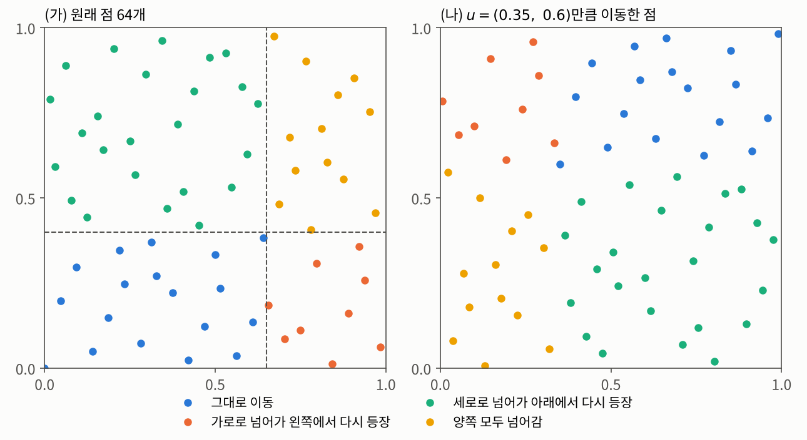

## 들어가며

[1.4](04-quasi-random.qmd)에서 본 준몬테카를로는 매끄러운 함수의 적분을 몬테카를로보다 훨씬 정확하게 계산했습니다. 2차원 예제에서는 같은 개수의 점으로 오차가 수백 배 작았습니다. 그런데 한 가지 큰 약점이 남았습니다. 점이 결정론적이라 **오차를 스스로 잴 방법이 없다**는 것입니다. [1.3](03-output-analysis.qmd)에서 몬테카를로 추정값에 신뢰구간을 붙일 수 있었던 것은 표본이 독립인 확률변수였기 때문인데, Halton 점에는 그런 무작위성이 전혀 없습니다. 콕스마-흘라브카 부등식의 상한은 계산하기도 어렵고, 계산해도 실제 오차보다 훨씬 큰 경우가 많습니다.

> 고르게 배치된 점의 정확도는 지키면서, 몬테카를로처럼 신뢰구간도 붙일 수는 없을까요?

이번 글에서 다룰 답은 놀랍도록 간단합니다. 점들을 하나하나 무작위로 흩뜨리는 대신, **점 전체를 하나의 무작위 벡터만큼 한꺼번에 미는 것**입니다. 점들의 상대적인 배치는 그대로이니 고른 성질은 유지되고, 미는 방향이 무작위이니 확률적인 분석이 가능해집니다. 이것을 **무작위화 준몬테카를로**(randomized quasi-Monte Carlo, RQMC)라고 합니다.

## 점 전체를 한꺼번에 밀기

### 1을 넘으면 반대편으로

점을 밀다 보면 단위 정육면체 밖으로 나가는 점이 생깁니다. 그런 점은 반대편에서 다시 들어오게 합니다. 실수 $x$의 소수 부분을 $\{x\} := x - \lfloor x \rfloor$로 쓰고, 벡터에서는 좌표마다 소수 부분을 취하는 것으로 이해합니다. 그러면 점 $x \in [0,1)^d$를 $u \in [0,1)^d$만큼 민 점은 $\{x + u\}$입니다. 1차원에서는 길이가 $1$인 원 위에서 점을 돌리는 것과 같고, 2차원에서는 화면 오른쪽으로 나간 캐릭터가 왼쪽에서 다시 나타나는 옛날 게임 화면, 즉 원환면(torus) 위에서 미는 것과 같습니다.

{fig-alt="밑이 2와 3인 Halton 점 64개를 u = (0.35, 0.6)만큼 밀기 전과 후. 왼쪽 그림은 원래 점이고 점선으로 네 영역이 나뉘어 있으며, 영역마다 파랑, 주황, 청록, 노랑으로 칠해져 있다. 오른쪽 그림은 민 뒤의 점으로, 각 색의 점 무리가 모양을 유지한 채 자리를 바꾸어 정사각형 전체를 여전히 고르게 채운다." width=90%}

왼쪽 그림의 점선은 미는 양 $u = (0.35, 0.6)$에 따라 어느 점이 경계를 넘어가는지를 나눕니다. 오른쪽 그림을 보면 네 무리의 점이 모양을 그대로 유지한 채 자리만 바꾸었고, 정사각형 전체는 여전히 고르게 채워져 있습니다. 모든 점이 똑같이 움직이므로 원환면 위에서의 상대적인 배치가 보존되기 때문입니다.

### 무작위화 준몬테카를로 추정량

이제 미는 양을 무작위로 고르고, 이것을 독립적으로 여러 번 반복합니다.

::: {.callout-note icon=false .callout-definition}
### 정의 1.5.1 (무작위 이동과 RQMC 추정량)
점 목록 $P_N = (x_1, \ldots, x_N)$ ($x_i \in [0,1)^d$)을 고정하고, $U_1, \ldots, U_R$을 $[0,1)^d$ 위의 균등분포를 따르는 i.i.d. 확률벡터라고 합시다. 적분 가능한 $h$에 대해
$$Z_r := \frac{1}{N} \sum_{i \le N} h(\{x_i + U_r\}), \qquad \hat I_{N,R} := \frac{1}{R} \sum_{r \le R} Z_r$$
로 정의합니다. $Z_r$은 같은 점 $N$개를 $U_r$만큼 민 점들에서의 평균이고, $\hat I_{N,R}$을 **무작위화 준몬테카를로 추정량**이라고 합니다. 이렇게 점 전체를 하나의 균등 무작위 벡터로 미는 방법을 **무작위 이동**(random shift)이라고 하며, 크랜리-패터슨 회전(Cranley–Patterson rotation)이라고도 부릅니다.
:::

여기서 의존 구조를 정확히 짚어 둘 필요가 있습니다. 하나의 $Z_r$ 안에 들어 있는 점 $N$개는 모두 같은 $U_r$로 정해지므로 **서로 강하게 의존**합니다. 사실 그 의존성이 바로 우리가 원하는 것입니다. 점들이 서로를 피해 고르게 퍼져 있어야 하니까요. 반면 서로 다른 이동으로 만든 $Z_1, \ldots, Z_R$은 **서로 독립**입니다. 신뢰구간은 이 $Z_r$들을 단위로 만듭니다.

## 간단한 예: 등간격 점을 밀기

일반적인 성질을 보기 전에, 왜 무작위 이동이 준몬테카를로의 장점을 유지하는지 간단한 예로 확인해 보겠습니다.

::: {.callout-note icon=false}
### 예제 1.5.2 (등간격 점과 $h(u) = u$)
1차원에서 $I(h) = \int_0^1 u\, du = 1/2$를 계산합니다. 등간격 점 $x_i = (i-1)/N$ ($i = 1, \ldots, N$)을 쓰고, $U \sim U(0,1)$로 한 번 밉니다.

$K := \lfloor NU \rfloor$, $Y := \{NU\}$로 두면 $U = (K + Y)/N$이고 $K \in \{0, \ldots, N-1\}$입니다. 길이 $1/N$인 $N$개의 구간 각각이 $u \mapsto \{Nu\}$에 의해 $[0,1)$ 위로 일차함수로 옮겨지므로 $Y$도 다시 $U(0,1)$을 따릅니다.

$i - 1 + K$를 $N$으로 나눈 나머지를 $j_i$라 하면
$$\{x_i + U\} = \Bigl\{\frac{i - 1 + K + Y}{N}\Bigr\} = \frac{j_i + Y}{N}$$
입니다. $i$가 $1$부터 $N$까지 움직일 때 나머지 $j_i$는 $0, \ldots, N-1$을 정확히 한 번씩 지나므로, 정수 부분 $K$는 점들의 순서를 돌려 놓을 뿐이고 민 점들은 순서를 무시하면
$$\frac{Y}{N},\ \frac{1 + Y}{N},\ \ldots,\ \frac{N - 1 + Y}{N}$$
입니다. 따라서 한 번 민 추정량은
$$Z = \frac{1}{N} \sum_{j=0}^{N-1} \frac{j + Y}{N} = \frac{N-1}{2N} + \frac{Y}{N} = \frac{1}{2} + \frac{Y - 1/2}{N}$$
이고, $Y \sim U(0,1)$이므로
$$E(Z) = \frac{1}{2}, \qquad V(Z) = \frac{1}{12 N^2}$$
입니다.
:::

비교하자면, 독립인 균등난수 $N$개를 쓰는 몬테카를로 추정량의 분산은 $V(U)/N = 1/(12N)$입니다. 무작위 이동을 한 번 하면 **불편성은 그대로 유지하면서 분산은 $N$분의 $1$로** 줄어든 것입니다. 이동을 $R$번 독립적으로 반복해도 마찬가지여서, 총 $NR$번의 계산으로 무작위화 준몬테카를로의 분산은 $1/(12N^2R)$, 몬테카를로의 분산은 $1/(12NR)$입니다. 실제로 확인해 보겠습니다.

```python
import numpy as np

np.random.seed(1557)
N, reps = 100, 10_000
x = np.arange(N) / N                                  # 등간격 점 0, 1/N, ..., (N-1)/N
shift = np.random.rand(reps)                          # 무작위 이동 reps번
Z_shift = np.mean((x[None, :] + shift[:, None]) % 1, axis=1)
Z_mc = np.mean(np.random.rand(reps, N), axis=1)       # 비교: 몬테카를로
print(f"무작위 이동:  평균 {Z_shift.mean():.5f},  분산 {Z_shift.var(ddof=1):.3e}  (이론 {1 / (12 * N**2):.3e})")
print(f"몬테카를로:   평균 {Z_mc.mean():.5f},  분산 {Z_mc.var(ddof=1):.3e}  (이론 {1 / (12 * N):.3e})")
```

```
무작위 이동:  평균 0.49999,  분산 8.406e-06  (이론 8.333e-06)
몬테카를로:   평균 0.49985,  분산 8.385e-04  (이론 8.333e-04)
```

두 추정량 모두 평균이 $1/2$에 맞고, 분산은 이론값대로 정확히 $N = 100$배 차이 납니다.

## 무작위화 준몬테카를로의 성질

이 예는 특정한 함수와 특정한 점에 대한 계산이었습니다. 일반적으로 어떤 성질이 성립하는지 정리해 보겠습니다. $h$가 제곱적분 가능하면 $v_N := V(Z_1)$로 두고, $R \ge 2$에 대해 $Z_r$들의 표본분산을
$$s_R^2 := \frac{1}{R-1} \sum_{r \le R} \bigl(Z_r - \hat I_{N,R}\bigr)^2$$
라 합시다.

::: {.callout-important icon=false .callout-satz}
### 명제 1.5.3 (무작위화 준몬테카를로)
$h$가 적분 가능하면 $Z_1, \ldots, Z_R$은 평균이 $I(h)$인 i.i.d. 확률변수입니다. $h$가 제곱적분 가능하면 $v_N < \infty$이고 $V(\hat I_{N,R}) = v_N / R$입니다. 여기에 $v_N > 0$이면, $N$을 고정하고 $R \to \infty$로 보낼 때
$$\frac{\sqrt{R}\,\bigl(\hat I_{N,R} - I(h)\bigr)}{s_R} \xrightarrow[R \to \infty]{D} N(0, 1)$$
이 성립합니다.
:::

::: {.callout-tip collapse="true" icon=false .callout-beweis}
### 증명
**1단계: 밀어도 균등분포는 균등분포입니다.** $x \in [0,1)^d$와 보렐 집합 $A \subseteq [0,1)^d$를 고정합니다. 사상 $T_x(u) := \{x + u\}$는 원환면 위의 일대일대응이고 역사상은 $T_{-x}$입니다. 각 좌표가 $1$을 넘어 되돌아가는지에 따라 정해지는 유한 개의 직사각형 위에서 $T_x$는 보통의 평행이동이므로 르베그 측도를 보존합니다. 따라서
$$P(\{x + U_r\} \in A) = \lambda(T_x^{-1} A) = \lambda(A)$$
이고, 고정된 $i$와 $r$마다 점 $\{x_i + U_r\}$은 $[0,1)^d$ 위의 균등분포를 따릅니다. 한 번의 이동 안에 있는 $N$개의 점은 모두 같은 $U_r$의 함수이므로 일반적으로 서로 의존하지만, 그 사이의 독립성은 사실도 아니고 필요하지도 않습니다.

**2단계: 불편성과 독립성.** $h$가 적분 가능하므로 기대값의 선형성에 의해
$$E(Z_r) = \frac{1}{N} \sum_{i \le N} E\bigl(h(\{x_i + U_r\})\bigr) = \frac{1}{N} \sum_{i \le N} \int_{[0,1]^d} h(u)\, du = I(h)$$
입니다. 또 결정론적인 가측함수 $G(u) := \frac{1}{N} \sum_{i \le N} h(\{x_i + u\})$에 대해 $Z_r = G(U_r)$이고, $U_1, \ldots, U_R$이 i.i.d.이므로 $Z_1, \ldots, Z_R$도 i.i.d.입니다. 앞으로의 분석은 모두 이 $Z_r$ 단위에서 이루어집니다.

**3단계: 분산.** $h$가 제곱적분 가능하다고 합시다. 볼록함수 $z \mapsto z^2$에 대한 옌센 부등식에 의해
$$Z_r^2 = \Bigl(\frac{1}{N} \sum_{i \le N} h(\{x_i + U_r\})\Bigr)^2 \le \frac{1}{N} \sum_{i \le N} h(\{x_i + U_r\})^2$$
이고, 기대값을 취한 뒤 1단계를 쓰면 $E(Z_r^2) \le \int_{[0,1]^d} h(u)^2\, du < \infty$입니다. 따라서 $v_N < \infty$이고, $Z_r$들이 독립이므로 $V(\hat I_{N,R}) = R^{-2} \sum_{r \le R} V(Z_r) = v_N / R$입니다.

**4단계: 중심극한정리.** $v_N > 0$이고 $N$을 고정하면, $Z_1, Z_2, \ldots$에 린데베르그-레비 중심극한정리를 적용해
$$\frac{\sqrt{R}\,\bigl(\hat I_{N,R} - I(h)\bigr)}{\sqrt{v_N}} \xrightarrow[R \to \infty]{D} N(0,1)$$
을 얻습니다. 한편 $Z_r$과 $Z_r^2$에 강한 큰 수의 법칙을 적용하면 $\frac{1}{R}\sum_{r \le R} Z_r \xrightarrow{\text{a.s.}} I(h)$, $\frac{1}{R}\sum_{r \le R} Z_r^2 \xrightarrow{\text{a.s.}} E(Z_1^2)$이므로
$$s_R^2 = \frac{R}{R-1} \Bigl(\frac{1}{R} \sum_{r \le R} Z_r^2 - \hat I_{N,R}^2\Bigr) \xrightarrow[R \to \infty]{\text{a.s.}} E(Z_1^2) - I(h)^2 = v_N$$
이고, 특히 $s_R / \sqrt{v_N} \xrightarrow{P} 1$입니다. 위의 통계량에 $\sqrt{v_N}/s_R$을 곱하고 슬러츠키 정리를 적용하면 결론을 얻습니다. 사용한 확률론의 정리들은 [1.3](03-output-analysis.qmd)과 [측도론적 확률론](../../measure-prob/index.qmd)을 참고하시기 바랍니다.
:::

이 명제가 말하는 것은 결국, **무작위 이동으로 만든 $Z_1, \ldots, Z_R$은 [1.3](03-output-analysis.qmd)의 $Z_1, \ldots, Z_N$과 똑같이 다룰 수 있다**는 것입니다. 각 $Z_r$은 참값을 평균으로 하는 i.i.d. 확률변수이므로, 그 평균에 [1.3](03-output-analysis.qmd)의 신뢰구간을 그대로 붙이면 됩니다. 달라진 것은 각 $Z_r$이 점 하나가 아니라 고르게 배치된 점 $N$개의 평균이라서, 분산 $v_N$이 몬테카를로보다 훨씬 작을 수 있다는 점뿐입니다.

::: {.callout-note icon=false}
### 알고리즘 1.5.4 (무작위화 준몬테카를로와 신뢰구간)
**입력:** 점 목록 $P_N = (x_1, \ldots, x_N)$ (예: Halton 점), 이동 횟수 $R$, 함수 $h$<br>
**출력:** $I(h)$의 추정값과 근사 95% 신뢰구간

1. $[0,1)^d$ 위의 i.i.d. 균등 무작위 벡터 $U_1, \ldots, U_R$을 생성합니다.
2. $r = 1, \ldots, R$에 대해 $Z_r := \frac{1}{N} \sum_{i \le N} h(\{x_i + U_r\})$를 계산합니다.
3. $\hat I_{N,R} := \frac{1}{R} \sum_{r \le R} Z_r$와 표본분산 $s_R^2$을 계산합니다.
4. $\hat I_{N,R}$과 구간 $\hat I_{N,R} \pm 1.96\, s_R / \sqrt{R}$을 반환합니다.
:::

[1.4](04-quasi-random.qmd)의 2차원 함수 $h(u) = \prod_{j \le 2} \frac{\pi}{2}\sin(\pi u_j)$ ($I(h) = 1$)로 실제로 해 보겠습니다. Halton 점 $N = 1{,}024$개를 $R = 30$번 밀고, 같은 계산량인 $NR = 30{,}720$번의 몬테카를로와 비교합니다. `halton` 함수는 [1.4](04-quasi-random.qmd)에서 만든 것을 그대로 씁니다.

```python
def h(u):                                             # I(h) = 1
    return np.prod(np.pi / 2 * np.sin(np.pi * u), axis=1)

def rqmc(P, R):
    """점 목록 P를 R번 무작위 이동해서 Z_1, ..., Z_R을 돌려준다"""
    shifts = np.random.rand(R, P.shape[1])
    return np.array([h((P + s) % 1).mean() for s in shifts])

N, R = 1024, 30
H = halton(N, [2, 3])
Z = rqmc(H, R)
I_hat, s_R = Z.mean(), Z.std(ddof=1)
half = 1.96 * s_R / np.sqrt(R)
print(f"RQMC (N={N}, R={R}):  추정값 {I_hat:.6f},  95% 신뢰구간 [{I_hat - half:.6f}, {I_hat + half:.6f}],  반폭 {half:.2e}")

Y = h(np.random.rand(N * R, 2))                       # 같은 계산량의 몬테카를로
half_mc = 1.96 * Y.std(ddof=1) / np.sqrt(N * R)
print(f"MC   (N·R={N * R}):     추정값 {Y.mean():.6f},  95% 신뢰구간 [{Y.mean() - half_mc:.6f}, {Y.mean() + half_mc:.6f}],  반폭 {half_mc:.2e}")
```

```
RQMC (N=1024, R=30):  추정값 0.999911,  95% 신뢰구간 [0.999686, 1.000137],  반폭 2.25e-04
MC   (N·R=30720):     추정값 1.003073,  95% 신뢰구간 [0.994966, 1.011181],  반폭 8.11e-03
```

두 신뢰구간 모두 참값 $1$을 포함하지만, 무작위화 준몬테카를로의 신뢰구간이 약 $36$배 좁습니다. 반폭은 $1/\sqrt{\text{계산량}}$에 비례하므로, 몬테카를로로 같은 폭을 얻으려면 계산을 $36^2 \approx 1{,}300$배 더 해야 합니다. 이제 준몬테카를로의 정확도와 몬테카를로의 신뢰구간을 함께 가지게 되었습니다.

### 주의할 점

**불편성만으로 분산이 줄어드는 것은 아닙니다.** 명제 1.5.3은 어떤 점 목록에 대해서도 성립하지만, 분산 $v_N$이 작다는 것은 말해 주지 않습니다. 극단적인 예로 점 $N$개가 모두 같은 점 $x_1$이라면 $Z_r = h(\{x_1 + U_r\})$이고, 이것은 균등난수 **하나**로 만든 몬테카를로 추정값과 같은 분포를 가집니다. 계산은 $N$번 했는데 분산은 몬테카를로의 $N$배인 셈입니다. 한 번의 이동 안에 있는 점들 사이의 공분산이 $v_N$을 결정하므로, 무작위 이동이 효과를 내려면 원래 점이 고르게 퍼져 있어야 합니다. 이것을 정확히 말해 주는 것이 다음 절의 명제입니다.

**점 하나가 시뮬레이션 한 번의 입력 전체여야 합니다.** 정해진 차원 $d$의 적분에서는 점 하나 $x_i \in [0,1)^d$가 $h$를 한 번 계산하는 데 필요한 입력 벡터 전체입니다. 그런데 몇 번 반복할지 미리 정해지지 않은 시뮬레이션, 예를 들어 조건을 만족할 때까지 난수를 계속 뽑는 루프에 준난수의 좌표나 점들을 차례로 넣으면 이 구조가 깨집니다. 이런 경우가 무조건 금지된다는 정리가 있는 것은 아니지만, 따로 정당화가 필요하고 실제로 결과가 크게 틀어지는 예도 알려져 있습니다.[^ag]

## 밀어도 불일치도는 크게 나빠지지 않는다

명제 1.5.3은 불편성과 오차 추정을 주었습니다. 여기에 [1.4](04-quasi-random.qmd)의 결정론적인 보장을 연결하려면, 민 점들의 불일치도가 원래 점들의 불일치도와 크게 다르지 않다는 것을 보여야 합니다. 원점에 꼭짓점을 둔 상자를 밀면 경계에서 잘려 여러 조각으로 나뉘는데, 그 조각들은 더 이상 원점에 붙어 있지 않다는 것이 어려운 점입니다.

$P_N^u := (\{x_1 + u\}, \ldots, \{x_N + u\})$로 쓰고, 점들의 경험적 분포와 르베그 측도 $\lambda$의 차이인 부호 측도(signed measure)
$$\nu_N := \frac{1}{N} \sum_{i \le N} \delta_{x_i} - \lambda$$
를 생각합니다. 상자 $B$에 대해 $\nu_N(B)$는 $B$에 든 점의 비율에서 $B$의 부피를 뺀 값입니다.

::: {.callout-important icon=false .callout-satz}
### 명제 1.5.5 (이동 후의 불일치도)
모든 $u \in [0,1)^d$에 대해 $D_N^*(P_N^u) \le 4^d\, D_N^*(P_N)$입니다. 따라서 $h \in C^d([0,1]^d)$이면
$$V(Z_1) \le 16^d\, V_{\mathrm{HK}}(h)^2\, D_N^*(P_N)^2, \qquad V(\hat I_{N,R}) \le \frac{16^d\, V_{\mathrm{HK}}(h)^2\, D_N^*(P_N)^2}{R}$$
가 성립합니다.
:::

::: {.callout-tip collapse="true" icon=false .callout-beweis}
### 증명
**1단계: 임의의 상자.** 먼저 원점에 붙지 않은 상자 $B = \prod_{j \le d} [a_j, b_j)$ ($0 \le a_j \le b_j \le 1$)에 대해
$$\lvert \nu_N(B)\rvert \le 2^d\, D_N^*(P_N)$$
임을 보입니다. $\mathbf{1}_{\{a_j \le x_j < b_j\}} = \mathbf{1}_{\{x_j < b_j\}} - \mathbf{1}_{\{x_j < a_j\}}$를 $d$개 곱해 전개하면
$$\mathbf{1}_B(x) = \sum_{\varepsilon \in \{0,1\}^d} (-1)^{d - \lvert \varepsilon\rvert}\, \mathbf{1}_{[0, c(\varepsilon))}(x)$$
입니다. 여기서 $\lvert \varepsilon\rvert$는 $\varepsilon$의 성분 중 $1$의 개수이고, $c(\varepsilon)$의 $j$번째 좌표는 $\varepsilon_j = 1$이면 $b_j$, $\varepsilon_j = 0$이면 $a_j$입니다. 항은 $2^d$개이고 각 $\lvert \nu_N([0,c))\rvert$는 $D_N^*(P_N)$ 이하이므로, 이 식을 $\nu_N$으로 적분하고 삼각부등식을 쓰면 주장을 얻습니다. 상자가 비어 있는 경우에는 양변이 모두 $0$이라 자명합니다.

**2단계: 민 상자는 상자 $2^d$개 이하로 나뉩니다.** $u \in [0,1)^d$와 $t \in [0,1]^d$를 고정하고 $A_t := [0, t)$, $T_u(x) := \{x + u\}$로 둡니다. 한 좌표만 보면, $\{x_j + u_j\} < t_j$를 만족하는 $x_j \in [0,1)$의 집합은 원 위의 구간입니다. 이 구간이 $[0,1)$의 경계를 넘으면 서로소인 반열린구간 두 개로, 아니면 하나로 나뉩니다($t_j = 0$이면 공집합, $t_j = 1$이면 전체). 좌표별 구간들의 곱을 취하면 $T_u^{-1}(A_t)$는 서로소인 반열린 상자 $B_1, \ldots, B_M$ ($0 \le M \le 2^d$)의 합집합입니다.

**3단계: 합치기.** 평행이동은 르베그 측도를 보존하므로 $\lambda(T_u^{-1}(A_t)) = \lambda(A_t)$이고, $A_t$에 든 민 점의 개수는 $T_u^{-1}(A_t)$에 든 원래 점의 개수와 같습니다. 따라서
$$\frac{1}{N} \sum_{i \le N} \mathbf{1}_{A_t}(\{x_i + u\}) - \lambda(A_t) = \nu_N\bigl(T_u^{-1}(A_t)\bigr) = \sum_{r \le M} \nu_N(B_r)$$
이고, 1단계에 의해 절댓값이 $M\, 2^d D_N^*(P_N) \le 4^d D_N^*(P_N)$ 이하입니다. $t$에 대한 상한을 취하면 $D_N^*(P_N^u) \le 4^d D_N^*(P_N)$입니다.

**4단계: 분산.** $U_1$이 실현될 때마다 결정론적인 점 목록 $P_N^{U_1}$에 [1.4](04-quasi-random.qmd)의 콕스마-흘라브카 부등식을 적용하고 3단계를 쓰면, 거의 확실하게
$$\lvert Z_1 - I(h)\rvert \le V_{\mathrm{HK}}(h)\, D_N^*(P_N^{U_1}) \le 4^d\, V_{\mathrm{HK}}(h)\, D_N^*(P_N)$$
입니다. 명제 1.5.3에 의해 $E(Z_1) = I(h)$이므로 $V(Z_1) = E((Z_1 - I(h))^2)$이고, 위 부등식을 제곱해 기대값을 취하면 첫째 부등식을 얻습니다. $Z_r$들이 독립이므로 평균의 분산은 $V(Z_1)/R$이고, 이것이 둘째 부등식입니다.
:::

이 명제 덕분에 무작위 이동을 해도 결정론적인 점의 장점이 사라지지 않습니다. 예를 들어 1차원에서 van der Corput 점을 쓰면, 같은 논증을 정리 1.4.2와 함께 써서 $\mathrm{TV}(h)$가 유한한 $h$에 대해
$$\mathrm{RMSE}(\hat I_{N,R}) \le c\, \mathrm{TV}(h)\, \frac{\log(N+1)}{N\sqrt{R}}$$
꼴의 상한을 얻습니다($c$는 상수이고, $N$이 밑의 거듭제곱이면 로그 인자가 빠집니다). 몬테카를로의 $1/\sqrt{NR}$과 비교하면 $N$에 대한 의존성이 훨씬 좋습니다. 다만 이 결론은 **점의 불일치도가 작다는 것**과 **함수가 매끄럽다는 것**을 모두 써서 얻은 것입니다. 앞에서 본 "모든 점이 같은" 예처럼 아무 점이나 밀어서는 분산이 줄지 않는다는 것과 잘 맞아떨어집니다.

상수 $4^d$는 증명을 간단히 하기 위한 것이라 실제로는 훨씬 여유가 있습니다. 1차원에서 van der Corput 점 $1{,}000$개를 무작위로 $1{,}000$번 밀어 보겠습니다. `van_der_corput`와 `star_discrepancy_1d`는 [1.4](04-quasi-random.qmd)에서 만든 함수입니다.

```python
P = van_der_corput(1_000)
D0 = star_discrepancy_1d(P)
D_shift = np.array([star_discrepancy_1d((P + u) % 1) for u in np.random.rand(1_000)])
print(f"원래 점: {D0:.6f},  이동한 점: 최소 {D_shift.min():.6f}, 최대 {D_shift.max():.6f},  최대 비율 {D_shift.max() / D0:.2f}")
```

```
원래 점: 0.002453,  이동한 점: 최소 0.001227, 최대 0.002396,  최대 비율 0.98
```

명제가 허락하는 것은 원래 불일치도의 $4$배까지이지만, 실제로는 $1{,}000$번 중 한 번도 원래 값을 넘지 않았습니다.

## 점의 개수와 이동 횟수를 어떻게 나눌까

마지막으로 실용적인 문제가 하나 남습니다. 전체 계산량 $NR$이 정해져 있을 때, 점을 많이 쓰고 이동을 적게 할까요, 아니면 점을 적게 쓰고 이동을 많이 할까요?

두 방향은 서로 다른 것을 개선합니다. 명제 1.5.5에 따르면 분산은 $N$에 대해서는 대략 $1/N^2$ 꼴로, $R$에 대해서는 $1/R$로만 줄어들므로 **정확도만 보면 $N$을 키우는 것이 유리합니다.** 반면 명제 1.5.3의 정규근사는 $N$을 고정하고 **$R$을 키울 때** 성립하는 것이므로, $R$이 작으면 신뢰구간을 믿기 어렵습니다. $N$을 아무리 키워도 이동 횟수에 대한 정규근사가 좋아지지는 않습니다.

계산량을 $NR = 16{,}384$로 고정하고 네 가지 배분을 비교해 보겠습니다. 각 배분마다 무작위화 준몬테카를로를 $1{,}000$번 반복해서, 실제 RMSE와 신뢰구간 $\hat I_{N,R} \pm 1.96\, s_R/\sqrt{R}$이 참값을 포함한 비율을 셉니다.

```python
H_all = halton(4096, [2, 3])
budget, reps = 16_384, 1_000
for N in [4096, 1024, 256, 64]:
    R = budget // N
    est, cover = [], 0
    for _ in range(reps):
        Z = rqmc(H_all[:N], R)
        half = 1.96 * Z.std(ddof=1) / np.sqrt(R)
        est.append(Z.mean())
        cover += abs(Z.mean() - 1) <= half
    rmse = np.sqrt(np.mean((np.array(est) - 1)**2))
    print(f"N = {N:>4}, R = {R:>3}:  실제 RMSE {rmse:.2e},  신뢰구간 포함 비율 {cover / reps:.3f}")
```

```
N = 4096, R =   4:  실제 RMSE 1.12e-04,  신뢰구간 포함 비율 0.858
N = 1024, R =  16:  실제 RMSE 1.48e-04,  신뢰구간 포함 비율 0.927
N =  256, R =  64:  실제 RMSE 3.04e-04,  신뢰구간 포함 비율 0.939
N =   64, R = 256:  실제 RMSE 9.15e-04,  신뢰구간 포함 비율 0.947
```

예상대로입니다. 이동을 $4$번만 하면 RMSE는 가장 작지만 "95%" 신뢰구간이 실제로는 $86\%$만 참값을 포함합니다.[^t] 이동을 $256$번 하면 신뢰구간은 약속을 지키지만 RMSE가 $8$배 넘게 커집니다. 그 사이의 $R = 16$이나 $64$ 정도가 무난한 타협입니다. 정리하면, 이동 횟수 $R$은 신뢰구간을 믿을 수 있을 만큼(수십 번 정도)만 확보하고, 남는 계산량은 점의 개수 $N$에 주는 것이 좋습니다. 수학적인 오차 보장과 경험적인 신뢰구간은 서로 관련은 있지만 **다른 질문에 대한 답**이라는 점을 기억해 두면 좋겠습니다.

## 정리

이번 글에서는 준몬테카를로의 정확도에 몬테카를로의 오차 추정을 더하는 무작위화 준몬테카를로를 살펴보았습니다.

- 고르게 배치된 점 전체를 하나의 균등 무작위 벡터만큼 밀면(무작위 이동), 점들의 상대적인 배치는 원환면 위에서 그대로 유지됩니다.
- 이렇게 만든 $Z_1, \ldots, Z_R$은 참값을 평균으로 하는 i.i.d. 확률변수이므로, [1.3](03-output-analysis.qmd)과 똑같이 $\hat I_{N,R} \pm 1.96\, s_R/\sqrt{R}$로 신뢰구간을 붙일 수 있습니다.
- 밀어도 불일치도는 많아야 $4^d$배까지만 커지므로, 함수가 매끄럽고 점의 불일치도가 작으면 분산이 몬테카를로보다 훨씬 작습니다. 아무 점이나 민다고 분산이 줄지는 않습니다.
- 계산량을 나눌 때는 신뢰구간을 위해 이동 횟수 $R$을 어느 정도 확보하고, 나머지를 점의 개수 $N$에 줍니다.

이것으로 1장을 마칩니다. 1장에서는 구하고 싶은 값을 기대값으로 바꿔 표본평균으로 근사한다는 몬테카를로 방법의 기본 틀에서 출발해, 그 재료인 균등난수를 만드는 방법(1.1)과 검사하는 방법(1.2), 결과의 정확도를 재고 필요한 시뮬레이션 횟수를 정하는 방법(1.3), 그리고 무작위 대신 고른 점을 써서 수렴을 빠르게 하는 준몬테카를로(1.4, 1.5)까지 살펴보았습니다.

그런데 지금까지 우리가 만든 것은 모두 균등분포를 따르는 수뿐이었습니다. 실제 시뮬레이션에서는 정규분포, 지수분포, 푸아송분포처럼 훨씬 다양한 분포가 필요합니다. 균등난수 하나로 이런 분포들을 어떻게 만들어 낼 수 있을까요? 이것이 2장의 주제입니다.

---

### 연결되는 개념
* $\leftarrow$ **이전 개념:** [1.4 고르게 찍으면 더 빠를까: 준난수와 불일치도](04-quasi-random.qmd)
* $\rightarrow$ **다음 개념:** 추후 작성 예정

[^ag]: 무작위화 준몬테카를로와 그 주의점은 S. Asmussen, P. W. Glynn, *Stochastic Simulation: Algorithms and Analysis*, Springer, 2007, IX.3절을 참고했습니다. 준난수를 무작위 보행의 정지 시각 시뮬레이션에 그대로 넣었을 때 결과가 틀어지는 예도 이 절에 있습니다.

[^t]: $R$이 이렇게 작을 때는 $1.96$ 대신 자유도가 $R-1$인 $t$분포의 분위수(예: $R = 4$이면 약 $3.18$)를 쓰는 것이 보통입니다. 다만 이것도 $Z_r$이 정규분포를 따른다는 가정 아래에서만 정확하므로, $R$을 충분히 확보하는 것이 근본적인 해결책입니다.
