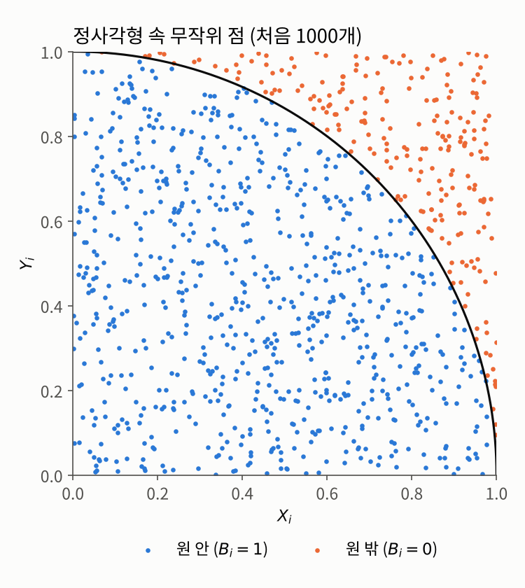
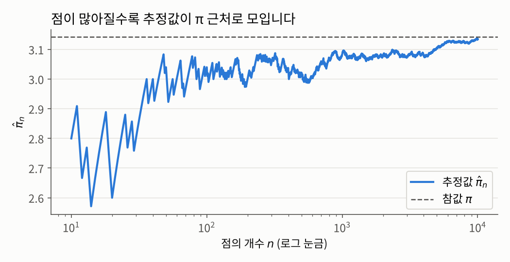

## 들어가며

[과목 소개 글](../index.qmd)에서 우리는 공식으로 구할 수 없는 값을 "여러 번 해 보고 평균을 내서" 근사한다는 아이디어를 이야기했습니다. 이번 글에서는 이 아이디어가 실제로 어떻게 작동하는지 두 가지 예제로 살펴보겠습니다.

1. 무작위로 점을 찍어 **원주율 $\pi$**를 구하는 문제
2. 같은 아이디어로 **정적분**을 계산하는 문제

두 문제 모두 같은 순서로 진행합니다. 먼저 문제 상황을 소개하고, 접근 아이디어를 설명한 다음, 그 아이디어를 수학적으로 정확하게 표현하는 데 필요한 개념과 정리를 정의합니다. 마지막으로 그 도구들을 이용해 문제를 해결합니다.

이번 글에 등장하는 개념들은 대부분 확률론에서 이미 다루는 내용입니다. 그래서 정의와 정리의 내용은 정확히 적되, 증명은 [측도론적 확률론](../../measure-prob/index.qmd) 쪽을 참고하는 것으로 하고 넘어가겠습니다.

## 문제 1: 원주율 π 구하기

### 문제 상황

$\pi \approx 3.14159\ldots$라는 값을 전혀 모른다고 가정해 봅시다. 우리가 아는 것은 반지름이 $1$인 원의 넓이가 $\pi$라는 사실뿐입니다. 이때 **무작위로 점을 찍는 실험만으로** $\pi$의 값을 알아낼 수 있을까요?

### 접근 아이디어: 다트 던지기

한 변의 길이가 $1$인 정사각형 $S = [0,1]^2$ 위에, 원점을 중심으로 하는 반지름 $1$짜리 원의 4분의 1 조각을 그려 봅시다.

$$A := \{(x, y) \in S : x^2 + y^2 \le 1\}$$

정사각형의 넓이는 $1$이고, 사분원 $A$의 넓이는 $\pi/4$입니다.

이제 이 정사각형을 과녁 삼아 다트를 던진다고 상상해 봅시다. 그러면 직관적으로, 다트가 정사각형 안의 **어느 곳에나 똑같이 고르게** 떨어진다면, 다트가 사분원 안에 떨어질 확률은 두 넓이의 비율과 같을 것입니다.

$$\mathbb{P}(\text{다트가 } A \text{ 안에 떨어짐}) = \frac{A\text{의 넓이}}{S\text{의 넓이}} = \frac{\pi/4}{1} = \frac{\pi}{4}$$

즉, 원주율이라는 **기하학적인 양**이 **확률**로 바뀌었습니다. 그리고 확률은 실험을 반복하면 상대빈도로 근사할 수 있습니다. 다트를 $N$번 던져서 그중 사분원 안에 떨어진 비율을 구하면, 그 비율은 $\pi/4$에 가까울 것입니다. 여기에 $4$를 곱하면 $\pi$의 근삿값을 얻습니다.

이 아이디어를 정확한 수학으로 옮기려면 몇 가지를 분명히 해야 합니다. "어느 곳에나 똑같이 고르게"는 정확히 무슨 뜻인가요? 다트를 여러 번 "따로따로" 던진다는 것은요? 그리고 "비율이 확률에 가까워진다"는 것은 왜 성립할까요? 차례대로 정의해 보겠습니다.

### 필요한 개념들

"고르게 떨어진다"는 성질은 **균등분포**로 표현합니다.

::: {.callout-note icon=false .callout-definition}
### 정의 1.1 (균등분포)
확률변수 $X$가 다음을 만족하면 $X$는 구간 $[0,1]$ 위의 **균등분포**(uniform distribution)를 따른다고 하고, $X \sim \mathrm{Unif}[0,1]$로 씁니다.
$$\mathbb{P}(a \le X \le b) = b - a \qquad (0 \le a \le b \le 1)$$
같은 방식으로, 평면 위의 무작위 점 $P$가 정사각형 $S = [0,1]^2$ 위의 균등분포를 따른다는 것은 $S$ 안의 모든 가측 집합 $C\subset S$에 대해
$$\mathbb{P}(P \in C) = \lambda(C)$$
가 성립한다는 뜻입니다. 여기서 $\lambda$는 $C$의 넓이를 계산하는 함수(르베그 측도)입니다.
:::

즉 균등분포에서는 어떤 영역에 떨어질 확률이 **그 영역의 크기에만** 비례하고, 위치와는 상관이 없습니다. 앞의 접근 아이디어에서 "확률 = 넓이의 비율"이라고 한 것이 바로 이 정의입니다.

다음으로 다트를 "따로따로" 던진다는 성질, 즉 한 번의 결과가 다른 결과에 아무런 영향을 주지 않는다는 성질은 **독립**으로 표현합니다.

::: {.callout-note icon=false .callout-definition}
### 정의 1.2 (독립, i.i.d.)
확률변수 $X_1, \ldots, X_N$이 **독립**(independent)이라는 것은, 임의의 가측 집합 $C_1, \ldots, C_N$에 대해
$$\mathbb{P}(X_1 \in C_1, \ldots, X_N \in C_N) = \mathbb{P}(X_1 \in C_1) \cdots \mathbb{P}(X_N \in C_N)$$
이 성립한다는 뜻입니다. 확률변수들이 서로 독립이면서 모두 같은 분포를 따르면, 이를 **독립 동일 분포**(independent and identically distributed)라고 하고 줄여서 **i.i.d.**라고 씁니다.
:::

컴퓨터로 점을 찍을 때는 $x$좌표와 $y$좌표를 각각 $[0,1]$ 위의 $\mathrm{Unif}[0,1]$를 따르는 확률변수 $X$, $Y$로 보고 따로 뽑습니다. 이렇게 해도 되는 이유는 직관적으로 생각하면 간단합니다. 우리가 만약 $S$의 임의의 점 $(x,y)$를 하나 고른다면, $x$, $y$의 값은 서로 서로 무관합니다. $x = 1$이라고 하더라도 $y$는 $[0,1]$의 어떠한 숫자가 되더라도 이상하지 않으며, 반대도 성립합니다.
따라서 우리는 $X,Y$가 독립임을 전제로 이야기를 진행할 수 있습니다. 그리고
$X, Y \sim \mathrm{Unif}[0,1]$가 서로 독립이면, 점 $P = (X, Y)$는 정사각형 $S$ 위의 균등분포를 따릅니다. 이는 직사각형 영역 $C = [a,b] \times [c,d]$에 대해서, $C$의 넓이가 $(b-a)(d-c)$임을 이용하면 다음과 같이 바로 확인할 수 있습니다.
$$\mathbb{P}(P \in C) = \mathbb{P}(a \le X \le b)\,\mathbb{P}(c \le Y \le d) = (b-a)(d-c) = \lambda(C)$$
일반적인 영역으로의 확장은 측도론의 표준적인 논증으로 처리됩니다.

이제 "다트가 원 안에 떨어졌는가?"라는 예/아니오 결과를 숫자로 바꿔야 평균을 낼 수 있습니다. 이때 쓰는 도구가 **지시함수**입니다.

::: {.callout-note icon=false .callout-definition}
### 정의 1.3 (지시함수와 지시확률변수)
집합 $A$의 **지시함수**(indicator function)는 다음으로 정의됩니다.
$$\mathbf{1}_A(z) := \begin{cases} 1, & z \in A \\ 0, & z \notin A \end{cases}$$
만약 $A$가 가측 집합이라면, $\mathbf{1}_A$ 또한 가측이며, 따라서 확률변수의 정의를 만족합니다.

우리는 이제 임의의 확률변수 $Z$에 대해 $B := \mathbf{1}_A\circ Z:=\mathbf{1}_A(Z)$를 고려할 수 있습니다. $B$는 $0$ 또는 $1$만 값으로 가지므로
$$\mathbb{E}[B] = 1 \cdot \mathbb{P}(Z \in A) + 0 \cdot \mathbb{P}(Z \notin A) = \mathbb{P}(Z \in A)$$
가 성립합니다. 즉 $B$는 성공 확률이 $\mathbb{P}(Z \in A)$인 **베르누이 확률변수**입니다.
:::

여기서 다뤄지는 확률변수 $B$의 핵심은 마지막 식, **확률을 기대값으로 바꿔 준다**는 데 있습니다. 확률은 직접 평균을 낼 수 없지만, 기대값은 표본평균으로 근사할 수 있기 때문입니다. 그 근사 가능성은 다음 정리에 의해 보장됩니다.

::: {.callout-important icon=false .callout-satz}
### 정리 1.4 (강한 큰 수의 법칙)
$X_1, X_2, \ldots$가 i.i.d.이고 $\mathbb{E}|X_1| < \infty$이면,
$$\bar{X}_N := \frac{X_1 + \cdots + X_N}{N} \xrightarrow[N \to \infty]{} \mathbb{E}[X_1] \quad \text{a.s.}$$
가 성립합니다.
:::

::: {.callout-tip collapse="false" icon=false .callout-beweis}
### 증명
[측도론적 확률론](../../measure-prob/index.qmd)의 큰 수의 법칙 부분을 참고하시기 바랍니다.
:::
위 정리는 결국 $i.i.d.$인 확률변수들이 주어졌을 때, 그 주어진 확률변수의 갯수인 $N$이 충분히 크다면 확률변수의 기대값 $\mathbb{E}[X_1]$을 그저 $X_1,...,X_N$의 산술평균으로 근사할 수 있음을 말해줍니다.

이미 확률론을 공부하셨다면 아시겠지만, 위의 정리는 큰 수의 법칙의 두 버젼 중 **강한** 큰 수의 법칙에 해당됩니다. 강한 큰 수의 법칙은 보시다시피 거의 확실한(almost surely) 수렴성을 보여줍니다.

참고로 거의 확실하게라는 표현은 측도론의 거의 어디서나(almost everwhere)와 동치인 개념으로, 이를 우리의 맥락에서 해석하자면 표본평균이 참값으로 수렴하지 않는 경우가 생길 확률이 $0$이라는 뜻입니다. 예를 들어 동전을 아무리 던져도 앞면만 계속 나오는 경우는 논리적으로는 가능하지만 그 확률은 $0$이고, 그런 예외를 제외하면 수렴이 반드시 일어난다는거죠. 거의 확실한 수렴은 저렇게 뒤에 $a.s.$를 붙이는 방법으로 구분됩니다.

### 해결

이제 도구가 모두 갖춰졌습니다. 앞의 접근 아이디어를 알고리즘으로 정리하면 다음과 같습니다.

::: {.callout-note icon=false}
### 알고리즘 1.5 (시뮬레이션을 이용한 π의 추정)
**입력:** 반복 횟수 $N$<br>
**출력:** $\pi$의 추정값 $\hat{\pi}$

1. $[0,1]$ 위의 균등난수 $X_1, \ldots, X_N, Y_1, \ldots, Y_N$을 생성합니다.
2. $i = 1, \ldots, N$에 대해 $B_i := \mathbf{1}\{X_i^2 + Y_i^2 \le 1\}$로 둡니다.
3. $\hat{\pi} := 4 (B_1 + \cdots + B_N)/N$을 반환합니다.
:::

이 알고리즘이 왜 맞는지는 지금까지의 정의와 정리를 순서대로 엮으면 바로 보입니다.

- **점의 분포 (정의 1.1, 1.2):** $P_i := (X_i, Y_i)$로 두면, $X_i$와 $Y_i$가 독립인 균등분포를 따르므로 이들을 결합한 $P_i$는 다시 정사각형 $S$ 위의 균등분포를 따릅니다. 또한 $P_1, \ldots, P_N$은 서로 독립입니다.
- **확률로의 변환 (정의 1.3):** $B_i = \mathbf{1}_A(P_i)$는 지시확률변수이므로 $\mathbb{E}[B_i] = \mathbb{P}(B_i = 1) = \mathbb{P}(P_i \in A) = |A| / |S| = \pi/4$입니다.
- **큰 수의 법칙 (정리 1.4):** $B_1, B_2, \ldots$는 i.i.d.이고, $0$과 $1$ 사이의 값만 가지므로 $\mathbb{E}|B_1| \le 1 < \infty$입니다. 따라서
$$\frac{B_1 + \cdots + B_N}{N} \xrightarrow[N \to \infty]{} \mathbb{E}[B_1] = \frac{\pi}{4} \quad \text{a.s.}$$
이고, 양변에 $4$를 곱하면 $\hat{\pi} \to \pi$입니다.

실제로 돌려 보겠습니다. [과목 소개 글](../index.qmd)에서 이야기한 대로, 결과를 재현할 수 있도록 시드를 고정했습니다.

```python
import numpy as np

np.random.seed(2026)
N = 10_000
coords = np.random.rand(2, N)          # 첫 행: X_1, ..., X_N / 둘째 행: Y_1, ..., Y_N
B = np.sum(coords**2, axis=0) <= 1     # B_i = 1{X_i^2 + Y_i^2 <= 1}
pihat = 4 * np.mean(B)
print(pihat)
```

```
3.134
```

아래 그림은 찍은 점들 중 처음 1,000개를 보여 줍니다. 파란 점은 사분원 안에 떨어진 점($B_i = 1$), 주황 점은 바깥에 떨어진 점($B_i = 0$)입니다.

{fig-alt="단위 정사각형 안에 찍힌 무작위 점 1000개. 사분원 안쪽의 점은 파란색, 바깥쪽의 점은 주황색으로 표시되어 있다." width=70%}

점을 하나씩 늘려 가면서 추정값 $\hat{\pi}_n = 4(B_1 + \cdots + B_n)/n$이 어떻게 변하는지도 살펴볼 수 있습니다.

```python
estimates = 4 * np.cumsum(B) / np.arange(1, N + 1)
print(estimates[[9, 99, 999, 9999]])   # n = 10, 100, 1000, 10000
```

```
[2.8   3.04  3.084 3.134]
```

{fig-alt="점의 개수 n을 10에서 10000까지 로그 눈금으로 늘려 갈 때 π 추정값의 변화. 처음에는 2.6과 3.0 사이를 크게 오르내리다가 점이 많아질수록 참값 π를 나타내는 점선 근처로 모인다."}

점이 적을 때는 추정값이 크게 흔들리지만, 점이 많아질수록 참값 $\pi$ 근처로 모여드는 것을 볼 수 있습니다. 큰 수의 법칙이 눈앞에서 일어나고 있는 셈입니다.

다만 점을 만 개나 찍었는데도 정확한 자릿수는 고작 두 자리 정도입니다. 이 수렴이 **얼마나 빠른지**는 큰 수의 법칙만으로는 알 수 없고, 이는 다음 글들에서 다룰 중요한 질문입니다.

## 문제 2: 정적분 구하기

### 문제 상황

이번에는 다음 정적분을 계산해 봅시다.

$$\ell := \int_0^1 e^{-x^2}\, dx$$

통계학에서 정규분포를 다룰 때마다 나오는 바로 그 함수입니다. 이 $e^{-x^2}$은 부정적분을 우리가 아는 공식의 형태로 나타낼 수 없어, 일반적인 1차원 적분 방식으로는 계산할 수 없다는걸로 유명합니다. 이런 함수들은 닫힌 공식을 통한 계산이 가능한 방법이 있다고 하더라도, 사실 그 방법을 따라서 머리를 굴려가며 계산하는 것에 비해 수치적인 방법으로 근사적 계산을 하는 것이 더 유리한 경우가 많습니다.

이런 문제 상황(닫힌 공식을 통한 계산이 비효율적인)을 조금 더 일반적으로 다루기 위해 연속함수 $H: [0,1] \to \mathbb{R}$에 대해 $\ell := \int_0^1 H(x)\, dx$를 계산하는 문제를 생각하겠습니다.

### 접근 아이디어: 적분은 평균 높이다

정적분 $\int_0^1 H(x)\,dx$는 그래프 아래의 넓이입니다. 그런데 구간의 길이가 $1$이므로, 이 넓이는 곧 **구간 길이 $\times$ 그래프의 평균 높이** $= 1 \times$ (평균 높이)로 볼 수도 있습니다.

그렇다면 평균 높이는 어떻게 구할까요? 구간 $[0,1]$에서 위치 $x$를 무작위로 고르게 골라 높이 $H(x)$를 재는 일을 여러 번 반복하고, 그 높이들의 평균을 내면 됩니다. 문제 1과 똑같은 아이디어입니다. 이번에는 "원 안에 떨어졌는가"라는 $0$ 또는 $1$의 값 대신 높이 $H(x)$를 평균 낸다는 점만 다릅니다.

이 아이디어를 정당화하려면, "무작위로 고른 위치에서의 평균 높이", 즉 $\mathbb{E}[H(U)]$가 정말로 적분값 $\int_0^1 H(x)\,dx$와 같다는 것을 보여야 합니다.

### 필요한 개념

균등분포를 따르는 확률변수 $U$는 **확률밀도함수**로도 표현할 수 있습니다. $U \sim \mathrm{Unif}[0,1]$의 밀도함수는 구간 $[0,1]$에서만 $1$이고 나머지에서는 $0$인 함수, 즉 $f_U = \mathbf{1}_{[0,1]}$입니다. 실제로 $\mathbb{P}(a \le U \le b) = \int_a^b \mathbf{1}_{[0,1]}(x)\,dx = b - a$가 되어 정의 1.1과 일치합니다.

확률변수 자체가 아니라 **확률변수에 함수를 씌운 것**의 기대값을 계산할 때는 다음 정리를 씁니다.

::: {.callout-important icon=false .callout-satz}
### 정리 1.6 (확률변수의 함수의 기대값)
연속 확률변수 $X$가 밀도함수 $f_X$를 가지고, 함수 $h: \mathbb{R} \to \mathbb{R}$이 $\mathbb{E}[\vert h(X)\vert] < \infty$를 만족하면(이 조건을 $h(X)$의 적분 가능성(Integrability)이라고도 합니다.) 다음이 성립합니다.
$$\mathbb{E}[h(X)] = \int_{\mathbb{R}} h(x)\, f_X(x)\, dx$$
:::

::: {.callout-tip collapse="false" icon=false .callout-beweis}
### 증명
[측도론적 확률론](../../measure-prob/index.qmd)의 변수변환 공식(transformation formula) 부분을 참고하시기 바랍니다.
:::

이 정리는 확률변수 $X$를 $h$로 변환한 이후에도 적분 가능성만 보장된다면, $h(X)$의 분포를 따로 구하지 않고도 $X$의 밀도함수만으로 $h(X)$의 기대값을 계산할 수 있음을 말해줍니다. 영어권에서는 이 편리함 때문에 반쯤 농담으로 "무의식적인 통계학자의 법칙"(law of the unconscious statistician, LOTUS)이라고 부르기도 합니다.

### 해결

접근 아이디어를 알고리즘으로 정리하면 다음과 같습니다.

::: {.callout-note icon=false}
### 알고리즘 1.7 (시뮬레이션을 이용한 적분의 추정)
**입력:** 반복 횟수 $N$, 연속함수 $H: [0,1] \to \mathbb{R}$<br>
**출력:** $\ell := \int_0^1 H(x)\,dx$의 추정값 $\hat{\ell}$

1. $[0,1]$ 위의 균등난수 $X_1, \ldots, X_N$을 생성합니다.
2. $\hat{\ell} := (H(X_1) + \cdots + H(X_N))/N$을 반환합니다.
:::

이 알고리즘이 맞다는 것은 다음과 같이 확인할 수 있습니다.

- **적분 가능성:** $H$는 닫힌 유계 구간 $[0,1]$에서 연속이므로 유계입니다. 즉 어떤 상수 $M$이 있어 $|H(x)| \le M$입니다. 따라서 $\mathbb{E}|H(X_1)| \le M < \infty$이고, 정리 1.6의 조건이 만족됩니다.
- **기대값 = 적분 (정리 1.6):** $X_1$의 밀도함수가 $\mathbf{1}_{[0,1]}$이므로
$$\mathbb{E}[H(X_1)] = \int_{\mathbb{R}} H(x)\, \mathbf{1}_{[0,1]}(x)\, dx = \int_0^1 H(x)\, dx = \ell$$
입니다.
- **큰 수의 법칙 (정리 1.4):** $X_1, X_2, \ldots$가 i.i.d.이므로 $H(X_1), H(X_2), \ldots$도 i.i.d.입니다. 따라서
$$\hat{\ell} = \frac{1}{N} \sum_{i=1}^{N} H(X_i) \xrightarrow[N \to \infty]{} \mathbb{E}[H(X_1)] = \ell \quad \text{거의 확실하게}$$
입니다.

$H(x) = e^{-x^2}$으로 실제 계산해 보겠습니다. 비교를 위해 하나를 더 계산합니다. $H(x) = \sqrt{1 - x^2}$은 바로 사분원의 경계선이므로 $\int_0^1 \sqrt{1-x^2}\,dx = \pi/4$이고, 여기에 $4$를 곱하면 다시 $\pi$를 얻습니다.

```python
np.random.seed(2026)
for N in [100, 10_000, 1_000_000]:
    U = np.random.rand(N)
    print(f"N = {N:>9,}:  e^(-x^2) 적분 ≈ {np.mean(np.exp(-U**2)):.5f},  "
          f"4·√(1-x²) 적분 ≈ {4*np.mean(np.sqrt(1-U**2)):.5f}")
```

```
N =       100:  e^(-x^2) 적분 ≈ 0.74611,  4·√(1-x²) 적분 ≈ 3.09585
N =    10,000:  e^(-x^2) 적분 ≈ 0.74596,  4·√(1-x²) 적분 ≈ 3.13935
N = 1,000,000:  e^(-x^2) 적분 ≈ 0.74672,  4·√(1-x²) 적분 ≈ 3.14129
```

$\int_0^1 e^{-x^2}\,dx$의 참값은 오차함수 $\mathrm{erf}$를 이용해 $\frac{\sqrt{\pi}}{2}\,\mathrm{erf}(1) \approx 0.74682$로 나타낼 수 있습니다.[^erf] 부정적분을 구하지 않고도, 균등난수 몇 줄만으로 참값에 가까운 답을 얻었습니다.

## 정리: 두 예제가 공유하는 구조

두 문제를 나란히 놓고 보면 같은 구조가 보입니다. 사실 문제 1은 문제 2의 특수한 경우입니다. 문제 1의 점 $P_i$를 정사각형 위의 균등한 무작위 점으로 보고, 높이 함수로 $0$ 또는 $1$만 취하는 지시함수 $\mathbf{1}_A$를 쓴 것일 뿐입니다.

| | 구하려는 값 | 무작위 표본 | 평균 내는 값 |
|:--|:--|:--|:--|
| 문제 1 | $\pi/4 = \mathbb{P}(P \in A)$ | $P_i \sim \mathrm{Unif}([0,1]^2)$ | $\mathbf{1}_A(P_i)$ |
| 문제 2 | $\ell = \int_0^1 H(x)\,dx$ | $X_i \sim \mathrm{Unif}[0,1]$ | $H(X_i)$ |

두 경우 모두 다음 형태로 정리됩니다.

$$\ell = \mathbb{E}[h(U)], \qquad \hat{\ell} = \frac{1}{N} \sum_{i=1}^{N} h(U_i)$$

즉, **구하고 싶은 값을 어떤 확률변수의 기대값으로 표현하고, 그 확률변수의 독립인 표본을 많이 뽑아 평균을 낸다**는 것입니다. 이것이 바로 [과목 소개 글](../index.qmd)에서 소개한 **몬테카를로 방법**의 기본 형태이며, 앞으로 이 과목 전체에서 반복해서 등장하는 틀입니다.

덧붙여, 문제 2에서 $H$의 연속성은 $\mathbb{E}|H(X_1)| < \infty$를 보장하기 위해 쓰였을 뿐입니다. 큰 수의 법칙이 요구하는 것은 적분 가능성이므로, $\int_0^1 |H(x)|\,dx < \infty$이기만 하면 $H$가 연속이 아니어도 같은 방법이 그대로 통합니다.

한편 이번 글은 몇 가지 질문을 남깁니다.

- **균등난수는 어디서 오는가?** 두 알고리즘 모두 첫 단계가 "균등난수($\mathrm{Unif}[0,1]$에 따라 생성된 $[0,1]$범위의 랜덤한 숫자)를 생성한다"입니다. [과목 소개 글](../index.qmd)에서 보았듯이 컴퓨터가 만드는 것은 유사 난수인데, 이것을 어떻게 만들고, 왜 i.i.d. 균등난수처럼 다뤄도 되는지는 아직 답하지 않았습니다.
- **얼마나 정확한가?** 큰 수의 법칙은 "언젠가는 수렴한다"는 것만 보장합니다. 문제1에서 파이를 근사할 때 점 만 개로 겨우 파이의 두 자리를 맞힌 것을 보면, 원하는 정확도를 얻으려면 $N$이 얼마나 커야 하는지, 오차를 어떻게 추정하는지가 중요한 문제가 됩니다.
- **결정론적 방법보다 나은가?** 1차원 적분은 사다리꼴 공식이나 심프슨 공식 같은 결정론적 수치적분으로도 계산할 수 있습니다. 몬테카를로 방법이 이런 방법들과 비교해 언제 유리한지도 따져 볼 필요가 있습니다.
- **다른 확률분포도 생성이 가능한가?** 위의 모든 문제에서 생성되는 난수들은 모두  균등난수였습니다. 그런데 당연히 이 세상에는 그거보다 더 복잡한 확률분포를 띄는 구조들이 더 많고, 이에 따라서 우리는 그런 확률분포의 값들도 생성이 가능한지를 고민해볼 필요가 있습니다.

이 질문들이 앞으로 이어질 글들의 출발점입니다.

---

### 연결되는 개념
* $\leftarrow$ **이전 개념:** [확률적 시뮬레이션 과목 소개](../index.qmd)
* $\rightarrow$ **다음 개념:** [1.1 선형 합동 생성기](01-lcg.qmd)

[^erf]: 오차함수는 $\mathrm{erf}(z) := \frac{2}{\sqrt{\pi}} \int_0^z e^{-t^2}\,dt$로 정의되는 특수함수입니다. 즉 이 값은 "계산했다"기보다 이 적분 자체에 이름을 붙여 둔 것에 가깝고, 실제 수치는 별도의 수치 근사 알고리즘으로 구합니다.
